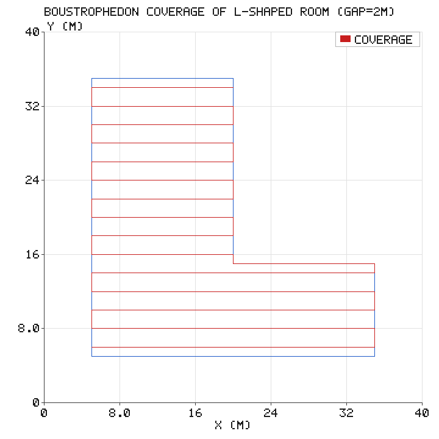
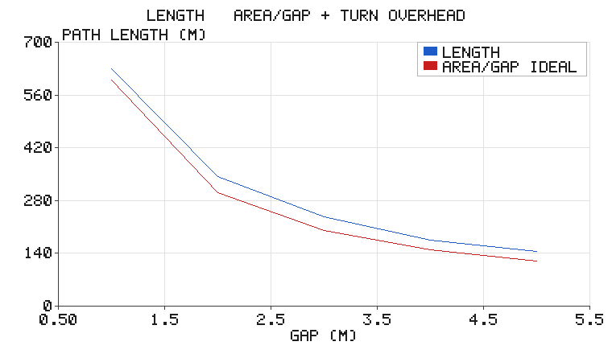
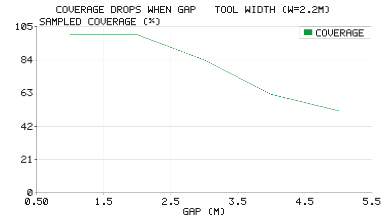
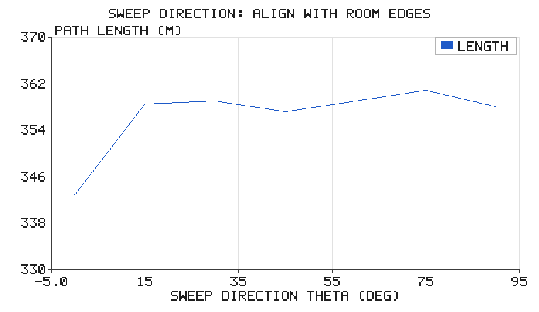

# 牛耕式全覆盖：扫遍整个房间的最简单方案

前两篇反应式导航（[势场](potential_field_avoidance.md)、
[Bug2](bug2_navigation.md)）都在回答"**怎么到某个点**"。但另一大类应用
的问题是反过来的：**把整个区域都走一遍**——扫地机器人、农田植保、
光伏板巡检、搜索救援。这类问题叫**全覆盖路径规划（Coverage Path
Planning, CPP）**。

牛耕式（boustrophedon，希腊语"牛耕地"的往返式）是最直观的方案：像
农民犁地一样，用一组等距平行线切分区域，逐行扫掠、行末掉头。

## 1. 方案与三个基本性质

给定多边形房间 $\mathcal{P}$（顶点逆时针）与行距 $d$（不超过作业宽度 $w$，
保证相邻行带无缝衔接；演示取 $d=2$ m、$w=2.2$ m，即相邻行带重叠
10%，与实际清扫/植保作业一致）：

1. 选定扫掠方向 $\theta$，把房间顶点旋转到扫掠坐标系；
2. 行中心从"半行距"开始等距排布 $y = y_{\min} + d/2 + k\,d$——
   保证边界处的作业宽度也覆盖到；
3. 每行与多边形求交得到若干扫掠区间（**凹形内墙会把一行自动切成多段**）；
4. 逐行扫掠，相邻行方向相反（"之"字）；行末掉头连接若直接穿出房间
   （凹形边界），改为**沿边界走短弧**。

> 行中心从"半行距 + 微小偏移 $\\varepsilon$"开始排布：偏移量专治"行中心
> 恰好压在内墙上"的退化情形——不加它，取 $\\theta=90°$ 时行中心正好
> 落在 L 形内墙上，该行只扫半段、漏掉约 3% 还伪装成"最短方向"；加了
> 它退化情形与普通情形一样完备（回归测试锁死）。

三个基本性质：

- **完备覆盖**：$d \le$ 作业宽度时扫过区域无空洞（可用采样覆盖率验证）；
- **长度可预算**：$L \approx A/d + L_{\mathrm{turn}}$（面积/行距 + 掉头开销），
  作业时间可以提前算出来——这对巡检、植保的排班至关重要；
- **无全局搜索**：没有 A*/RRT 的图搜索，纯几何求交，复杂度只有
  O(行数 × 顶点数)。

## 2. 实验：L 形房间

演示房间是 30 m × 10 m 横臂 + 15 m × 20 m 竖臂的 L 形（面积 600 m²），
行距 2 m：



实测（`coverage_stats` 在房间内按 0.5 m 采样，统计到路径距离
$\le w/2 = 1.1$ m 的点比例；判定半径与**固定作业宽度** $w=2.2$ m
绑定、不随行距缩放——否则行距拉到多大都会"自证"满覆盖）：

| 指标 | 数值 |
|---|---|
| 房间面积 | 600 m² |
| 扫掠行数 | 15 |
| **路径长度** | **342.9 m**（理论下限 $A/d$ = 300 m） |
| **采样覆盖率** | **100.0 %** |
| 预估作业时间 | 343 s（1 m/s 匀速） |

掉头开销 42.9 m 占 12.5%——其中一部分来自 L 形凹角处的**沿边绕行**
（横臂到竖臂的换行不能直接斜穿，会出房间）。

### 行距扫描：长度 ~ 面积/gap + 掉头开销；行距超作业宽度后覆盖率骤降





| 行距 | 路径长度 | 面积/gap 理想值 | 行数 | 覆盖率（$w$=2.2 m 固定） |
|---|---|---|---|---|
| 1 m | 629 m | 600 m | 30 | 100% |
| 2 m | 343 m | 300 m | 15 | 100% |
| 3 m | 237 m | 200 m | 10 | 83.9% |
| 4 m | 176 m | 150 m | 8 | 62.1% |
| 5 m | 145 m | 120 m | 6 | 51.8% |

实测长度始终贴着 $A/d$ 上方，偏离部分就是掉头开销——**这个规律让
作业时长可以按行距直接预算**，也是本模块做巡检排班的依据。行距超过
作业宽度 $w=2.2$ m 后覆盖率开始骤降：行间出现宽 $d-w$ 的漏扫带
（0.5 m 采样网格只能部分命中窄条，故实测值略高于连续几何期望
$w/d$）——**完备覆盖的行距上界就是"行距 ≤ 作业宽度"**，这条结论
现在可以直接用 `coverage_stats` 当验收指标（回归测试锁死：
gap=5 m 覆盖率 51.8% < 60%）。

### 扫掠方向扫描：顺着房间直角边最省



把扫掠方向从 0° 扫到 90°（每 15° 一组，长度与覆盖率都是实测）：

| 方向 | 0° | 15° | 30° | 45° | 60° | 75° | 90° |
|---|---|---|---|---|---|---|---|
| 长度 m | 342.9 | 358.5 | 359.1 | 357.2 | 359.0 | 360.9 | 358.0 |
| 覆盖率 | 100% | 99.3% | 99.7% | 99.6% | 99.6% | 99.3% | 100% |

最优是 **0°（342.9 m，顺着横臂的长直边）**；斜方向全部落在 357~361 m，
不仅掉头次数多（19~21 行 vs 15 行），凹形边界的沿边绕行弧也更长，
且采样覆盖率略低于 100%（行与行之间的锯齿边界存在窄条漏扫）。
90°（358.0 m）与 0° 同为整多 15 行、覆盖率 100%，但比 0° 多走
15 m——两个直角边中应选更长的那个。**选扫掠方向时应优先对齐房间
最长的直角边**；更复杂的区域分解方法（如 English 的单元分解）会
自动在各子区域选择局部最优方向，本模块的 `theta` 参数把这一决策
暴露出来便于教学。

## 3. 代码结构

```
src/reactive_navigation/boustrophedon_coverage/
├── scripts/
│   ├── coverage.py             # 多边形求交、逐行扫掠、掉头连接、边界弧长参数化、覆盖率统计
│   ├── plan_control_node.py    # ROS 2 节点：离线规划 → 发布 Path → 反馈跟踪，走完即"覆盖完成"
│   ├── simulate.py / main.py   # 离线实验与配图
│   └── tests/                # 20 项回归测试（算法 16 + rclpy 桩 4）
├── launch/boustrophedon_coverage.launch.py
└── CMakeLists.txt / package.xml / main.sh
```

实现要点：

- **边界参数化**：掉头连接需要"沿边界从 A 走到 B 的最短弧"——把
  多边形周长参数化成绝对弧长，A、B 各自投影到最近的边，取顺/逆时针
  中较短的一段；
- **行末补扫**：最后两行间距若超过 0.75 行距（浮点误差或形状不规则），
  自动补一行贴边扫掠，保证边界带不漏；
- **覆盖率是可执行的验收指标**：`coverage_stats(poly, path, w)` 用
  采样法算出覆盖率（判定半径 = 固定作业宽度 $w$ 的一半，不随行距
  缩放），测试里 `assertGreaterEqual(cov, 0.98)` 与
  `assertLess(cov_gap5, 0.6)` 直接把"扫干净了"和"行距超限的漏扫"
  都变成回归断言。

## 4. 在 ROS 2 上运行

```bash
colcon build --packages-select boustrophedon_coverage
ros2 launch boustrophedon_coverage boustrophedon_coverage.launch.py
```

launch 起 `sim_node` + `plan_control_node` 闭环。与到点导航不同，
**覆盖完成 = 参考路径走完**：跟踪到路径末端即宣布覆盖结束、停车。
节点启动日志会打印行数、长度、面积与预估作业时间：

```
[coverage_planner_control]: 牛耕式覆盖路径: 15 行, 长度 342.9 m,
                             房间面积 600 m^2, 预估作业 343 s (1 m/s)
[coverage_planner_control]: 覆盖完成（路径走完），停车
```

`gap` 参数可在 launch 里调大（如 `gap:=5.0`）——覆盖率骤降到约
一半（51.8%，见行距扫描表），直观演示"行距必须 ≤ 作业宽度"这条
完备性条件。

纯离线复现：

```bash
cd src/reactive_navigation/boustrophedon_coverage
./main.sh
```

## 5. 小结

- 全覆盖是"到点导航"的对偶问题：不问怎么到，只问**扫遍没有**；
- 牛耕式 = 等距平行线扫掠 + 之字掉头：完备、长度可预算、零搜索开销；
- 长度规律 $L \approx A/d + $ 掉头开销，实测逐行距吻合，作业时长可
  提前排班；
- 扫掠方向对齐房间长直边最省；凹形内墙靠"行区间切分"自动处理；
- 覆盖率采样法把"扫干净"变成可执行的验收断言。

> **关于验证范围**：本文全部数值在本机离线实跑得到
> （`tests/` 共 20 项全过：`test_coverage.py` 16 项含 L 形覆盖 100%、
> 薄房间空路径、退化方向不漏扫、行距超作业宽度后覆盖率骤降；
> `test_ros_params.py` 4 项用 rclpy
> 接口桩验证了节点参数声明/读回与 `cmd_vel` / `planning/path` 话题
> 发布）；跟踪回放在 L 形凹角处存在约 0.6 m 的切角出界
> （回放测试以 1 m 余量断言，路径本身全部在房间内）；ROS 2 节点按
> rclpy 标准接口编写，**尚未在真实 ROS 2 发行版上 `colcon build`
> 实测**。配图由纯标准库手写 PNG 编码生成，无 matplotlib 依赖。
