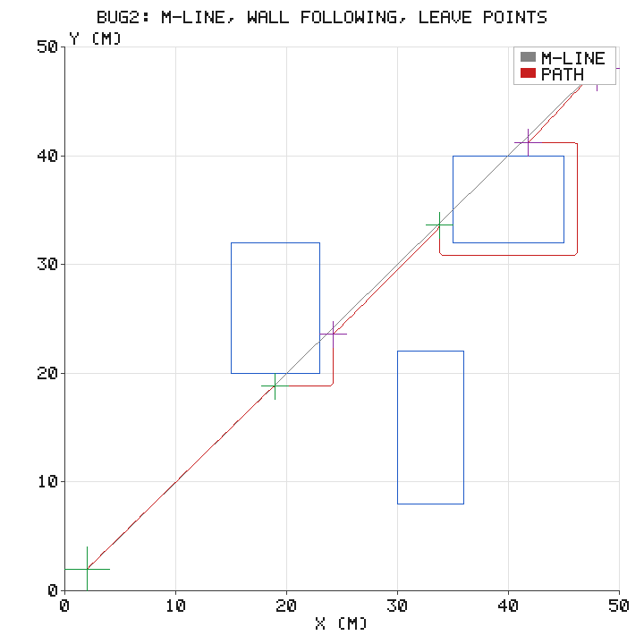
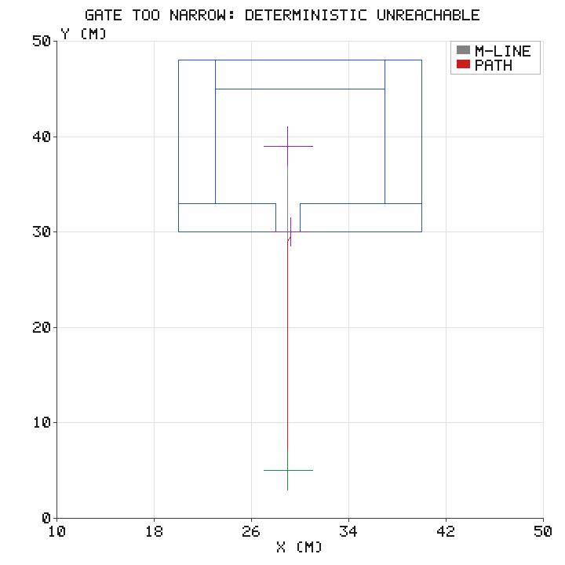
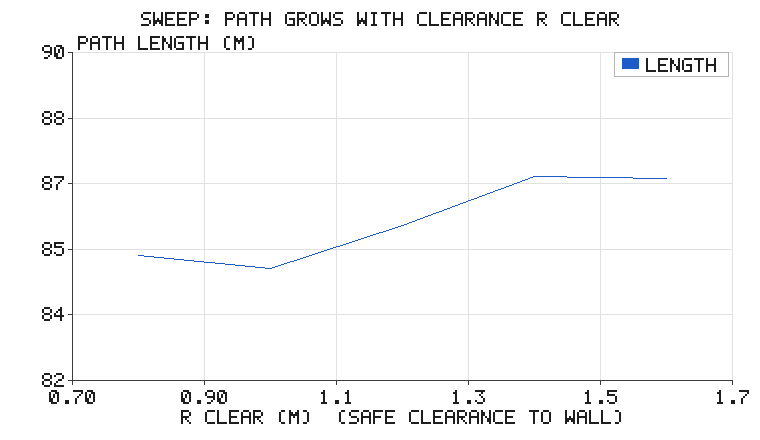

# Bug2 导航：不建图的完备导航与确定性不可达判据

[人工势场](potential_field_avoidance.md)有个致命缺陷：局部极小处梯度
恰好抵消，机器人会卡死，而且**卡住时你不知道**"是暂时绕不过去"还是
"目标根本到不了"。

Bug 系列算法（Lumelsky & Stepanov, 1987）给出另一个极端的回答：**同样
不建图，但带完备性证明**——原始 Bug2 里，只要目标可达就一定能到；
不可达时，算法会在有限步内**确定性宣告失败**。这是 A*/RRT 这类"先建
图再搜索"的方法给不了的答案：图不完备时它们只会说"我搜不到路径"
，分不清是图的问题还是真的无解。完备性的前提是"沿墙 = 沿**整块**
障碍（含彼此相接形成的联合边界）绕行"；本模块对这一步做了教学简化，
适用范围与反例见第 1 节末尾。

## 1. 行为规则：只有三条

Bug2 的全部智能浓缩为三条行为和一条不变量。假设机器人能感知
"沿当前行进方向多远会撞上障碍"（一根虚拟激光笔）：

1. **MOVE（走向目标）**：沿起点到目标的直线——m-line——匀速前进；
2. **FOLLOW（沿墙绕行）**：撞到障碍后记下 **hit 点**，贴着障碍边界走；
3. **LEAVE（回到 m-line）**：沿墙途中再次跨过 m-line、且此处离目标比
   hit 点**更近**，就离开障碍回到行为 1。

**核心不变量：只有"更近的 m-line 交点"才允许离开。**



为什么这条不变量能保证完备？每个障碍的边界与 m-line 至多有限个交点，
按离目标距离排序；沿墙走一圈必然会依次遇到这些交点，"只在更近处离开"
保证**每次 leave 都严格缩短到目标的直线距离**——所以 hit→leave 的
循环次数有限，算法必然终止：要么到达目标，要么沿墙一整圈回到 hit 点。

**终止判据（本模块的第二个）**：沿墙途中撞到**相邻的墙体**（另一块
障碍的边界），说明障碍彼此连接形成了封死的腔——门不够宽，物理上
进不去。此时直接宣告不可达，返回 `blocked` 事件。

> **适用范围（保守启发式判据，评审 #1400）**："撞到相邻墙体 ⇒ 封死
> 腔"只在障碍**真的彼此连接成封闭边界**时成立（如上面的窄门腔）。
> 反例：两块 4×4 m 障碍 `(20, 20, 4, 4)` 与 `(25, 20, 4, 4)` 相距
> 1 m（< 2×`r_clear`=2.4 m），起点 (5,5)、目标 (45,42)——目标明明
> 可以从障碍外侧绕过，本实现仍在 25.4 m 处误报 `blocked`。
> 原因：原始 Bug2 在撞到相邻障碍时应改跟踪**联合边界**继续绕行；本
> 模块沿墙只跟踪单块障碍的边界（真实系统里沿墙由激光雷达实现，遇
> 转角/接缝时换墙继续跟踪），教学重点在状态机而非墙体拼接。
> 因此 `blocked` 是一个**保守的启发式判据**：对封闭腔它确定正确；
> 对"相邻但不封死"的障碍组可能误报——误报时车会提前停车而不是
> 卡死。这个已知限制已写进 `tests/test_bug2.py` 锁死（若未来实现
> 联合边界绕行使该测试失败，请同步更新本节）。

## 2. 实验：标准场景

50 m × 50 m 地图、三个矩形障碍、起点 (2,2)、目标 (48,48)：

| 指标 | 数值 |
|---|---|
| m-line 直线长 | 65.05 m |
| **Bug2 路径长度** | **85.79 m** |
| 撞墙（hit）次数 | 2 |
| 每次绕行 | 沿墙到更近的 m-line 交点即离开 |

图中灰线是 m-line，红色路径在撞到第一块障碍（绿十字 = hit）后贴墙
绕行，在紫十字（leave）处回到 m-line；两次绕行后直线抵达目标。

对比[势场法](potential_field_avoidance.md)在同尺寸地图上的 57 m：Bug2
更长——这是完备性的价格。势场走的是"合力最顺"的方向，Bug2 走的是
"保证有结果"的规则。工程选型时：动态障碍、目标常变、地图大——势场
响应快；静态障碍、必须给出成败结论——Bug2 类更可靠。

## 3. 实验：确定性不可达（A*/RRT 给不了的答案）

构造一个四面围墙的腔，门宽 2.0 m，机器人安全间隙需求 2×1.2 = 2.4 m
（`r_clear=1.2`）——**门在物理上钻不进去**：



实测行为：

| 阶段 | 行为 |
|---|---|
| MOVE | 沿 m-line 朝腔内目标直行 |
| FOLLOW | 撞上底墙，记 hit 点，逆时针沿墙（底边→右边→顶边→左边） |
| **blocked** | 沿墙撞到相邻墙体 → **宣告不可达，返回失败** |
| 总消耗 | 25.04 m（全部用于排除，无一米浪费在"也许能过"的侥幸上） |

势场法在同一场景会卡在门口的斥力垒上（引力与门缝两侧的斥力抵消），
既到不了也说不出原因；A* 在栅格图上搜不到路径时，也分不清是分辨率
不够还是真无解。Bug2 的 `blocked` 事件把"不可达"变成一个**可枚举、
可测试**的一等结果——本模块用回归测试把这条判定锁死。

### 安全间隙 r_clear 的影响

把机器人离墙的安全间隙从 0.8 m 扫到 1.6 m，路径长度依次为
85.04 → 84.72 → 85.79 → 86.97 → 86.92 m：总体随间隙抬升（间隙越大，
沿墙走的"膨胀边界"越远，弧长自然越长），但并非严格单调——1.0 m 处的
局部回落来自"回到 m-line 的更近交点"在离散间隙上跳变，属正常现象。
撞墙次数（hit）在所有间隙下都为 2，行为拓扑不变。这是给实际机器人
标定 `r_clear`（底盘尺寸的一半 + 余量）时的直接依据。



## 4. 代码结构

```
src/reactive_navigation/bug2_navigation/
├── scripts/
│   ├── bug2.py                # 状态机：m-line、矩形边界弧长参数化、沿墙、hit/leave/blocked
│   ├── plan_control_node.py   # ROS 2 节点：离线执行状态机 → 发布 Path → 反馈跟踪
│   ├── simulate.py / main.py  # 离线实验与配图
│   └── tests/test_bug2.py     # 16 项回归测试（算法 12 + launch 参数/话题桩 4）
├── launch/bug2_navigation.launch.py
└── CMakeLists.txt / package.xml / main.sh
```

实现要点：

- **边界弧长参数化**：矩形障碍按周长参数化，沿墙 = 弧长步进，天然无
  歧义，也便于"回到 hit 点"的闭环检测；
- **状态机与几何分离**：`navigate()` 只产出 `(path, events, hits/detours)`，
  事件序列（hit/leave/blocked）可直接断言——窄门腔的回归测试就是
  `assert events 含 blocked`；
- **跟踪器复用三部曲统一模式**：`track_cmd()` 纯函数，20 Hz 积分回放
  90 s 内到达、全程距障碍 > 0.3 m。

## 5. 在 ROS 2 上运行

```bash
colcon build --packages-select bug2_navigation
ros2 launch bug2_navigation bug2_navigation.launch.py
```

launch 起 `sim_node` + `plan_control_node` 闭环：`/odom` 进、`/cmd_vel`
与 `/planning/path` 出。节点日志会**逐条打印事件**（撞墙 @ 坐标 / 离开
墙体 @ 坐标 / 沿墙撞到相邻墙体），最后给出成败结论：

```
[bug2_planner_control]: 撞墙 @ (15.0, 24.5)，转入沿墙
[bug2_planner_control]: 回到 m-line 且更近 @ (18.2, 31.0)，离开墙体
[bug2_planner_control]: Bug2 参考轨迹: 成功, 长度 85.8 m, 撞墙沿墙 2 次, 绕满整圈 0 次
```

> 字段含义：`撞墙沿墙`（hits）= 撞墙转入沿墙的段数，成功路径通常 > 0；
> `绕满整圈`（detours）= 一次沿墙以失败收尾的次数——绕满一整圈
> 回到 hit 点，**或**撞到相邻墙体被 blocked 终止，两种都 +1（成功
> 路径恒为 0；失败原因以事件序列里有无 blocked 为准）。

切换窄门腔场景（确定性不可达演示）：

```bash
ros2 launch bug2_navigation bug2_navigation.launch.py \
    scenario:=walls x0:=29.0 y0:=5.0 yaw0:=1.5708
# 节点宣告不可达后清空参考轨迹、不发布 cmd_vel，机器人保持静止
```

纯离线复现：

```bash
cd src/reactive_navigation/bug2_navigation
./main.sh
```

## 6. 小结

- Bug2 不建图、不搜索，只用"撞墙—沿墙—回线"三条行为，却带完备性
  证明（原始 Bug2 沿联合边界绕行时成立；本模块的 blocked 判据是
  其保守近似，见第 1 节适用范围）；
- "只在更近的 m-line 交点离开"是不变量，保证 hit→leave 循环有限；
- 两条终止判据——回到 hit 点（绕满一圈）、撞到相邻墙体——把"不可达"
  变成可测试的确定性结论，这是全局规划器给不了的；
- 代价是路径长度不如最优规划（85.8 m vs 势场 57 m，非同地图不可直接
  比，量级如此）——完备性与即时性之间的工程取舍。

> **关于验证范围**：本文全部数值在本机离线实跑得到（`tests/` 共 16 项
> 全过：`test_bug2.py` 12 项含窄门腔 blocked 判定、相邻障碍保守判据的
> 已知限制与跟踪回放；
> `test_ros_params.py` 4 项用 rclpy 接口桩验证了节点参数声明/读回与
> `cmd_vel` / `planning/path` 话题发布）；ROS 2 节点按 rclpy 标准
> 接口编写，**尚未在真实 ROS 2 发行版上 `colcon build` 实测**。
> 配图由纯标准库手写 PNG 编码生成，无 matplotlib 依赖。
