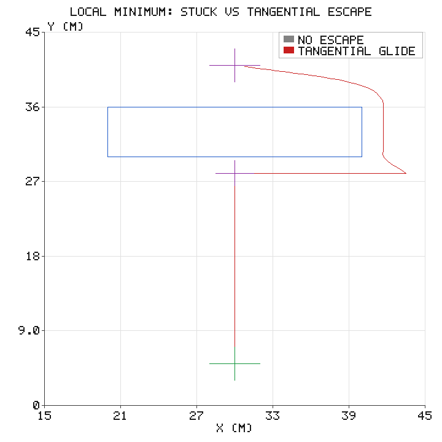
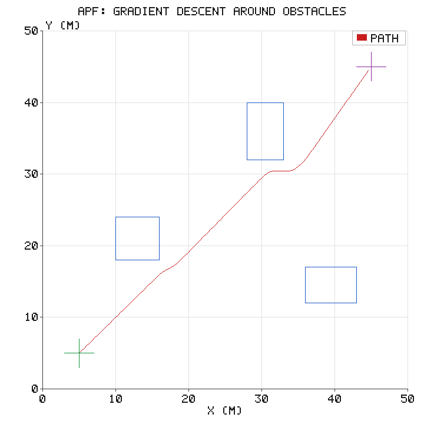
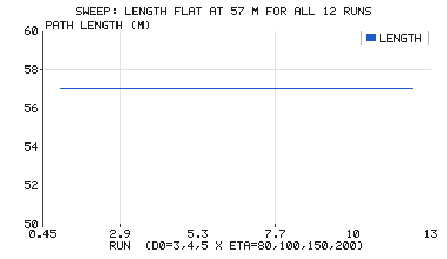
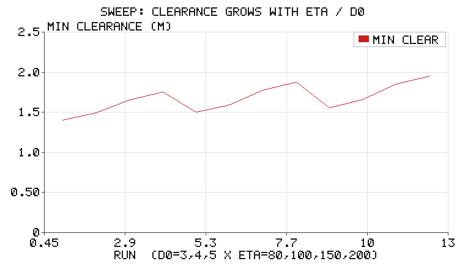

# 人工势场（APF）：梯度下降式反应式避障与局部极小逃逸

前几篇路径规划（A*、RRT、Dijkstra）都要先**建一张图**：栅格、采样树、拓扑
连线——然后才能搜。但很多真实机器人等不起：它们只有一根激光雷达/超声，
能感知的只有"前方多远会撞上"，根本没有全局地图。

人工势场法（Artificial Potential Field, APF）就是为这种机器人准备的：
**不建图、不搜索，每一步只算一个方向就走**。它在 1986 年由 Khatib 提出，
至今仍是低算力嵌入式平台上最常用的实时避障方案。

本模块是"反应式导航三部曲"的第一篇：

| 模块 | 回答的问题 | 需要什么 |
|---|---|---|
| **人工势场（本篇）** | 怎么朝目标走并绕开障碍 | 目标位置 + 障碍距离 |
| [Bug2 导航](bug2_navigation.md) | 绕障的尽头，目标到底能不能到 | 同上，但有完备性证明 |
| [牛耕式覆盖](boustrophedon_coverage.md) | 不去某个点，而是扫遍整个房间 | 房间多边形 |

> **与[人工势场法路径规划](../ground/apf_path_planning.md)模块的关系**：
> 仓库地面载具栏目已有一篇 APF（圆形障碍、随机抖动逃逸、pygame 可视化），
> 定位是"路径规划实验"。本篇与其互补而非重复：定位是**反应式控制**——
> 矩形障碍 + 解析梯度（与数值差分逐点对照锁死）、确定性的**切向滑行**
> 逃逸（代替随机抖动）、`stuck` 卡点作为一等结果显式返回，并接
> ROS 2 闭环（离线参考轨迹 + 里程计反馈跟踪）。两篇合起来正好覆盖
> "同一算法的两种用法：离线规划 vs 在线反应"。

## 1. 核心思想：把地图变成一场"下山"

在位形空间里定义一个**人工势场** $U(q)$，让目标吸引机器人、障碍排斥
机器人，然后机器人沿负梯度方向"下山"：

$$U(q) = U_{\mathrm{att}}(q) + U_{\mathrm{rep}}(q)$$

**引力势**（目标处的碗）：抛物线势场，离目标越远拉力越强——

$$U_{\mathrm{att}}(q) = \frac{1}{2}\,\zeta\,\|q - q_{\mathrm{goal}}\|^2,
\qquad \nabla U_{\mathrm{att}} = \zeta\,(q - q_{\mathrm{goal}})$$

**斥力势**（障碍周围的山包）：只在一个影响半径 $d_0$ 内起作用，越靠近
障碍坡越陡；在最近障碍表面距离 $d$ 处——

$$U_{\mathrm{rep}}(q) = \begin{cases}
\frac{1}{2}\,\eta\,\left(\frac{1}{d} - \frac{1}{d_0}\right)^2, & d \le d_0 \\
0, & d > d_0
\end{cases}$$

注意符号约定：梯度 $\nabla U_{\mathrm{rep}}$ **指向障碍**（爬坡方向），
控制量取负梯度才是"被推开"。本模块的回归测试用中心差分数值验证了
`total_gradient` 与 `potential` 逐点一致——这个符号曾经写反过：斥力项
返回了"力"而不是"梯度"，路径照样能走（逃逸机制兜了底），但表面上看
是"路径绕远 + 多次逃逸"，实测多走 55 m，直到数值差分对照把它抓出来。

机器人按归一化负梯度前进，步长随离障碍的间隙自适应收缩：

$$q_{k+1} = q_k - \alpha_k\,\frac{\nabla U(q_k)}{\|\nabla U(q_k)\|},
\qquad \alpha_k = \alpha\,\max\!\left(0.1,\ \min\!\left(1,\ \frac{d_{\mathrm{clear}}}{2\alpha}\right)\right)$$

固定步长在斥力与引力的平衡点附近会"跳过去又荡回来"（一步跨过平衡点，
净位移趋近零，卡死检测永远不触发）；自适应步长把 $\alpha_k$ 压到间隙
的一半以内，让下降过程真正收敛而不是振荡。

## 2. 致命缺陷：局部极小

两个场的负梯度之和可能在某处**恰好抵消**——机器人停在一个既不是目标的
"山坳"里。最典型的场景是凹形障碍挡在目标正前方：



本模块的陷阱场景是一面厚墙（20 m × 6 m）：起点在墙正下方、目标在墙
正后方。引力向上、斥力向下，在墙前精确抵消。实测：

- **关闭逃逸**：机器人卡死在墙前 $(30,\ 28)$，一步都动不了——这是势场法
  的正确行为，模块把"卡住"作为一等结果返回（`stuck` 字段），供教学与
  回归测试使用；
- **开启切向滑行逃逸**：检测到净位移停滞（30 步滑窗内位移 < 1.2 步长），
  把负梯度方向旋转 ±90° 得到切向，沿等势线"滑行"绕过墙端；途中撞到
  别的墙面时向外偏转 15°/30°/45°/60° 重新扫掠。退出条件是**滑出斥力
  影响半径 $d_0$**——此时净梯度只剩纯引力、必然重新指向目标，回到梯度
  下降模式。实测 1 次逃逸、路径 72.0 m（绕行方向左右随 seed 而定，
  长度与逃逸次数逐 seed 完全一致），全程不出 50 m × 50 m 地图。

> **为什么是切向滑行而不是随机跳？** 随机扰动要靠运气翻过斥力垒，
> 同一场景换个种子结果就不同；切向滑行是确定性的——它顺着等势线走，
> 势能不升不降，直到滑出斥力影响半径，梯度自然恢复指向目标。这在
> 实验里表现为：逃逸次数恒为 1，路径长度逐 seed 完全一致（左右绕行
> 方向随机，但两条路对称等长）。

## 3. 实验：开阔场景其实很"听话"

50 m × 50 m 地图、三个矩形障碍、起点 (5,5)、目标 (45,45)：



势场下降的路径几乎贴着直线走，只在障碍附近让出安全间隙：

| 指标 | 数值 |
|---|---|
| 直线距离 | 56.57 m |
| **势场路径长度** | **57.00 m**（绕行开销 < 1%） |
| 逃逸次数 | 0 |
| 步数 | 114（步长 0.5 m） |
| 最小障碍间隙 | 1.59 m |

### 参数敏感性：改的不是"绕多远"，是"离多远"

把斥力增益 $\eta$ 从 80 扫到 200、影响半径 $d_0$ 从 3 m 扫到 5 m
（共 12 组），一个有趣的结论：





| 参数 | 路径长度 | 最小障碍间隙 |
|---|---|---|
| 12 组全部 | 57.0 m（组组相同） | 1.41 ~ 1.95 m |

在这个开阔场景里，参数**只改变方向场的形状，不改变绕行的同伦类**：
$\eta$ 和 $d_0$ 调的是"离障碍多远"，而不是"绕多绕少"。工程含义：
不要指望调势场参数来缩短路径——要缩短路径得换规划器；调参数的正确
目标是安全间隙与抖振之间的平衡。

## 4. 代码结构

```
src/reactive_navigation/potential_field_avoidance/
├── scripts/
│   ├── apf.py                 # 势场、梯度、自适应步长下降、震荡检测、切向滑行逃逸
│   ├── plan_control_node.py   # ROS 2 节点：离线算参考轨迹 → 发布 Path → 反馈跟踪
│   ├── simulate.py / main.py  # 离线实验与配图
│   └── tests/                # 24 项回归测试（算法 18 + rclpy 桩 6）
├── launch/potential_field_avoidance.launch.py
└── CMakeLists.txt / package.xml / main.sh
```

梯度相关的三组函数刻意保持纯函数：`potential()`（标量场）、
`attractive_gradient()` / `repulsive_gradient()` / `total_gradient()`
（解析梯度）、`navigate()`（下降主循环）。解析梯度与数值差分逐点对照
是本模块最重要的回归测试——**符号、系数、作用域（$d_0$ 截断）** 三类
错误都逃不过它。

## 5. 在 ROS 2 上运行

```bash
colcon build --packages-select potential_field_avoidance
ros2 launch potential_field_avoidance potential_field_avoidance.launch.py
```

launch 同时起两个节点构成闭环：`sim_node`（运动学模拟器）发布
`/odom`，`plan_control_node` 订阅后反馈跟踪、发布 `/cmd_vel` 与
`/planning/path`（RViz 里加 Path 即可看到参考轨迹）。参数 `v`（巡航
速度）、`x0`/`y0`/`yaw0`（起点）可在 launch 里改；切换陷阱场景与逃逸
开关见 [README](https://github.com/OpenHUTB/ros2/blob/master/src/reactive_navigation/potential_field_avoidance/README.md)。

话题链路：

```
sim_node --/odom--> plan_control_node --/cmd_vel--> sim_node
                 └--/planning/path--> RViz
```

纯离线复现（不需要 ROS 2）：

```bash
cd src/reactive_navigation/potential_field_avoidance
./main.sh
```

## 6. 小结

- 势场法把规划降维成**逐点求梯度**：每步 O(障碍数)，天然适合低算力实时避障；
- 开阔场景它几乎最优（57.0 m vs 56.6 m 直线），且对参数鲁棒；
- 代价是**局部极小**：凹形障碍 + 目标在后方时纯梯度必然卡死；本模块用
  确定性的切向滑行逃逸，并通过 `stuck` 把"卡住"显式返回；
- 解析梯度必须与数值差分对照锁死——符号写反时系统能跑，只是悄悄变差。

> **关于验证范围**：本文全部数值在本机离线实跑得到（`tests/` 共 24 项
> 全过：`test_apf.py` 18 项含解析/数值梯度对照、逃逸不出地图与跟踪回放；
> `test_ros_params.py` 6 项用 rclpy 接口桩验证了节点参数声明/读回与
> `cmd_vel` / `planning/path` 话题发布）；ROS 2 节点按 rclpy 标准
> 接口编写，**尚未在真实 ROS 2 发行版上 `colcon build` 实测**。
> 配图由纯标准库手写 PNG 编码生成，无 matplotlib 依赖。
