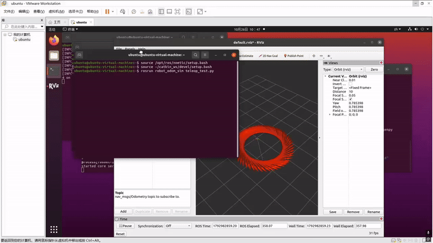

# 基于 ROS 的两轮差速机器人运动学与里程计仿真

## 任务说明
本人选择任务（1）：车辆运动仿真，使用 ROS 纯节点级别实现两轮差速机器人的运动学模型（Kinematics），实时计算并发布 TF 坐标变换与 Odometry 轮式里程计。通过键盘控制机器人在 Rviz 中进行 3D 运动可视化。

## 运行环境
- Ubuntu 20.04
- ROS Noetic
- Python 3.8

##文件结构
'''
src/
└── robot_odom_sim/
    ├── package.xml
    ├── CMakeLists.txt
    ├── scripts/
    │   ├── main.py
    │   └── teleop_test.py
    └── docs/
        ├── README.md
        └── robot_odom.gif
'''
## 运行步骤
1. 打开终端，启动 ROS 核心：roscore
2. 新开终端，启动 Rviz，将 Fixed Frame 设为 map，并添加 TF 和 Odometry 插件。
3. 新开终端，运行底层仿真节点：rosrun robot_odom_sim main.py
4. 新开终端，运行键盘控制节点：rosrun robot_odom_sim teleop_test.py
5. 鼠标点击终端，使用 W/A/S/D 控制机器人在 Rviz 中移动，观察里程计轨迹。

## 运行结果

## 大模型声明
代码由本人参考 ROS 官方文档和课程资料编写，未使用大模型生成。
