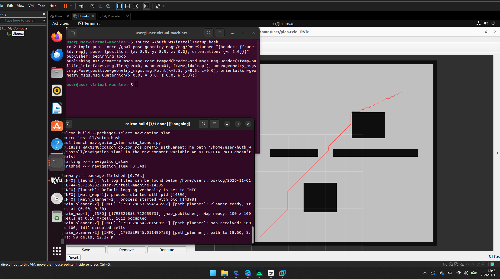

# 任务 3: 导航与路径规划模块 (Navigation and Path Planning)

## 1. 模块概述

本模块实现一条最小可用的全局导航链路，包含两个节点：

- `main_map`：发布一张室内场景的二维占据栅格地图（`nav_msgs/OccupancyGrid`），10 m × 10 m、分辨率 0.1 m，包含外墙、两块障碍和一道只留一个缺口的隔墙。
- `main_planner`：全局路径规划器。订阅地图与目标点，用 A\* 算法在栅格上搜索，把路径以 `nav_msgs/Path` 发布出去。

规划部分是自己实现的：八邻域扩展、欧氏代价、欧氏距离启发，用二叉堆维护开放集。地图通过 transient-local QoS 发布，因此规划器晚于地图启动也能拿到数据。

给一个目标点，规划器会输出一条绕开障碍的折线路径，并打印格子数与路径长度。这就是导航栈里 "global planner" 的职责。

## 2. 运行环境

- 操作系统: Ubuntu 22.04
- ROS 版本: ROS 2 Humble
- 依赖: rclpy、nav_msgs、geometry_msgs（均为 Desktop-Full 安装自带）

## 3. 编译与运行步骤

```bash
# 1. 编译包
cd ~/hutb_ws
colcon build --packages-select navigation_slam
source install/setup.bash

# 2. 一次启动地图与规划器
ros2 launch navigation_slam main_launch.py

# 3. 另开终端下发目标点
source install/setup.bash
ros2 topic pub --once /goal_pose geometry_msgs/msg/PoseStamped \
  "{header: {frame_id: map}, pose: {position: {x: 8.5, y: 8.5, z: 0.0}, orientation: {w: 1.0}}}"
```

规划器终端会打印类似：

```
path to (8.50, 8.50): 99 cells, 12.37 m
```

## 4. 话题与参数

| 话题 | 类型 | 方向 | 说明 |
| --- | --- | --- | --- |
| `/map` | `nav_msgs/OccupancyGrid` | 发布 | 二维栅格地图，0 为空闲、100 为占据 |
| `/goal_pose` | `geometry_msgs/PoseStamped` | 订阅 | 目标点，只用 position 的 x、y |
| `/plan` | `nav_msgs/Path` | 发布 | 规划出的路径，逐点为栅格中心 |

| 参数 | 默认值 | 说明 |
| --- | --- | --- |
| resolution | 0.1 | 地图分辨率（米/格） |
| width / height | 100 / 100 | 栅格尺寸（格） |
| start_x / start_y | 0.5 / 0.5 | 起点坐标（米），规划器固定从该点出发 |

## 5. 运行效果验证

```bash
# 地图话题存在
ros2 topic list | grep -E "map|plan"

# 地图信息
ros2 topic echo /map --once --field info

# 下发目标点后查看路径点数
ros2 topic echo /plan --once --field poses | head -5
```

可视化：启动 `rviz2`，`Fixed Frame` 设为 `map`，依次 `Add` → `By topic` → `/map` → `Map`，再 `Add` → `/plan` → `Path`。应该能看到灰色地图轮廓、黑色障碍，以及一条从起点绕过障碍通向目标的红色路径。

若把目标点设在障碍内部（例如 `x: 3.5, y: 2.5`），规划器会打印警告并拒绝规划，不会输出非法路径。



## 6. 大模型声明

本模块的代码与文档编写过程使用了 AI 大模型辅助。作者已对代码进行实际运行验证，对提交内容的正确性与完整性负全部责任。
