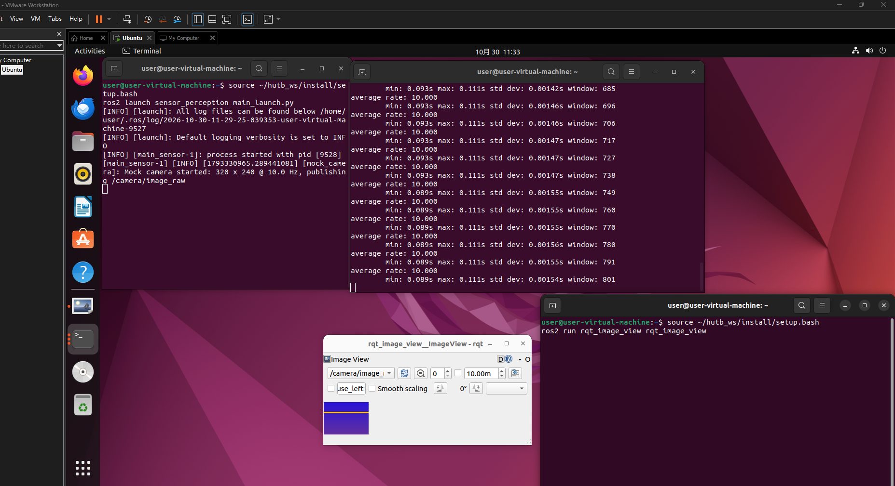

# 任务 2: 模拟传感器数据源 (Mock Sensor Source)

## 1. 模块概述

本模块提供一个模拟相机节点，作为感知链路的输入源。在没有真实相机、也没有启动 Carla 仿真的情况下，它按照固定频率往 `/camera/image_raw` 话题发布 `sensor_msgs/Image` 消息，为后续的图像处理、目标检测等节点提供一个可以稳定订阅的数据源。

图像是自己生成的：背景是一层从上到下的蓝色渐变，另有一条亮黄色的横带在画面中匀速下移。这样在 rviz2 或 rqt_image_view 里能直接看出画面在刷新，而不是一张静止图，方便确认话题真的在发布。

分辨率、帧率和坐标系都通过 ROS 2 参数暴露出来，可以在 launch 文件里改，不用动代码。本模块只负责产生数据，不做检测或识别

## 2. 运行环境

- 操作系统: Ubuntu 22.04
- ROS 版本: ROS 2 Humble
- 依赖: rclpy、sensor_msgs、std_msgs（均为 Desktop-Full 安装自带）

## 3. 编译与运行步骤

```bash
# 1. 编译包
cd ~/hutb_ws
colcon build --packages-select sensor_perception
source install/setup.bash

# 2. 运行节点（两种方式任选）
ros2 launch sensor_perception main_launch.py
# 或者
ros2 run sensor_perception main_sensor
```

## 4. 参数说明

| 参数 | 默认值 | 说明 |
| --- | --- | --- |
| width | 320 | 图像宽度（像素） |
| height | 240 | 图像高度（像素） |
| fps | 10.0 | 发布频率（赫兹） |
| frame_id | camera_link | 图像消息的坐标系名 |

修改方式：在 `launch/main_launch.py` 的 `parameters` 里改，或者命令行传参：

```bash
ros2 run sensor_perception main_sensor --ros-args -p fps:=30.0
```

## 5. 运行效果验证

```bash
# 确认话题存在
ros2 topic list | grep camera

# 确认发布频率接近 10 Hz
ros2 topic hz /camera/image_raw

# 看一帧消息的字段
ros2 topic echo /camera/image_raw --once | head -20
```

再用 `rqt_image_view` 选中 `/camera/image_raw`，应该能看到蓝色渐变背景和一条移动的黄色横带。



## 6. 大模型声明

本模块的代码与文档编写过程使用了 AI 大模型辅助。作者已对代码进行实际运行验证，对提交内容的正确性与完整性负全部责任。
