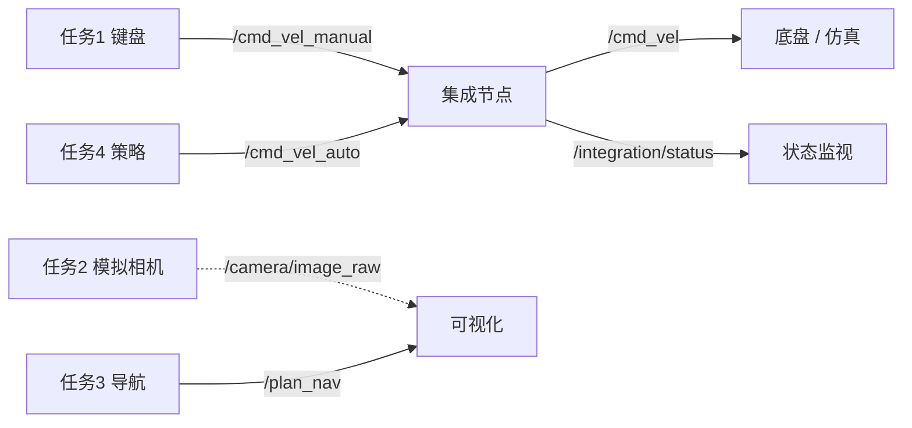

# 任务5：系统集成（System Integration）

## 1. 模块概述

前四个任务各自是一个能独立运行的模块，但直接同时启动会出现**通道冲突**：

- 任务1 键盘控制和任务4 策略网络都发布 `/cmd_vel`
- 任务3 导航和任务4 策略网络都发布 `/plan`
- 任务3 的地图是 10 m × 10 m，任务4 的仿真地图是 12 m × 12 m，都叫 `/map`

本模块把四路输出接到**独立通道**，再由集成节点仲裁成唯一的速度出口，并在中间加上
看门狗和急停。



仲裁规则按优先级从高到低：

1. **急停**：`/integration/estop` 为真时立即输出零速，且保持到显式解除
2. **当前模式的数据是否新鲜**：超过 `timeout`（默认 0.5 s）没有收到指令就输出零速
3. **模式选择**：`manual` 用手动通道，`auto` 用自动通道
4. **限幅**：线速度 ±1.0 m/s、角速度 ±1.5 rad/s

## 2. 运行环境

- 操作系统：Ubuntu 22.04
- ROS 版本：ROS 2 Humble
- 依赖：`rclpy`、`geometry_msgs`、`std_msgs`；被集成的四个模块需先编译

## 3. 编译与运行步骤

```bash
# 1. 编译（四个模块 + 集成层）
cd ~/hutb_ws
colcon build --packages-select teleop_control sensor_perception \
    navigation_slam policy_learning system_integration
source install/setup.bash

# 2. 离线跑通仲裁逻辑（不需要 ROS）
ros2 run system_integration main_demo

# 3. 默认集成：任务4 的仿真 + 策略 → 集成层 → /cmd_vel
ros2 launch system_integration main_launch.py

# 4. 同时拉起键盘和相机（手动通道可用）
ros2 launch system_integration main_launch.py keyboard:=true camera:=true
```

## 4. 操作说明

启动后集成节点每 50 ms 输出一次 `/cmd_vel`，同时发布一行文本状态：

```bash
ros2 topic echo /integration/status
# mode=manual estop=0 source=manual reason=ok age=0.012
```

切换模式（`manual` 或 `auto`，也接受「手动」「自动」）：

```bash
ros2 topic pub --once /integration/mode std_msgs/msg/String "{data: auto}"
```

急停与解除：

```bash
ros2 topic pub --once /integration/estop std_msgs/msg/Bool "{data: true}"
ros2 topic pub --once /integration/estop std_msgs/msg/Bool "{data: false}"
```

参数：

| 参数 | 默认 | 说明 |
|---|---|---|
| `timeout` | 0.5 s | 看门狗超时，超过即回零 |
| `max_linear` | 1.0 m/s | 线速度限幅 |
| `max_angular` | 1.5 rad/s | 角速度限幅 |
| `rate_hz` | 20 Hz | 输出频率 |
| `mode` | auto | 启动时的模式，配合 launch 默认启动的策略节点 |

launch 开关：`policy`（默认 true）、`keyboard`（默认 false）、`camera`（默认 false）、
`nav`（默认 false）。缺哪个模块就把对应开关关掉，其余不受影响。

## 5. 运行效果验证

离线演示 `main_demo` 的 13 步场景，输出如下（节选）：

| t (s) | 场景 | 输出 v / w | source | reason |
|---|---|---|---|---|
| 1.0 | 手动给 0.6 | 0.60 / 0.00 | manual | ok |
| 3.5 | 手动停发 1.5 s | 0.00 / 0.00 | manual | stale |
| 4.2 | 切自动并给 0.8 / 0.2 | 0.80 / 0.20 | auto | ok |
| 5.0 | 自动给 3.0 / 5.0 | 1.00 / 1.50 | auto | ok（限幅） |
| 7.0 | 急停期间自动仍在发 | 0.00 / 0.00 | estop | estop |
| 8.0 | 解除急停 | 0.80 / 0.00 | auto | ok |
| 9.5 | 自动再次超时 | 0.00 / 0.00 | auto | stale |

在线集成实测（`ros2 launch system_integration main_launch.py` 默认配置）：

| 检查项 | 命令 | 实测结果 |
|---|---|---|
| 状态行 | `ros2 topic echo /integration/status --once` | `mode=auto estop=0 source=auto reason=ok age=0.021` |
| 速度出口频率 | `ros2 topic hz /cmd_vel` | 19.937 / 19.998 / 19.998 Hz（窗口 22 / 43 / 64） |
| 手动通道隔离 | `ros2 topic info /cmd_vel_manual` | Publisher count: 0，Subscription count: 1 |

未开启键盘时 `/cmd_vel_manual` 没有发布者，只有集成节点在订阅，说明四个模块的通道
确实分开，不会互相覆盖。

单元测试 15 项全部通过（不需要 ROS）：

```bash
colcon test --packages-select system_integration
# test_arbiter.py ............... [100%]
```

覆盖：手动直通、模式切换、看门狗回零、无数据、急停与恢复、限幅、
模式别名与非法值、计数器、切到未发过数据的通道、切到已过期的通道、
非法数据源、非有限值（NaN/inf）被拒收、演示场景可运行。

## 6. 已知限制

- 只做**通道仲裁**，不做多地图融合：任务3 的 10 m 地图和任务4 的 12 m 地图仍是两套，
  靠重映射分开，不能拼成一张图。
- 急停是软件级的：节点挂掉之后不再发布，依靠下游的超时保护，不是硬件断电。
- 只支持两路速度源（手动 / 自动），没有做多优先级队列或抢占式调度。
- 未接入真实底盘，验证都在仿真里完成。

## 大模型使用声明

本模块的代码与文档由作者在 AI 助手（DeepSeek）辅助下完成，实验数据在本机实际运行产生，
作者已核对并对内容负责。
