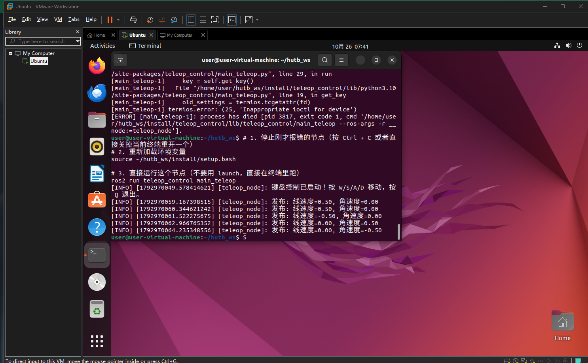

# 任务 1：机器人键盘控制模块 (Teleop Control)

## 1. 模块概述
本模块实现了基于 ROS 2 的机器人键盘控制功能。通过监听键盘输入（W/S/A/D），发布对应的速度控制指令 (`geometry_msgs/Twist`) 到 `/cmd_vel` 话题，可用于控制仿真环境中的机器人移动。

## 2. 运行环境
*   **操作系统**: Ubuntu 22.04
*   **ROS 版本**: ROS 2 Humble
*   **依赖库**: rclpy, geometry_msgs, termios (Python 内置)

## 3. 编译与运行步骤
```bash
# 1. 编译包
cd ~/hutb_ws
colcon build --packages-select teleop_control
source install/setup.bash

# 2. 运行节点
ros2 run teleop_control main_teleop
```

## 4. 操作说明
*   按 `W`：前进 (线速度 0.5)
*   按 `S`：后退 (线速度 -0.5)
*   按 `A`：左转 (角速度 0.5)
*   按 `D`：右转 (角速度 -0.5)
*   按 `Q`：退出节点

## 5. 运行效果验证


## 6. 大模型声明
本模块的代码与文档编写过程使用了 AI 大模型辅助。作者已对代码进行实际运行验证，对提交内容的正确性与完整性负全部责任。
