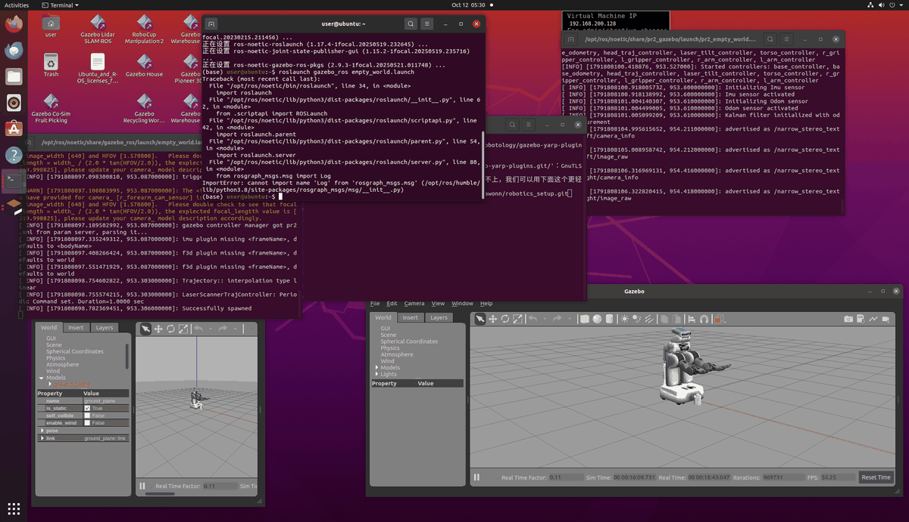

## ROS Noetic 人形机器人（PR2）部署指南
## 一.环境概览
- 操作系统: Ubuntu 20.04 LTS
- ROS 版本: ROS Noetic Ninjemys
- 仿真工具: Gazebo
- 机器人模型: PR2 (Personal Robot 2)
- Python 环境: Anaconda (Base) / System Python
## 二. 使用工具清单
本项目部署过程中涉及以下核心工具：
- Gazebo: 3D 动态仿真器，用于加载物理世界和机器人模型。
- RViz: ROS 可视化工具（可选），用于查看传感器数据。
- Terminal (终端): 用于执行 ROS 命令和环境配置。
- Anaconda: Python 环境管理工具（本次部署中需暂时退出以避免冲突）。
- Git / GitHub: 用于版本控制和文档管理。
## 三.部署步骤
第一步：安装 PR2 功能包 **
```bash
sudo apt update 
sudo apt install ros-noetic-pr2-simulator
```
第二步：解决 Anaconda 环境冲突:
由于 Anaconda 的 Python 环境可能会覆盖 ROS 所需的系统 Python 库（导致 No module named 'rospkg' 错误），启动前必须先退出 Conda 环境。
```bash
conda deactivate
```
第三步：加载 ROS 环境 **
确保当前终端已 sourced ROS 的环境变量：
```bash
source /opt/ros/noetic/setup.bash
```
第四步：启动 PR2 仿真 **
使用 roslaunch 启动 PR2 在空世界中的仿真：
```bash
roslaunch pr2_gazebo pr2_empty_world.launch
```
## 4. 运行结果
启动成功后，Gazebo 窗口将弹出，并加载 PR2 机器人模型。

## 5.运用了千问的大模型。
