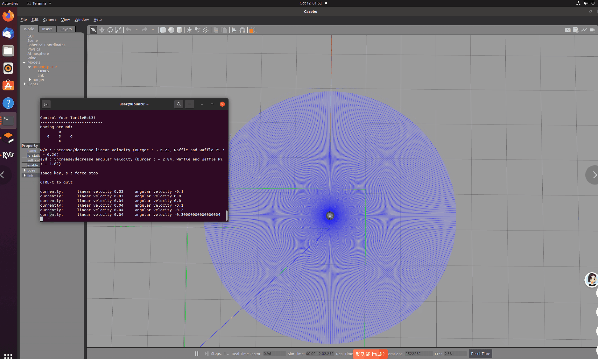
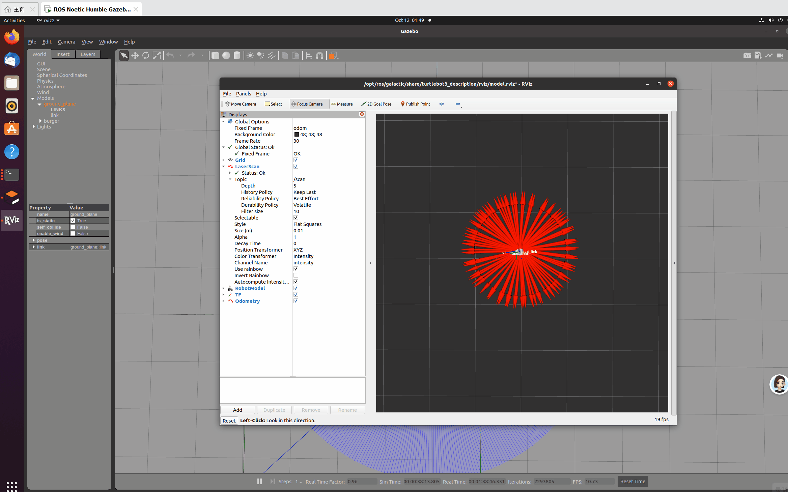

# ROS2机器人激光雷达避障实验报告

## 一、实验目的
1. 熟悉 ROS2 工作空间、功能包创建、节点编译与运行流程。
2. 掌握 ROS2 话题通信机制，实现激光雷达 `/scan` 话题订阅与速度 `/cmd_vel` 话题发布。
3. 了解激光雷达数据格式、QoS服务质量机制，解决雷达数据接收失败问题。
4. 实现 Turtlebot3 机器人环境感知与自主避障功能，对雷达无效数据进行滤波处理。
5. 熟悉 Gazebo 仿真运行与 RViz 数据可视化方法，完成完整机器人仿真实验。

## 二、实验环境
- 操作系统：Ubuntu 22.04
- 机器人系统：ROS2 Galactic
- 仿真平台：Gazebo 11
- 可视化工具：RViz2
- 实验平台：Turtlebot3 移动机器人仿真模型

## 三、实验原理
本次实验利用 Turtlebot3 激光雷达获取前方环境距离信息，通过 ROS2 话题通信实现感知与控制。

1. **激光雷达感知原理**
激光雷达持续扫描360°环境，通过 `/scan` 话题发布距离数组数据，数组第0号位代表机器人**正前方距离**。

2. **QoS通信匹配原理**
Gazebo 发布激光雷达数据默认采用 **Best_Effort** 传输模式，RViz 和自定义节点必须统一 QoS 策略，否则无法接收数据。

3. **避障控制逻辑**
设定安全距离阈值为 **0.5m**：
- 前方距离大于0.5m：无障碍物，机器人直行
- 前方距离小于0.5m：存在障碍物，停止前进、原地左转避障

4. **无效数据处理**
雷达无障碍物时返回 `inf`（无穷大），程序通过 math 库过滤无效值，统一赋值为10.0m，保证程序逻辑稳定运行。

## 四、实验核心代码
### obstacle_avoid.py
```python
import rclpy
from rclpy.node import Node
from sensor_msgs.msg import LaserScan
from geometry_msgs.msg import Twist
from rclpy.qos import QoSProfile, QoSReliabilityPolicy
import math

class AvoidNode(Node):
    def __init__(self):
        super().__init__('obstacle_avoid')
        # 速度指令发布
        self.pub = self.create_publisher(Twist, '/cmd_vel', 10)

        # 适配激光雷达QoS
        scan_qos = QoSProfile(
            reliability=QoSReliabilityPolicy.BEST_EFFORT,
            depth=10
        )

        # 订阅激光雷达数据
        self.sub = self.create_subscription(
            LaserScan,
            '/scan',
            self.scan_callback,
            scan_qos
        )

        self.twist_msg = Twist()
        self.safe_dist = 0.5

    def scan_callback(self, msg: LaserScan):
        front_dist = msg.ranges[0]

        # 过滤inf、nan无效数据
        if math.isinf(front_dist) or math.isnan(front_dist):
            front_dist = 10.0

        self.get_logger().info(f"前方距离: {front_dist:.2f} m")

        # 避障判断
        if front_dist < self.safe_dist:
            self.twist_msg.linear.x = 0.0
            self.twist_msg.angular.z = 0.3
        else:
            self.twist_msg.linear.x = 0.2
            self.twist_msg.angular.z = 0.0

        self.pub.publish(self.twist_msg)

def main():
    rclpy.init()
    node = AvoidNode()
    rclpy.spin(node)
    node.destroy_node()
    rclpy.shutdown()

if __name__ == '__main__':
    main()
```
### setup.py 节点注册部分
```python
entry_points={
    'console_scripts': [
        'laser_reader = laser_sub.laser_reader:main',
        'obstacle_avoid = laser_sub.obstacle_avoid:main',
    ],
},
```
## 五、实验步骤
1. 创建 ROS2 工作空间与功能包
2. 编写激光雷达避障 Python 代码并注册可执行节点
3. 编译工作空间并更新环境变量
4. 启动 Gazebo 仿真环境，加载 Turtlebot3 机器人
5. 启动 RViz2，配置激光雷达显示，修改 QoS 为 Best_Effort
6. 运行自主避障节点，观察机器人运动与终端数据
7. 添加障碍物，测试机器人避障效果

## 六、实验结果与动态展示
### （一）Gazebo 机器人运动效果

> 图1 机器人根据程序指令直行、遇障自动左转避障动态效果
>
> 机器人在无障碍物区域保持匀速直行，当检测到前方障碍物距离小于 0.5m 时，立刻停止前进并原地旋转，成功实现基础自主避障。

### （二）RViz 激光雷达可视化效果

> 图2 RViz 激光雷达点云实时可视化效果
>
> RViz 中红色点云实时跟随机器人扫描环境，能够准确识别障碍物轮廓，证明 `/scan` 话题数据接收正常、QoS 匹配成功。

## 七、实验现象分析
- 空旷环境下雷达返回无穷大数值，经代码过滤后稳定显示 10.00m，机器人持续直行。
- 障碍物靠近机器人时，雷达获取真实近距离数据，机器人触发避障逻辑。
- 本次实验必须配置正确 QoS 策略，否则 RViz 与自定义节点无法接收雷达数据。
- 修改代码后必须重新编译，ROS2 才能加载最新程序逻辑。

## 八、实验总结
本次实验基于 ROS2 完成激光雷达环境感知与机器人避障控制。通过话题订阅获取雷达测距数据，通过数据滤波解决无效值问题。实验成功实现：机器人直行、障碍物检测、自动转向避障，熟练掌握了 ROS2 话题通信、QoS 配置、Gazebo 仿真与 RViz 可视化。
本次程序仅检测正前方单点距离，未来可优化为检测左右多方向距离，实现更智能的绕行避障。

## 九、实验思考题
**问题：如何让机器人选择障碍物更少的方向绕行？**

> 答：采集机器人左侧、右侧、前方多组雷达距离数据，对比两侧平均距离值，优先向距离更远、障碍物更少的方向持续绕行，实现避障。
