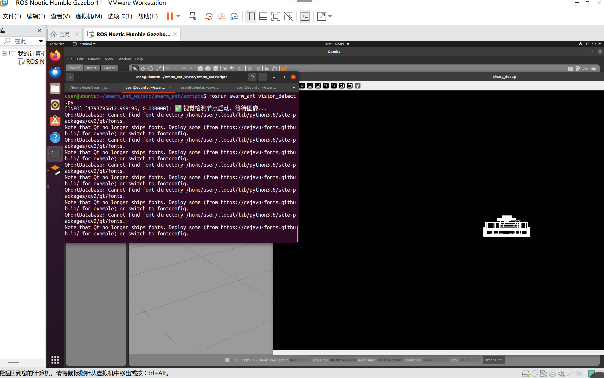
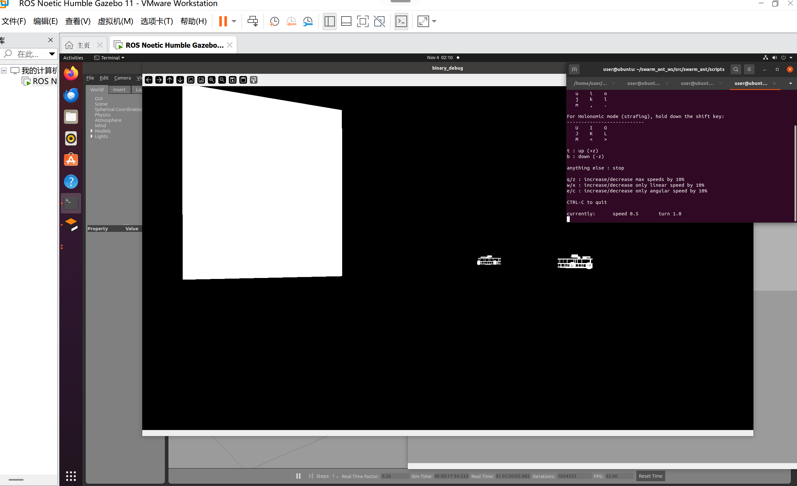

# ant_colony_swarm 功能包：基于机器视觉的多机器人蚁群编队
## 概述
ant_colony_swarm是ROS2 Python功能包，用于多机器人领航跟随蚁群编队，通过机载相机视觉识别领航机器人标记，实现编队协同运动。

## 目录结构
src/ant_colony_swarm

├── ant_colony_swarm/

│   ├── __init__.py

│   ├── vision_detect_node.py

│   └── swarm_control_node.py

├── launch/

│   └── swarm_bringup.launch.py

├── resource/

│   └── ant_colony_swarm

├── package.xml

├── setup.py

└── setup.cfg

## 环境依赖
- ROS2 Humble
- opencv-python
- cv_bridge
- numpy

---
### 编译与运行命令
# 编译
colcon build --packages-select ant_colony_swarm
# 刷新环境
source install/setup.bash
# 一键启动
ros2 launch ant_colony_swarm swarm_bringup.launch.py

## 运行效果图

图1 视觉检测节点启动，等待图像输入

图2 Gazebo仿真环境下双机器人加载场景
