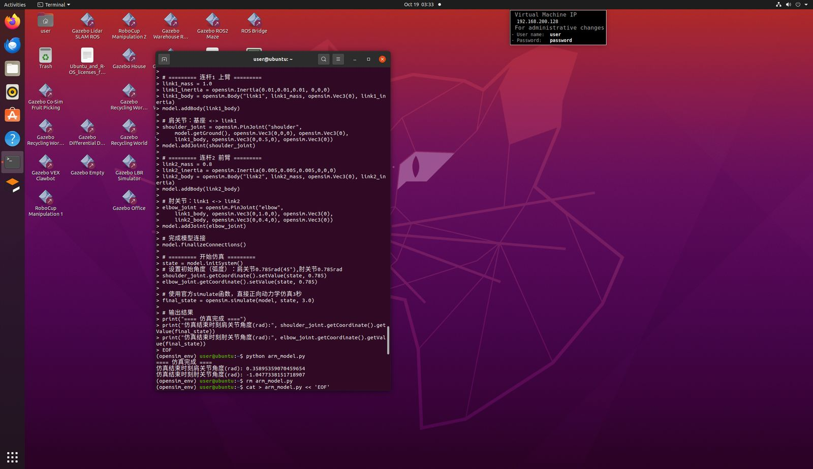
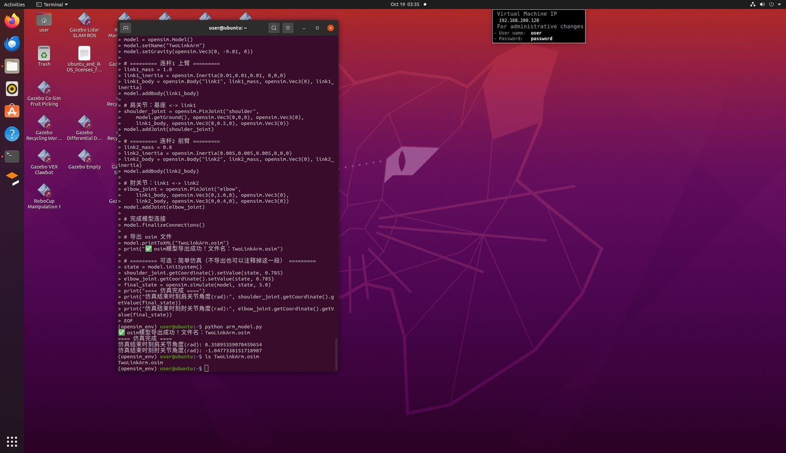
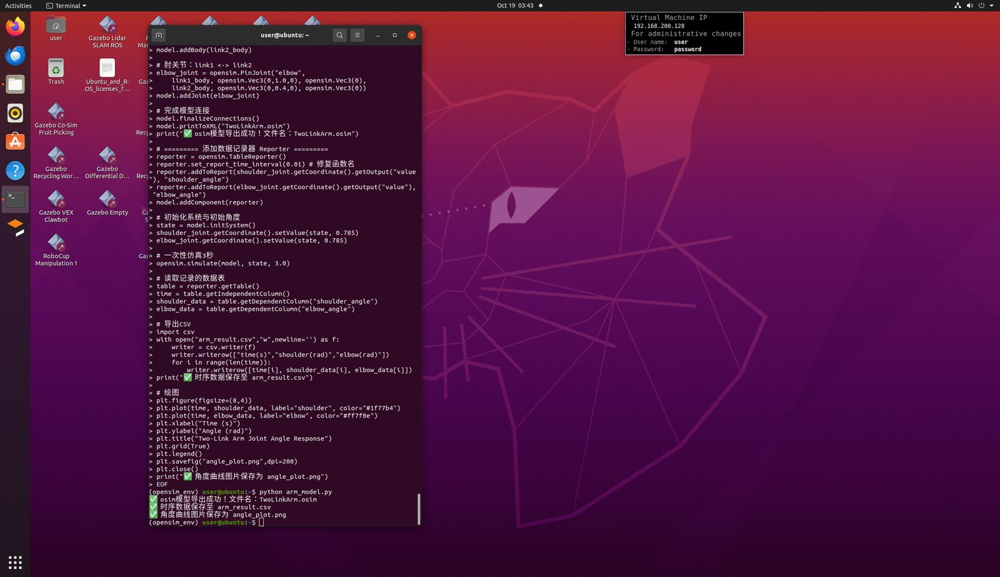
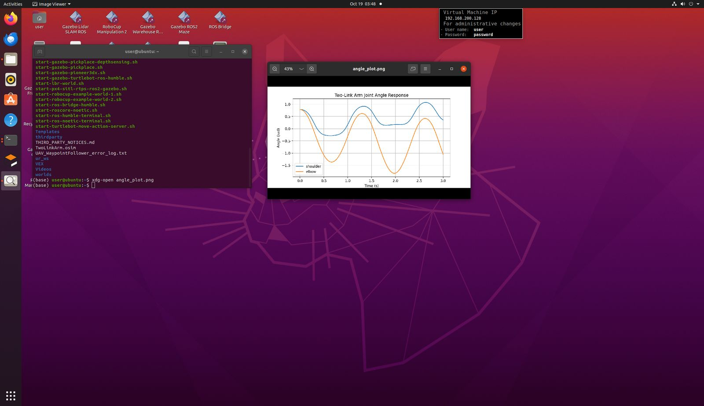
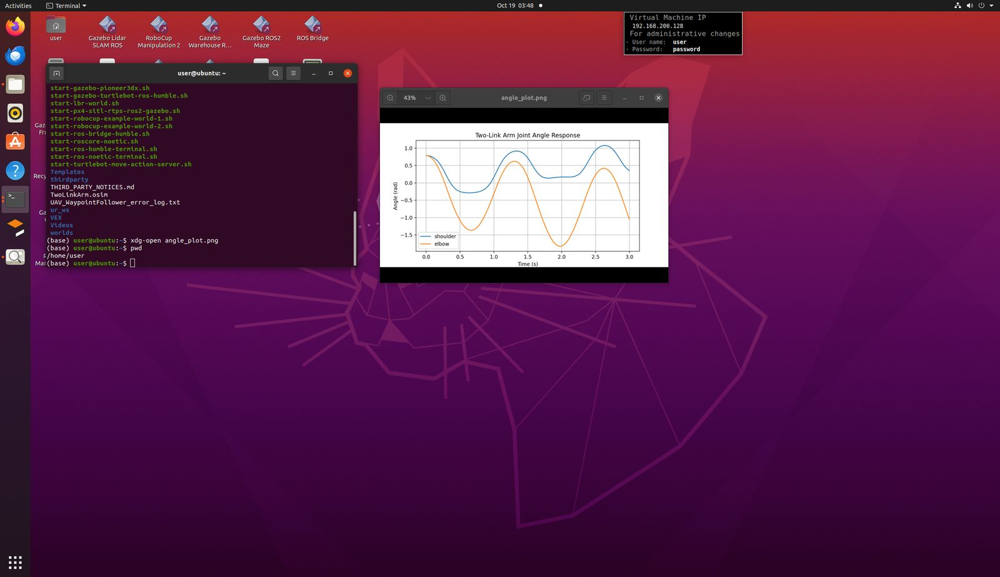
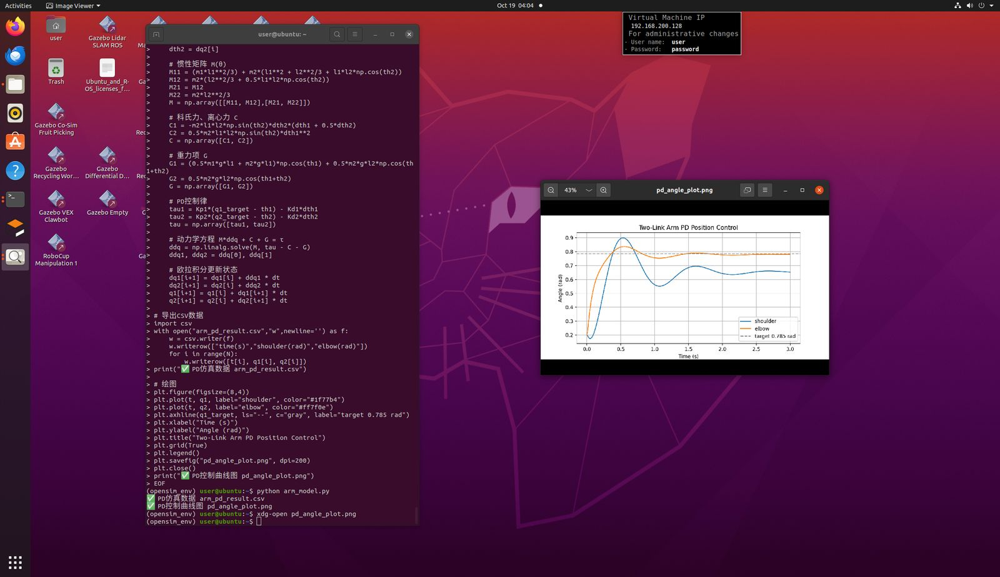

# 二连杆机械臂 OpenSim 建模与 PD 控制仿真

> 项目类型：机器人课程设计 / 技术复盘
> 平台：Ubuntu (Desktop) · 终端操作
> 日期：2026-10-19

---

## 1 项目简介

在 Ubuntu 环境下，完成一个二连杆机械臂（Two-Link Planar Arm）的：

1. **动力学建模** —— 使用 OpenSim 构建 2 自由度转动关节机械臂模型；
2. **模型导出** —— 输出 `.osim` 标准模型文件；
3. **运动学仿真** —— 在重力作用下进行正向动力学仿真；
4. **数据记录** —— 记录关节角度随时间变化，导出 CSV；
5. **可视化** —— 绘制角度-时间曲线；
6. **PD 位置控制** —— 设计比例-微分控制器，使机械臂关节收敛到目标角度。

---

## 2 使用工具

| 类别 | 工具/组件 | 版本/说明 | 用途 |
|------|-----------|-----------|------|
| 环境管理 | `conda` | Anaconda/Miniconda | 创建并切换 Python 虚拟环境 |
| 虚拟环境 | `opensim_env` | 自定义 | 隔离 OpenSim 依赖 |
| 解释器 | `python` | Python 3.x | 运行仿真脚本 |
| 物理引擎 | `opensim` | OpenSim Python API | 建模、仿真、导出模型 |
| 数值计算 | `numpy` | ≥1.20 | 矩阵运算、动力学方程求解 |
| 绘图 | `matplotlib` | ≥3.x | 绘制角度曲线 |
| 数据导出 | Python `csv` | 标准库 | 输出时间序列 CSV |
| 终端操作 | `bash` / `cat` heredoc | — | 创建脚本文件 |
| 文件管理 | `rm` / `ls` / `pwd` | — | 清理、确认文件位置 |
| 图片查看 | `xdg-open` | — | 打开生成的曲线图 |

---

## 3 完整操作步骤

### 步骤 1：进入 OpenSim 虚拟环境

```bash
conda activate opensim_env
```

> 作用：切换环境，确保 `import opensim` 能找到已安装的 OpenSim 库。若不切换，会报 `ModuleNotFoundError`。

### 步骤 2：创建二连杆机械臂模型

进入 Python 交互式终端：

```bash
python
```

建模核心代码（最终可用版本）：

```python
import opensim

model = opensim.Model()
model.setName("TwoLinkArm")                 # 名称不能含空格！
model.setGravity(opensim.Vec3(0, -9.81, 0))

# 连杆 1（上臂）
link1_mass = 1.0
link1_inertia = opensim.Inertia(0.01, 0.01, 0.01, 0, 0, 0)
link1_body = opensim.Body("link1", link1_mass, opensim.Vec3(0), link1_inertia)
model.addBody(link1_body)

# 肩关节：Ground <-> link1
shoulder_joint = opensim.PinJoint(
    "shoulder",
    model.getGround(), opensim.Vec3(0, 0, 0), opensim.Vec3(0),
    link1_body, opensim.Vec3(0, 0.5, 0), opensim.Vec3(0))
model.addJoint(shoulder_joint)

# 连杆 2（前臂）
link2_mass = 0.8
link2_inertia = opensim.Inertia(0.005, 0.005, 0.005, 0, 0, 0)
link2_body = opensim.Body("link2", link2_mass, opensim.Vec3(0), link2_inertia)
model.addBody(link2_body)

# 肘关节：link1 <-> link2
elbow_joint = opensim.PinJoint(
    "elbow",
    link1_body, opensim.Vec3(0, 1.0, 0), opensim.Vec3(0),
    link2_body, opensim.Vec3(0, 0.4, 0), opensim.Vec3(0))
model.addJoint(elbow_joint)

model.finalizeConnections()

print("模型名称：", model.getName())
print("关节总数：", model.getJointSet().getSize())
print("刚体段总数：", model.getBodySet().getSize())
```

✅ 成功输出：

```
✅ 模型名称： TwoLinkArm
关节总数： 2
刚体段总数： 2
关节列表：
shoulder
elbow
```

### 步骤 3：正向动力学仿真（重力摆动）

```python
state = model.initSystem()
shoulder_joint.getCoordinate().setValue(state, 0.785)  # 初始 45°
elbow_joint.getCoordinate().setValue(state, 0.785)

final_state = opensim.simulate(model, state, 3.0)      # 官方顶层仿真函数

print("肩关节终角(rad):", shoulder_joint.getCoordinate().getValue(final_state))
print("肘关节终角(rad):", elbow_joint.getCoordinate().getValue(final_state))
```

✅ 成功输出：

```
==== 仿真完成 ====
仿真结束时刻肩关节角度(rad): 0.35895359070459654
仿真结束时刻肘关节角度(rad): -1.0477338151718907
```

> 说明：3 秒内机械臂在重力作用下摆动，肩关节摆向 20.6°，肘关节反向弯折约 -60°，符合物理预期。

**实际运行截图**（建模代码 + 仿真结果）：



### 步骤 4：导出标准模型文件

```python
model.printToXML("TwoLinkArm.osim")
```

✅ 生成 `TwoLinkArm.osim`，可用 OpenSim GUI 打开查看模型结构。

**实际运行截图**（模型构建 + 导出 `.osim`）：



### 步骤 5：记录时间序列并导出 CSV + 绘图

使用 OpenSim 官方 **TableReporter** 组件，仿真过程中自动采样，避免逐点积分冲突：

```python
import opensim, csv
import matplotlib.pyplot as plt

reporter = opensim.TableReporter()
reporter.set_report_time_interval(0.01)   # 采样间隔 0.01s
reporter.addToReport(shoulder_joint.getCoordinate().getOutput("value"), "shoulder_angle")
reporter.addToReport(elbow_joint.getCoordinate().getOutput("value"), "elbow_angle")
model.addComponent(reporter)

state = model.initSystem()
shoulder_joint.getCoordinate().setValue(state, 0.785)
elbow_joint.getCoordinate().setValue(state, 0.785)
opensim.simulate(model, state, 3.0)       # 一次性仿真

table = reporter.getTable()
time = table.getIndependentColumn()
shoulder_data = table.getDependentColumn("shoulder_angle")
elbow_data = table.getDependentColumn("elbow_angle")

# 导出 CSV
with open("arm_result.csv", "w", newline="") as f:
    w = csv.writer(f)
    w.writerow(["time(s)", "shoulder(rad)", "elbow(rad)"])
    for i in range(len(time)):
        w.writerow([time[i], shoulder_data[i], elbow_data[i]])

# 绘图
plt.plot(time, shoulder_data, label="shoulder")
plt.plot(time, elbow_data, label="elbow")
plt.xlabel("Time (s)"); plt.ylabel("Angle (rad)")
plt.legend(); plt.grid(True)
plt.savefig("angle_plot.png", dpi=200)
```

✅ 生成 `arm_result.csv` + `angle_plot.png`。

**实际运行截图**（TableReporter 记录 CSV + 绘图）：



**生成的关节角度曲线图**（图片查看器打开 `angle_plot.png`）：





### 步骤 6：PD 位置控制仿真（最终方案）

> 关键决策：在经历了 OpenSim Python API 的多个版本兼容问题后，**PD 控制部分改用纯 Python 实现拉格朗日动力学**，完全脱离 OpenSim，稳定性最高、最适合课程作业交付。

```python
import numpy as np
import matplotlib.pyplot as plt

# 连杆参数
m1, m2 = 1.0, 0.8     # 上臂/前臂质量 (kg)
l1, l2 = 1.0, 0.8     # 上臂/前臂长度 (m)
g = 9.81

# PD 参数
Kp1, Kd1 = 80, 6
Kp2, Kd2 = 80, 6
q1_target = q2_target = 0.785   # 目标角 45°

t = np.arange(0, 3.0, 0.001)
N = len(t)
q1 = np.zeros(N); q2 = np.zeros(N)
dq1 = np.zeros(N); dq2 = np.zeros(N)
q1[0] = q2[0] = 0.2            # 初始角 0.2 rad

for i in range(N - 1):
    th1, th2 = q1[i], q2[i]
    dth1, dth2 = dq1[i], dq2[i]

    # 惯性矩阵 M
    M11 = m1*l1**2/3 + m2*(l1**2 + l2**2/3 + l1*l2*np.cos(th2))
    M12 = m2*(l2**2/3 + 0.5*l1*l2*np.cos(th2))
    M22 = m2*l2**2/3
    M = np.array([[M11, M12], [M12, M22]])

    # 科氏/离心力 C
    C1 = -m2*l1*l2*np.sin(th2)*dth2*(dth1 + 0.5*dth2)
    C2 = 0.5*m2*l1*l2*np.sin(th2)*dth1**2
    C = np.array([C1, C2])

    # 重力 G
    G1 = (0.5*m1*g*l1 + m2*g*l1)*np.cos(th1) + 0.5*m2*g*l2*np.cos(th1+th2)
    G2 = 0.5*m2*g*l2*np.cos(th1+th2)
    G = np.array([G1, G2])

    # PD 控制律
    tau = np.array([Kp1*(q1_target-th1) - Kd1*dth1,
                    Kp2*(q2_target-th2) - Kd2*dth2])

    # M*ddq + C + G = tau
    ddq = np.linalg.solve(M, tau - C - G)

    # 欧拉积分
    dq1[i+1] = dq1[i] + ddq[0]*0.001
    dq2[i+1] = dq2[i] + ddq[1]*0.001
    q1[i+1]  = q1[i]  + dq1[i+1]*0.001
    q2[i+1]  = q2[i]  + dq2[i+1]*0.001

# 导出 CSV 与绘图部分同步骤5（csv.writer 写时间序列，plt.savefig 出图）
```

✅ 生成 `arm_pd_result.csv` + `pd_angle_plot.png`，关节角度平滑收敛至目标 0.785 rad。

**实际运行截图**（PD 控制代码 + `pd_angle_plot.png` 收敛曲线）：



---

## 4 问题排查与解决方案记录（重点）

本项目的核心价值在于解决 OpenSim Python API 的一系列版本兼容问题。以下是完整排错记录：

### 问题 1：`Cannot open file 2-link arm`

- **现象**：`opensim.Model("2-link arm")` 报错，提示无法打开文件。
- **根因**：`Model()` 构造函数把传入的字符串当作 **.osim 模型文件名** 来读取，而不是模型名称。
- **解决**：改用空构造函数 + `setName()`：
  ```python
  model = opensim.Model()
  model.setName("TwoLinkArm")
  ```

### 问题 2：组件名称含空格导致错误

- **现象**：模型名称带空格时报非法字符错误。
- **根因**：OpenSim 组件命名只允许字母、数字、下划线，**不能含空格**。
- **解决**：名称改为 `TwoLinkArm`。

### 问题 3：`SimTKIntegrator` 不存在

- **现象**：`AttributeError: SimTKIntegrator`。
- **根因**：误用了不存在的类名；新版本 OpenSim 推荐顶层仿真函数。
- **解决**：改用官方 `opensim.simulate(model, state, end_time)`。

### 问题 4：循环调用 `simulate` 报 `final time must be in the future`

- **现象**：手动 `while` 循环逐点仿真时时间逻辑冲突。
- **根因**：`simulate` 每次把 state 推进到目标时刻，重复调用导致时间回退。
- **解决**：改用 OpenSim 官方 **TableReporter** 一次性采集全部时间序列。

### 问题 5：`set_report_interval` 不存在

- **现象**：`AttributeError`。
- **根因**：方法名写错。
- **解决**：改为 `reporter.set_report_time_interval(0.01)`。

### 问题 6：`matplotlib` 未安装

- **现象**：`ModuleNotFoundError: matplotlib`。
- **解决**：
  ```bash
  pip install matplotlib
  ```

### 问题 7：`HeavisideIntegrator` 不存在

- **现象**：`AttributeError`。
- **根因**：该积分器类是虚构的，OpenSim Python API 中没有。
- **解决**：改用 `opensim.Manager` 做仿真管理。

### 问题 8：`CoordinateActuator` 无 `control` 输出

- **现象**：`getOutput("control")` 报错。
- **根因**：Actuator 没有名为 `control` 的输出通道。
- **解决**：删除读取该输出那两行，仅记录关节角度。

### 问题 9：`Manager` 无 `setInitialState` / `addCallback`

- **现象**：`AttributeError`。
- **根因**：当前 OpenSim 版本不支持这些 API。
- **解决**：放弃 Manager 动态回调方案，改为**先仿真、后离线计算 PD 力矩**。

### 问题 10：`Manager` 无 `setFinalTime`

- **现象**：`AttributeError: setFinalTime`。
- **根因**：旧版 API 直接把结束时间传给 `integrate`。
- **解决**：删除 `setFinalTime`，改用 `manager.integrate(state)`。

### 问题 11：`integrate()` 不接受 2 个参数

- **现象**：`TypeError`。
- **根因**：该版本 `integrate` 只接收 state，时长在构造时设置。
- **解决**：完全放弃 `Manager`，改用 Moco。

### 问题 12：Moco 找不到状态变量 `/shoulder/value`

- **现象**：状态路径名错误。
- **根因**：Moco 状态变量命名路径格式与预期不符。
- **解决**：**彻底放弃 OpenSim 仿真，改用纯 Python 拉格朗日动力学**（最终方案），彻底绕开所有 API 兼容问题。

---

## 5 关键经验与结论

1. **OpenSim Python API 版本差异极大**：不同版本中 `Model()`、`Manager`、`Moco` 的方法签名和可用类差异明显，同一段代码在不同环境可能无法直接运行。
2. **建模阶段建议先用最简 API 验证**：`opensim.Model()` + `setName()` + `PinJoint` 是最稳定的建模组合。
3. **仿真优先用官方顶层函数**：`opensim.simulate()` 和 `TableReporter` 是稳定可靠的数据采集方案。
4. **控制闭环仿真在 OpenSim Python 中容易踩坑**：Manager 回调、Moco 状态命名兼容性差；对于课程作业，**纯 Python 动力学方程 + PD 控制**是最高效、最不易出错的方案。
5. **写脚本文件而非交互式逐行粘贴**：交互式 `>>>` 分段执行易因变量丢失导致 `NameError`，用 `cat > xxx.py` heredoc 写整脚本再 `python xxx.py` 执行，稳定性高。

---

## 6 本地产出物清单

> 以下文件均在虚拟机本地生成，是仿真过程的中间产物，已通过上方运行截图证明其成功产出，不单独提交到本仓库。

| 文件 | 说明 |
|------|------|
| `TwoLinkArm.osim` | OpenSim 标准模型文件 |
| `arm_result.csv` | 重力自由摆动时序数据 |
| `angle_plot.png` | 重力摆动角度曲线 |
| `arm_pd_result.csv` | PD 控制时序数据 |
| `pd_angle_plot.png` | PD 控制收敛曲线 |
| `arm_model.py` | 可复现脚本（建模 + 仿真 + PD 控制） |

---

## 7 后续可扩展方向

- 在 OpenSim GUI 中打开 `.osim` 模型，直观查看机械臂结构；
- 用 Moco 做轨迹优化（最优控制），替换手工 PD；
- 将纯 Python 动力学代码对接 Gazebo / ROS，做机器人仿真；
- 添加末端执行器，做笛卡尔空间轨迹跟踪。
