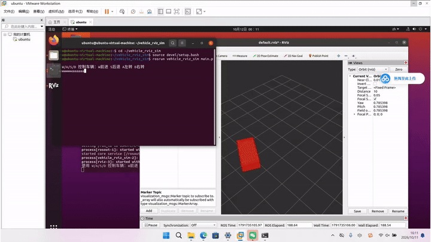

# 基于 ROS 的无人车运动仿真通过键盘控制机器人小车运动

## 任务说明
本人选择任务（1）：车辆运动仿真，通过键盘对机器人进行运动控制。

## 运行环境
- Ubuntu 20.04
- ROS Noetic
- Python 3.8

## 依赖安装
1. 安装 pynput：
   pip install pynput
2. 安装 ROS Noetic（Ubuntu 环境）。

##文件结构
```
ros2/                          
└── src/
    └── vehicle_rviz_sim/      
        ├── package.xml
        ├── CMakeLists.txt
        ├── launch/
        │   └── vehicle_sim.launch
        ├── rviz/
        │   └── vehicle.rviz
        └── scripts/
            └── main.py
```
## 运行步骤
1. 打开终端，给脚本添加可执行权限：chmod +x catkin_ws/src/vehicle_rviz_sim/scripts/main.py
2. 进入工作空间：source devel/setup.bash
3. 启动 launch 文件：roslaunch vehicle_rviz_sim vehicle_sim.launch
4. 在 rviz 中，点击左下角 Add 添加 Marker 插件，并将 Marker 的 Topic 设为 /vehicle_marker，Fixed Frame 设为 map。
5. 另开终端，运行键盘控制：rosrun vehicle_rviz_sim main.py
6. 鼠标点击终端，使用 W/A/S/D 控制车辆移动。

## 运行结果


## 大模型声明
代码由本人参考 ROS 官方文档和课程资料编写，未使用大模型生成。
