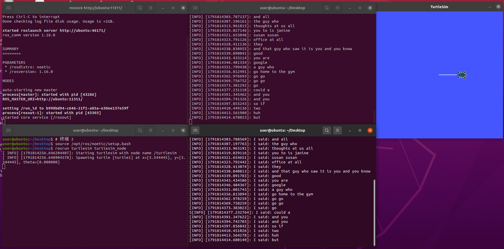

# ROS Noetic PocketSphinx 语音识别与小乌龟控制

目标环境：Ubuntu 20.04、ROS Noetic、系统 Python 3.8、GStreamer 1.0。流程为麦克风 → GStreamer/PocketSphinx → `/recognizer/output` (`std_msgs/String`) → `voice_teleop` → `/turtle1/cmd_vel` (`geometry_msgs/Twist`)。

## 8.1 配套代码与工作空间

源码在 `src/chap8/noetic_voice/`，含 `pocketsphinx` 和 `robot_voice` 两个 catkin 包。容器目录放置 CATKIN_IGNORE、COLCON_IGNORE，避免整仓扫描重复发现包。仅将里面两个包复制到独立工作空间，不复制这两个忽略文件，也不要与第五章同名 robot_voice 同时编译。

假设仓库位于 `~/ros2`：

```bash
mkdir -p ~/catkin_ws/src
cp -r ~/ros2/src/chap8/noetic_voice/pocketsphinx ~/catkin_ws/src/
cp -r ~/ros2/src/chap8/noetic_voice/robot_voice ~/catkin_ws/src/
```

若目标包已存在，先备份并核对，不要直接覆盖。不要激活 AirSim 的虚拟环境。

## 8.2 安装依赖

```bash
source /opt/ros/noetic/setup.bash
sudo apt update
sudo apt install ros-noetic-turtlesim python3-gi python3-gst-1.0 gir1.2-gstreamer-1.0 gir1.2-gst-plugins-base-1.0 gstreamer1.0-tools gstreamer1.0-plugins-base gstreamer1.0-plugins-good gstreamer1.0-pulseaudio gstreamer1.0-pocketsphinx pocketsphinx-en-us
gst-inspect-1.0 pocketsphinx
```

VMware 声卡应已连接；在 Ubuntu 设置的声音输入页面确认音量条能响应说话。

## 8.3 编译

两个包均提供 CMakeLists.txt，并用 catkin_install_python 注册 Python 程序。Git 中三个程序应为 100755；ZIP 或共享目录丢失权限时先修复：

```bash
chmod +x ~/catkin_ws/src/pocketsphinx/nodes/recognizer.py
chmod +x ~/catkin_ws/src/pocketsphinx/nodes/voice_cmd_vel.py
chmod +x ~/catkin_ws/src/robot_voice/scripts/voice_teleop.py
cd ~/catkin_ws
catkin_make
source devel/setup.bash
rospack find pocketsphinx
rospack find robot_voice
```

## 8.4 模型与控制词

声学模型 HMM 来自系统 pocketsphinx-en-us。命令识别的 LM 和字典使用包内 `demo/voice_cmd.lm`、`demo/voice_cmd.dic`，不使用通用 en-us.lm.bin 进行控制。它们限制命令词汇，但不是零误识别保证。

控制节点进行整句精确匹配：

| 口令 | 动作 |
| --- | --- |
| forward / move forward | 前进 |
| back / backward / move back / move backward | 后退 |
| left / move left | 左转 |
| right / move right | 右转 |
| stop / halt | 停止 |

字典没有 go，本文不再用 go。未知词、half speed、full speed 在 voice_teleop 中均停止，不执行调速。另一个旧演示 voice_cmd_vel.py 支持调速和连续运动，但无看门狗，不作为本实验默认控制器。

## 8.5 启动 master 和小乌龟

终端 1：

```bash
source /opt/ros/noetic/setup.bash
roscore
```

终端 2：

```bash
source /opt/ros/noetic/setup.bash
rosrun turtlesim turtlesim_node
```

## 8.6 启动受限命令识别

终端 3：

```bash
source /opt/ros/noetic/setup.bash
source ~/catkin_ws/devel/setup.bash
HMM=$(dirname "$(find /usr/share/pocketsphinx/model -type f -name mdef | head -n 1)")
LM="$(rospack find pocketsphinx)/demo/voice_cmd.lm"
DICT="$(rospack find pocketsphinx)/demo/voice_cmd.dic"
ls "$HMM/mdef" "$LM" "$DICT"
rosrun pocketsphinx recognizer.py _hmm:="$HMM" _lm:="$LM" _dict:="$DICT" _source:=autoaudiosrc
```

变量只在当前终端有效。HMM 必须指向含 mdef 的目录，不是模型外层目录。

## 8.7 启动带超时保护的控制节点

终端 4：

```bash
source /opt/ros/noetic/setup.bash
source ~/catkin_ws/devel/setup.bash
rosrun robot_voice voice_teleop.py _linear_speed:=1.0 _angular_speed:=1.0 _command_timeout:=1.0
```

控制节点以 10Hz 发布最近指令，距最后文本命令达到 1 秒后归零；未知文本立即归零，退出时尝试发布零速度。单次 forward 只持续约 1 秒，持续移动需要重复命令。不要同时运行另一个速度发布节点。watchdog 以单调时钟计算超时，在正常 ROS 定时器调度时生效，不是硬件安全保证。

## 8.8 分层测试

另开终端：

```bash
source /opt/ros/noetic/setup.bash
source ~/catkin_ws/devel/setup.bash
rostopic pub -1 /recognizer/output std_msgs/String "data: 'forward'"
rostopic pub -1 /recognizer/output std_msgs/String "data: 'stop'"
```

再分别观察：

```bash
rostopic echo /recognizer/output
# 另一个终端
rostopic echo /turtle1/cmd_vel
```

人工发布仅验证文本到速度的控制链路；必须另外对麦克风说 forward、back、left、right、stop 检查识别。记录匹配结果、非零速度和超时归零，不能仅凭收到文本日志认定运动成功。

## 8.9 原始联调记录与本轮修订



原截图使用通用模型，出现无关识别文本和重复口令，仅证明识别输出、订阅节点及 turtlesim 窗口启动，不证明所有动作通过。新版改用受限命令模型、补齐构建文件与超时保护后，仍需 Ubuntu 上重新编译及麦克风端到端验证。离线逻辑检查不替代在线联调。

## 8.10 故障排查及可选扩展

- catkin 提示缺少 CMakeLists.txt：核对两个源码包中此文件存在，并确认拉取最新 PR，不使用早期副本。
- Failed to initialize PocketSphinx：检查 HMM/mdef、LM、DICT 文件路径及 gst-inspect 插件。
- 有文本无运动：核对整句是否是命令表中的内容，检查控制节点和 cmd_vel；不要使用 go。
- 约 1 秒后停止：看门狗的预期行为，可通过正数 command_timeout 调整。
- 中文识别：原用户提供模型目录为 ~/pocketsphinx_models/cmusphinx-zh-cn-5.2；中文 LM/字典是另一组模型，中文输出不能直接驱动英文控制表，需要另做映射和实测，不属于本次英文控制验收。

## 来源与辅助声明

pocketsphinx 保留原包作者与 BSD 元数据；参见 [ROS pocketsphinx 包](https://wiki.ros.org/pocketsphinx)。本轮 robot_voice 控制实现由 OpenAI Codex 辅助重写，按包内 MIT LICENSE 发布；维护者 syj133。机器人语音作业没有自动导航或中文控制成功的验证结论。
