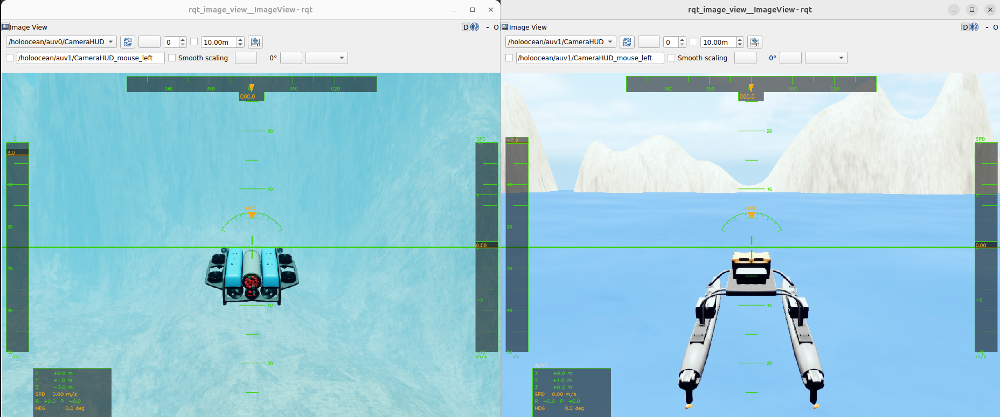
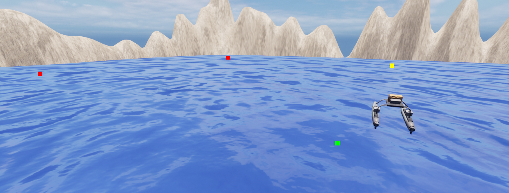

# 水域载具 ROS2 接口

针对高保真海洋机器人模拟器 [HoloOcean](https://github.com/byu-holoocean/HoloOcean) 的
ROS 2 集成方案。该软件包把 HoloOcean Python API 接到 ROS 2 网络上：传感器数据以
Topic（话题）发布，控制指令通过 Subscription（订阅）和 Service（服务）接收。

上游项目：[byu-holoocean/holoocean-ros](https://github.com/byu-holoocean/holoocean-ros)。

## HoloOcean ROS (0.0.1) 新特性

- 改进了游戏手柄（joystick）示例
- 新增多代理（multi-agent）游戏手柄示例
- 简化代理指令：弃用 `command/control` 话题，改用 `command/agent`
- 新增传感器旋转指令
- 修复少量错误并改进 Docker 配置

## 软件包

| 软件包 | 描述 |
|---|---|
| `holoocean_main` | 核心仿真节点：加载场景 JSON，启动 HoloOcean 并在后台线程中 tick |
| `holoocean_interfaces` | 自定义 ROS 2 消息与服务定义 |
| `holoocean_examples` | 示例节点：手柄控制、航点跟踪、深度/航向/速度指令 |

## 先决条件

- Ubuntu 22.04 + ROS 2 Humble，或 Ubuntu 24.04 + ROS 2 Jazzy（上游在 Humble 和
  Jazzy 上测试过）
- HoloOcean Python 包，以及对应的 Unreal 世界包（有画面和无画面模式都需要场景资源）
- 与 ROS 2 相同版本的 Python；`rclpy` 是编译扩展，不能和系统 Python 混用
- 可选：NVIDIA GPU 和显示器；无显示器时用 `show_viewport: false` 跑无头模式

> **关于 Conda：** 不建议在 ROS 2 + HoloOcean 的组合里使用 Conda。如果必须使用，
> 需要在同一个环境里安装与 ROS 2 版本匹配的 `rclpy`、`colcon-common-extensions`、
> `catkin_pkg` 和 `holoocean`，否则会出现 `rclpy` 导入失败或 ABI 不匹配。

## 安装

### Docker（推荐）

Docker 方式不需要在本机安装 ROS 2 和 HoloOcean，适合快速复现。参见：

- [Docker 开发环境](./docker.md)
- [HoloOcean ROS2 运行时容器](./docker_runtime.md)

### 从源码安装

先安装 HoloOcean Python 包（详见 [HoloOcean 文档](https://byu-holoocean.github.io/holoocean-docs/)），
然后准备一个 ROS 2 工作空间。下面用稀疏克隆只取 `src/water`，避免把整个文档仓库
拉下来：

```bash
mkdir -p ~/holoocean_ws/src
cd ~/holoocean_ws/src
git clone --depth 1 --filter=blob:none --sparse https://github.com/OpenHUTB/ros2.git
cd ros2
git sparse-checkout set src/water
cd ~/holoocean_ws
```

编译前先确认 `holoocean` 能被当前 Python 导入：

```bash
python3 -c "import holoocean; print(holoocean.__file__)"
```

然后编译三个包：

```bash
source /opt/ros/humble/setup.bash
colcon build --base-paths src/ros2/src/water \
  --packages-select holoocean_interfaces holoocean_main holoocean_examples
source install/setup.bash
```

如果用的是 Jazzy，把上面两处 `humble` 换成 `jazzy`，并把后面的
`ros-humble-*` 依赖换成 `ros-jazzy-*`。

如果只想要上游原版包，也可以把 `byu-holoocean/holoocean-ros` 克隆到
`src/holoocean-ros`，再把 `--base-paths` 换成 `src/holoocean-ros`。

示例节点还需要 `joy_linux`、`cv_bridge` 等运行时依赖，按需安装：

```bash
sudo apt install ros-humble-joy-linux ros-humble-cv-bridge ros-humble-rqt-image-view
```

#### 常见安装错误

`colcon build` 报 `ModuleNotFoundError: No module named 'catkin_pkg'`：

```bash
sudo apt install python3-catkin-pkg
# 或者只装到当前 Python：
python3 -m pip install --user catkin_pkg
```

这个错误通常来自“系统 ROS 2 的 Python”和“当前激活的 Python”不是同一个。先
`which python3`、`python3 -c "import rclpy"` 确认环境，再决定是否使用 Conda。

## 快速入门

```bash
source ~/holoocean_ws/install/setup.bash
ros2 launch holoocean_main holoocean_launch.py
```

launch 默认做三件事：

- 命名空间设为 `holoocean`
- 加载 `holoocean_main/config/ros_params.yaml`
- 默认场景是 `config/torpedo_fossen.json`，并打开 Unreal 视窗

启动后另开一个终端验证：

```bash
ros2 node list | grep holoocean
ros2 topic list | grep holoocean
ros2 topic echo /clock --once
ros2 service list | grep -E 'reset|control_mode'
```

正常情况下能看到 `holoocean_node`、`/holoocean/command/agent` 等话题、
`/clock` 以及 `reset`、`control_mode` 两个服务。第一次启动要加载 Unreal 场景，
可能需要几十秒。

无显示器时，把 `config/ros_params.yaml` 里的 `show_viewport` 改成 `false`，或者直接
运行节点并覆盖参数：

```bash
ros2 run holoocean_main holoocean_node --ros-args \
  -p show_viewport:=false -p scenario_path:=config/torpedo_fossen.json
```

## 示例

### 操纵杆控制

使用 `joy_linux` 包通过手柄控制 HoloOcean 中的代理：

```bash
ros2 launch holoocean_examples joy_launch.py
```

完整按键映射和配置见[水域载具示例](./holoocean_examples.md)。



### 航点跟踪

根据预设航点列表控制水面船舶：

```bash
ros2 launch holoocean_examples waypoint_launch.py
```



### 深度、航向及速度指令

利用 Fossen 控制器向鱼雷型 AUV 发送深度、航向和速度指令：

```bash
ros2 launch holoocean_examples command_launch.py
```

## 节点引用：`holoocean_node`

加载场景 JSON 文件，启动 HoloOcean 环境，并在后台线程中持续 tick。下面的话题和
服务名都是**节点命名空间内的相对名称**；launch 默认命名空间是 `holoocean`，
完整名称要加 `/holoocean/` 前缀（`/clock` 是绝对话题，见下）。

### 订阅的话题

| 话题 | 类型 | 描述 |
|---|---|---|
| `command/agent` | `AgentCommand` | 所有代理的推进器/执行器指令。`frame_id` 必须是代理名（如 `auv0`）；节点把 `frame_id` 直接当代理名，只有该代理在 `fossen_agents` 中才路由到 `set_u_control`，设成 `body` 不会命中 |
| `command/sensor` | `SensorCommand` | 传感器配置指令（例如摄像头旋转） |
| `depth` | `DesiredCommand` | 自动驾驶模式的深度设定值 |
| `heading` | `DesiredCommand` | 自动驾驶模式的航向设定值 |
| `speed` | `DesiredCommand` | 自动驾驶模式的速度设定值 |
| `debug/points` | `visualization_msgs/Marker` | 在仿真中绘制的调试点 |

### 发布的话题

| 话题 | 类型 | 描述 |
|---|---|---|
| `<agent>/<SensorName>` | 取决于传感器 | 每个代理的传感器数据 |
| `/clock` | `rosgraph_msgs/Clock` | 仿真时间（绝对话题） |

传感器话题名遵循 `<agent_name>/<sensor_name>`；如果场景 JSON 没有给传感器命名，
默认使用传感器类型名。

### 服务

| 服务 | 类型 | 描述 |
|---|---|---|
| `reset` | `std_srvs/Trigger` | 重置仿真环境 |
| `control_mode` | `SetControlMode` | 更改代理的控制模式 |

`SetControlMode` 请求：

| 字段 | 类型 | 说明 |
|---|---|---|
| `vehicle_name` | `string` | 代理名（场景 JSON 里的 key） |
| `mode` | `int32` | 0 = manualControl，1 = depthHeadingAutopilot，2 = headingAutopilot，3 = depthAutopilot |

### 参数

| 参数 | 类型 | 默认值 | 描述 |
|---|---|---|---|
| `scenario_path` | string | `""` | 场景 JSON 路径；launch 的 params 文件默认 `config/torpedo_fossen.json`。直接运行节点时必须提供，空值会抛 `ValueError` |
| `relative_path` | bool | `true` | 相对于 `holoocean_main` 的 share 目录解析 `scenario_path` |
| `show_viewport` | bool | `true` | 显示 Unreal 视窗 |
| `draw_arrow` | bool | `true` | 给每个 Fossen 代理画朝向箭头 |
| `draw_waypoints` | bool | `false` | 预留参数，当前未使用：节点只声明/读取，未传给 `HolooceanInterface`，不会实际绘制航点 |
| `render_quality` | int | `-1` | 渲染质量：0 = 低，1 = 普通，2 = 高；-1 = 默认 |
| `publish_commands` | bool | `true` | 把计算出的控制面指令发布回 ROS |

### 消息字段

| 消息 | 字段 | 说明 |
|---|---|---|
| `AgentCommand` | `header.frame_id`、`float64[] command` | `frame_id` 是代理名；`command` 长度由载具控制方案决定 |
| `SensorCommand` | `agent_name`、`sensor_name`、`float64[3] rotation` | `rotation` 为 `[roll, pitch, yaw]` |
| `DesiredCommand` | `header.frame_id`、`float64 data` | 深度单位 m，航向单位度（NWU，-180~180），速度单位 RPM |

## 记录传感器数据

```bash
ros2 bag record /holoocean/auv0/RotationSensor /holoocean/auv0/LocationSensor
```

话题名取决于场景 JSON 里的代理名和传感器名。回放时如果要使用仿真时间：

```bash
ros2 bag play <bag> --clock
```

更多用法见 [ROS 2 bag 文档](https://docs.ros.org/en/humble/Tutorials/Beginner-CLI-Tools/Recording-And-Playing-Back-Data/Recording-And-Playing-Back-Data.html)。

## 常见问题

| 现象 | 原因 / 处理 |
|---|---|
| `ModuleNotFoundError: catkin_pkg` | 安装 `python3-catkin-pkg`，或确认当前 `python3` 就是 ROS 2 使用的 Python |
| `Package 'holoocean_main' not found` | 没有 `source install/setup.bash`，或三个包没有编译成功 |
| `ModuleNotFoundError: holoocean` | HoloOcean Python 包没装，或装到了另一个 Python 环境 |
| `The 'scenario_path' parameter cannot be blank` | 直接 `ros2 run` 时没有传 `scenario_path`；用 launch 的 params 文件或显式 `-p scenario_path:=...` |
| 启动后没有画面 | 检查 `show_viewport`、显卡驱动和 `DISPLAY`；无头模式本来就看不到视窗 |
| `rclpy` 导入失败或 ABI 错误 | 混用了 Conda/系统 Python；统一到 ROS 2 对应的 Python |
| 手柄没有反应 | 检查 `/dev/input/js0` 权限，以及 `joy_linux` 节点是否在跑 |
| 仿真时间和实际时间不一致 | 正常现象，用 `/clock` 和 `use_sim_time` 同步节点 |

## 注意

- 仿真时间可能比实际时间（wall time）快或慢，节点应使用 `/clock` 订阅仿真时间，
  并设置 `use_sim_time:=true`。
- HoloOcean 世界包体积较大，首次启动加载时间长；不要把它放在网盘挂载目录里直接跑。
- 修改代码后重新 `colcon build` 并重新 `source install/setup.bash`，否则运行的还是旧版本。

## 参考与引用

- [holoocean-ros 上游仓库](https://github.com/byu-holoocean/holoocean-ros)
- [HoloOcean 仓库](https://github.com/byu-holoocean/HoloOcean)
- [HoloOcean 文档](https://byu-holoocean.github.io/holoocean-docs/)
- [ROS 2 文档](https://docs.ros.org/en/humble/index.html)

如果在本项目或 HoloOcean 上做研究，请引用：

```bibtex
@inproceedings{meyers2025testing,
  title={Testing and Evaluation of Underwater Vehicle Using Hardware-in-the-Loop Simulation with HoloOcean},
  author={Meyers, Braden and Mangelson, Joshua G.},
  booktitle={OCEANS 2025-Great Lakes},
  pages={1--8},
  year={2025},
  organization={IEEE}
}
```

上游项目由 Brigham Young University 的
[FRoStLab (Field Robotic Systems Lab)](https://frostlab.byu.edu/) 开发。
