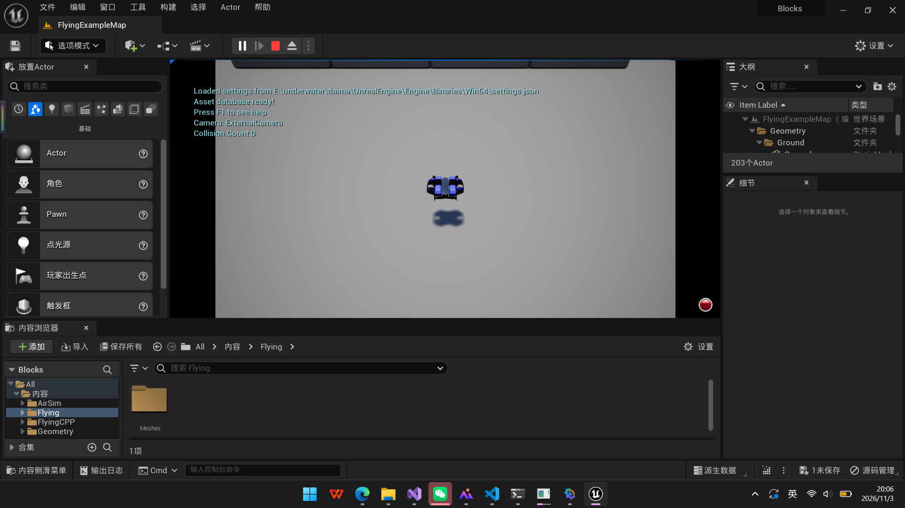
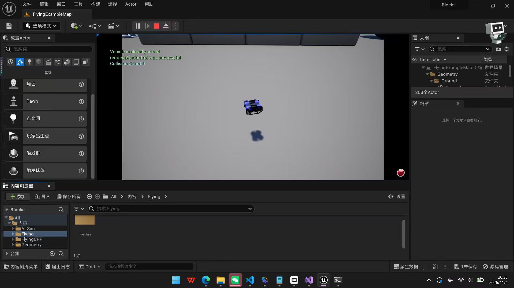
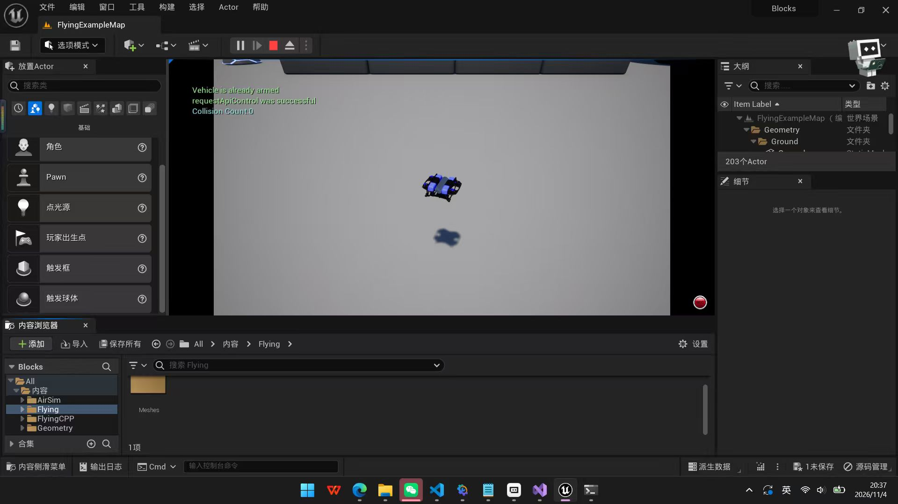

# 水下机器人 Unreal Engine 5 仿真

## 1. 安装说明（针对 Windows 操作系统）

UNav-Sim 依赖于 Unreal Engine 5 生成逼真的渲染图。首先安装 UE5，然后继续安装 UNav-Sim。

### 1.1 UE5

确保你已经在 Epic Games 注册了。这是获取虚幻引擎源代码访问所必需的。

在你喜欢的文件夹里克隆 Unreal 5.1 并构建它（这需要大量的时间与内存，需要 163 GB）：

```bash
git clone -b 5.1 git@github.com:EpicGames/UnrealEngine.git
cd UnrealEngine
.\Setup.bat
.\GenerateProjectFiles.bat
```

### 1.2 UNav-Sim

在你最喜欢的文件夹里克隆这个仓库：

```bash
git clone git@github.com:open-airlab/UNav-Sim.git
cd UNav-Sim
build.cmd
```

### 1.3 构建 UE5 环境

在 `cd ~\UNav-Sim\Unreal\Environments\Blocks` 目录下：

右键点击 `Blocks.uproject` 文件，在菜单中选择“Generate Visual Studio project files”（生成 Visual Studio 项目文件）。

## 2. 运行模拟

1. 将 `ros2/src/water/ue5_UNav-Sim/settings.json` 文件添加到 `C:\[用户名]\Documents\AirSim`
2. 用 Visual Studio 打开 `Blocks.sln`
3. 进行调试
4. 进入 Unreal Engine 5 后进行模拟


### 2.1 HelloROV 圆形轨迹

>本仿真基于1.2的`UNav-Sim`仓库

#### 第 1 步：启动仿真器

1. 打开 `（存储文件的磁盘）:\underwater\daima\UNav-Sim\Unreal\Environments\Blocks\Blocks.uproject`
2. 等编辑器加载完（约 1 分钟）
3. 点工具栏绿色 `Play` 按钮
4. 确认：视口出现蓝色 `BlueROV2` 且没有报错弹窗

#### 第 2 步：确认 RPC 服务器已就绪

另开一个命令行窗口输入: `netstat -ano | findstr ":41451"`

看到 `LISTENING` 就说明 `API` 服务在线。

#### 第 3 步：运行圆形轨迹控制器

在命令行输入: `python （存储文件的磁盘）:\underwater\daima\UNav-Sim\circle_rov.py`

- 运行 `90` 秒自动停止，半径 `2.5` 米，一圈约 `79` 秒
- 脚本开头会自动把 `ROV` 重置回水面附近，不需要手动处理沉底问题

#### 第 4 步：在 UE 视口里看

1. 鼠标点一下视口中的画面
2. 滚轮拉远 `+` 右键旋转到俯视角度，能看到整个约 5m 直径的圆
3. 盯着蓝色 `ROV` ， `20` 秒内就能看到它在绕圈
如图所示：



#### 第 5 步：停止

| 情况 | 命令 |
|---|---|
| Python 脚本 | 等下自动停（90 秒）或 `Ctrl+C` |
| HelloRov.exe | `Stop-Process -Name HelloRov -Force` |
| 退出仿真 | 点编辑器 Stop （停止 Play） |
