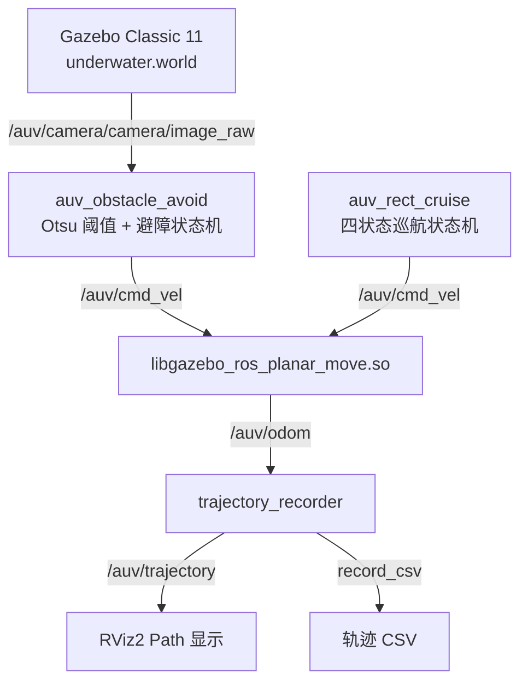
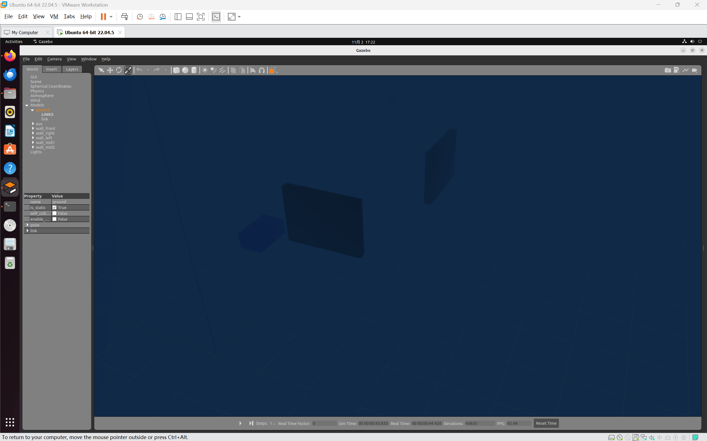
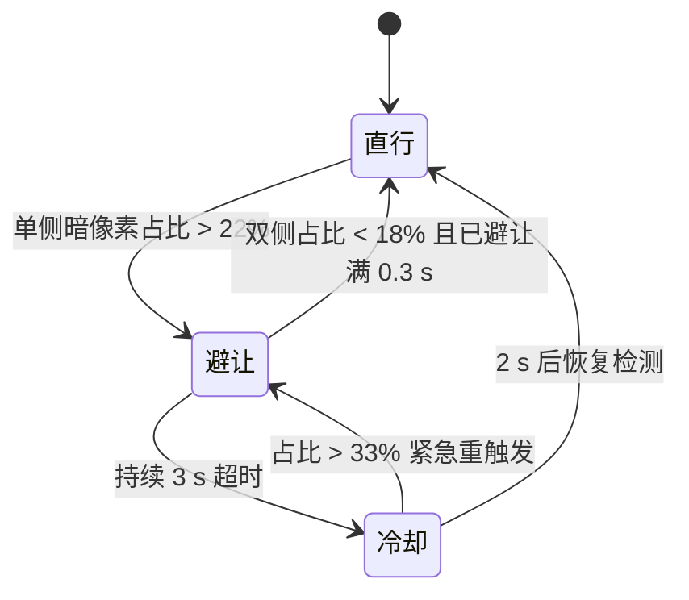
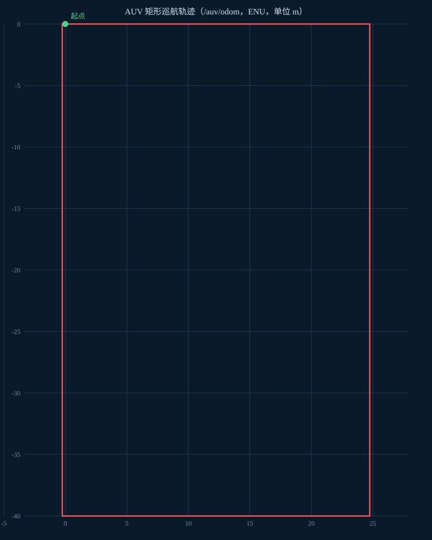
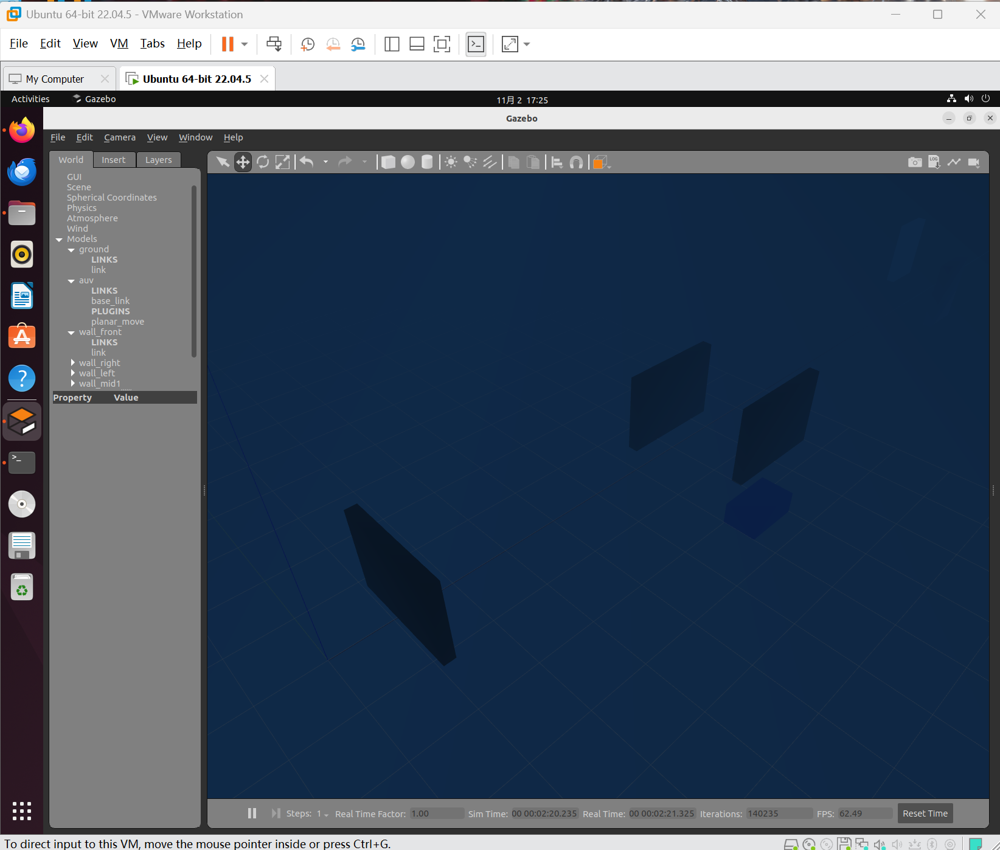

# 水下 AUV 矩形巡航与视觉双向避障仿真

## 1. 实验概述

本实验在 ROS2 Humble + Gazebo Classic 11 环境下搭建水下 AUV 仿真场景，实现两个功能：

1. **矩形巡航**：AUV 按「前进 → 右移 → 后退 → 左移」四状态闭合循环往复运动，形成矩形轨迹；
2. **视觉双向避障**：基于前置单目相机图像检测前方暗色障碍物，判断障碍位于画面左侧还是右侧，向相反方向横向避让，配合超时与冷却机制避免持续偏转。

**覆盖任务点：**

- 任务(5)：水下机器人物理仿真 + 运动控制
- 任务(52)：传感器（摄像头）感知 + 控制指令生成
- 任务(5\*1)：端到端感知-控制（相机图像 → 暗区占比 → 速度指令）

## 2. 系统架构



场景中 `planar_move` 插件作为运动学驱动接收 `/auv/cmd_vel` 并发布 `/auv/odom`，两个控制节点各自独立发布速度指令，**不能同时运行**（会互相抢占 `/auv/cmd_vel`）。`trajectory_recorder` 只订阅 `/auv/odom`、不发速度，可以和控制节点同时运行。

## 3. 环境依赖

- Ubuntu 22.04
- ROS2 Humble
- Gazebo Classic 11.10.2（**不是** Humble 默认搭配的 Ignition Fortress）
- Python 3.10+
- OpenCV（`python3-opencv`）、numpy（`python3-numpy`）
- `cv_bridge`
- RViz2（只有 `use_rviz:=true` 时需要，`ros-humble-desktop` 自带）

Gazebo Classic 需要单独安装，否则会出现 `gazebo: command not found`：

```bash
sudo apt install gazebo11 libgazebo11-dev
sudo apt install ros-humble-gazebo-ros-pkgs ros-humble-gazebo-plugins
gazebo --version   # 应输出 gazebo, version 11.x
```

## 4. 编译与启动

```bash
cd ~/ros2_ws
colcon build --packages-select auv_end2end
source install/setup.bash
```

矩形巡航：

```bash
ros2 launch auv_end2end auv_rect_cruise.launch.py
```

视觉避障：

```bash
ros2 launch auv_end2end auv_sim.launch.py
```

两个 launch 都会自行启动 Gazebo：矩形巡航加载 `worlds/underwater_cruise.world`（无墙体的空场景，避免航路被障碍阻断），视觉避障加载 `worlds/underwater.world`（8 道错位墙）。单独执行即可看到仿真画面，切换功能前先 Ctrl+C 关闭当前仿真，避免两个仿真实例同时向 `/auv/cmd_vel` 发布指令。

两个 launch 都额外提供三个与「看结果」相关的开关：

```bash
# 无显示环境（SSH / CI）只跑物理，不启动 gzclient
ros2 launch auv_end2end auv_rect_cruise.launch.py gui:=false

# 打开 RViz 观察 /auv/trajectory 轨迹
ros2 launch auv_end2end auv_rect_cruise.launch.py use_rviz:=true

# 退出时把轨迹写成 CSV，便于离线画图
ros2 launch auv_end2end auv_rect_cruise.launch.py record_csv:=$HOME/rect.csv
```

`gui:=false` 只关闭 `gzclient`，`gzserver` 仍在运行；相机传感器需要渲染，无显示环境下仍要通过 `DISPLAY` 指向一个可用的 X 服务，否则图像话题不会有数据。

单元测试与代码规范检查共用同一条命令，都不依赖 Gazebo 与相机，直接覆盖 `avoid_logic.py` 里的纯逻辑：

```bash
colcon test --packages-select auv_end2end
colcon test-result --verbose
```

共 22 项，其中 20 项是逻辑用例：`test/test_vision.py` 覆盖 ROI 裁剪、Otsu 双峰判据与可分性上界、均匀水面与雾渐变兜底、固定/自适应阈值切换；`test/test_avoid_state.py` 覆盖触发与恢复滞环、最小避让时长、超时、冷却以及冷却期紧急重触发。另 2 项是 `ament_flake8`、`ament_pep257` 规范检查。



## 5. 节点与话题

| 名称 | 类型 | 说明 |
| --- | --- | --- |
| `auv_rect_cruise` | 节点 | 矩形巡航状态机，50 ms 定时发布速度 |
| `auv_obstacle_avoid` | 节点 | 视觉避障，相机回调中发布速度 |
| `trajectory_recorder` | 节点 | 订阅 `/auv/odom`，发布轨迹并可选写 CSV |
| `/auv/cmd_vel` | 话题（发布） | `geometry_msgs/Twist`，速度指令 |
| `/auv/camera/camera/image_raw` | 话题（订阅） | `sensor_msgs/Image`，前置相机图像 |
| `/auv/odom` | 话题（发布，来自插件） | 里程计，用于观察轨迹 |
| `/auv/trajectory` | 话题（发布） | `nav_msgs/Path`，累积轨迹，供 RViz 的 Path 显示 |

视觉算法与状态机都放在不依赖 ROS 的 `auv_end2end/avoid_logic.py` 里，节点只做图像转换与速度发布，因此这部分逻辑可以直接用 pytest 覆盖（见 `test/test_vision.py`、`test/test_avoid_state.py`）。

## 6. 参数说明

参数全部通过 ROS 参数暴露，两个 launch 用 `DeclareLaunchArgument` 声明默认值，可在命令行覆盖，不需要重新 `colcon build`：

```bash
# 缩短横向时间，加快巡航循环
ros2 launch auv_end2end auv_rect_cruise.launch.py side_time:=8.0

# 提高触发阈值，减少误触发
ros2 launch auv_end2end auv_sim.launch.py trigger_ratio:=0.3 max_avoid_duration:=2.0
```

下表为默认值。

避障节点 `auv_obstacle_avoid`：

| 参数 | 默认值 | 说明 |
| --- | --- | --- |
| `obstacle_thresh` | 22 | 固定灰度阈值（0-255），低于该值判为暗色障碍像素；自适应不可用时作为兜底 |
| `adaptive_thresh` | true | true 时用 Otsu 自适应阈值，抗雾效与整体光照变化 |
| `trigger_ratio` | 0.22 | 触发阈值，单侧暗像素面积占比超过 22% 触发避障 |
| `recover_ratio` | 0.18 | 恢复阈值，双侧占比均低于 18% 恢复直行 |
| `forward_speed` | 4.5 | 直行巡航速度（m/s） |
| `side_speed` | 2.8 | 横向避让速度（m/s） |
| `max_avoid_duration` | 3.0 | 单次最长避让时长（s），超时进入冷却期 |
| `avoid_cooldown` | 2.0 | 冷却时长（s），期间强制直行、禁止常规重触发 |
| `min_avoid_duration` | 0.3 | 最小避让时长（s），防止阈值附近抖动 |
| `emergency_factor` | 1.5 | 冷却期占比超过 `trigger_ratio × 该值` 时立即中断冷却重新避让 |

注意 `obstacle_thresh = 22` 是灰度阈值，`trigger_ratio = 0.22` 是面积占比阈值，两者含义不同。

巡航节点 `auv_rect_cruise`：

| 参数 | 默认值 | 说明 |
| --- | --- | --- |
| `forward_speed` | 2.5 | 前进/后退速度（m/s） |
| `side_speed` | 2.0 | 横向平移速度（m/s） |
| `forward_time` | 10.0 | 直行/后退持续时间（s） |
| `side_time` | 20.0 | 横向平移持续时间（s） |

两个 launch 共用的开关：

| 参数 | 默认值 | 说明 |
| --- | --- | --- |
| `gui` | true | 是否启动 `gzclient`；无显示环境设 false |
| `use_rviz` | false | 是否启动 RViz2 并加载 `rviz/auv.rviz` |
| `record_csv` | 空 | 轨迹 CSV 输出路径，留空则不写文件 |

## 7. 避障状态机



五个要点：

1. **检测区域**：只取画面高度 15%~70% 的中上部条带，剔除海底地面干扰；左右各取一半分别统计暗像素占比。
2. **自适应阈值**：默认用 Otsu 阈值代替固定灰度 22。Otsu 只在画面确实「双峰」时才启用（类间方差 / 总方差 ≥ 0.8），否则退回 `obstacle_thresh`。这一步是必须的：开阔水域整幅画面灰度相同（实测恒定 37），Otsu 会硬切一刀把整幅水色判成障碍，AUV 会一路横移跑飞；均匀场景应当「没有障碍」，而不是「全是障碍」。
3. **双向选择**：左侧占比高则向右避让（`linear.y = -2.8`），右侧占比高则向左避让（`linear.y = +2.8`）。
4. **滞环 + 最小避让时长**：触发阈值 22%、恢复阈值 18%，两者之间为滞环带；进入避让后至少保持 0.3 s 才允许因画面变亮而恢复，避免在阈值附近高频抖动。
5. **超时与冷却**：超时判断独立于状态迁移之外，占比长期停在滞环带内也能在 3 s 后强制结束避让并进入 2 s 冷却。冷却期不是完全盲区——占比超过 `trigger_ratio × emergency_factor`（默认 33%）说明障碍明显恶化，会立即中断冷却重新避让。

避障期间的日志文案与代码一致：

```
=== 触发避障 向右避让 ===
=== 触发避障 向左避让 ===
=== 障碍物清除 恢复直行 ===
=== 避让超时 进入冷却期 强制直行 ===
=== 冷却结束 恢复避障检测 ===
=== 冷却期紧急重触发 恢复避让 ===
```

## 8. 实测结果

测试环境：Ubuntu 22.04 + ROS2 Humble + Gazebo 11.10.2，虚拟机软件渲染，实时因子约 0.9~1.0。

### 8.1 矩形巡航

`ros2 launch auv_end2end auv_rect_cruise.launch.py` 启动后，AUV 依次进入四个状态，每个状态切换时终端输出：

```
切换状态：向右平移
切换状态：后退
切换状态：向左平移
切换状态：前进 | 完成一个矩形循环
```

四段持续时间由 `forward_time = 10 s`、`side_time = 20 s` 控制。Ctrl+C 时两个节点都在 rclpy 关闭 context 之前先发布零速度指令；`planar_move` 没有指令超时，这一步决定 AUV 是否立即停下。

巡航使用独立的 `underwater_cruise.world`（空场景）：`wall_front` 位于 `(4, 0)`，正好压在 y = 0 的直行航路上，用演示场景会让矩形轨迹被墙体切断；`planar_move` 不参与碰撞，穿墙不会报错，但轨迹不可读。

轨迹由 `trajectory_recorder` 节点录制，`record_csv` 指定输出路径，节点退出时写盘。实测一次完整循环（`gui:=false`，仿真时间 72.65 s）：

| 指标 | 实测值 | 理论值 |
| --- | --- | --- |
| 采样点数 | 1453 | — |
| 状态切换时刻 | 10.5 / 30.7 / 40.7 / 60.8 s | 10 / 30 / 40 / 60 s |
| x 范围 | −0.25 ~ 24.75 m | 0 ~ 25 m（2.5 m/s × 10 s） |
| y 范围 | −40.0 ~ 0 m | 0 ~ −40 m（2.0 m/s × 20 s） |



x、y 两端都与「速度 × 时长」吻合，说明状态机计时、`cmd_vel` 下发和 `planar_move` 的位移三者一致，矩形是真正闭合的 25 m × 40 m。

> 早期版本在这里跑出过 x 只有 0.35 m 的轨迹，原因不是状态机，而是 world 里把 `velocity_decay` 写成了 0.997 —— SDF 中该单位是「每秒衰减比例」，0.997 表示每秒丢掉 99.7% 的速度，再叠加模型下沉贴地后的地面摩擦，实际速度只剩指令值的 1% 左右。修正方式见 8.4。

### 8.2 视觉双向避障

`ros2 launch auv_end2end auv_sim.launch.py` 启动后，AUV 沿 +x 方向直行，接近 x=4 处的正前方墙体时画面暗像素占比上升。实测（`gui:=false`，时间为节点启动后的仿真秒）：

| 时刻 | 日志 | 说明 |
| --- | --- | --- |
| 0.00 s | 触发避障 向左避让 | 正前方墙体左右占比接近，方向由像素级差异决定 |
| 0.86 s | 障碍物清除 恢复直行 | 横移 2.8 m/s × 0.86 s ≈ 2.4 m，墙体移出检测条带 |
| 1.65 s | 触发避障 向左避让 | 直行后再次看到同一道墙的边角 |
| 2.10 s | 障碍物清除 恢复直行 | 仅持续 0.45 s，已超过最小避让时长 0.3 s |
| 7.30 s | 触发避障 向左避让 | 后续墙体进入视野，持续占据画面 |
| 10.30 s | 避让超时 进入冷却期 强制直行 | 满 3 s 仍未恢复，强制结束避让 |
| 12.30 s | 冷却结束 恢复避障检测 | 冷却 2 s 到期 |

避障期间横向速度 `linear.y = ±2.8`、前进速度降为 4.05 m/s；方向始终由左右占比大小决定，因此正前方正对墙体时左右对称，实际方向可能在换场景后翻转，这不是 bug。



实测同时确认了自适应阈值的兜底行为：AUV 驶出墙体范围后整幅画面灰度恒定在 37 左右，`analyze` 退回固定阈值 22，左右占比均为 0.00，速度指令恢复为 `linear.x = 4.5, linear.y = 0`，不会出现「无障碍却一直在避让」。

### 8.3 复现方法

```bash
# 观察速度指令与状态
ros2 topic echo /auv/cmd_vel

# 观察轨迹（横向位移是否受限）
ros2 topic echo /auv/odom --field pose.pose.position
```

> 说明：`libgazebo_ros_planar_move.so` 是运动学驱动，不与墙体发生物理碰撞，因此「没有撞上」不能单独作为避障成功的证据，需结合 `/auv/odom` 的横向位移曲线判断。

### 8.4 仿真模型修正（位移与时钟）

排查「AUV 实际位移远小于指令速度」时定位到两处 world 级问题，都在两个 world 里做了修正：

| 问题 | 现象 | 处理 |
| --- | --- | --- |
| `velocity_decay` 写成 `0.997` | 该值单位是「每秒衰减比例」，2.5 m/s 指令 10 s 只走 0.36 m | 删除该节点，速度完全由 `cmd_vel` 决定 |
| 重力使模型下沉贴地 | z 从 0.3 沉到 0.2，底面与 ground 接触，地面摩擦吃掉速度 | 加 `<gravity>0 0 0</gravity>`，按中性浮力处理 |

改动前后各做一次定速对照（同一 world，指令恒速 1.0 m/s 直行；巡航演示用的 2.5 m/s 指令下同样只走 0.36 m / 10 s）：

| 配置 | 实测位移 | 等效速度 |
| --- | --- | --- |
| 原配置（重力 + 0.997 衰减） | 0.39 m / 20 s | ≈ 0.02 m/s |
| 仅关闭重力、把衰减改成 0.15 | 3.92 m / 11.4 s | ≈ 0.34 m/s |
| 关闭重力、去掉 `velocity_decay` | 10.13 m / 10.1 s | ≈ 1.00 m/s（指令 1.0） |

只要 `velocity_decay` 填了不为 0 的系数，实际速度就会明显偏离指令，因此这里选择不启用速度衰减，把水阻的取舍写进第 10 节。

时钟问题同源：`libgazebo_ros_init.so` 是 SystemPlugin，写在 world 的 `<plugin>` 标签里会报 `detected an incorrect plugin type`，`/clock` 不发布，所有 `use_sim_time: True` 的节点时钟恒为 0，定时器永不触发。现改为 launch 里 `gzserver -s libgazebo_ros_init.so` 加载。

## 9. 多障碍场景

`underwater.world` 目前有 8 道错位墙，其中本次新增 3 道（`wall_far1` / `wall_far2` / `wall_far3`），用于观察连续避让。下表几何来自 world 文件，行为结论来自上面的实测日志。

需要说明的是：只有 `wall_front`（尺寸 0.2 × 2，跨 y ∈ [-1, 1]）真正挡在 y = 0 的航路上；其余 7 道是厚 0.2 m、沿 x 方向长 1~2 m 的条状墙，分布在 y = **±0.8~1.5** 之间，是否进入相机视野、暗像素占比能否超过 22%，取决于上一次避让后停在哪个 y 上。单次超时避让横移 2.8 m/s × 3 s = 8.4 m，足以越过全部 ±1.5 m 的墙。

| 墙 | x | y | 尺寸 x×y (m) | 与下一道间距 | 直行通过 @4.5 m/s |
| --- | --- | --- | --- | --- | --- |
| `wall_front` | 4 | 0 | 0.2 × 2 | 4 m | 0.89 s |
| `wall_right` | 8 | −1.5 | 2 × 0.2 | 4 m | 0.89 s |
| `wall_left` | 12 | +1.5 | 2 × 0.2 | 4 m | 0.89 s |
| `wall_mid1` | 16 | −1.0 | 1 × 0.2 | 2 m | 0.44 s |
| `wall_mid2` | 18 | +1.0 | 1 × 0.2 | 6 m | 1.33 s |
| `wall_far1` | 24 | −1.2 | 1.2 × 0.2 | 4 m | 0.89 s |
| `wall_far2` | 28 | +1.2 | 1.2 × 0.2 | 4 m | 0.89 s |
| `wall_far3` | 32 | −0.8 | 1.2 × 0.2 | — | — |

「8 道墙」不等于「8 次避让」，实测结论更直接：整段 40 s 运行里只在前 13 s 产生了 3 次避让（2 次阈值恢复 + 1 次超时冷却），之后 AUV 一路直行到 x > 150 m 再未触发。原因是 `wall_front` 之后 AUV 已横移到 y ≈ −8 m，其余 7 道墙都落在 |y| ≤ 1.5 m 内，横向偏离 6.5 m 以上，早已移出相机取景范围。

也就是说，只有真正压在航路上的 `wall_front` 能稳定触发避障；其余条状墙是「换参数后可能被看见」的候选场景，不是必然事件。想观察多次连续避让，需要把 `trigger_ratio` 调低、把相机水平视场（`horizontal_fov`）加大，或让 AUV 在墙群之间往返。

两种恢复路径的写法与实测一致：

- 阈值恢复路径：绕过墙体后双侧占比回落到 18% 以下，日志出现「障碍物清除 恢复直行」（0.86 s、2.10 s 两次）；
- 超时路径：日志出现「避让超时 进入冷却期 强制直行」，随后 2 s 内不响应常规触发；若这 2 s 内占比超过 33%，则改为「冷却期紧急重触发 恢复避让」。本次实测走的是完整 2 s 冷却。

```bash
# 想更快回到直行：缩短单次避让、拉长冷却
ros2 launch auv_end2end auv_sim.launch.py max_avoid_duration:=1.5 avoid_cooldown:=3.0
```

## 10. 已知限制

- 障碍持续存在时会形成「避让 3 s → 冷却 2 s → 再避让」的循环；冷却期虽有紧急重触发，但面对连续长墙仍无法真正绕过，这是本作业的教学取舍。
- `planar_move` 是运动学驱动，不与墙体发生物理碰撞。冷却期强制直行时会直接穿过侧墙，视觉上看起来像撞上去了，实际没有任何碰撞响应。
- 自适应阈值依赖「画面双峰」这一前提：类间方差占比低于 0.8 时退回固定阈值。因此 `obstacle_thresh` 仍必须低于该场景的水体灰度（实测约 37），否则兜底路径会失效。改动雾密度、背景色或相机曝光后需要重新标定。
- 参数在启动时读取一次，运行中修改需要重启节点。
- world 关闭了重力、也不再设置 `velocity_decay`，所以模型没有水阻惯性：速度完全跟随 `cmd_vel`，指令归零即停。若要模拟加减速过程，应改用差速/推进器插件并引入水动力阻尼，而不是把 `velocity_decay` 填成接近 1 的数。

## 参考文献

1. [ROS2 Humble 官方文档](https://docs.ros.org/en/humble/)
2. [gazebo_ros_pkgs](https://github.com/ros-simulation/gazebo_ros_pkgs)
3. [OpenCV 图像阈值处理](https://docs.opencv.org/4.x/d7/d4d/tutorial_py_thresholding.html)
