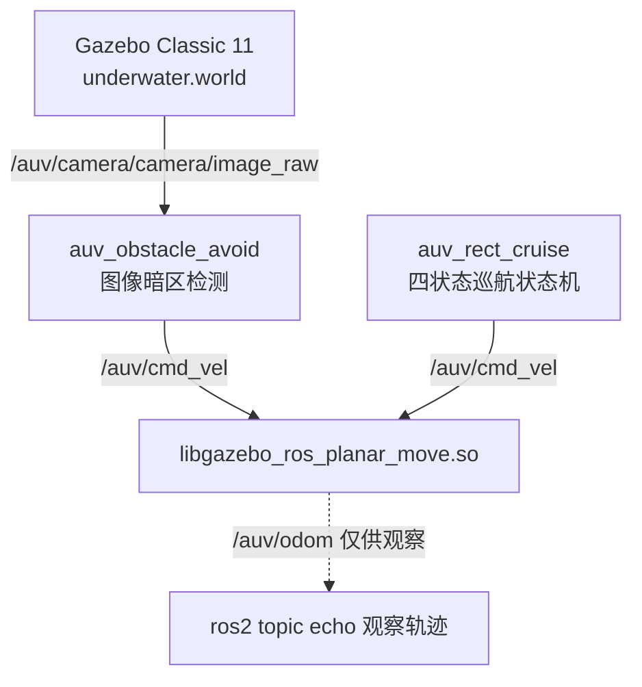
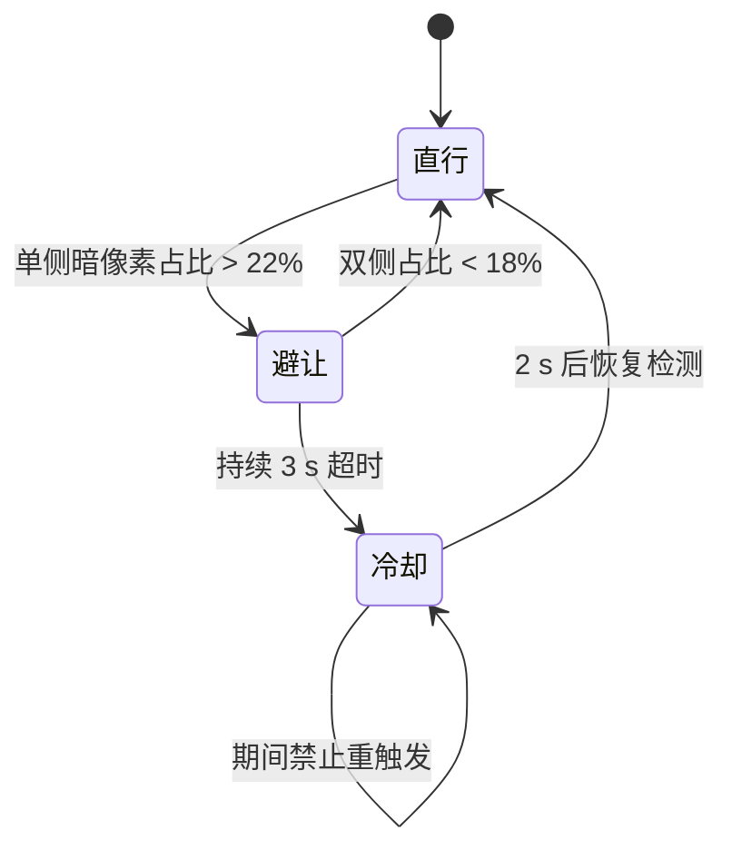

# 水下 AUV 矩形巡航与视觉双向避障仿真

## 1. 实验概述

本实验在 ROS2 Humble + Gazebo Classic 11 环境下搭建水下 AUV 仿真场景，实现两个功能：

1. **矩形巡航**：AUV 按「前进 → 右移 → 后退 → 左移」四状态闭合循环往复运动，形成矩形轨迹；
2. **视觉双向避障**：基于前置单目相机图像检测前方暗色障碍物，判断障碍位于画面左侧还是右侧，向相反方向横向避让，配合超时与冷却机制避免持续偏转。

**覆盖任务点：**

- 任务(5)：水下机器人物理仿真 + 运动控制
- 任务(52)：传感器（摄像头）感知 + 控制指令生成
- 任务(5\*1)：端到端感知-控制（相机图像 → 暗区占比 → 速度指令）

## 2. 系统架构



场景中 `planar_move` 插件作为运动学驱动接收 `/auv/cmd_vel` 并发布 `/auv/odom`，两个节点各自独立发布速度指令，**不能同时运行**（会互相抢占 `/auv/cmd_vel`）。

## 3. 环境依赖

- Ubuntu 22.04
- ROS2 Humble
- Gazebo Classic 11.10.2（**不是** Humble 默认搭配的 Ignition Fortress）
- Python 3.10+
- OpenCV（`python3-opencv`）、numpy（`python3-numpy`）
- `cv_bridge`

Gazebo Classic 需要单独安装，否则会出现 `gazebo: command not found`：

```bash
sudo apt install gazebo11 libgazebo11-dev
sudo apt install ros-humble-gazebo-ros-pkgs ros-humble-gazebo-plugins
gazebo --version   # 应输出 gazebo, version 11.x
```

## 4. 编译与启动

```bash
cd ~/ros2_ws
colcon build --packages-select auv_end2end
source install/setup.bash
```

矩形巡航：

```bash
ros2 launch auv_end2end auv_rect_cruise.launch.py
```

视觉避障：

```bash
ros2 launch auv_end2end auv_sim.launch.py
```

两个 launch 都会自行启动 Gazebo：矩形巡航加载 `worlds/underwater_cruise.world`（无墙体的空场景，避免航路被障碍阻断），视觉避障加载 `worlds/underwater.world`（8 道错位墙）。单独执行即可看到仿真画面，切换功能前先 Ctrl+C 关闭当前仿真，避免两个仿真实例同时向 `/auv/cmd_vel` 发布指令。

代码规范检查：

```bash
colcon test --packages-select auv_end2end
colcon test-result --verbose
```


## 5. 节点与话题

| 名称 | 类型 | 说明 |
| --- | --- | --- |
| `auv_rect_cruise` | 节点 | 矩形巡航状态机，50 ms 定时发布速度 |
| `auv_obstacle_avoid` | 节点 | 视觉避障，相机回调中发布速度 |
| `/auv/cmd_vel` | 话题（发布） | `geometry_msgs/Twist`，速度指令 |
| `/auv/camera/camera/image_raw` | 话题（订阅） | `sensor_msgs/Image`，前置相机图像 |
| `/auv/odom` | 话题（发布，来自插件） | 里程计，用于观察轨迹 |

## 6. 参数说明

参数全部通过 ROS 参数暴露，两个 launch 用 `DeclareLaunchArgument` 声明默认值，可在命令行覆盖，不需要重新 `colcon build`：

```bash
# 缩短横向时间，加快巡航循环
ros2 launch auv_end2end auv_rect_cruise.launch.py side_time:=8.0

# 提高触发阈值，减少误触发
ros2 launch auv_end2end auv_sim.launch.py trigger_ratio:=0.3 max_avoid_duration:=2.0
```

下表为默认值。

避障节点 `auv_obstacle_avoid`：

| 参数 | 默认值 | 说明 |
| --- | --- | --- |
| `obstacle_thresh` | 22 | 灰度阈值（0-255），低于该值判为暗色障碍像素 |
| `trigger_ratio` | 0.22 | 触发阈值，单侧暗像素面积占比超过 22% 触发避障 |
| `recover_ratio` | 0.18 | 恢复阈值，双侧占比均低于 18% 恢复直行 |
| `forward_speed` | 4.5 | 直行巡航速度（m/s） |
| `side_speed` | 2.8 | 横向避让速度（m/s） |
| `max_avoid_duration` | 3.0 | 单次最长避让时长（s），超时进入冷却期 |
| `avoid_cooldown` | 2.0 | 冷却时长（s），期间强制直行、禁止重触发 |

注意 `obstacle_thresh = 22` 是灰度阈值，`trigger_ratio = 0.22` 是面积占比阈值，两者含义不同。

巡航节点 `auv_rect_cruise`：

| 参数 | 默认值 | 说明 |
| --- | --- | --- |
| `forward_speed` | 2.5 | 前进/后退速度（m/s） |
| `side_speed` | 2.0 | 横向平移速度（m/s） |
| `forward_time` | 10.0 | 直行/后退持续时间（s） |
| `side_time` | 20.0 | 横向平移持续时间（s） |

## 7. 避障状态机



三个要点：

1. **检测区域**：只取画面高度 15%~70% 的中上部条带，剔除海底地面干扰；左右各取一半分别统计暗像素占比。
2. **双向选择**：左侧占比高则向右避让（`linear.y = -2.8`），右侧占比高则向左避让（`linear.y = +2.8`）。
3. **滞环**：触发阈值 22%、恢复阈值 18%，两者之间为滞环带，避免在阈值附近反复横跳。超时判断独立于状态迁移之外，因此占比长期停在滞环带内也能在 3 s 后强制结束避让。

避障期间的日志文案与代码一致：

```
=== 触发避障 向右避让 ===
=== 避让超时 进入冷却期 强制直行 ===
=== 冷却结束 恢复避障检测 ===
=== 障碍物清除 恢复直行 ===
```

## 8. 实测结果

测试环境：Ubuntu 22.04 + ROS2 Humble + Gazebo 11.10.2，虚拟机软件渲染，实时因子约 0.9~1.0。

### 8.1 矩形巡航

`ros2 launch auv_end2end auv_rect_cruise.launch.py` 启动后，AUV 依次进入四个状态，每个状态切换时终端输出：

```
切换状态：向右平移
切换状态：后退
切换状态：向左平移
切换状态：前进 | 完成一个矩形循环
```

四段持续时间由 `forward_time = 10 s`、`side_time = 20 s` 控制，轨迹可通过 `ros2 topic echo /auv/odom` 观察（XY 轨迹截图待补）。Ctrl+C 时两个节点都在 rclpy 关闭 context 之前先发布零速度指令；`planar_move` 没有指令超时，这一步决定 AUV 是否立即停下。

巡航使用独立的 `underwater_cruise.world`（空场景）：`wall_front` 位于 `(4, 0)`，正好压在 y = 0 的直行航路上，用演示场景会让矩形轨迹被墙体切断；`planar_move` 不参与碰撞，穿墙不会报错，但轨迹不可读。

> 截图待补：巡航默认使用 `underwater_cruise.world`（空场景），需在该场景中运行并叠加 `/auv/odom` 的 XY 轨迹后重拍。旧截图录于 5 墙场景，只显示启动瞬间的画面，不能作为轨迹证据，故此处不再引用。

### 8.2 视觉双向避障

`ros2 launch auv_end2end auv_sim.launch.py` 启动后，AUV 沿 +x 方向直行，接近 x=4 处的正前方墙体时画面暗像素占比上升：

- 本次实测左侧占比先超阈值 → 输出「触发避障 向右避让」，横向速度 `linear.y = -2.8`，同时前进速度降为 4.05 m/s。正前方居中墙体的左右占比接近，方向实际由像素级差异决定，换场景或改雾密度后可能变成向左避让；
- 绕过墙体后双侧占比回落到 18% 以下 → 输出「障碍物清除 恢复直行」；
- 若障碍物持续占据画面导致占比长期停在 18%~22% 之间，3 s 超时后强制进入 2 s 冷却期，期间固定直行。


### 8.3 复现方法

```bash
# 观察速度指令与状态
ros2 topic echo /auv/cmd_vel

# 观察轨迹（横向位移是否受限）
ros2 topic echo /auv/odom --field pose.pose.position
```

> 说明：`libgazebo_ros_planar_move.so` 是运动学驱动，不与墙体发生物理碰撞，因此「没有撞上」不能单独作为避障成功的证据，需结合 `/auv/odom` 的横向位移曲线判断。

## 9. 多障碍场景设计（待实测）

`underwater.world` 目前有 8 道错位墙，其中本次新增 3 道（`wall_far1` / `wall_far2` / `wall_far3`），作为连续避让的候选场景。**本节只描述几何与预期行为，尚未采集日志，不作为实测结论。**

需要说明的是：只有 `wall_front`（尺寸 0.2 × 2，跨 y ∈ [-1, 1]）真正挡在 y = 0 的航路上；其余 7 道是厚 0.2 m、沿 x 方向长 1~2 m 的条状墙，分布在 y = **±0.8~1.5** 之间，是否进入相机视野、暗像素占比能否超过 22%，取决于上一次避让后停在哪个 y 上。单次超时避让横移 2.8 m/s × 3 s = 8.4 m，足以越过全部 ±1.5 m 的墙。

| 墙 | x | y | 尺寸 x×y (m) | 与下一道间距 | 直行通过 @4.5 m/s |
| --- | --- | --- | --- | --- | --- |
| `wall_front` | 4 | 0 | 0.2 × 2 | 4 m | 0.89 s |
| `wall_right` | 8 | −1.5 | 2 × 0.2 | 4 m | 0.89 s |
| `wall_left` | 12 | +1.5 | 2 × 0.2 | 4 m | 0.89 s |
| `wall_mid1` | 16 | −1.0 | 1 × 0.2 | 2 m | 0.44 s |
| `wall_mid2` | 18 | +1.0 | 1 × 0.2 | 6 m | 1.33 s |
| `wall_far1` | 24 | −1.2 | 1.2 × 0.2 | 4 m | 0.89 s |
| `wall_far2` | 28 | +1.2 | 1.2 × 0.2 | 4 m | 0.89 s |
| `wall_far3` | 32 | −0.8 | 1.2 × 0.2 | — | — |

「8 道墙」不等于「8 次避让」：单次避让走超时路径时是 3 s 避让 + 2 s 冷却 ≈ 5 s，按 4.5 m/s 折算约 22 m，足以跨过后面两三道墙。实际触发次数取决于每次走的是「阈值恢复」还是「超时 + 冷却」，需实测确认。

预期行为：

- 阈值恢复路径：绕过墙体后双侧占比回落，日志出现「障碍物清除 恢复直行」；
- 超时路径：日志出现「避让超时 进入冷却期 强制直行」，随后 2 s 内不响应任何障碍；
- 把 `max_avoid_duration` 调小、`avoid_cooldown` 调大，可以更早回到直行，但横向绕行距离变短。

```bash
ros2 launch auv_end2end auv_sim.launch.py max_avoid_duration:=1.5 avoid_cooldown:=3.0
```

## 10. 已知限制

- 障碍持续存在时会形成「避让 3 s → 强制直行 2 s → 再避让」的循环；面对连续长墙无法绕过，这是本作业的教学取舍。
- 冷却期 2 s（约 9 m）内不做任何避让，即使画面全黑也不会重触发。这是刻意取舍：避免冷却刚结束就立刻再次进入避让产生抖动；代价是 `planar_move` 不与墙体碰撞，视觉上会直穿侧墙。
- 灰度阈值 22 依赖具体场景：墙体材质 ambient/diffuse = 0.1，在 Gazebo 渲染下接近纯黑，本身远低于阈值；但水下雾效与背景色会把画面整体灰度抬高，改动雾密度、材质或相机距离时仍需重新标定 `obstacle_thresh`。
- 参数已通过 ROS 参数暴露，但仍是启动时读取一次，运行中修改需要重启节点。

## 参考文献

1. [ROS2 Humble 官方文档](https://docs.ros.org/en/humble/)
2. [gazebo_ros_pkgs](https://github.com/ros-simulation/gazebo_ros_pkgs)
3. [OpenCV 图像阈值处理](https://docs.opencv.org/4.x/d7/d4d/tutorial_py_thresholding.html)
