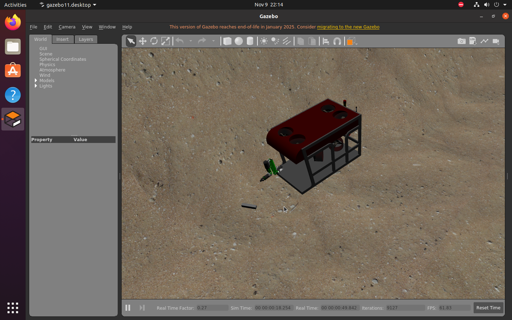
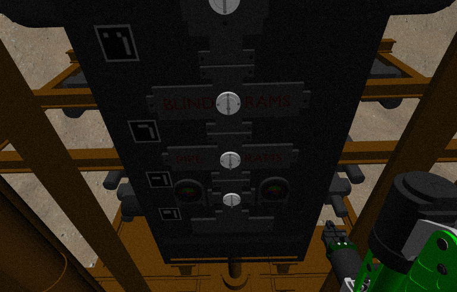
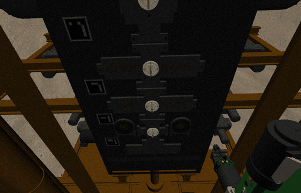
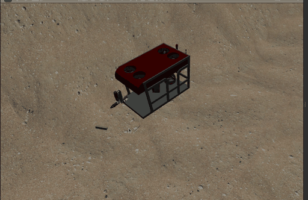

# DAVE 水下机器人仿真环境搭建与 REXROV/Oberon7 作业演示

> 本页对应源码模块：`src/water/dave_underwater_sim/`

## 1. 简介

**Project DAVE**（DAVE Aquatic Virtual Environment）是由美国海军研究生院
Field-Robotics-Lab 开发的开源水下机器人仿真环境（Apache-2.0），技术栈为
**ROS Noetic + Gazebo 11**。它支持：

- REXROV 等水下机器人（UUV）的动力学仿真与推进器控制；
- 多自由度水下机械臂（Oberon7）与夹爪的作业仿真；
- 水下相机、DVL、IMU、压力计、多波束前视声呐（可选 CUDA）等传感器；
- 海底地形/海流/波浪等环境要素。

本模块在 Ubuntu 20.04 虚拟机中完成 DAVE 及依赖的部署，并复现了官方 demo 中的
ROV 巡航与 **BOP 防喷器面板操控**场景，用于课堂作业演示。

## 2. 环境要求

| 项目 | 要求 |
|---|---|
| 操作系统 | Ubuntu 20.04（推荐；22.04 需使用官方 Docker 方案） |
| ROS | ROS Noetic |
| 仿真器 | Gazebo 11（建议 11.15+） |
| 硬件 | 4 核 CPU / 4 GB 内存起（VMware 实测 4 GB 可运行，8 GB 更流畅）；无独立显卡可运行（软件渲染，较慢） |
| 磁盘 | 约 5 GB（源码 + 编译产物） |

## 3. 安装

```bash
# 1) 安装 ROS Noetic desktop-full 与 Gazebo 11（已安装可跳过；install_dave.sh 会检查该前置）

# 2) 克隆本仓库并进入模块目录
git clone <本仓库地址>
cd ros2/src/water/dave_underwater_sim

# 3) 一键安装（前置检查 -> apt 依赖 -> 按固定 commit 下载 DAVE 及依赖 -> catkin 构建）
bash install_dave.sh
```

安装脚本会创建 `~/uuv_ws` 工作区，构建 demo 所需的 44 个包（catkin build，约 12 分钟）；
上游 8 个仓库均按实测可用的固定 commit 下载，避免分支漂移导致构建失败。

## 4. 运行演示

```bash
# 基础场景：REXROV + Oberon7 机械臂 + 海浪/海底地形
bash main.sh

# BOP 防喷器面板操控场景
bash main.sh valve

# 无界面（无 GPU 服务器）
bash main.sh demo headless
```

机械臂控制与相机采集：

```bash
source /opt/ros/noetic/setup.bash && source ~/uuv_ws/devel/setup.bash
python3 scripts/dave_arm_move.py       # 六关节 effort 动作 + 夹爪开合
python3 scripts/dave_save_camera.py    # 保存 /tmp/valve_cam_1.png
```

若同时装有 ROS 2，也可用 ament_python 封装启动（需 ROS 1 + ROS 2 共存）：

```bash
ros2 launch dave_underwater_sim main.launch.py            # demo 场景
ros2 launch dave_underwater_sim main.launch.py mode:=valve
```

## 5. 运行效果



*图 1：Gazebo 中的 REXROV（红色）与 Oberon7 机械臂、海底地形*



*图 2：水下相机视角，正对 BOP 防喷器面板（BLIND RAMS / PIPE RAMS），右侧为机械臂*



*图 3：机械臂在水下相机画面中运动（动图，约 2.4 MB）*



*图 4：Gazebo 中 REXROV 在海底上方运动（动图，约 1.5 MB）*

## 6. 实测数据

| 指标 | 数值 |
|---|---|
| 构建 | 44 个包成功，0 失败，约 11 分 53 秒 |
| 节点/话题 | 19 个节点 / 48 个话题（本次实测） |
| 带界面实时因子 | 0.30~0.54（VMware 软件渲染；800×600 实测 0.44~0.54） |
| Gazebo 场景帧率 | 约 60 FPS（800×600 实测 61.6 FPS；1920×1080 下更低） |
| 水下相机 | 768×492，`/rexrov/rexrov/camera/camera_image` |
| REXROV 位姿变化 | `/rexrov/cmd_vel`（x=0.6, y=0.2, z=0.15, yaw=0.1）下由 (4.00, 4.00, -93.05) 运动至 (5.06, 1.68, -93.24) |
| 机械臂关节 | oberon7 六关节 + 夹爪，关节角与夹爪开合均有变化 |

## 7. 已知限制

- 虚拟机无独立 GPU，带界面仿真实时因子偏低；课堂演示建议适当降低分辨率。
- 无摇杆时机械臂以 effort 指令控制，动作幅度有限；完整面板插拔作业建议使用官方
  摇杆 + MoveIt 流程。
- `valve` 场景 launch 会同时拉起 RViz 与 `rqt_image_view`（多窗口），无界面环境请用
  `demo headless` 或给 roslaunch 传 `gui:=false`。
- `plug` 场景未在本环境实测，如不可用请以 `demo`/`valve` 为准。
- ROS Noetic 已 EOL，启动时会出现 EOL 弹窗，可设置 `DISABLE_ROS1_EOL_WARNINGS=1` 屏蔽。
- 若需 Ubuntu 22.04（ROS 2 Humble），DAVE 官方提供 Docker（Dockwater）方案，本页未展开。

## 8. 参考

- DAVE 上游：<https://github.com/Field-Robotics-Lab/dave>
- DAVE 文档：<https://field-robotics-lab.github.io/dave.doc/>
- 本模块安装/运行脚本：`src/water/dave_underwater_sim/`

## 大模型使用声明

本页文档与配套脚本由 AI 助手辅助整理，所有命令和实验数据均在 Ubuntu 20.04 +
ROS Noetic + Gazebo 11 环境中实际运行验证，作者已核对并对内容负责。
