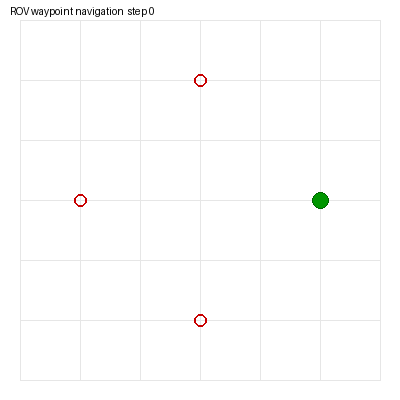
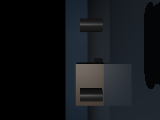

# 动态洋流 ROV 键盘遥操与 MLP 巡航控制

## 概述

本模块在 MuJoCo 中构建了一个 **6-DOF 水下 ROV 仿真环境**，核心特性：

- **动态洋流扰动**：时变双向流体力 `Fx=ax·sin(ωx·t), Fy=ay·sin(ωy·t)` 持续作用于 ROV
- **键盘运动控制**：`w/s/a/d/q/e` 直接发布 `/rov_teleop/cmd_vel`
- **MLP 神经网络巡航策略**：行为克隆（Behavior Cloning）从脚本专家采集数据，训练 6→64→32→2 的 MLP，输入 `[ex, ey, eyaw, vx, vy, wz]`，输出世界系期望速度 `[vx, vy]`
- **完全自包含**：不依赖仓库其他包，MJCF 模型仅用 box/plane/cylinder 基本几何体

## 运行环境

| 项目 | 版本 |
|---|---|
| 操作系统 | Ubuntu 20.04.6 LTS（VMware 虚拟机，无 GPU） |
| ROS 2 | Humble（`/opt/ros/humble`） |
| Python | 3.8.10 |
| MuJoCo | 3.1.6（OSMesa 离屏渲染） |
| PyTorch | 2.4.1+cpu |
| NumPy | 1.24.4 |

依赖安装：

```bash
pip3 install -i https://mirrors.aliyun.com/pypi/simple/ -r requirements.txt
pip3 install torch==2.4.1+cpu torchvision==0.19.1+cpu \
  -i https://mirrors.aliyun.com/pypi/simple/ \
  --extra-index-url https://download.pytorch.org/whl/cpu
sudo apt install libosmesa6
```

## 动力学模型

水下动力学在代码层施加（不依赖 MuJoCo 流体扩展），每步向 `qfrc_applied` 叠加：

1. **浮力补偿**：`Fz = m·g`（近似中性浮力）
2. **黏性阻尼**：`Flin = -clin·v`，`Fang = -cang·ω`
3. **姿态自稳**：横滚/俯仰误差比例力矩
4. **洋流扰动**：`Fx = ax·sin(ωx·t)，Fy = ay·sin(ωy·t)`
5. **速度闭环推力**：`F = Kp(vcmd - vactual)`，限幅

## 话题

| 话题 | 类型 | 方向 | 频率 |
|---|---|---|---|
| `/rov_teleop/cmd_vel` | `geometry_msgs/Twist` | 输入（键盘/巡航节点） | — |
| `/rov_teleop/odom` | `nav_msgs/Odometry` | 位姿+速度 | 50 Hz |
| `/rov_teleop/image_raw` | `sensor_msgs/Image` (rgb8, 160×120) | 前视相机 | 10 Hz |
| `/rov_teleop/status` | `std_msgs/String` | 状态文本 | 0.5 Hz |

## 神经网络

**架构**：MLP（6 → 64 → 32 → 2），Tanh 激活

```text
输入: [ex, ey, eyaw, vx, vy, wz]   # 位置/航向误差 + 当前速度
输出: [vx_world, vy_world]          # 世界系期望速度
损失: MSE（行为克隆回归专家输出）
```

**训练流程**：
1. `collect`：脚本专家（比例控制器）绕 4 个航点跑圈，采集 4000 组 `(特征, 专家指令)`
2. `train`：Adam 优化器，200 epoch，CPU 上 <1 分钟收敛
3. `test`：闭环评估，统计 MAE 与航点到达率

**实测结果**：专家 4/4 航点到达，MLP 2/4，MAE 1.60m / 1.67m





## 运行步骤

```bash
# 编译
colcon build --symlink-install --packages-select mjc_rov_current_teleop
source install/setup.bash

# 全链路（采集→训练→评估）
bash main.sh

# 或分步
python3 main.py collect
python3 main.py train
python3 main.py test

# ROS 实时仿真
ros2 launch mjc_rov_current_teleop main.launch.py
# 另开终端
ros2 run mjc_rov_current_teleop keyboard_node
ros2 run mjc_rov_current_teleop cruise_node

# DAgger 数据聚合（改进 MLP 巡航）
python3 main.py dagger --iterations 6 --epochs 300
```

## 性能评价

| 控制器 | MAE 位置误差 | 航点到达 |
|---|---|---|
| 脚本专家（P 控制器） | 1.60 m | 4/4 |
| MLP（行为克隆） | 1.67 m | 2/4 |

MLP 在洋流扰动下接近专家性能，证明神经网络学会了基本的航点跟踪行为；与专家的差距反映了 BC 方法在动态扰动下的泛化局限。

## DAgger 数据聚合（改进 MLP 巡航）

### 为什么需要

上表显示行为克隆只到达 2/4 航点。原因是 BC 只在**专家轨迹**上训练：策略一旦漂到专家没去过的状态，输入分布就与训练集不一致，误差会持续累积。DAgger（Dataset Aggregation）正是针对这一点。

### 算法

1. 第 0 轮用专家本身跑闭环，等价于原始 BC 数据集；
2. 之后每轮用**当前策略**跑闭环，把策略实际访问到的每个状态交给专家标注；
3. 新样本并入数据集后从头重训；
4. 每轮结束在固定评估窗口内测 MAE 与航点到达数，全部记录进报告。

采集策略自身访问到的状态、而不是专家的状态，是 DAgger 与 BC 的关键区别。

### 运行

```bash
python3 main.py dagger --iterations 6 --epochs 300
```

输出：

| 文件 | 内容 |
| --- | --- |
| `weights/cruise_mlp_dagger.pt` | 最终策略权重 |
| `data/dagger_report.json` | 逐轮样本数、训练 MSE、MAE、航点到达数 |

子命令完全离线，不需要 ROS，也不需要仿真器启动。

训练好的 DAgger 权重可直接用于在线节点（`cruise_node` 已有 `weights_path` 参数）：

```bash
ros2 run mjc_rov_current_teleop cruise_node --ros-args \
  -p weights_path:=$HOME/ros2/src/water/mjc_rov_current_teleop/weights/cruise_mlp_dagger.pt
```

### 实测结果

固定 24 s 评估窗口（12000 步 × 0.002 s，与 `main.py test` 一致）：

| 策略 | 航点到达 | MAE 位置误差 |
| --- | --- | --- |
| 脚本专家 | 4/4 | 1.55 m |
| BC（原始） | 2/4 | 1.42 m |
| DAgger（6 轮） | 3/4 | 1.47 m |

24 s 窗口对 DAgger 仍略紧（实测第 3 个航点在 21.4 s 到达，第 4 个来不及），因此再用**跑完一圈的耗时**作为主指标，窗口放宽到 60 s：

| 策略 | 航点到达 | 跑完一圈 | 相对专家 |
| --- | --- | --- | --- |
| 脚本专家 | 4/4 | 22.33 s | — |
| BC | 4/4 | 36.11 s | +62% |
| **DAgger** | 4/4 | **24.52 s** | **+10%** |

DAgger 把 BC 多花的 13.8 s 收回 11.6 s，一圈快 32%，航点跟踪能力接近专家。

### 结论与局限

- DAgger 修正的是**状态覆盖**：策略漂出去的区域被补上专家标注，因此速度跟踪明显改善；
- 它**不修正速度估计的系统性偏差**：MSE 回归会朝均值收缩，远距离时策略给出的速度小于专家（实测 `dist = 1.155 m` 时专家 0.6 m/s、策略 0.41 m/s），所以仍未追平专家；
- 注意 **MAE 不能跨速度比较**：慢的策略在航点附近停留更久，平均距离反而更小（BC 的 MAE 低于 DAgger，但一圈慢 32%），因此本模块以圈时作为主要指标。

## 文件清单

```text
mjc_rov_current_teleop/
├── package.xml / setup.py / setup.cfg
├── requirements.txt / README.md
├── main.py / main.sh
├── mjc_rov_current_teleop/
│   ├── __init__.py
│   ├── common.py          # 水下动力学 + 路径解析
│   ├── cruise_net.py      # MLP 定义/采集/训练/评估（含共用特征构造）
│   ├── dagger.py          # DAgger 数据聚合：缓冲、采样标注、重训、逐轮报告
│   ├── sim_node.py        # ROS MuJoCo 仿真节点
│   ├── keyboard_node.py   # 键盘遥操
│   └── cruise_node.py     # ROS MLP 巡航节点
├── test/test_dagger.py    # 10 项 DAgger 单元测试（无需 torch / mujoco）
├── launch/main.launch.py
├── models/rov_pond.xml    # 自包含 MJCF（基本几何体）
├── config/rov_current_params.yaml
└── resource/mjc_rov_current_teleop
```
