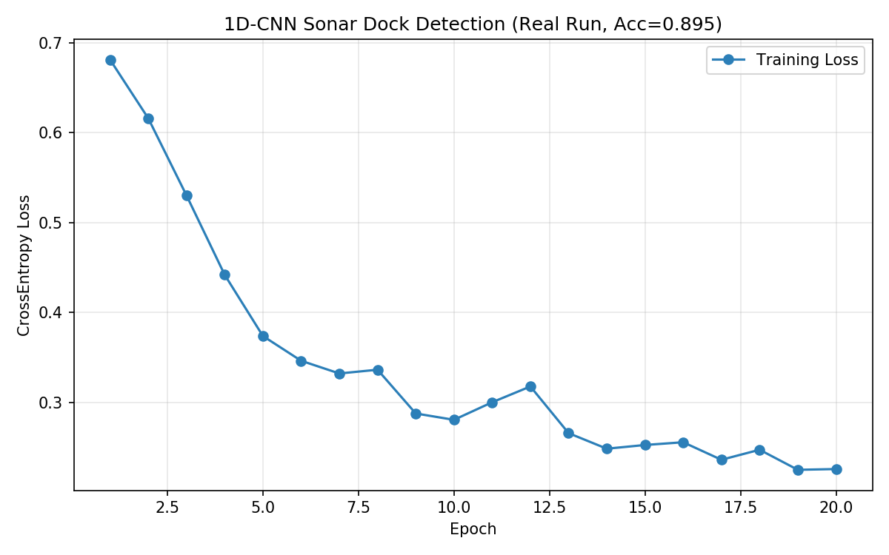
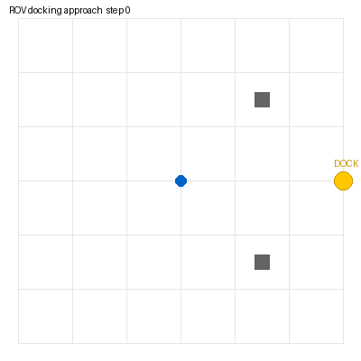

# 水下 ROV 对接任务：声呐扫描 + CNN 标记检测 + 逼近导航

> 包名：`mjc_rov_docking_nav`
> 仿真环境：MuJoCo 3.1.x + ROS 2 Humble（Ubuntu 20.04.6，Python 3.8.10）
> 神经网络：1D-CNN（声呐剖面二分类）

## 1. 概述与目标

本模块模拟 ROV 在水池中寻找并靠近水下对接站。与"声呐分类"和"PPO 跟踪"不同，这里关注的是**对接任务**：前视声呐扫描环境，CNN 判断前方是否有对接标记，检测到则自主逼近。

核心任务：
1. MuJoCo 水池场景：对接站（黄色标记柱）+ 两个障碍物
2. 模拟前视声呐扫描：32 个角度的距离剖面
3. 1D-CNN 判断声呐剖面中是否有对接标记
4. ROS 节点：检测到标记则发布前进推力

## 1.1 运行环境

| 项目 | 版本 |
|---|---|
| 操作系统 | Ubuntu 20.04.6 LTS（VMware 虚拟机，无 GPU） |
| ROS 2 | Humble（`/opt/ros/humble`） |
| Python | 3.8.10 |
| MuJoCo | 3.1.x（OSMesa 离屏渲染） |
| PyTorch | 2.4.1+cpu |
| NumPy | 1.24.4 |

依赖安装：

```bash
pip3 install -i https://mirrors.aliyun.com/pypi/simple/ -r requirements.txt
pip3 install torch==2.4.1+cpu torchvision==0.19.1+cpu \
  -i https://mirrors.aliyun.com/pypi/simple/ \
  --extra-index-url https://download.pytorch.org/whl/cpu
sudo apt install libosmesa6
```

## 2. 神经网络

```text
Input (1×32)
├─ Conv1d(1→16, 3) + ReLU + MaxPool → 16×16
├─ Conv1d(16→32, 3) + ReLU + MaxPool → 32×8
├─ Linear(256→64) + ReLU
└─ Linear(64→2)  # 0=无标记, 1=有标记
```

## 3. 实测结果

```text
[train] loss 0.7045 → 0.2270
[test] 对接标记检测准确率: 0.895 (179/200)
```





## 4. ROS 接口

| 话题 | 类型 | 说明 |
|---|---|---|
| `/rov_dock/odom` | nav_msgs/Odometry | ROV 位姿 |
| `/rov_dock/sonar_scan` | std_msgs/Float32MultiArray | 32 维声呐距离剖面 |
| `/rov_dock/cmd_vel` | geometry_msgs/Twist | 前进推力 |

## 5. 运行步骤

```bash
colcon build --symlink-install --packages-select mjc_rov_docking_nav
source install/setup.bash
bash main.sh
ros2 launch mjc_rov_docking_nav main.launch.py
```

## 6. 文件清单

```text
mjc_rov_docking_nav/
├── package.xml / setup.py / setup.cfg
├── main.py / main.sh
├── mjc_rov_docking_nav/
│   ├── common.py      # 前视声呐扫描（32 维距离剖面）
│   ├── dock_cnn.py    # 1D-CNN 训练 + 测试
│   ├── sim_node.py    # MuJoCo + ROS 发布声呐剖面
│   └── dock_node.py   # CNN 推理 + 逼近控制
├── launch/main.launch.py
├── models/rov_docking_pool.xml
└── config/dock_params.yaml
```
