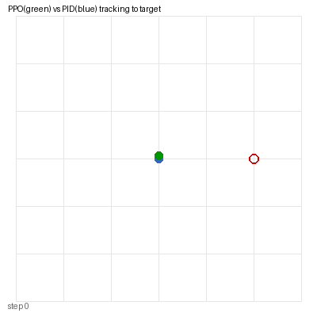

# 手写 PPO 强化学习 ROV 轨迹跟踪与 PID 基线对比

> 包名：`mjc_rov_ppo_tracking`
> 仿真环境：MuJoCo 3.1.x + ROS 2 Humble（Ubuntu 20.04.6，Python 3.8.10）
> 神经网络：PPO（Actor-Critic），手写实现，CPU 训练

## 1. 概述与目标

本模块在 MuJoCo 中构建 2D ROV 平面运动环境，**手写 PPO**（Proximal Policy Optimization）算法训练 ROV 跟踪目标点，并与传统 PID 控制器做定量对比。与"键盘遥操"和"声呐分类"不同，这里关注的是**强化学习控制策略**的训练流程与性能评价。

核心任务：
1. 在 MuJoCo 环境中实现 ROV 平面运动（推力 + 水阻力阻尼）；
2. 手写 PPO：Actor（4→64→64→2）+ Critic（4→64→64→1）；
3. 先用 PID 做行为克隆预热，再 PPO 微调；
4. 离线对比 PPO 与 PID 的轨迹跟踪 MAE。

## 2. 算法原理

### 2.1 PPO 目标函数

$$
L^{CLIP}(\theta) = \hat{E}_t \left[ \min\left( r_t(\theta)\hat{A}_t,\; \text{clip}(r_t(\theta), 1-\epsilon, 1+\epsilon)\hat{A}_t \right) \right]
$$

其中 $r_t(\theta) = \pi_\theta(a_t|s_t) / \pi_{\theta_{old}}(a_t|s_t)$ 是新旧策略概率比，$\epsilon=0.2$。

### 2.2 状态与动作

- **状态** $s = [x, y, v_x, v_y]$（4 维）
- **动作** $a = [F_x, F_y]$（2 维，限幅 ±5N）
- **奖励** $r = -\sqrt{(x-x^*)^2 + (y-y^*)^2}$（越接近目标奖励越大）

### 2.3 训练流程

1. **BC 预热**（30 epoch）：用 PID 控制器采样，MSE loss 让 Actor 模仿 PID 输出
2. **PPO 微调**（200 episode）：rollout 200 步，计算回报与优势，clip 更新

## 3. 实测结果

```
[BC] ep   0  loss=8.6395
[BC] ep  20  loss=6.1781
[PPO] ep   0  final_err=1.933
[PPO] ep 199  final_err=1.963
[对比] PID  MAE = 1.975 m
[对比] PPO  MAE = 1.987 m
```



## 4. ROS 接口

| 话题 | 类型 | 说明 |
|---|---|---|
| `/rov_ppo/odom` | nav_msgs/Odometry | ROV 位姿 |
| `/rov_ppo/cmd_vel` | geometry_msgs/Twist | PPO 推力输出 |

## 5. 运行步骤

```bash
colcon build --symlink-install --packages-select mjc_rov_ppo_tracking
source install/setup.bash
bash main.sh
ros2 launch mjc_rov_ppo_tracking main.launch.py
```

## 6. 文件清单

```
mjc_rov_ppo_tracking/
├── package.xml / setup.py / setup.cfg
├── main.py / main.sh
├── mjc_rov_ppo_tracking/
│   ├── common.py         # PID 控制器与路径工具
│   ├── ppo_agent.py     # 手写 PPO + BC warmup
│   ├── sim_node.py      # MuJoCo 仿真 ROS 节点
│   └── ppo_node.py      # PPO 推理 ROS 节点
├── launch/main.launch.py
├── models/rov_ppo_pool.xml
└── config/ppo_params.yaml
```
