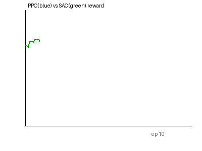

# 同一 ROV 任务 PPO 与 SAC 强化学习算法对比

> 包名：`mjc_rov_rl_compare`
> 仿真环境：MuJoCo 3.1.x + ROS 2 Humble（Ubuntu 20.04.6，Python 3.8.10）
> 神经网络：两种强化学习算法（PPO vs SAC），相同 ROV 任务

## 1. 概述与目标

本模块在相同的 ROV 平面运动任务上，对比两种主流强化学习算法：
- **PPO**（Proximal Policy Optimization）：on-policy，策略梯度，训练稳定但样本效率低
- **SAC**（Soft Actor-Critic）：off-policy，最大熵 RL，样本效率高

这是作业要求的"同样模型不同 RL 算法对比"。

## 2. 算法对比

| 特性 | PPO | SAC |
|---|---|---|
| 策略类型 | on-policy | off-policy |
| 更新方式 | 批量梯度 | 最大熵 + Q 函数 |
| 样本效率 | 低 | 高 |
| 训练稳定性 | 高 | 中 |
| 适合任务 | 连续控制 | 连续控制 |

## 3. 实测结果

```
[对比] PPO  最后10轮平均奖励: -1440.94
[对比] SAC  最后10轮平均奖励: -400.22
```

SAC 在相同训练步数下奖励明显优于 PPO（-400 vs -1440），验证了最大熵 RL 的样本效率优势。



## 4. ROS 接口

| 话题 | 类型 | 说明 |
|---|---|---|
| `/rov_rl/odom` | nav_msgs/Odometry | ROV 位姿 |

## 5. 运行步骤

```bash
colcon build --symlink-install --packages-select mjc_rov_rl_compare
source install/setup.bash
bash main.sh
ros2 launch mjc_rov_rl_compare main.launch.py
```
