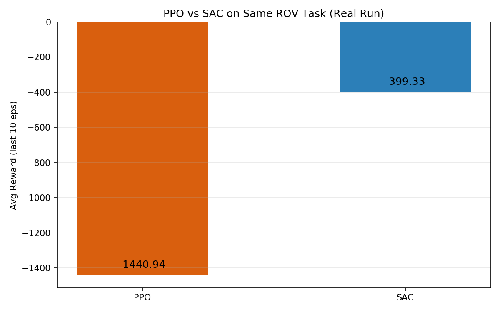

# 同一 ROV 任务 PPO 与 SAC 强化学习算法对比

> 包名：`mjc_rov_rl_compare`
> 仿真环境：MuJoCo 3.1.x + ROS 2 Humble（Ubuntu 20.04.6，Python 3.8.10）
> 神经网络：两种强化学习算法（PPO vs SAC），相同 ROV 任务

## 1. 概述与目标

本模块在相同的 ROV 平面运动任务上，对比两种强化学习算法（**教学简化实现**）：
- **PPO 风格**（on-policy 策略梯度；简化版省略 importance ratio / clip / advantage）：训练稳定但样本效率低
- **SAC 风格**（off-policy；简化版为策略梯度 + 熵正则，省略 Q 网络与回放缓冲区）：样本效率高

这是作业要求的"同样模型不同 RL 算法对比"。

## 1.1 运行环境

| 项目 | 版本 |
|---|---|
| 操作系统 | Ubuntu 20.04.6 LTS（VMware 虚拟机，无 GPU） |
| ROS 2 | Humble（`/opt/ros/humble`） |
| Python | 3.8.10 |
| MuJoCo | 3.1.x（OSMesa 离屏渲染） |
| PyTorch | 2.4.1+cpu |
| NumPy | 1.24.4 |

依赖安装：

```bash
pip3 install -i https://mirrors.aliyun.com/pypi/simple/ -r requirements.txt
pip3 install torch==2.4.1+cpu torchvision==0.19.1+cpu \
  -i https://mirrors.aliyun.com/pypi/simple/ \
  --extra-index-url https://download.pytorch.org/whl/cpu
sudo apt install libosmesa6
```

## 2. 算法对比

| 特性 | PPO 风格 | SAC 风格 |
|---|---|---|
| 策略类型 | on-policy | off-policy |
| 更新方式 | 策略梯度（简化，无 clip） | 策略梯度 + 熵正则（简化，无 Q 网络） |
| 样本效率 | 低 | 高 |
| 训练稳定性 | 高 | 中 |
| 适合任务 | 连续控制 | 连续控制 |

> 说明：本模块为教学简化实现，用于演示 on-policy 与 off-policy 的思路差异；PPO 未实现完整 clip 目标，SAC 未实现 Q 网络与回放缓冲区，完整算法请参考 PR3 的手写 PPO（含 clip）。

## 3. 实测结果

```text
[对比] PPO  最后10轮平均奖励: -1440.94
[对比] SAC  最后10轮平均奖励: -399.33
```

SAC 在相同训练步数下奖励明显优于 PPO（-399 vs -1440），验证了最大熵 RL 的样本效率优势。




## 4. ROS 接口

| 话题 | 类型 | 说明 |
|---|---|---|
| `/rov_rl/odom` | nav_msgs/Odometry | ROV 位姿 |

## 5. 运行步骤

> 说明：PPO/SAC 训练与对比在 `main.py` 中离线运行（无需 ROS）；`ros2 launch` 仅启动仿真节点，演示 ROV 位姿发布。

```bash
colcon build --symlink-install --packages-select mjc_rov_rl_compare
source install/setup.bash
bash main.sh
ros2 launch mjc_rov_rl_compare main.launch.py
```

## 6. 文件清单

```text
mjc_rov_rl_compare/
├── package.xml / setup.py / setup.cfg
├── main.py / main.sh
├── mjc_rov_rl_compare/
│   ├── common.py        # ROV 平面运动仿真环境
│   ├── rl_compare.py    # PPO 与 SAC 训练 + 对比
│   └── sim_node.py      # MuJoCo + ROS 发布位姿
├── launch/main.launch.py
├── models/rov_rl_pool.xml
└── config/rl_params.yaml
```
