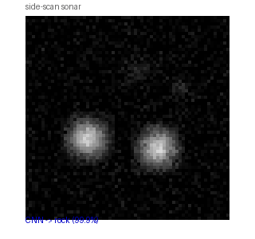
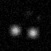
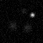
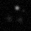

# 侧扫声呐图像仿真与 CNN 海底目标分类

> 包名：`mjc_rov_sonar_cnn`
> 仿真环境：MuJoCo 3.1.x + ROS 2 Humble（Ubuntu 20.04.6，Python 3.8.10）
> 神经网络：三层卷积 CNN，三分类（礁石 / 管道 / 残骸）

## 1. 概述与目标

本模块在 MuJoCo 水池场景中模拟 ROV 搭载侧扫声呐，**合成**声呐回波灰度图像，并用一个轻量 CNN 完成海底目标物三分类。与已有"声呐 SLAM 建图"不同，这里关注的是**声呐图像理解**：从声呐回波纹理判断下方是礁石、管道还是残骸，为后续水下巡检提供感知层输出。

核心任务：
1. 用 MuJoCo 场景几何生成合成声呐图像（64×64 mono8）；
2. 训练小型 CNN（3 层 Conv + 2 层 FC）做三分类；
3. ROS 节点实时订阅声呐图，发布分类结果。

## 1.1 运行环境

| 项目 | 版本 |
|---|---|
| 操作系统 | Ubuntu 20.04.6 LTS（VMware 虚拟机，无 GPU） |
| ROS 2 | Humble（`/opt/ros/humble`） |
| Python | 3.8.10 |
| MuJoCo | 3.1.x（OSMesa 离屏渲染） |
| PyTorch | 2.4.1+cpu |
| NumPy | 1.24.4 |

依赖安装：

```bash
pip3 install -i https://mirrors.aliyun.com/pypi/simple/ -r requirements.txt
pip3 install torch==2.4.1+cpu torchvision==0.19.1+cpu \
  -i https://mirrors.aliyun.com/pypi/simple/ \
  --extra-index-url https://download.pytorch.org/whl/cpu
sudo apt install libosmesa6
```

## 2. 物理仿真

### 2.1 场景模型（`models/rov_sonar_pool.xml`）

- 水池：10m×10m，带 checkerboard 池底；
- 三类目标物分布在池底：
  - **礁石**：3 个圆柱堆（灰褐色，弥散回波）；
  - **管道**：2 个横放长圆柱（黄褐色，细长强回波）；
  - **残骸**：2 个 box 碎块（深灰色，弱碎回波）；
- ROV：0.25m×0.15m×0.08m 浮筒，自由漂浮在水柱中层。

### 2.2 声呐图像合成

真实侧扫声呐回波强度随目标物材质、距离、掠射角变化。本模块用高斯亮斑近似：

```text
I(x,y) = Σ_i intensity_i · exp(-((x-px_i)² + (y-py_i)²) / (2σ_i²))
+ 高斯噪声 σ=0.05
```

- 礁石：σ=4，中等弥散；
- 管道：σ=2，细长强斑；
- 残骸：σ=3，弱碎斑。

## 3. 神经网络

### 3.1 CNN 结构

```text
Input (1×64×64)
├─ Conv2d(1→16, 3×3) + ReLU + MaxPool(2)   → 16×32×32
├─ Conv2d(16→32, 3×3) + ReLU + MaxPool(2)   → 32×16×16
├─ Conv2d(32→64, 3×3) + ReLU + MaxPool(2)   → 64×8×8
├─ Linear(4096→128) + ReLU
└─ Linear(128→3)
```

参数量约 548k（主要来自 Linear(4096→128) 的 524,416 个参数），CPU 上 30 个 epoch 约 5 秒收敛。

### 3.2 数据集

`SyntheticSonarDataset` 生成 600 张合成声呐图：随机 ROV 位置 + 随机 label，按 label 控制哪类目标物亮斑强度高（主目标 0.6~0.9，背景类 0.12~0.15）。

### 3.3 训练与测试结果

```text
[train] epoch  0/30  loss=0.9125
[train] epoch 10/30  loss=0.0000
[test] 合成测试集准确率: 1.000 (200/200)
```

三类声呐样例图（CNN 推理 probs 均为 1.0）：







## 4. ROS 接口

| 话题 | 类型 | 频率 | 说明 |
|---|---|---|---|
| `/rov_sonar/image_raw` | sensor_msgs/Image (mono8, 64×64) | 5 Hz | 合成声呐图 |
| `/rov_sonar/odom` | nav_msgs/Odometry | 20 Hz | ROV 位姿 |
| `/rov_sonar/classification` | std_msgs/String | 随图像 | CNN 分类结果 |

## 5. 运行步骤

```bash
# 编译
colcon build --symlink-install --packages-select mjc_rov_sonar_cnn
source install/setup.bash

# 离线训练 + 测试
cd src/water/mjc_rov_sonar_cnn
bash main.sh

# 开集识别（背景类 + 置信度拒识）
python3 main.py openset --epochs 30 --clutter 2

# ROS 实时仿真
ros2 launch mjc_rov_sonar_cnn main.launch.py
# 另开终端
ros2 run mjc_rov_sonar_cnn classify_node
```

## 6. 开集识别：背景类与置信度拒识

### 6.1 原评估的两个问题

- **测试集与训练集同源**：`SyntheticSonarDataset` 与 `test_cnn` 都从 `RandomState(42)` 起生成，测试集的 200 张正好是训练集的前 200 张；
- **任务过于平凡**：三类亮斑坐标几乎固定（礁石约 (1.5, 1.5)、管道约 (2.5, -1.5)、残骸约 (0.5, -2.5)），CNN 只要看"哪个固定位置最亮"就能分类。

实测：即使把测试集换成独立种子（`python3 main.py test --seed 1234`），准确率仍是 **1.000**。这说明 100% 不是"模型好"，而是**任务本身太容易**——该指标无法反映真实泛化能力。

### 6.2 新增能力

`open_set.py` 把任务改成**开集识别**：

1. **增加"背景"类**（第 4 类，无目标）。真实巡检中绝大多数画面没有目标，原实现要求每帧三选一，必然产生误报；
2. **目标位置逐样本随机**，模型只能依赖回波形状与尺度（三类 σ 分别为 4 / 2 / 3），而不是固定像素；
3. **叠加随机假目标（clutter）**，让"背景"与"有目标"不再是简单的整体亮度阈值问题；
4. **训练与测试使用互不相同的随机种子**；
5. **置信度拒识**：当最大 softmax 低于阈值 τ 时输出 `unknown`，把"我不确定"作为合法输出。

数据集构造、拒识判定与指标计算都只依赖 numpy，只有训练与推理需要 PyTorch。

### 6.3 运行

```bash
python3 main.py openset --epochs 30 --clutter 2
```

输出 `weights/sonar_cnn_openset.pt` 与 `data/openset_report.json`，并在终端打印阈值扫描表。

### 6.4 实测结果

训练 800 张（seed 42）、测试 400 张（**独立 seed 1234**）、每图叠加 2 个随机假目标：

| 拒识阈值 τ | 覆盖率 | 被接受准确率 | 背景误报率 |
|---|---|---|---|
| 0.000（不拒识） | 1.000 | 0.912 | 0.070 |
| 0.500 | 0.998 | 0.915 | 0.061 |
| 0.700 | 0.948 | 0.934 | 0.042 |
| 0.900 | 0.843 | 0.959 | 0.022 |
| **0.950** | **0.800** | **0.966** | **0.011** |
| 0.990 | 0.655 | 0.973 | 0.013 |

阈值取 0.95 时，**背景误报率从 7.0% 降到 1.1%（约 6 倍）**，代价是拒识 20% 的画面；被接受样本的准确率同时从 91.2% 升到 96.6%。这正是"覆盖率–准确率"权衡曲线的用途：巡检场景宁可少报，不可乱报。

### 6.5 单元测试

`test/test_open_set.py` 共 **17 项**，只依赖 numpy，不需要 PyTorch：数据集形状与类别均衡、同种子可复现、不同种子不同、目标图比背景图更亮、位置非常量、杂波提升能量、拒识阈值行为、指标（覆盖率 / 准确率 / 背景误报率）的精确值、输入校验。

## 7. 文件清单

```text
mjc_rov_sonar_cnn/
├── package.xml / setup.py / setup.cfg
├── main.py / main.sh
├── mjc_rov_sonar_cnn/
│   ├── common.py        # 声呐图像合成（支持传入 rng 复现噪声）
│   ├── cnn_model.py     # 三分类 CNN 定义 + 训练 + 测试（test 支持 --seed）
│   ├── open_set.py      # 背景类 + 置信度拒识：数据集、拒识、指标、训练
│   ├── sim_node.py      # MuJoCo + ROS 发布声呐图
│   └── classify_node.py # CNN 推理节点
├── test/test_open_set.py # 17 项开集识别单测（无需 torch / mujoco）
├── launch/main.launch.py
├── models/rov_sonar_pool.xml
├── config/sonar_params.yaml
└── resource/mjc_rov_sonar_cnn
```
