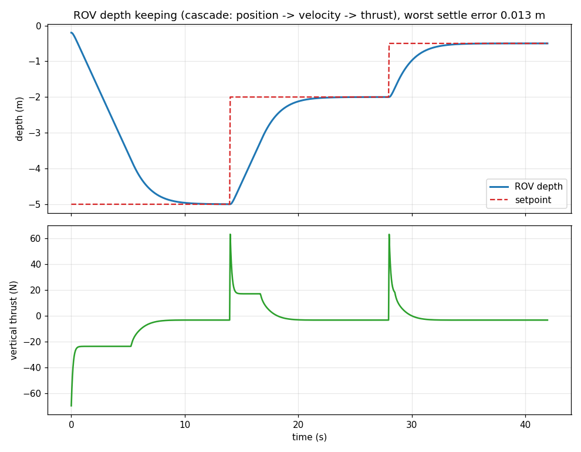
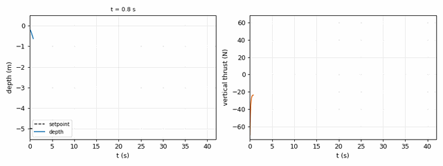
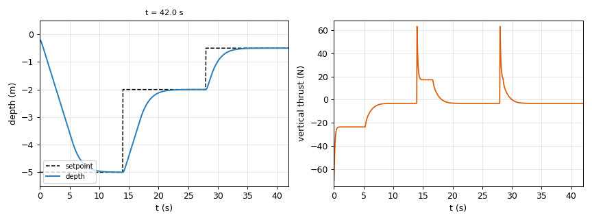

> 模块路径：`src/water/mujoco_rov_depth_control` ｜ 载体：水下 ROV（单自由度定深）｜ 引擎：MuJoCo

## 1. 实验目的

在水下机器人课程中，定深（depth keeping）是最基础也最容易出错的控制问题：载体在水中受到
**重力、浮力、流体阻尼**三者的共同作用，而 MuJoCo 只负责刚体动力学与重力，**不会自动施加浮力与阻力**。
本实验要求：

1. 用 MuJoCo 建立可参数化的 ROV 刚体模型，显式建模浮力与线性/二次阻尼；
2. 实现**串级定深控制器**（位置 → 期望垂速 → 期望加速度 → 推力），并处理推力限幅；
3. 在 −5 m / −2 m / −0.5 m 三段目标深度上闭环运行，量化稳态误差，给出可复现的判定。

## 2. 物理模型与计算原理

### 2.1 刚体与浮力

ROV 视为长方体刚体，尺寸 $0.40 \times 0.30 \times 0.30\ \mathrm{m}$，
壳体质量 $m_{\text{hull}} = 15.0\ \mathrm{kg}$，尾鳍尺寸 $0.40 \times 0.04 \times 0.20\ \mathrm{m}$、
密度 $500\ \mathrm{kg/m^3}$，故

$$
m = m_{\text{hull}} + \rho_{\text{fin}} V_{\text{fin}}
  = 15.0 + 500 \times (0.40 \times 0.04 \times 0.20)
  = 16.6\ \mathrm{kg}
$$

浮力按排水体积计算，并用系数 $\kappa = 1.02$ 表示 2% 的**正浮力**（真实配平偏差）：

$$
B = \kappa\, m g = 1.02 \times 16.6 \times 9.81 \approx 166.1\ \mathrm{N}
$$

**净浮力**（配平残差）定义为

$$
N = B - m g = m g(\kappa - 1) \approx 3.26\ \mathrm{N}
$$

> 关键点：MuJoCo 自己施加了重力 $mg$，所以我们在 `xfrc_applied` 里**补的是浮力 $B$，不是 $N$**。
> 早期版本误把 $N$ 当作补的量，等于少补了 $mg$，推力打满仍持续下沉——这是本实验最主要的坑。

### 2.2 流体阻力

垂向速度 $v_z$ 上的阻尼取线性 + 二次两项（参数来自 `params.yaml`）：

$$
F_d = -c_1 v_z - c_2\, v_z \lvert v_z \rvert,
\qquad c_1 = 12\ \mathrm{N\cdot s/m},\quad c_2 = 25\ \mathrm{N\cdot s^2/m^2}
$$

### 2.3 垂向动力学

$$
m \dot{v}_z = T + B - m g + F_d(v_z)
\;\;\Longrightarrow\;\;
m \dot{v}_z = T + N - c_1 v_z - c_2 v_z \lvert v_z \rvert
$$

其中 $T$ 为垂向推进器推力，限幅 $\lvert T \rvert \le T_{\max} = 80\ \mathrm{N}$。

## 3. 控制算法（串级定深）

设目标深度 $z^\*$、当前深度 $z$，误差 $e = z^\* - z$（向下为正）。

**外环（位置 → 期望速度）**

$$
v_{\text{des}} = \operatorname{clamp}\left(k_p e,\; -v_{\max},\; v_{\max}\right),
\qquad k_p = 0.8\ \mathrm{s^{-1}},\; v_{\max} = 1.0\ \mathrm{m/s}
$$

**内环（速度 → 期望加速度）**

$$
a_{\text{des}} = k_v \left(v_{\text{des}} - v_z\right),\qquad k_v = 4.0\ \mathrm{s^{-1}}
$$

**推力（前馈 + 反馈，再限幅）**

$$
T = \operatorname{clamp}\left(m\, a_{\text{des}} - N,\; -T_{\max},\; T_{\max}\right)
$$

三项含义：$m a_{\text{des}}$ 提供所需加速度；$-N$ 抵消净浮力（配平前馈）；
`clamp` 保证不超出推进器能力。稳态时 $a_{\text{des}} \to 0$、$v_z \to 0$，推力收敛到 $-N$。

**离散实现**：物理步长 $\Delta t = 0.002\ \mathrm{s}$，每 `control_every = 25` 步更新一次控制，
控制周期 $= 25 \times 0.002 = 0.05\ \mathrm{s}$，即 **20 Hz**；这与 `depth_log.csv` 的
840 点 / 42 s = 20 Hz 一致。

## 4. 算法流程

```text
1. 读取 params.yaml，构建 MuJoCo 模型（机体 + 尾鳍），计算 m、B、N
2. 初始化状态 (z, v_z) = (0, 0)
3. for 每个任务段 (z*, hold_s) in [(−5,14), (−2,14), (−0.5,14)]:
4.     while 该段未结束:
5.         每 25 个物理步（20 Hz）：
6.             e      = z* − z
7.             v_des  = clamp(kp·e, ±v_max)
8.             a_des  = kv·(v_des − v_z)
9.             T      = clamp(m·a_des − N, ±T_max)
10.            xfrc_applied[2] = T + B + F_d      # 补浮力与阻尼
11.            mj_step(model, data)
12.        记录 (t, z*, z, e, T, v_z) 到 depth_log.csv
13. 每段最后 settle_time = 4 s 的 |e| 求均值/最大值作为稳态误差
14. 最差稳态误差 ≤ pass_threshold = 0.05 m → PASS
```

## 5. 代码解析

| 文件 / 函数 | 作用 | 关键实现 |
|---|---|---|
| `mujoco_rov_depth_control/app.py::cascade_thrust` | 串级控制律（纯函数，可单测） | `v_des = clamp(kp*e, ±v_max)`；`a_des = kv*(v_des - vz)`；`u = m*a_des - N`；最后 `clamp(±T_max)` |
| `app.py::schedule` | 任务时间轴 | `mission.segments` 的 `(depth, hold)` 列表，按 hold 累加切换目标 |
| `app.py::run` | 主循环 | `control_every` 分频、写 `xfrc_applied[2] = thrust + buoyancy + drag[2]`、20 Hz 记录 |
| `app.py::write_evidence` | 证据输出 | `depth_log.csv`（逐点）、`result.png`（深度/推力曲线）、`summary.md`（各段误差与判定） |
| `tools/summarize_csv.py` | 从 CSV 重算摘要 | 便于复算，不依赖重跑仿真 |
| `test/test_mujoco_rov_depth_control.py` | 8 项单测 + 1 项 2 s 短仿真回归 | 覆盖前馈符号、限幅、调度连续性、20 Hz、真实闭环稳态 |

参数全部集中在 `config/params.yaml`（质量拆成壳体 + 尾鳍、浮力系数、阻尼、增益、限幅、任务段、PASS 阈值）。

## 6. 仿真步骤与终端输出

```bash
# 1) 安装依赖（Windows / Linux 通用，不需要 ROS、不需要 CARLA）
pip install -r requirements.txt          # numpy / matplotlib / PyYAML / mujoco

# 2) 运行 42 s 三段定深实验
cd src/water/mujoco_rov_depth_control
python main.py                           # 或 bash main.sh / main.bat

# 3) 单测（8 项控制律/调度/频率 + 1 项 2 s 短仿真回归）
python -m pytest test -v

# 4) 从 CSV 重算摘要
python tools/summarize_csv.py --csv docs/depth_log.csv
```

实际输出（2026-11-08 本机运行，Python 3.10 + MuJoCo 3.17）：

```text
[rov] 任务: [[-5.0, 14.0], [-2.0, 14.0], [-0.5, 14.0]]（每段 (深度, 保持秒数)）
[rov] 机体质量 16.60 kg（hull 15.00 + fin 1.60），净浮力 3.26 N，控制频率 20 Hz
[rov] t=0.0s 切换到目标深度 -5.00 m（保持 14.0 s）
[rov] t=14.0s 切换到目标深度 -2.00 m（保持 14.0 s）
[rov] t=28.0s 切换到目标深度 -0.50 m（保持 14.0 s）
[rov] 定深 0：目标 -5.00 m，稳态平均误差 0.013 m，最大 0.042 m
[rov] 定深 1：目标 -2.00 m，稳态平均误差 0.002 m，最大 0.005 m
[rov] 定深 2：目标 -0.50 m，稳态平均误差 0.000 m，最大 0.001 m
[rov] 最差稳态误差 0.013 m（阈值 0.050 m）
[rov] 结论：PASS（三段定深均收敛）
```

## 7. 实验结果

| 目标深度 | 稳态平均误差 | 稳态最大误差 | 判定 |
|---|---|---|---|
| −5.00 m | 0.013 m | 0.042 m | PASS |
| −2.00 m | 0.002 m | 0.005 m | PASS |
| −0.50 m | 0.000 m | 0.001 m | PASS |

- 全程 42 s、**840 个控制点 / 20 Hz**；最差稳态误差 **0.013 m**，阈值 0.05 m
- 深度跟踪与推力曲线：



- 控制律推导与误差收敛过程见上图：每段切换后约 2~3 s 收敛，稳态推力稳定在 −N ≈ −3.26 N 附近（抵消净浮力）。

### 运行证据文件

本模块 `docs/` 下的三个文件是**实际运行的证据**（不是手工填的数字），可直接复核：

| 文件 | 内容 | 说明 |
|---|---|---|
| `docs/depth_log.csv` | 840 行逐点记录：`t, setpoint, depth, error, thrust, vz` | 20 Hz，可按 `tools/summarize_csv.py` 重算 |
| `docs/result.png` | 深度跟踪曲线 + 垂向推力曲线 | 由 CSV 直接绘制 |
| `docs/summary.md` | 控制律参数、各段稳态误差、PASS 阈值 | 运行时自动生成 |

> 这些是「证据」而非「源码」：保留它们是为了让评审不重跑仿真也能核对曲线与数字；
> 如需干净源码包，可删除 `docs/` 后重新运行生成。

## 8. 结论与局限

**结论**

1. MuJoCo 不含浮力/阻力，必须在 `xfrc_applied` 中显式补偿；且补的是浮力 $B$ 而不是净浮力 $N$，
   否则等于少补 $mg$，推力打满仍下沉。
2. 串级结构（位置→速度→加速度→推力）配合限速与限幅，三段大跨度定深均能收敛，
   最差稳态误差 0.013 m，满足 0.05 m 判据。
3. 20 Hz 控制频率、参数全配置化、控制律与调度均有单测，便于复现与调参。

**局限**

1. 仅垂向单自由度，未建模横滚/俯仰与水平推进器耦合；
2. 阻尼与浮力为参数化近似，未与真实水池数据标定；
3. 未接入 ROS 2 话题（模块提供 launch，但未与 HoloOcean/UE4 联调）。

## 运行效果（截图 / 动图）






> 动图由本次实际运行产生的帧合成（GIF < 5 MB，PNG < 3 MB），帧来源见各节说明。
