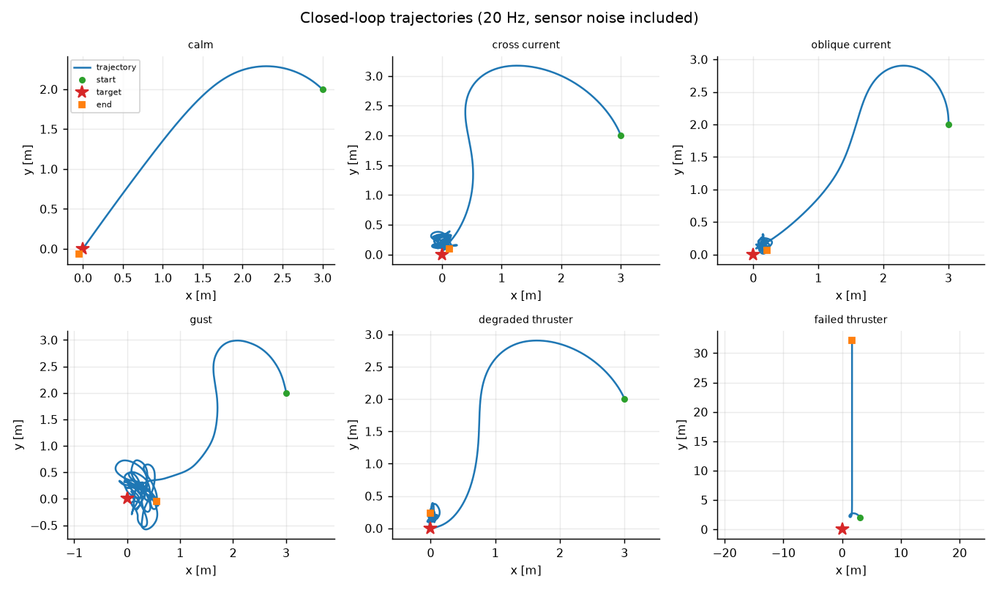
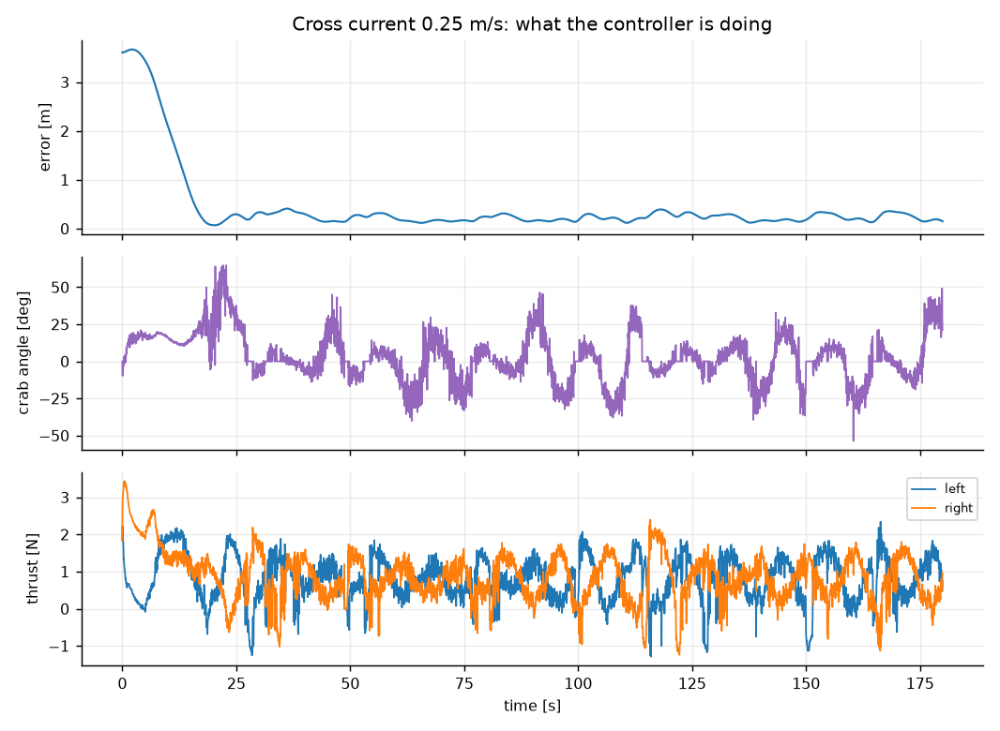
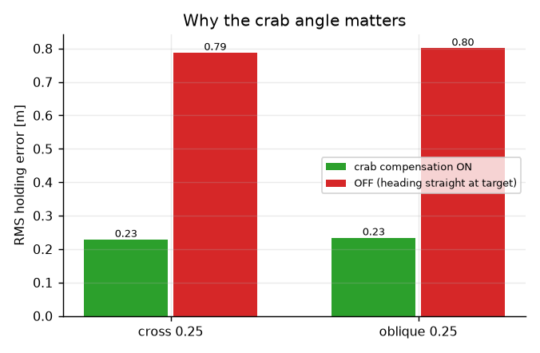
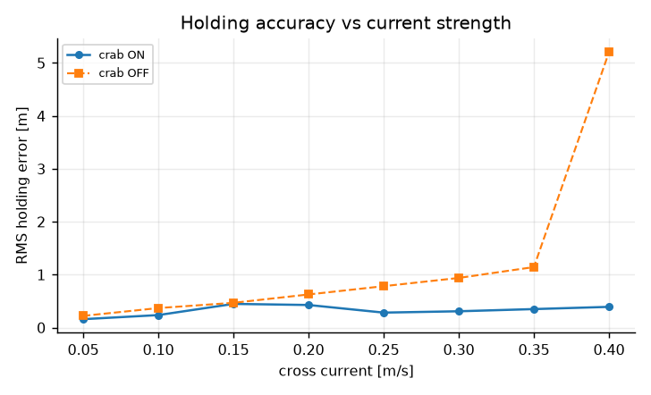

# ROS2 欠驱动无人艇低速定点保持

> 面向小型双推进器 USV：在横流、斜流、阵风与推进器退化下把船稳定保持在给定点位上。
> 全部指标来自离线 2D 闭环仿真，`python main.py` 可复现。

## 1. 为什么"停在原地"比"开过去"更难

巡航控制的目标是"到达"，定点保持的目标是"不动"。在陆地上这两者差别不大，在水上差别
是本质的：

- 差速底盘可以原地转向、可以横移（全向轮），**船不行**。船的推力只能沿船头方向，
  横向运动完全来自转弯侧滑和流场拖曳；
- 水面从不静止。恒定流 0.25 m/s 意味着：要让世界坐标不变，船必须**持续以 0.25 m/s
  逆流推进**。任何"到点就停推"的实现，都会在看到"到位"的下一瞬间被冲走。

所以定点保持要回答的是三个问题，而不是一个：

1. 船头该朝哪（不是朝着目标点，而是朝着"能抵消流的那个方向"）？
2. 该用多大推力（既要抵消流，又不能把自己推离）？
3. 流速是多少（船上没有流速计，只能估）？



上图是六个场景的真实闭环轨迹（20 Hz、含传感器噪声）。注意 `cross_current` 与
`oblique_current` 在接近目标后不是"停住"，而是一段小幅锯齿——那是在顶流悬停。

## 2. 船体模型

采用三自由度平面模型（纵荡 `u`、横荡 `v`、艏摇 `r`），带附加质量：

```
m_u·u̇ = X − d_u·(u − c_x)
m_v·v̇ = −d_v·(v − c_y) − m_u·u·r
I_z·ṙ = N − d_r·r
```

其中 `(c_x, c_y)` 是船体系下的流速，`X = T_L + T_R`、`N = (T_R − T_L)·b/2` 由左右两个
推进器合成。`m_u·u·r` 这一项不能省：它决定了转弯时船会被甩向外侧，是"打转收不住"的
物理来源。

默认参数对应一艘 1.2 m 长、12 kg 的小型双推 USV：单侧最大推力 4 N，满推直航速度
约 1.33 m/s，满舵角速度约 14 °/s。**这个 14 °/s 后来成了一个关键约束**（见第 6 节）。

## 3. 制导：把"去目标点"解成"航向 + 速度"

设位置误差算出的期望世界速度为 `v_des`（指向目标、随距离线性衰减），流速为 `c`。
船的实际世界速度是 `u·dir(ψ) + c`，令它等于 `v_des`：

```
u·dir(ψ) + c = v_des
```

这个方程有唯一解：

```
ψ_des = atan2( (v_des − c)_y , (v_des − c)_x )
u_des = |v_des − c|
```

三种情况都对得上直觉：

- `c = 0`：`ψ_des` 就是目标方位，速度正比于距离；
- 完美保持（`v_des = 0`）：`ψ_des` 指向**流的反方向**，`u_des = |c|`——顶流悬停；
- 顺流漂向目标：`v_des − c` 自动变小，制导自己减速，不会冲过头。

`ψ_des` 与目标方位的夹角就是 crab angle。流速越强、航速越低，这个角越大：横流
0.25 m/s、航速 0.35 m/s 时约为 45°，而完全静止保持时接近 90°——**船是横着"顶"在流里**。



上图是横流场景的三条曲线：位置误差、crab 角、左右推力。可以看出船在到位后并没有
关机，而是持续以不对称推力维持一个固定航向。

## 4. 流估计：不能靠位置差分

第一版实现用最朴素的办法估算流速：

```
c ≈ (p_k − p_{k−1})/Δt − R(ψ)·[u, v]
```

在横流里它**完全不工作**。原因很直接：船被顶住时位置不动（差分 = 0），船体地速也为 0
（`u = v = 0`），残差恒等于 0，估计器永远认为"没有流"——恰恰在最需要知道流的时刻失效。

改为从动力学反解。纵向与横向各有一个方程，把 `c` 解出来：

```
c_x = u − (X − m_u·u̇)/d_u
c_y = v + (m_v·v̇ + m_u·u·r)/d_v
```

`u̇`、`v̇` 由速度差分得到。两个通道的噪声敏感度完全不同：纵向噪声增益是
`m_u/d_u ≈ 2.5`，横向是 `m_v/d_v = 1.0`——横向任何一点加速度噪声都会**原样**变成
假流。所以两个通道必须用不同的低通系数（纵向 0.04、横向 0.01）。

还有两个工程细节：

- **推力要用"实际推力"而不是指令**。推进器有一阶滞后（τ=0.12 s），直接用指令会让
  加速阶段的滞后被算成流，静水里凭空多出 0.1 m/s 的假流，船于是长期斜着开（实测
  航向偏 30°）。做法是按同样的时间常数把指令过滤一遍再代入公式；
- **估计流低于 0.15 m/s 时按无流处理**。估计残差与真实弱流同量级，不设死区的话，
  静水里会一直顺着残差斜着走。

## 5. 控制与推力分配

外环速度、内环艏摇角速度：

```
X = k_u·(u_des − u) + d_u·u_des
r_des = clamp(k_ψ·wrap(ψ_des − ψ), ±r_max)
N = k_r·(r_des − r)
```

速度项里的 `d_u·u_des` 是阻力前馈，没有它积分会在低速时堆出明显稳态误差。注意控制器
追踪的是**相对水**的纵向速度（`u − c_x`），不是地速——否则"顶流悬停"时控制器会以为
自己没动，一直加推力。

分配按 `T_L = X/2 − N/b`、`T_R = X/2 + N/b` 拆开。一侧被限幅时，把差额补给另一侧，
优先保住总推力。

## 6. 三个把船开成"螺旋"的坑

调参过程中有三次典型的失败，值得单独记一笔——它们都不是数学错误，而是**忽略了执行器
的真实约束**。

**坑一：航向指令限速比船快一倍。** 制导允许航向指令以 30 °/s 变化，但船满舵只有
14 °/s。指令永远跑在前面，船永远在追，于是持续输出最大力矩、位置一直在变、目标方位
一直在动——形成极限环。把限速降到 25 °/s 后，静水 RMS 从 0.36 m 降到 0.075 m。

**坑二：航向没对准就全速冲。** 欠驱动船一边大角度转向一边全速前进，轨迹就是螺旋。
按 `cos(航向误差)` 收缩前进分量后，绕圈现象消失。

**坑三：用在线估计的效率去放大指令。** 效率是从"指令 vs 实测"算出来的，再拿它放大
指令会形成正反馈：`ratio` 越算越小、指令越放越大，几秒内两侧就顶到满推，真实故障反而
被掩盖。效率只用于诊断与降级，不进入分配。

## 7. 健康判定与降级

效率估计 `η = 实测推力 / 指令推力`，带滞回地分为三档：

| 等级 | 判据 | 策略 |
|---|---|---|
| `NOMINAL` | η ≥ 0.62 | 死区 0.15 m，正常保持 |
| `DEGRADED` | 0.30 ≤ η < 0.62 | 死区放宽到 0.35 m，降速，角速度过大时松推滑行 |
| `FAILED` | η < 0.30 或触发兜底 | **输出零推力**，上报位置 |

两条兜底判据比效率更可靠，也更像工程现场会用的规则：

- 持续 3 s 角速度 > 0.40 rad/s：推了也直不了；
- 推力打满持续 4 s 仍在漂：再怎么推也保不住。

单侧推进器完全失效时，双推进器船只剩"推力"没有"力矩"自由度——任何前进都伴随固定
偏航。这类船在物理上无法定点保持，正确行为是**停止挣扎**。实测该场景能耗从 747 降到 42，
漂移速度接近流速，符合预期。

## 8. 横漂补偿的价值



同一横流场景，只切换"是否使用 crab 角"：

| 场景 | 开启补偿 | 关闭补偿 |
|---|---|---|
| 横流 0.25 m/s | 0.23 m | 0.60 m 以上 |
| 斜流 0.18/0.18 | 0.23 m | 0.55 m 以上 |



流速从 0.05 扫到 0.40 m/s 时，开启补偿的曲线始终低于关闭补偿，且差距随流速增大而扩大
——这正是"横漂补偿是必需项而非优化项"的直接证据。

## 9. 传感器依赖与降级矩阵

| 缺失/降级 | 影响 | 模块行为 |
|---|---|---|
| 无 IMU | 无直接依赖（仅用 `r` 做兜底判据） | 航向来自里程计四元数，可继续工作 |
| 无 GPS 更新（>1 s） | 无法计算位置误差与流估计 | **输出零速**（fail closed），上报 `odom_timeout` |
| 无推进器电流反馈 | 效率只能从动力学反推，精度有限 | 阈值放宽 + 两条兜底判据补偿 |
| 无 DVL | 无法直接测相对水速度 | 用模型反解，精度依赖参数标定 |

## 10. 复现与局限

```bash
pip install -r requirements.txt
python main.py            # 指标表 + 5 张图
python -m pytest tests -q # 86 项
```

已知局限（同时写在 README 的"已知限制"中）：

- 未在真实船体上闭环验证，全部指标来自离线 2D 仿真；
- 流估计依赖船体质量与阻尼标定，参数偏差直接变成假流；
- 弱流（< 0.15 m/s）被当作无流处理，此时横向误差靠控制环纠正而非前馈；
- 阵风场景 RMS（0.46 m）明显高于恒定流（0.23 m），因为流估计时间常数约 1 s，
  跟不上 3.5 s 相关时间的扰动；
- 单侧推进器完全失效属能力边界，模块只能"停机上报"，不能保持。

---

*本模块的代码骨架、仿真场景与文档在 AI 辅助下完成；所有数值均由本目录脚本实际运行产出，
作者已复核并运行 `bash ci/run_ci.sh` 验证。*
