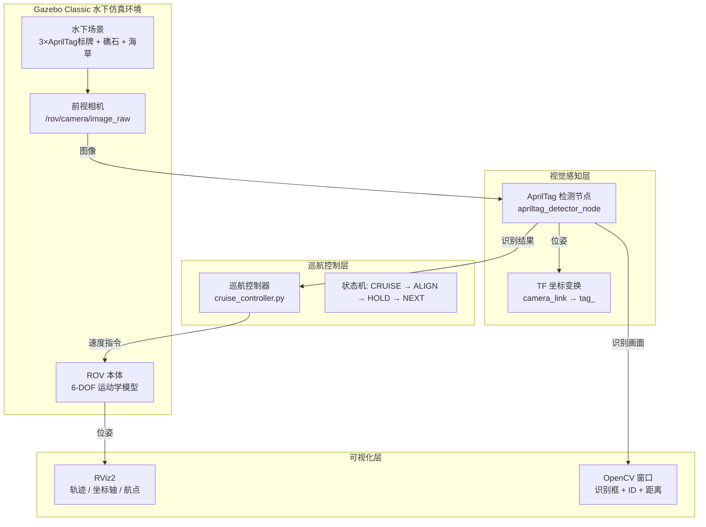
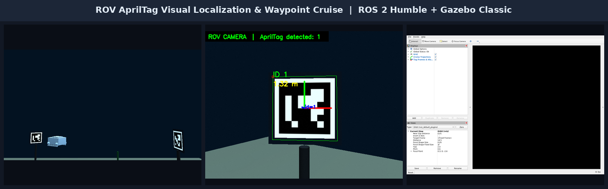
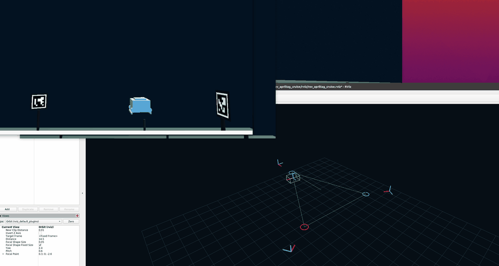
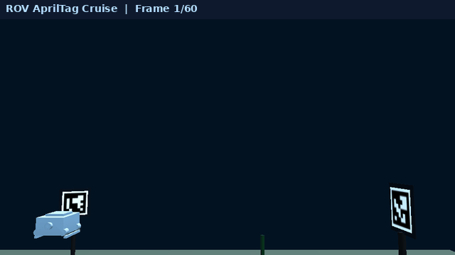
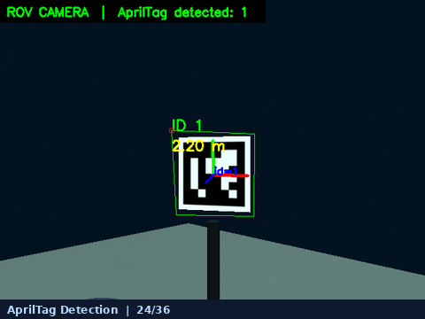
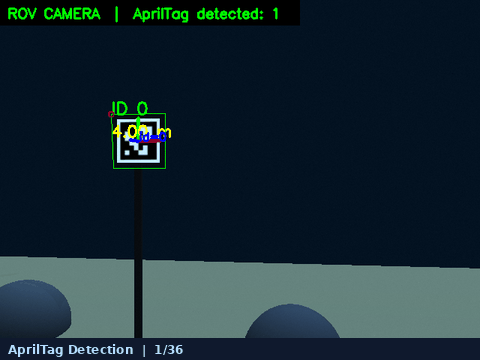

# 水下 ROV AprilTag 视觉定位与定点巡航仿真

---

## 1. 作业概述与背景

在水下机器人（ROV）作业任务中，**视觉伺服定位**与**定点巡航**是两项核心技术。受水下光线衰减、浑浊度、遮挡等因素影响，纯光学视觉定位极具挑战。AprilTag 作为一种高鲁棒性、易部署的基准标记（Fiducial Marker），被广泛应用于水下机器人定位、码头对接、结构物巡检等场景。

本模块基于 **ROS 2 Humble + Gazebo Classic 11**，构建了一套完整的水下 ROV AprilTag 视觉定位与定点巡航仿真系统：

- **水下场景**：包含 3 块 AprilTag 标牌（ID 0/1/2）、礁石、海草、海底地形，模拟真实水下环境。
- **视觉识别**：ROV 前视相机实时检测 AprilTag，输出标签 ID、相对位姿（x, y, z）与距离。
- **姿态调整**：检测到标签后，ROV 自动调整航向与位置，使标签位于视野中心。
- **定点巡航**：依次飞往 3 个标签点，到达后悬停识别，完成循环巡航。
- **可视化**：RViz 实时显示巡航轨迹、标签坐标系、ROV 位姿与航点标记。



---

## 2. 运行环境

| 项目 | 版本 / 说明 |
| :--- | :--- |
| 操作系统 | Ubuntu 22.04 LTS (Jammy) |
| ROS 版本 | ROS 2 Humble Hawksbill |
| 仿真器 | Gazebo Classic 11.13.0 |
| 视觉库 | OpenCV 4.2 (ArUco 模块) |
| 编程语言 | C++ (检测节点) + Python (巡航控制器) |
| 构建工具 | colcon / ament_cmake |
| 显卡 | 支持 OpenGL 2.1+（虚拟机需开启 3D 加速） |

!!! note "依赖安装"
    本模块依赖以下 ROS 2 包，系统默认已包含在 `ros-humble-desktop` 中：
    - `gazebo_ros`（Gazebo-ROS 桥接）
    - `cv_bridge`（ROS-OpenCV 图像转换）
    - `tf2_ros`（坐标变换）
    - `nav_msgs` / `visualization_msgs`（轨迹与标记）

    若缺少 OpenCV ArUco 模块，请安装：
    ```bash
    sudo apt install libopencv-dev libopencv-aruco-dev
    ```

---

## 3. 核心代码文件清单

| 文件路径 | 功能说明 |
| :--- | :--- |
| `src/water/rov_apriltag_cruise/src/apriltag_detector.cpp` | AprilTag 检测节点：订阅相机图像，检测标签，发布位姿与 TF |
| `src/water/rov_apriltag_cruise/scripts/cruise_controller.py` | 巡航控制器：状态机管理航点切换、视觉对准、悬停保持 |
| `src/water/rov_apriltag_cruise/world/underwater_apriltag.world` | Gazebo 水下世界：场景、标牌、光照、雾效、第三人称相机 |
| `src/water/rov_apriltag_cruise/urdf/rov.urdf` | ROV 机器人模型：几何、碰撞体、相机传感器 |
| `src/water/rov_apriltag_cruise/config/cruise.yaml` | 巡航参数：航点坐标、速度、悬停时间、检测距离 |
| `src/water/rov_apriltag_cruise/launch/apriltag_cruise.launch.py` | 一键启动文件：Gazebo + 检测 + 巡航 + RViz |
| `src/water/rov_apriltag_cruise/rviz/rov_apriltag_cruise.rviz` | RViz 配置：网格、轨迹、航点、坐标轴显示 |
| `src/water/rov_apriltag_cruise/models/apriltag_*/` | 标牌模型：SDF 定义 + 材质纹理 |

---

## 4. 运行步骤

### 4.1 编译功能包

```bash
cd ~/ros2
colcon build --packages-select rov_apriltag_cruise
source install/setup.bash
```

### 4.2 一键启动仿真

```bash
ros2 launch rov_apriltag_cruise apriltag_cruise.launch.py
```

启动参数说明：

| 参数 | 默认值 | 说明 |
| :--- | :--- | :--- |
| `gui` | `true` | 是否显示 Gazebo 客户端窗口 |
| `rviz` | `true` | 是否启动 RViz 可视化 |
| `show_camera_gui` | `true` | 是否显示 OpenCV 识别窗口 |

示例（无界面模式，仅后台运行）：

```bash
ros2 launch rov_apriltag_cruise apriltag_cruise.launch.py gui:=false rviz:=false show_camera_gui:=false
```

### 4.3 验证运行状态

```bash
# 查看话题
ros2 topic list | grep rov

# 查看 AprilTag 检测结果
ros2 topic echo /rov/tag_detections

# 查看巡航状态
ros2 topic echo /rov/status

# 查看 TF 变换
ros2 run tf2_ros tf2_echo camera_link tag_0
```

---

## 5. 效果图

### 5.1 三栏总览



从左至右依次为：

1. **Gazebo 第三人称视角**：ROV 在水下场景中巡航，可见 3 块 AprilTag 标牌、礁石与海草。
2. **ROV 相机识别窗口**：实时显示 AprilTag 识别框、ID 编号、距离（米）与坐标轴。
3. **RViz 可视化**：左侧 Displays 面板显示 Grid、Cruise Trajectory、Tag Frames & Waypoints。

### 5.2 ScreenToGif 实录：三窗口联动巡航



使用 ScreenToGif 对虚拟机桌面实时录制的完整巡航过程，画面同时包含：

- **左上**：Gazebo 第三人称场景相机 —— ROV 在水下环境中飞向 AprilTag 标牌；
- **右上**：ROV 前视相机识别窗口 —— 实时识别框、标签 ID、距离与坐标轴；
- **下方**：RViz 可视化 —— 巡航轨迹（绿色）、航点圆圈、标签坐标系与 ROV 位姿实时更新。

### 5.3 巡航过程 GIF（场景相机视角）



ROV 依次飞往 TAG 0 → TAG 1 → TAG 2 → TAG 0 循环巡航，到达每个标签后自动悬停并进行视觉对准。

### 5.4 AprilTag 检测特写



识别画面包含：

- 绿色识别框：标签边界
- `ID X`：标签编号
- `X.XX m`：ROV 与标签的直线距离
- 彩色坐标轴：标签坐标系（X-红，Y-绿，Z-蓝）

### 5.5 检测过程 GIF



展示 ROV 从远距离接近标签、识别框逐渐放大、距离读数减小的完整过程。

---

## 6. 技术要点

### 6.1 AprilTag 检测参数调优

针对水下低光照、低对比度环境，对 OpenCV ArUco 检测器进行了专项调优：

```cpp
detector_params_ = cv::aruco::DetectorParameters::create();
detector_params_->adaptiveThreshWinSizeMin = 3;
detector_params_->adaptiveThreshWinSizeMax = 23;
detector_params_->adaptiveThreshWinSizeStep = 2;
detector_params_->minMarkerPerimeterRate = 0.01;
detector_params_->cornerRefinementMethod = cv::aruco::CORNER_REFINE_SUBPIX;
// 标牌为「白色底板 + 黑色标记」，开启反转检测才能稳定识别
detector_params_->detectInvertedMarker = true;
```

关键发现：本机 OpenCV 4.2 环境下，`detectInvertedMarker = true` 是稳定识别「白底黑标」AprilTag 的必要条件。

### 6.2 巡航状态机

巡航控制器采用有限状态机（FSM）管理任务流程：

| 状态 | 行为 |
| :--- | :--- |
| `CRUISE` | 向目标航点飞行，线速度 0.55 m/s |
| `VISUAL ALIGN` | 检测到标签后，调整航向使标签居中 |
| `HOLD` | 到达悬停点，保持位置 2.5 秒，持续识别 |
| `NEXT` | 切换至下一航点，循环执行 |

### 6.3 水下视觉增强

- **雾效模拟**：Gazebo `<fog>` 标签设置 density=0.025，模拟水下能见度衰减。
- **环境光**：ambient 设置为 (0.30, 0.45, 0.58)，模拟深水蓝绿色调。
- **重力补偿**：世界重力设为 0，通过浮力与推力平衡实现中性浮力。

---

## 7. 相关链接

- [水下机器人物理仿真与 6-DOF 键盘运动控制](./rov_physical_simulation.md)
- [水下多传感器感知与 3D 轨迹跟踪控制](./rov_trajectory_tracking.md)
- [水下声呐 SLAM 占据栅格建图与自主避障导航](./rov_sonar_slam_navigation.md)

---

!!! tip "大模型声明"
    本模块代码与文档由大模型辅助生成，核心算法与参数经人工调试验证。
