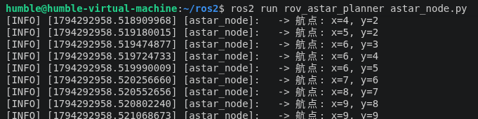

# 水下机器人 A* 路径规划初步验证

## 一、项目介绍

本项目是一个独立的 ROS 2 功能包 `rov_astar_planner`。在前期实现水下机器人物理仿真与 SLAM 建图的基础上，本项目进一步研究水下自主导航的核心算法——路径规划。通过构建二维栅格地图（包含静态障碍物），利用 A* (A-Star) 启发式搜索算法，为水下机器人规划出一条从起点到终点的无碰撞最优路径。

## 二、运行环境

- 操作系统：Ubuntu 22.04 (虚拟机)
- ROS 版本：ROS 2 Humble Hawksbill
- 编程语言：Python 3.10
- 依赖功能包：rclpy, math (Python 内置库)

## 三、项目结构

```text
src/rov_astar_planner/
├── scripts/
│   └── astar_node.py            # 核心算法节点
├── CMakeLists.txt               # 编译文件
├── package.xml                  # ROS 2 包清单
└── README.md                    # 运行说明
```

## 四、核心算法与源码解析

1. 环境地图构建：在代码中定义了一个 10x10 的二维数组 self.grid，其中 0 代表自由水域（可通行），1 代表障碍物（如礁石）。
2. 启发式函数 (Heuristic)：采用欧几里得距离（math.sqrt((x1-x2)^2 + (y1-y2)^2)）作为估算代价，指引算法快速向目标点逼近。
3. A 搜索过程*：
   · 维护 open_set（待考察节点）和 came_from（父节点追踪）。
   · 支持 8 个方向的节点扩展（上下左右及对角线）。
   · 通过计算 g_score（起点到当前点的实际代价）和 f_score（实际代价 + 预估代价），每次从 open_set 中挑选 f_score 最小的节点进行扩展。
4. 路径回溯：当搜索到终点 goal 时，通过 came_from 字典逆向回溯，最终输出从起点到终点的完整坐标序列。

## 五、运行步骤

1. 编译工作空间

```bash
cd ~/ros2
colcon build --packages-select rov_astar_planner
source install/setup.bash
```

2. 运行路径规划节点

```bash
ros2 run rov_astar_planner astar_node.py
```

## 六、运行效果

节点启动后，A* 算法会立即在地图中进行搜索，并在终端打印出计算出的最优路径坐标点：



## 七、实验总结

本次实验成功在 ROS 2 框架下开发了独立的 A* 路径规划节点。实验结果表明，A* 算法能够有效地避开地图中的预设障碍物，并规划出一条从起点到终点的最优路径。该模块的完成为后续将路径规划算法与 MuJoCo 物理仿真、声呐 SLAM 结合，实现水下机器人的全自动闭环导航打下了坚实基础。