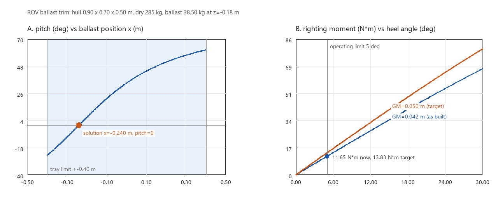

# ROV 浮力-压载配平与初稳性核算

ROV 下水前第一件事不是写控制律，而是**配平**：把压载挂到对的位置，让净浮力为零、横倾纵倾归零，
并留下足够的初稳心高。这三件事任何一件没做好，推进器和控制器都要替配重背锅——上浮下沉要靠推力顶，
姿态偏差要靠推力掰，最后表现为"这个 ROV 不好控"。

本模块用静水静力学把这套账算清楚，只依赖 Python 标准库，不需要 NumPy、Matplotlib 或 ROS；
配图由 `tools/make_figures.py` 用 Pillow 从同一套函数生成。

## 全潜 ROV 与水面船的差别（最容易算错的一处）

```text
水面船     GM = BM - (z_G - z_B),   BM = I_waterplane / V
全潜 ROV   GM = z_B - z_G                        没有 BM 项
```

水面船横倾时水线面形状改变，浮心横向移动，才有了 `BM = I/V` 这一项；ROV 整体没入水中，
横倾时排水体积形状不变、浮心相对船体不动，恢复力矩只来自"重心低于浮心"：

```text
GZ = (z_B - z_G) * sin(phi)
M_恢复 = Delta * GZ = Delta * GM * sin(phi)      对任意倾角成立，不限于小角度
```

把船那套 `BM` 直接套到 ROV 上会算出虚高的稳心高，进而低估倾角、配出过少的压载。

## 默认样机结论

默认参数：外壳 0.90 x 0.70 x 0.50 m（排水 0.315 m³ = 323.505 kg）、
六个部件合计 285 kg、压载托盘在船底 z = -0.18 m（限位 x = ±0.40 m、y = ±0.30 m）、
海水按 10 ℃/35 psu 取 1027 kg/m³。

| 指标 | 数值 | 说明 |
| --- | --- | --- |
| 排水体积 / 排水质量 | 0.315 m³ / 323.505 kg | 长方体近似 |
| 干重 | 285.00 kg | 六个部件 |
| 浮力 / 重量 | 3172.5 N / 2794.9 N | 净浮力 +377.6 N（+13.51%） |
| 干重重心 | (0.0325, 0.0035, -0.0235) m | 机械臂前伸导致重心偏前 |
| 需要压载 | 38.505 kg | 中性浮力 |
| 空载倾角 | 横倾 +8.49°，纵倾 +54.08° | GM 只有 23.5 mm，偏心放大得很厉害 |
| 压载方案 | 38.505 kg @ (-0.240, -0.026, -0.180) m | 托盘限位内，可行 |
| 配平后 | 横倾 0.00°，纵倾 0.00°，GM 42.1 mm | 横摇周期 2.77 s |
| 倾角容差 | 2° 对应横向偏心 1.47 mm | 5° 对应扰动力矩 11.65 N·m |

两个值得注意的结论：

- **空载纵倾 54° 不是笔误。** 重心比浮心高 23.5 mm、又前移 32.5 mm，`tan(θ) = 0.0325/0.0235`
  就是 54°。ROV 的 GM 只有厘米量级，几十毫米的偏心就能造成几十度的姿态偏差，所以配平必须在
  下水前做完，不能靠控制器在线纠。
- **42 mm 的 GM 仍然偏小。** 按建议值 50 mm 反解，压载得放到 z = -0.246 m，也就是离船底只剩 4 mm。
  这条结论比"再调调看"有用：在外壳几何不变的前提下，想拿到 5 cm 稳心高只能把配重贴底，
  或者把电池舱下移、在顶部加浮力块。

## 1. 运行环境

只要 Python 3.8 及以上，**运行时不依赖任何第三方库**（配图另需 Pillow）。ROS 2 部分
（`colcon build` / `ros2 launch`）由 CI 在 Ubuntu 22.04 + Humble 上验证，见第 6、7 节。

```bash
cd src/water/rov_ballast_trim
python3 main.py --output outputs
python3 main.py --target-gm 0.05 --output outputs
python3 main.py --beam 0.80 --tray-y 0.35 --output outputs
```

实测环境：Windows 11 `10.0.26200`、Python `3.12.14`；`python3 main.py` 实际输出：

```text
==> rov_ballast_trim
    外壳: 0.900 x 0.700 x 0.500 m, 排水 0.3150 m^3 = 323.50 kg (rho=1027.0 kg/m^3)
    干重: 285.00 kg, 重心 (0.032, 0.004, -0.024) m, 浮心 (0.000, 0.000, 0.000) m
    浮力/重量: 3172.5 N / 2794.9 N, 净浮力 +377.6 N (+13.51%)
    压载需求: 38.50 kg
    空载倾角: 横倾 +8.49 deg, 纵倾 +54.08 deg
    空载初稳心高: 0.024 m (注意)
    压载方案: 38.50 kg @ (x=-0.240, y=-0.026, z=-0.180) m  需要 (x=-0.240, y=-0.026, z=-0.180) m  可行
    配平后: 横倾 +0.00 deg, 纵倾 +0.00 deg, GM 0.042 m (注意), 横摇周期 2.77 s
    质量/净浮力: 323.50 kg, +0.0 N
    容差: 2.0 deg 倾角对应横向偏心 0.0015 m (1.5 mm); 5.0 deg 扰动对应力矩 11.65 N*m
    深度影响:
           0 m  rho=1027.00 kg/m^3  净浮力   +0.00 N  需补压载 +0.000 kg
         100 m  rho=1027.46 kg/m^3  净浮力   +1.42 N  需补压载 +0.145 kg
        1000 m  rho=1031.60 kg/m^3  净浮力  +14.21 N  需补压载 +1.449 kg
        3000 m  rho=1040.80 kg/m^3  净浮力  +42.63 N  需补压载 +4.347 kg
        6000 m  rho=1054.60 kg/m^3  净浮力  +85.26 N  需补压载 +8.694 kg
    判定门限: GM>=0.050 m 正常, 0.020~0.050 m 注意, <=0 失稳; 静止倾角 <=2.0 deg
    [提示] 未加压载时净浮力 377.6 N（13.5%），下水后会上浮 38.5 kg
    [提示] 空载横倾 8.5 deg / 纵倾 54.1 deg，超过 2.0 deg 门限
    [提示] 配平后初稳心高 0.042 m 低于建议值 0.050 m，建议压载下移
    [提示] 压载 38.50 kg 装在 (x=-0.240, y=-0.026, z=-0.180) m，倾角归零，GM=0.042 m
```

结果写入 `outputs/report.json`（`outputs/` 已进 `.gitignore`），`report.json` 里的每个数都能用
第 2 节公式手算复核。

`--target-gm 0.05` 的输出差异（其余相同）：

```text
    压载方案: 38.50 kg @ (x=-0.240, y=-0.026, z=-0.246) m  ...  可行
    配平后: 横倾 +0.00 deg, 纵倾 +0.00 deg, GM 0.050 m (正常), 横摇周期 2.54 s
    容差: 2.0 deg 倾角对应横向偏心 0.0017 m (1.7 mm); 5.0 deg 扰动对应力矩 13.83 N*m
```

## 2. 公式

```text
排水体积     V      = L * B * H
浮力         F_B    = rho * V * g
重量         W      = m * g
重心         r_G    = sum(m_i * r_i) / sum(m_i)
初稳心高     GM     = z_B - z_G                     (全潜 ROV，无 BM 项)
横倾角       phi    = atan((y_G - y_B) / GM)
纵倾角       theta  = atan((x_G - x_B) / GM)
横摇惯量     I_xx   = m * (B^2 + H^2) / 12
横摇周期     T      = 2*pi*sqrt(I_xx / (Delta*GM))
允许扰动力矩 M      = Delta*GM*sin(phi_limit)
海水密度     rho    = 1027 - 0.20*(T_C-10) + 0.80*(S-35) + 0.0046*depth
```

三条反解（`report.json` 的 `ballast_plan` / `tolerance` 字段）：

```text
压载质量      m_b  = m_排水 - m_干重
纵向位置      x_b  = -(m_干重 * x_G) / m_b          横向同理
目标 GM 的 z  z_b  = ((m_干重+m_b) * (z_B - GM*) - m_干重*z_G) / m_b
倾角容差      dy   = GM * tan(phi_limit)
```

`x_b`、`y_b` 超出托盘限位时，程序把位置裁到限位并给出残余倾角，同时把方案标成不可行——
这一条比"给个漂亮数字"重要：装不上去的方案等于没算。

## 3. 判定阈值

| 量 | 阈值 | 含义 |
| --- | --- | --- |
| 初稳心高 GM | ≥ 0.05 m 正常；0.02~0.05 m 注意；≤ 0 失稳 | 低于 20 mm 时 1 mm 偏心就有 2.9° 横倾 |
| 静止倾角 | ≤ 2° | 配平后的初始姿态偏差 |
| 作业倾角 | ≤ 5° | 机械臂等外扰下的允许倾斜 |
| 净浮力偏差 | ≤ 1% 重量 | 对应约 ±3.2 kg，超出说明压载没配够 |

`GM ≤ 0` 时程序不给横摇周期（`null`）、倾角记为 ±90°，并在 `warnings` 里标"失稳"——
这是物理上的翻覆，不是可以继续算下去的状态。

## 4. 配图



左图：固定压载 38.505 kg、安装高度 z = -0.18 m，只改纵向位置时纵倾角的变化。
浅色带是托盘 ±0.40 m 的可安装范围，红点是本模块给出的解（x = -0.240 m，纵倾归零）。
曲线在 x = 0 附近最平，越往外越陡——这就是"压载位置差几厘米、姿态差十几度"的由来。

右图：恢复力矩随横倾角的变化。5° 作业门限处，现状 GM = 42.1 mm 能扛 11.65 N·m，
把 GM 提到 50 mm 后升到 13.83 N·m。作为对照：50 kg 机械臂伸出 0.5 m 施加 25 N 侧向力就是
12.5 N·m，已经越过现状那条线（约 5.4° 横倾），所以抓取重物前要么降 GM 需求、要么限速。

## 5. 适用范围与限制

- 长方体外壳 + 集中质量点：真实 ROV 的框架、浮力块、缆绳与自由液面（若压载舱未满）都会让
  重心/浮心与这里不同，**要用实测的部件质量与位置替换 `DEFAULT_COMPONENTS`**；
- 静水静力学：不含推进器推力、缆绳张力、水流阻力与附加质量对**静平衡**的影响；附加惯量只用在
  横摇周期的估算上（系数 1.3，典型 1.2~1.5）。倾角公式按净浮力为零（已配平）推导，
  空载倾角（净浮力 +377.6 N）只是量级参考，不是真实的下水姿态；
- 横摇周期按均匀长方体惯量估算，实际分布（电池在下、电子舱在上）会改变 5%~20%；
- 海水密度是一阶近似，0~30 ℃、30~38 psu、0~6000 m 内与 UNESCO 状态方程偏差 < 0.3%，
  不能用于盐度跃层或近岸淡水混合区的精密配平；
- 深水压缩只算了海水密度变化，没算耐压壳与浮力块的体积压缩；后者对全海深 ROV 是同一量级，
  需要单独的 p-V 曲线。

## 6. 测试与验证

```bash
cd src/water/rov_ballast_trim
python3 test/test_ballast_trim.py          # 没有 pytest 时直接跑
python3 -m pytest test -v                  # CI 上用
```

18 项检查全部通过，期望值都能手算核对：

- 海水密度的四个单调方向与 3000 m 的 1040.80 kg/m³，以及温度/盐度/深度的越界拒绝；
- 对称部件重心归零、偏置部件按质量比偏移、空列表报错；
- `tan(phi) = offset/GM` 在 offset = GM 时正好 45°，负偏心给负角，GM ≤ 0 给 ±90°；
- GM 四档判定（失稳/注意/正常）的边界值；
- 默认样机的排水量 323.505 kg、干重 285 kg、压载 38.505 kg、重心三个分量；
- 空载 GM 23.5 mm 与 54° 纵倾的闭式解；
- 压载方案让净浮力归零、横倾纵倾归零，质量守恒；
- 配平后 GM = 42.1 mm 与手算的 z_G 一致；
- 目标 GM 反解（0.05 m → z = -0.246 m）正反算互逆，超出外壳范围判不可行；
- 托盘限位裁剪：机械臂前移后需要 -0.69 m，判不可行并给出残余倾角；
- 质量全堆顶部时 GM < 0、横摇周期为 `null`、扰动力矩报错；
- 横摇周期与 1/√GM、√附加惯量的比例关系；
- 2°/5° 容差与 11.65 N·m 的扰动力矩；
- 深度扫描的单调性与 3000 m 的 4.347 kg；
- `report.json` 字段自洽且可 JSON 序列化；GBK 控制台打印不抛 `UnicodeEncodeError`；CLI 冒烟。

CI：`.github/workflows/rov_ballast_trim_tests.yml` 有三个任务——Ubuntu（Python 3.8，跑 pytest、
无 pytest 直跑、`main.py` 冒烟、GBK 复跑与配图重生成）、Windows（GBK 控制台再跑一遍），以及
**ROS 2 Humble**（官方 `ros:humble` 容器，与上游 `ros2_rov_pipeline_follow` 的写法一致，
`colcon build --packages-select rov_ballast_trim` 后跑两次 `ros2 launch`，断言
`report.json` 的 GM 与压载量）。

另有 `test/test_packaging.py` 6 项**打包一致性检查**，同样不依赖 ROS：package.xml 能否解析、
setup.py 的 entry point 与 `cli.py` 是否对得上、`data_files` 引用的文件是否存在、launch 声明的参数
与 `cli.py` 的 `add_argument` 是否一一对应、文档与 CI 引用的路径是否存在。这些正是 `colcon build`
失败时最常见的几类错误，先在本地拦住。

网页渲染：本页用 mkdocs 1.6.1 + 与仓库相同的插件栈（bibtex / video / mermaid2 / grid-tables /
mdx_math）做了局部构建验证，页面与配图正常生成；全站 `mkdocs serve` 留待仓库环境复查。

## 7. ROS 2 与 HoloOcean 的接入

`launch/main.launch.py` 用 `ExecuteProcess` 直接调 CLI，**不需要 rclpy**。能不能被 colcon 正确安装、
launch 能不能起来，是两件独立于算法的事，分开验证：

- **打包一致性**（已做）：`test/test_packaging.py` 6 项，检查 package.xml、setup.py 的 entry point
  与 `data_files`、launch 参数与 CLI 参数是否一一对应、文档与 CI 的引用路径是否存在；
- **colcon build + ros2 launch**（已由 CI 跑通）：`ros2` 任务用官方 `ros:humble` 容器
  （不走 `setup-ros` 的网络下载，避免偶发失败），`colcon build --base-paths src/water/rov_ballast_trim
  --packages-select rov_ballast_trim` 编译后，跑默认参数与 `target_gm:=0.05` 两次
  `ros2 launch`，并断言 `report.json` 里的 `gm_m`（0.042135）与 `required_ballast_kg`
  （38.505）与离线结果一致，两次 launch 均通过。

构建时有一个仓库布局上的坑：上游 `src/water/package.xml` 会把 `src/water` 整体识别成一个
ament_python 包 `water`，colcon 认定该目录是包后**不再向下递归**，本模块因此不可见
（表现为 `0 packages finished`）。必须显式限定发现范围，与上游 `ros2_rov_pipeline_follow`
的写法一致：

```bash
colcon build --base-paths src/water/rov_ballast_trim \
  --packages-select rov_ballast_trim --symlink-install
```

接到 HoloOcean 的路径是：

1. 从 HoloOcean 的 agent 配置读出各部件质量与位姿（或实测后用 `Component` 列表替换默认值）；
2. 用 `RovTrim.report()` 的 `ballast_plan` 决定配重块质量与安装位置，写入 agent 配置；
3. 下水后用 `/odom` 或 IMU 的横滚/俯仰角回填，与 `trim_dry` 的预测值对照，偏差大说明部件位置表不准。

这一段属于"设计校核 → 仿真验证"的接口说明，本文没有对应的实跑记录。

## 使用声明

使用 DeepSeek Harness（deepseek-flash）辅助实现、测试与文档；作者对提交内容负责。
默认样机的质量表与尺寸取自常见的 200~300 kg 级作业型 ROV 量级，不是某一台真实机型的实测数据；
使用者需按自己的部件表替换后再作结论。

