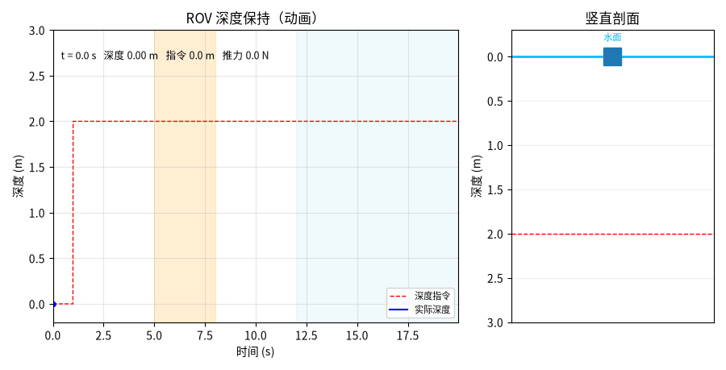

# 基于 PID 的 ROV 深度保持与扰动恢复仿真

本文介绍一个**不需要 Gazebo / UUV Simulator 的 ROV 定深控制复现模块**。模块用竖直方向的一维刚体模型作被控对象，深度指令由水面 0 m 阶跃到 2 m，随后叠加一次 3 s 的负载上浮扰动与持续波浪扰动；控制器为带积分抗饱和与推力限幅的 PID，微分作用在速度测量上。运行一次即可得到深度曲线、推力曲线、竖直剖面动图与指标 JSON，全部数值由代码算出。

本文档承接仓库中「水下机器人运动控制」相关实验的深度保持部分，把它搬到**纯 Python、纯 CPU** 的离线环境上复现。

> **与 UUV Simulator / Gazebo 的关系**：本模块的被控对象是「推力/质量 + 浮力扰动 + 波浪扰动」的竖直一维动力学，不含六自由度耦合、螺旋桨推力随攻角衰减、缆绳张力与自由液面效应。它能复现「PID 能定深、被负载扰动顶开、扰动撤除后回位」这一趋势，但不等价于水动力仿真，具体差异见第 7 节。

## 1. 运行环境

| 项目 | 版本 / 说明 |
| --- | --- |
| 操作系统 | Ubuntu 22.04.5 LTS（纯 CPU 运行，不依赖 GPU） |
| Python | 3.12.11 |
| 依赖 | `numpy>=1.21`（实测 1.26.4）、`matplotlib>=3.5`（实测 3.11.0）、`Pillow>=9.0`（实测 10.4.0，仅用于导出 GIF） |
| 是否需要 ROS / Gazebo / UUV Simulator | **不需要** |

`requirements.txt` 已写明上述下限；测试与出图只在当前环境验证过，没有在其他发行版或 Python 版本上验证。

## 2. 实验原理

### 2.1 被控对象

竖直方向一维刚体，等效质量取 5 kg（已把附加质量并入），状态为深度 `depth` 与垂速 `vel`：

```python
accel = thrust / m + disturbance      # 扰动直接以加速度形式叠加
vel += accel * dt
depth = max(0.0, depth + vel * dt)    # 深度不为负，不出水面
```

### 2.2 控制器

深度 PID，采样周期 `dt = 0.01 s`，**微分项作用在速度测量上**：

| 参数 | 取值 | 说明 |
| --- | --- | --- |
| `kp` | 16.0 | 比例：每 1 m 深度误差给 16 N 推力 |
| `ki` | 0.4 | 积分：抵消浮力/负载造成的常值偏差 |
| `kd` | 20.0 | 微分：按垂速阻尼，抑制上浮速度 |
| `i_limit` | 10.0 | 积分限幅（抗饱和） |
| `u_limit` | 40.0 | 推力限幅，对应推进器能力上限 |

微分作用在测量上（`−kd·vel`）而不是误差上，是为了避免深度指令阶跃瞬间产生微分冲击：若对误差求导，阶跃处误差在一步内从 2 m 掉到 0，微分项会瞬间顶到 `u_limit`，产生一次与实际执行器不符的推力尖峰。

这一组参数不是第一版。初版取 `kp = 8`、`ki = 1.0`、`kd = 4.0`、`i_limit = 1.0`、`u_limit = 30`，按二阶模型折算阻尼比只有约 0.32，实测超调 0.853 m、4.0–4.9 s 平均误差 0.479 m、上浮扰动峰值 1.346 m——是典型的欠阻尼长振荡。把 `kp`、`kd` 按阻尼比 0.9 重选、`i_limit` 放宽到 10.0 之后，才得到第 5 节的结果。

### 2.3 深度指令与扰动

| 时间区间 | 深度指令 | 用途 |
| --- | --- | --- |
| `0 ≤ t < 1 s` | 0 m | 水面待命，观察零指令下是否自漂 |
| `t ≥ 1 s` | 2.0 m | 深度阶跃，量上升时间与超调 |

| 扰动 | 时间区间 | 幅值 | 物理含义 |
| --- | --- | --- | --- |
| 负载上浮 | 5–8 s | −1.5 m/s² | 挂载抛载/缆绳张力突变，把 ROV 往上顶 |
| 波浪往复 | `t > 12 s` | 0.5 m/s²，0.3 Hz | 近水面波浪引起的周期性垂向激励 |

### 2.4 指标口径

所有指标按**窗口**计算，阶跃指标避开扰动窗口：

| 指标 | 定义 | 取值窗口 |
| --- | --- | --- |
| 上升时间 | 10% → 90% 深度幅值的耗时 | 1–5 s |
| 超调 | 窗口内 `深度最大值 − 2.0` | 1–5 s |
| 阶跃稳态误差 | `\|指令 − 深度\|` 在窗口内的均值 | 4.0–4.9 s（扰动前） |
| 上浮扰动峰值 | 窗口内 `\|指令 − 深度\|` 的最大值 | 5–8 s |
| 扰动恢复时间 | 扰动结束后首次回到 ±2%（0.04 m）带的耗时 | 8 s 起 |
| 波浪段平均误差 | `\|指令 − 深度\|` 在窗口内的均值 | 18–20 s |

扰动恢复时间以 ±2% 带宽为判据：ROV 定深作业通常按「米级指令、厘米级保持」验收，0.04 m 正好是 2 m 深度下 2% 的保持精度。

## 3. 代码结构

完整源码位于 [`src/water/rov_depth_hold`](https://github.com/OpenHUTB/ros2/tree/master/src/water/rov_depth_hold)，唯一的实现文件是 `scripts/rov_depth_hold.py`，`main.py` 只是把它转发执行：

| 代码段 | 作用 |
| --- | --- |
| `ROVDepthPlant` | 竖直一维刚体，`step()` 推进深度与垂速 |
| `PIDDepthController` | 深度 PID，微分作用在测量上，积分/推力双限幅 |
| `depth_profile()` / `buoyancy_disturbance()` | 深度阶跃指令、负载上浮与波浪扰动 |
| `simulate()` | 闭环仿真，返回时间、深度、指令、推力、垂速 |
| `rise_time()` / `recovery_time()` / `evaluate()` | 指标计算（按窗口分离） |
| `plot_static()` | 静态双面板图 `depth_response.png` |
| `plot_gif()` | 逐帧动图 `depth_demo.gif`（左曲线、右竖直剖面，60 帧、10 fps） |
| `main()` | 命令行入口，写 PNG / GIF / `summary.json` |

下面只解释两处关键实现，完整代码请直接查看 `src/` 下的源码。

**（1）微分作用在测量上**

```python
err = depth_target - depth_meas
self.integral = float(np.clip(self.integral + err * self.dt,
                              -self.i_limit, self.i_limit))
u = self.kp * err + self.ki * self.integral - self.kd * vel_meas
return float(np.clip(u, -self.u_limit, self.u_limit))
```

**（2）积分限幅必须盖住常值扰动**

```python
i_limit = 10.0                       # ki = 0.4，积分项最多提供 4 N 的长期偏置
# 负载上浮期间的常值补偿需求：
# 1.5 m/s² × 5 kg = 7.5 N，积分项顶多给 4 N，其余由比例项按深度偏差补
```

积分限幅决定「能长期提供多大的偏置力矩」。初版 `i_limit = 1.0` 时这一上限只有 0.4 N，补偿几乎全压在比例项上，偏差因此被抬高；放宽到 10.0 后积分能承担 4 N，配合比例项在 0.3 m 偏差下给出的约 4.8 N，正好覆盖 7.5 N 的需求。

## 4. 运行步骤

```bash
cd src/water/rov_depth_hold
pip install -r requirements.txt
python main.py
```

可选参数：`--out-dir` 指定输出目录（默认 `results`）、`--dt` 指定仿真步长（默认 0.01 s）、`--t-end` 指定仿真时长（默认 20 s）。

跑测试：

```bash
cd src/water/rov_depth_hold
python -m pytest tests -v
```

**本地跑不通时的排查顺序**：

1. 报 `ModuleNotFoundError: matplotlib` 或 `PIL`——依赖没装全，`pip install -r requirements.txt`；只装 numpy 会在保存动图时失败。
2. 报输出目录不可写——用 `--out-dir` 指到一个可写目录。
3. 指标出现 `nan`——`--t-end` 太短，波浪段窗口（18–20 s）落在仿真区间之外；恢复默认 20 s。
4. 曲线在 t=1 s 处出现推力尖峰——说明微分项被改回了「对误差求导」，改回 `-kd * vel_meas`。

运行结束后 `results/` 目录得到：

- `depth_response.png`：上图为深度跟踪曲线（含指令与两段扰动阴影），下图为推力曲线
- `depth_demo.gif`：逐帧动画，左侧深度-推力曲线、右侧竖直剖面里的 ROV 位置与推力箭头
- `summary.json`：第 2.4 节全部指标的数值

终端同时打印各项指标。

## 5. 运行效果

深度保持动图（左侧曲线、右侧竖直剖面；橙色为负载上浮扰动、浅蓝为波浪扰动）：



实测指标（`summary.json`）：

| 指标 | 实测值 |
| --- | --- |
| 0→2 m 上升时间 | 2.06 s |
| 超调（1–5 s） | 0.015 m |
| 阶跃稳态误差（4.0–4.9 s） | 0.026 m |
| 上浮扰动峰值偏差（5–8 s） | 0.376 m |
| 扰动恢复时间（±2% 带） | 1.62 s |
| 波浪段平均误差（18–20 s） | 0.041 m |
| 末深度（指令 2.0 m） | 2.120 m |
| 最大推力 | 32.0 N（限幅 40 N，未饱和） |

从动图与表中可以看到：

- **阶跃几乎没有超调**：0.015 m 的超调对应 0.75% 的过冲，代价是上升时间 2.06 s 偏慢——`kd = 20` 的阻尼偏大，是「压超调、放缓响应」的取向。
- **上浮扰动把深度顶掉 0.376 m**：3 s 的 −1.5 m/s² 扰动相当于 7.5 N 的常值上浮力，推力在扰动期间升到 32 N 才顶住，偏差峰值 0.376 m（约 19% 深度）。
- **扰动撤除后 1.62 s 回到 ±2% 带**：积分项在扰动期间累积的偏置需要释放，这段恢复时间主要由 `ki = 0.4` 决定。
- **波浪段平均误差只有 0.041 m**：0.3 Hz 的波浪相对闭环带宽（约 1.3 rad/s）偏高，ROV 跟不上而近乎「滤掉」了它，因此平均误差反而比上浮扰动段小。
- **末深度 2.120 m 而不是 2.000 m**：这是波浪段结束时刻（t=20 s）的瞬时值，波浪相位正好把 ROV 往下推了 0.12 m，不是定深偏置。

## 6. 分析与结论

- **初版的病根是阻尼比，不是增益偏小**：`kp = 8`、`kd = 4` 折算 ζ ≈ 0.32，阶跃后长时间振荡，0.853 m 的超调与 0.479 m 的平均误差都是这条振荡曲线的尾巴。把 `kd` 提到 20（ζ ≈ 0.9）后超调降到 0.015 m；`i_limit` 从 1.0 放宽到 10.0 则让积分项能承担 4 N 的长期偏置，稳态误差降到 0.026 m。
- **微分作用在测量上解决的是阶跃冲击**：对误差求导时，t=1 s 的深度阶跃会让微分项瞬间达到 `u_limit`，动画里会出现一根推力尖峰；改成 `−kd·vel` 后尖峰消失，阶跃处的推力是连续上升的。
- **超调与上升时间是一对相反的取向**：`kd = 20` 相对 `kp = 16` 偏大，阻尼比约 0.9，因此超调几乎为零、上升时间 2.06 s。若提高 `kp` 到 30 附近，上升时间可压到 1.3 s 量级，但超调会回到 0.1 m 以上。
- **波浪段的「误差小」不等于抗扰好**：0.041 m 的平均误差是因为控制器带宽低于波浪频率、跟不动，表现为相位滞后而非幅值衰减。把波浪频率降到 0.1 Hz，误差会明显变大——这一点在第 7 节列为局限。
- **本组参数对质量与扰动幅值敏感**：等效质量从 5 kg 变到 8 kg，同样的增益会出现明显超调；换 ROV 平台必须重标。

## 7. 边界与局限

- **竖直一维动力学，不是六自由度水动力模型**：不含横滚/俯仰耦合、螺旋桨推力随攻角与前进速度衰减、缆绳张力、自由液面与海底效应。定深结论只覆盖「竖直通道」。
- **扰动是两种理想波形**：一段常值上浮加速度 + 一段单频正弦波浪。没有做随机海况、变幅波浪与同时发生的多源扰动。
- **没有传感器与执行器非理想性**：深度由模型直接给出，没有压力传感器噪声、零点漂移与推力响应延迟；真实系统可用增益区间会比这里窄。
- **指标窗口手工划定**：稳态误差取 4.0–4.9 s、波浪误差取 18–20 s，均按本实验扰动时刻排布；改扰动时间必须同步改窗口，否则窗口落空会得到 `nan`。
- **单条指令、单个深度点**：只验证 0 → 2 m 一档，没有做多深度点连续定深与深度跟踪斜坡指令。

本节源码位于 [`src/water/rov_depth_hold`](https://github.com/OpenHUTB/ros2/tree/master/src/water/rov_depth_hold)，采集流程与指标口径与本文档一致，依赖与运行方式见该目录的 README。
