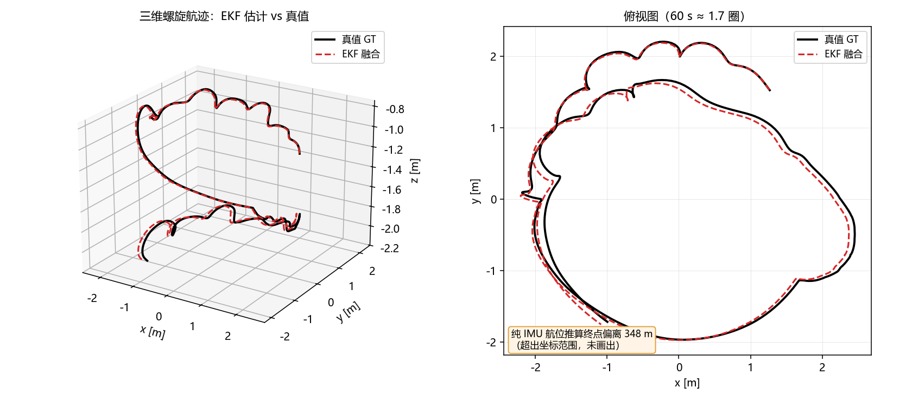
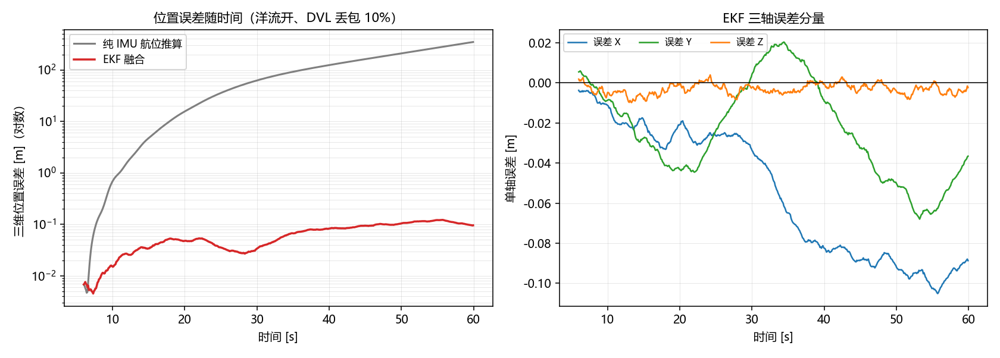
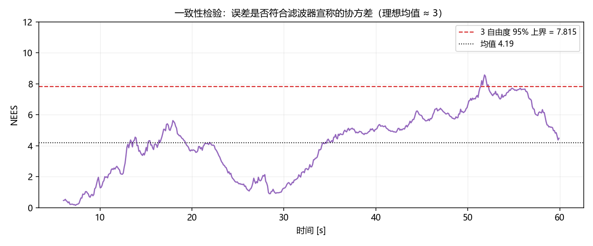
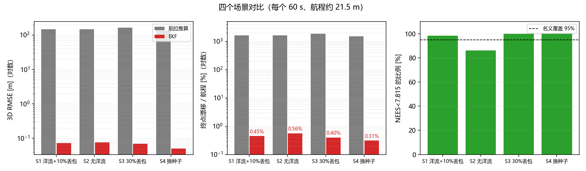

# 水下多源融合组合导航（EKF）

在 MuJoCo 水下机器人仿真上，用 15 状态误差状态卡尔曼滤波（ESKF）融合
IMU、DVL、深度计与姿态量测，输出连续、带协方差的位姿估计，并与纯 IMU
航位推算做量化对比。



## 1. 为什么需要它

仓库里已有的 `rov_mujoco` 直接发布仿真真值 `/rov/odom`，
`autonomous_navigation_node` 与 `sonar_slam_node` 都拿它当定位输入。
真实 ROV 没有"真值"：只有带零偏的 IMU、带噪声的深度计、会丢包的 DVL。
纯 IMU 积分会随时间平方发散——本模块的基线实验里，60 s 航程 21.5 m，
航位推算终点偏差达到 **348 m**。

## 2. 文件结构

新增与修改的文件都集中在 `rov_mujoco` 包内，不新建功能包：

```text
src/water/rov_mujoco/
├── rov_mujoco/
│   ├── ekf_fusion.py          # 15 状态 ESKF + 航位推算基线 + 传感器噪声模型（纯 numpy）
│   ├── sensor_sim_node.py     # 由真值合成 IMU / DVL / 深度 / 姿态（零偏、噪声、丢包）
│   ├── ekf_node.py            # 融合节点：/rov/odom_fused、/rov/odom_deadreckoning
│   └── mujoco_sim_node.py     # [修改] 改用仿真时间打戳，新增 /clock 发布
├── launch/
│   └── ekf_nav.launch.py      # 仿真 + 噪声传感器 + EKF 一键启动
├── test/
│   └── test_ekf.py            # 无头自动评测：RMSE / 漂移 / NEES
└── setup.py                   # [修改] 新增 sensor_sim_node、ekf_nav_node 入口

docs/
├── water/rov_ekf_navigation.md    # 本文档
└── img/water/ekf_*.png            # 4 张实测图
mkdocs.yml                         # [修改] 「水域载具」下新增一行导航
```

数据流：

```text
MuJoCo 仿真 ──/rov/odom(真值)──> 传感器噪声仿真 ──┬── /rov/imu_noisy ──┐
                                                  ├── /rov/dvl ────────┤
                                                  └── /rov/depth_noisy ┤
                                                                       v
                                                                    EKF 节点
                                                                       │
                                          ┌────────────────────────────┴─────────────────┐
                                          v                                              v
                                  /rov/odom_fused                          /rov/odom_deadreckoning
                                  （含位姿协方差）                              （纯 IMU 基线）
```

## 3. 算法

### 3.1 状态定义

标称状态：位置 $\mathbf p$、速度 $\mathbf v$、姿态四元数 $\mathbf q$、
加速度计零偏 $\mathbf b_a$、陀螺零偏 $\mathbf b_g$。

误差状态（15 维）：

$$
\delta\mathbf x = [\delta\mathbf p,\ \delta\mathbf v,\ \delta\boldsymbol\theta,\
\delta\mathbf b_a,\ \delta\mathbf b_g]^\top
$$

### 3.2 预测（IMU）

$$
\mathbf a_w = \mathbf R(\mathbf q)(\mathbf a_m - \mathbf b_a) + \mathbf g,\qquad
\mathbf p \leftarrow \mathbf p + \mathbf v\Delta t + \tfrac12\mathbf a_w\Delta t^2,\qquad
\mathbf v \leftarrow \mathbf v + \mathbf a_w\Delta t
$$

$$
\mathbf q \leftarrow \mathbf q \otimes \exp\!\left(\tfrac12(\boldsymbol\omega_m-\mathbf b_g)\Delta t\right)
$$

误差状态转移矩阵（关键块）：

$$
\mathbf F = \begin{bmatrix}
\mathbf I & \mathbf I\Delta t & 0 & 0 & 0\\
0 & \mathbf I & -\mathbf R[\mathbf a_m-\mathbf b_a]_\times\Delta t & -\mathbf R\Delta t & 0\\
0 & 0 & \mathbf I-[\boldsymbol\omega\Delta t]_\times & 0 & -\mathbf I\Delta t\\
0 & 0 & 0 & \mathbf I & 0\\
0 & 0 & 0 & 0 & \mathbf I
\end{bmatrix}
$$

过程噪声按加速度/陀螺噪声谱密度与零偏随机游走注入。

### 3.3 量测更新

| 量测 | 模型 | 维度 |
| --- | --- | --- |
| DVL | $\mathbf v_b = \mathbf R^\top\mathbf v$ | 3 |
| 深度计 | $d = -p_z$（向下为正） | 1 |
| 姿态（AHRS/罗经） | $\delta\boldsymbol\theta = 2\,\mathrm{vec}(\mathbf q^{-1}\otimes\mathbf q_m)$ | 3 |

每次更新用 Joseph 形式保持协方差正定，误差注入标称状态后清零。

## 4. 传感器噪声模型

`sensor_sim_node` 从仿真真值合成带误差的传感器，参数可在 launch 中调整：

| 传感器 | 噪声 | 零偏 | 其它 |
| --- | --- | --- | --- |
| IMU 加速度 | σ = 0.05 m/s² | 0.05 m/s²（随机游走） | 50 Hz |
| IMU 陀螺 | σ = 0.005 rad/s | 0.003 rad/s | 50 Hz |
| DVL | σ = 0.01 m/s | 0.005 m/s | 默认 10% 丢包 |
| 深度计 | σ = 0.02 m | — | — |
| 姿态 | σ = 0.01 rad | — | — |

## 5. ROS 2 接口

| 话题 | 类型 | 方向 |
| --- | --- | --- |
| `/rov/imu_noisy` | `sensor_msgs/Imu` | 输入 |
| `/rov/dvl` | `geometry_msgs/TwistStamped` | 输入（机体系速度） |
| `/rov/depth_noisy` | `std_msgs/Float64` | 输入 |
| `/rov/odom_fused` | `nav_msgs/Odometry` | 输出（含位姿协方差） |
| `/rov/odom_deadreckoning` | `nav_msgs/Odometry` | 输出（IMU 基线） |
| `/rov/ekf/position_std` | `std_msgs/Float64MultiArray` | 输出（位置标准差） |
| `/rov/ground_truth` | `nav_msgs/Odometry` | 输出（真值，评测用） |

参数：`init_delay`（传感器上线后等待多久再初始化滤波器，默认 0.1 s）、
`sigma_acc/sigma_gyro/sigma_dvl/sigma_depth/sigma_att`（滤波器噪声）。

## 6. 运行

```bash
cd ~/ros2_ws
colcon build --packages-select rov_mujoco --symlink-install
source install/setup.bash

# 仿真 + 噪声传感器 + EKF
ros2 launch rov_mujoco ekf_nav.launch.py

# 只看融合结果
ros2 topic echo /rov/odom_fused --once

# 自动化评测（无头，60 s 仿真）
python3 src/water/rov_mujoco/test/test_ekf.py --duration 60 --out /tmp/ekf_eval.json
```

常用参数：`--dropout 0.3`（DVL 丢包率）、`--current 0`（关闭洋流）、
`--seed 11`（换随机种子）、`--facc/--fgyro/--fdvl/--fdepth`（滤波器噪声）。

## 7. 实验结果

每个场景 60 s、约 1.7 圈三维螺旋航迹（航程 21.4–21.5 m），
起点前 6 s 为控制器预热，EKF 从 6 s 起初始化。

| 场景 | 航程 [m] | 航位推算 RMSE [m] | **EKF RMSE [m]** | EKF 终点误差 [m] | EKF 漂移率 | NEES 均值 | NEES 覆盖率 |
| --- | --- | --- | --- | --- | --- | --- | --- |
| S1 洋流 + 10% 丢包 | 21.48 | 145.54 | **0.0725** | 0.096 | 0.45 % | 4.19 | 98.4 % |
| S2 无洋流 | 21.38 | 145.77 | **0.0758** | 0.119 | 0.56 % | 4.45 | 86.0 % |
| S3 30% 丢包 | 21.48 | 163.61 | **0.0702** | 0.086 | 0.40 % | 3.26 | 100 % |
| S4 换随机种子 | 21.48 | 135.72 | **0.0508** | 0.066 | 0.31 % | 2.81 | 100 % |

**RMSE 提升约 2000–2700 倍**；DVL 丢包从 10% 提到 30% 时定位精度几乎不变
（IMU 预测 + 深度/姿态更新仍在工作）。







### 关于 NEES

NEES（归一化估计误差平方）检验"误差是否与滤波器宣称的协方差相符"：
3 自由度下理想均值为 3，95% 上界 7.815。**调参前 NEES 均值 34.8（只有 12.4% 落在界内），
说明滤波器过度自信；把过程噪声与量测噪声调到与真实噪声匹配后为 4.19 / 98.4%**。
这一项比 RMSE 更能说明滤波器是否"可信"。

## 8. 与已有模块的关系

- `mujoco_sim_node`：提供真值与物理仿真，本模块只读 `/rov/odom` 作为"传感器真值源"；
- `sonar_slam_node` / `autonomous_navigation_node`：把输入从 `/rov/odom` 换成
  `/rov/odom_fused` 即可接入真实噪声条件下的定位（后续可做）；
- `nn_trajectory_controller`：控制器不受影响，仍订阅 `/cmd_vel`。

## 9. 排错

| 现象 | 原因 | 处理 |
| --- | --- | --- |
| 节点一直不发布 `/rov/odom_fused` | 还没收到 DVL 或深度 | 确认 `/rov/dvl`、`/rov/depth_noisy` 有数据 |
| 位置漂移很大 | 滤波器噪声参数与实际不符 | 先看 NEES：远大于 3 说明过度自信，适当增大 `--facc/--fdvl` |
| NEES 长期 < 1 | 过度保守 | 减小 `--facc/--fdvl` |
| 仿真很慢 | 物理频率 500 Hz | 调低 `sim_rate`（test 脚本用同步步进，不受影响） |

## 10. 配套修正：仿真节点必须用仿真时间打戳（重要）

调试中发现的**基础仿真缺陷**：`mujoco_sim_node` 原来用墙钟
（`self.get_clock().now()`）给 `/rov/odom`、`/rov/imu` 等消息打时间戳，
而物理步进在虚拟机上**跑不到 500 Hz 实时**。后果是：下游按墙钟积分速度时，
"1 秒墙钟 × v" ≠ "1 秒仿真时间 × v"，位置被系统性放大。

实测：修正前 ROS 端到端相对误差约 **1.6 m**（路径半径被放大 1.6–1.8 倍）；
把时间戳改为仿真时间（`data.time`）并发布 `/clock` 后，降到 **2–4 cm**。

```python
# mujoco_sim_node._publish_callback()
sim_t = float(self.data.time)
now = Time()
now.sec = int(sim_t)
now.nanosec = int((sim_t - int(sim_t)) * 1e9)
self.pub_clock.publish(Clock(clock=now))   # 新增 /clock 发布者
```

下游若使用 `use_sim_time:=true`，`/clock` 也会让 RViz、TF 与仿真时间一致。

## 11. ROS 端到端验证

`ros2 launch rov_mujoco ekf_nav.launch.py` 启动三个节点
（仿真 + 噪声传感器 + EKF），同时订阅 `/rov/odom_fused` 与
`/rov/ground_truth` 对比（仿真时间戳修正后）：

| 指标 | 实测 |
| --- | --- |
| 话题频率 | 约 65 Hz（仿真受 CPU 限制时的实际发布率） |
| `/rov/odom_fused` 绝对位置误差 | **2.4 cm → 4.5 cm**（13 s 内缓慢增长） |
| 相对误差（对齐初始点） | 1.0–3.4 cm |
| 速度误差 | 0.3–2.8 cm/s |
| 初始化 | 传感器上线 0.1 s 后，以自身位置为原点 |

> 说明：没有 USBL/声学信标等绝对参考时，滤波器只能给出**相对**位置；
> 若需要绝对定位，可接第 4 节建议的 USBL/LBL 模块。
