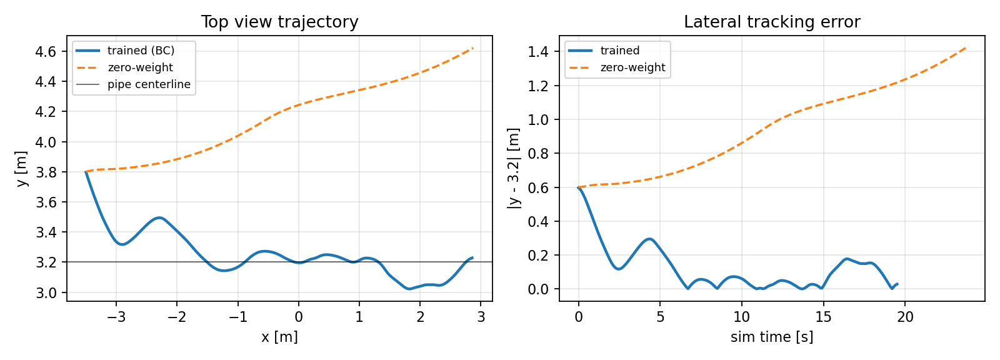
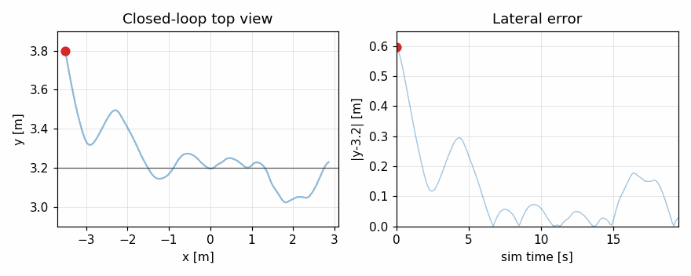

# 任务 4：图像端到端视觉伺服

本文档对应课程任务（4）：**输入图像，直接输出控制指令**的端到端神经网络，
包括网络结构、训练数据与目标、训练/测试结果、ROS2 封装与源码解析。

## 1. 运行环境

- Ubuntu 22.04 + ROS2 Humble + Python 3.10
- MuJoCo 3.12.0，NumPy 1.21.5
- 无头运行需 `MUJOCO_GL=osmesa`
- 不依赖 PyTorch：网络前向与反向传播均由 NumPy 实现

## 2. 任务与数据流

```text
MuJoCo forward_cam (84x84 RGB)
        │  sensor_msgs/Image  /rov/camera/image_raw
        ▼
end_to_end_node
  灰度化 + 归一化 → CNN → o∈[-1,1]^3
        │  vx = 0.45(o0+1)/2, vy = 0.35 o1, wz = 0.60 o2
        ▼
geometry_msgs/Twist  /cmd_vel
        ▼
mujoco_sim_node（推力分配 + 定深 PID + 洋流）
```

## 3. 网络结构

输入为 84×84 灰度图 $I$，按训练集统计量归一化：

$$
\tilde I = \frac{I - \mu}{\sigma},\qquad \mu = 116.97,\ \sigma = 28.99 .
$$

三种架构共享同一套动作解码：

$$
v_x = 0.45\cdot\frac{o_0+1}{2},\qquad
v_y = 0.35\,o_1,\qquad
w_z = 0.60\,o_2 .
$$

### 3.1 卷积层

第 $l$ 层第 $k$ 个通道：

$$
z^{l}_{k}(i,j)=\sum_{c}\sum_{u,v} W^{l}_{k,c}(u,v)\,a^{l-1}_{c}(i s+u,\ j s+v)+b^{l}_{k},
\qquad a^{l}_{k}=\max(0,z^{l}_{k}).
$$

两层卷积后接 2×2 平均池化，再展平接全连接层。

| 架构 | 结构 | 参数量 |
|---|---|---|
| `mlp` | flatten(84×84) → FC128 ReLU → FC3 tanh | 903,683 |
| `small_cnn` | Conv8@5×5/2 → Conv16@3×3/2 → AvgPool2 → FC64 → FC3 | 84,579 |
| `nature_cnn` | Conv16@5×5/2 → Conv32@3×3/2 → AvgPool2 → FC128 → FC3 | 337,347 |

输出层为 tanh。实现上对输出层采用小初始化（标准差 0.01）：若使用 He 初始化，
初始 logits 较大，tanh 饱和导致梯度接近 0，实测 30 轮后 MSE 仍停在 0.6。

## 4. 训练数据与专家标签

### 4.1 数据采集

在 MuJoCo 中把 ROV 随机摆放在管道附近，渲染 `forward_cam` 84×84 图像：

- 位置：$x\in[-3.3, 2.7]$，横向 $|y-3.2|\le 0.6$ m，深度 $|z+1.45|\le 0.16$ m
- 偏航：$|\psi|\le 0.28$ rad
- 共 1200 帧；首次采集约 4.5 分钟，缓存为 `models/task4_bc_dataset.npz`

### 4.2 几何专家

令 $\Delta y = 3.2-y$（管道中心线为 $y=3.2$）：

$$
\begin{aligned}
v_x^* &= 0.45\,(1-0.55\min(1,|\Delta y|/0.6))\,(1-0.30\min(1,|\psi|/0.28)),\\
v_y^* &= \operatorname{clip}(1.2\,\Delta y,\,-0.35,\,0.35),\\
w_z^* &= \operatorname{clip}(-1.6\,\psi,\,-0.60,\,0.60).
\end{aligned}
$$

对应网络标签：

$$
o^*=\Big(2v_x^*/0.45-1,\ \ v_y^*/0.35,\ \ w_z^*/0.60\Big).
$$

### 4.3 损失与优化

均方误差与 Adam（Kingma & Ba, 2015）：

$$
\mathcal L=\frac{1}{ND}\sum_{n=1}^{N}\sum_{d=1}^{D}\big(\hat o_{n,d}-o^*_{n,d}\big)^2,
\qquad
\theta_{t+1}=\theta_t-\eta\,\frac{\hat m_t}{\sqrt{\hat v_t}+\epsilon}.
$$

超参数：batch 32，epochs 30，$\eta=10^{-3}$，80/20 训练/验证划分。

反向传播要点（`rov_mujoco/end_to_end_networks.py:210`）：

- tanh 输出层：$\delta = \frac{2(\hat o-o^*)}{ND}(1-\hat o^2)$；
- ReLU 掩码在 forward 中缓存，backward 使用真实掩码；
- 卷积用 im2col 展开为矩阵乘，`_col2im` 累加梯度。

## 5. 训练结果

验证集（随机种子 2026）：

| 架构 | MSE | corr vx / vy / wz | RMSE vx / vy / wz |
|---|---|---|---|
| mlp | 0.0552 | 0.736 / 0.936 / 0.903 | 0.047 m/s / 0.101 m/s / 0.118 rad/s |
| small_cnn | 0.0357 | 0.842 / 0.957 / 0.944 | 0.038 m/s / 0.083 m/s / 0.090 rad/s |
| nature_cnn | 0.0269 | 0.882 / 0.965 / 0.967 | 0.033 m/s / 0.074 m/s / 0.071 rad/s |

`vx` 的相关性最低，因为 $v_x^*$ 只随 $|\Delta y|$ 缓慢变化、标签方差小；
闭环最关键的是横向纠偏 $v_y$ 与航向 $w_z$，两者均 > 0.9。

## 6. 闭环测试

### 6.1 方法

`test/test_task4.py:64` 从初始横向偏差 0.6 m 出发（$y=3.8$），控制周期 0.1 s
（50 个 2 ms 物理子步），仅使用前视图像更新指令，直到 $x\ge 2.85$。
零权值消融把所有参数置零，此时

$$
o=(0,0,0)\ \Rightarrow\ (v_x,v_y,w_z)=(0.225,0,0),
$$

即固定直航，可检验横向纠偏是否真正来自权值。

### 6.2 结果

```text
训练网络  : RMSE_y=0.080 m | 终点偏差=0.028 m | 深度 RMSE=0.041 m | 19.6 s
零权值    : RMSE_y=1.112 m | 终点偏差=1.422 m | 深度 RMSE=0.044 m | 23.8 s
```





> GIF 由本次闭环实测的位置/误差序列生成（非屏幕录制），共 99 帧、0.78 MB；
> 红点为当前 ROV 位置，右图为对应时刻的横向误差。

### 6.3 ROS2 launch

`./main.sh --launch4` 启动 `mujoco_sim_node` 与 `end_to_end_node`。联调中修复了：

1. 相机发布用 `step_count % 5` 与 50 Hz 发布相位锁死，导致话题长期无消息；
   改为 `publish_count % 5`（`mujoco_sim_node.py:444`）。
2. 训练与部署图像规格不一致：训练为 84×84 原始渲染，相机默认 320×240 且叠加水下色偏。
   新增 `camera_width/height`、`camera_underwater_effect` 参数，任务 4 launch 设为
   84×84、关闭色偏。
3. launch 缺少初始位姿：新增 `start_pose` 参数，默认 `-3.5,3.2,-1.45,0`。

实测：相机约 3.6 Hz（osmesa 单帧渲染约 0.28 s），推理 2–14 ms，
约 70 s 控制时间到达 `x=2.85, y=3.23`，节点打印“已抵达管线三通，转入动力定位悬停”。

## 7. 源码解析

| 文件:行号 | 内容 |
|---|---|
| `rov_mujoco/end_to_end_networks.py:41` | 几何专家标签 `expert_label_ref` |
| `rov_mujoco/end_to_end_networks.py:63` | 灰度化与 84×84 缩放 |
| `rov_mujoco/end_to_end_networks.py:133` | `NumpyConvNet` 三种架构与初始化 |
| `rov_mujoco/end_to_end_networks.py:172` | 前向传播（im2col、池化、FC） |
| `rov_mujoco/end_to_end_networks.py:210` | 反向传播与梯度 |
| `rov_mujoco/end_to_end_networks.py:300` | `train_network`：Adam 训练循环 |
| `rov_mujoco/end_to_end_networks.py:339` | `VisuomotorController` 权值查找与推理 |
| `train/train_task4.py:57` | MuJoCo 随机位姿渲染数据集 |
| `train/train_task4.py:98` | 三架构训练与保存 `.npz` |
| `test/test_task4.py:28` | 分布外验证集渲染 |
| `test/test_task4.py:64` | 闭环巡线与零权值消融 |
| `rov_mujoco/end_to_end_node.py:40` | ROS2 端到端节点 |
| `rov_mujoco/end_to_end_node.py:76` | 图像消息解析 |
| `rov_mujoco/end_to_end_node.py:87` | 10 Hz 控制与航向安全层 |

## 8. 公式与算法流程

```text
for epoch in 1..30:
    shuffle 训练集
    for batch in 训练集:
        o = Net(Ĩ)                       # 前向
        δ = 2(o - o*)/(ND) * (1 - o²)    # tanh 输出层梯度
        backprop δ 经过 FC/池化/卷积        # 缓存 ReLU 掩码
        Adam 更新 θ
    评估验证集 MSE
保存 w1,b1,w2,b2,... → task4_{arch}_bc.npz
```

## 9. 多场景与评价

| 测试 | 结果 |
|---|---|
| 三架构分布外验证（60 帧） | corr vx/vy/wz：0.81/0.95/0.91（mlp）、0.91/0.97/0.97（small）、0.93/0.98/0.98（nature） |
| 单帧推理延迟 | 0.69 / 1.44 / 3.88 ms，远低于 100 ms 实时约束 |
| 横向纠偏方向 | Δy>0.25 m 时平均 vy=-0.316 m/s；Δy<-0.25 m 时 +0.302 m/s |
| 闭环纠偏 | RMSE_y 0.080 m，终点偏差 0.028 m |
| 零权值消融 | RMSE_y 1.112 m，终点偏差 1.422 m |
| ROS2 launch | 两节点启动，相机/`/cmd_vel` 正常，抵达三通 |

## 10. 已知限制

- 数据集只覆盖直线管道走廊；末端三通分支会使图像出现额外结构，横向误差瞬时增大。
- 纯 NumPy/CPU 训练与推理，无 GPU 加速。
- 行为克隆不是强化学习；旧版本文档中的 SAC/PPO/RESNET 描述已删除。
- 运行时保留航向安全层（`|yaw|>0.25 rad` 时 P 控制回正），仅作安全兜底。
- 无头 WSL 下相机发布频率约 3.6 Hz；原生图形环境应更高。
- `--task4` 3D 视窗在 WSLg 软件渲染下可运行，但推理约 374 ms，未跑完整巡检；
  完整闭环以 `--test4` 与 `--launch4` 的结果为准。
