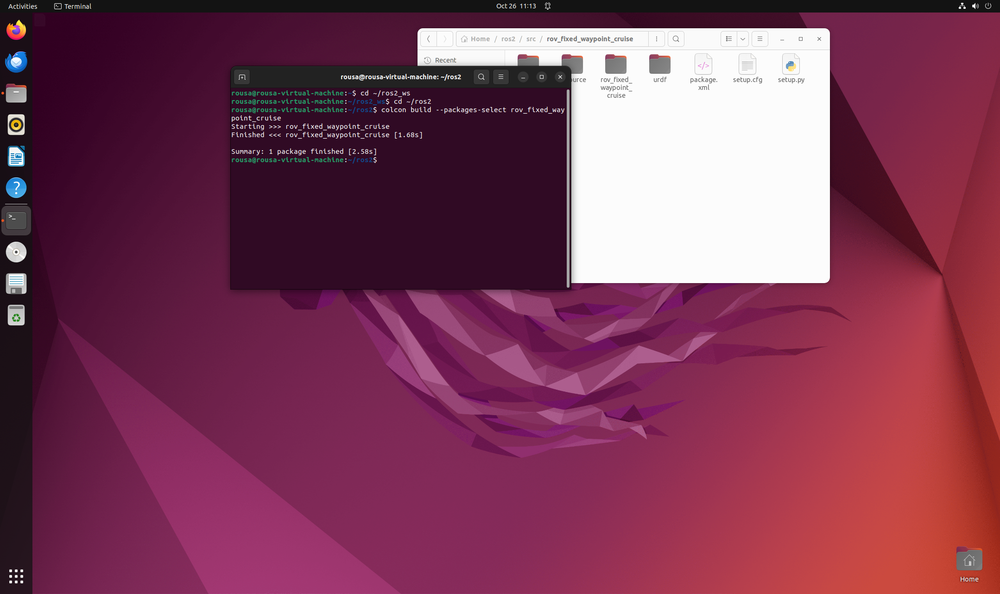
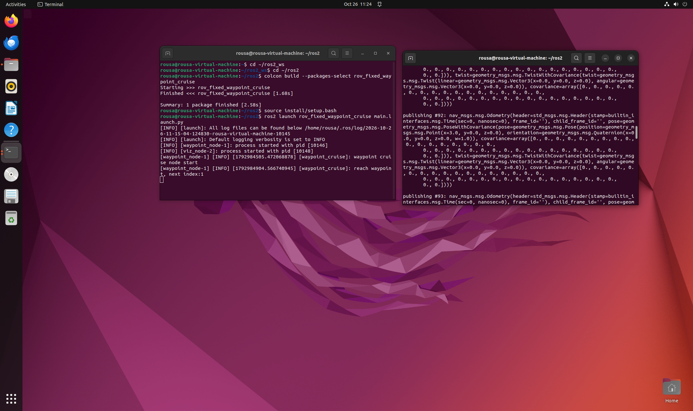
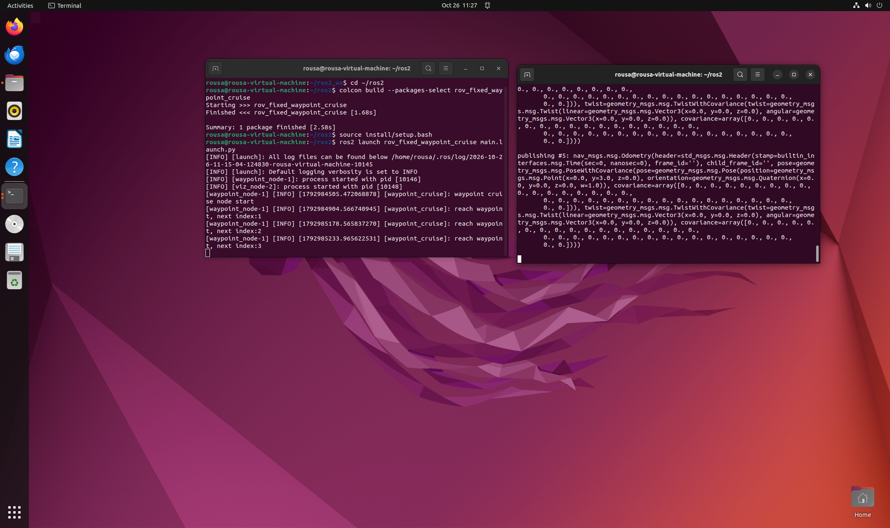

# rov_fixed_waypoint_cruise 使用说明
ROV固定航点巡航工具（ROS 2 功能包）

## 修改概述 / Overview
- 中文：新增ROV固定航点巡航功能包。该模块包含航点控制节点、可视化节点，通过订阅里程计`/odom`话题实时判断是否抵达目标航点，依次遍历预设航点；可在RViz中可视化机器人位置与航点。
- English: Add ROV fixed waypoint cruise package. It contains waypoint control node and visualization node. By subscribing to the `/odom` odometry topic, it judges whether the target waypoint is reached in real time, traverses preset waypoints in sequence, and can visualize robot pose and waypoints in RViz.

## 运行环境
- 操作系统：Ubuntu 22.04
- ROS 版本：ROS 2 Humble
- 依赖库：Python 3.10，`nav_msgs`，`geometry_msgs`，`rclpy`，`rviz2`

## 核心代码文件
本模块包含以下核心文件，均已提交至仓库：
```text
src/
└── rov_fixed_waypoint_cruise/
    ├── launch/
    │   └── main.launch.py        # 节点一键启动文件
    ├── resource/
    │   └── rov_fixed_waypoint_cruise  # resource资源标识文件
    ├── rov_fixed_waypoint_cruise/
    │   ├── __init__.py           # Python包初始化文件
    │   ├── waypoint_node.py      # 航点巡航控制主节点
    │   └── viz_node.py           # RViz可视化节点
    ├── urdf/
    │   └── rov_simple.urdf       # 演示用简易ROV模型
    ├── package.xml               # ROS2功能包描述文件
    ├── setup.cfg                 # 节点安装路径配置文件
    └── setup.py                  # ROS2功能包配置文件
```
## 功能说明
- 中文：航点节点持续监听`/odom`里程计话题，对比当前位置与目标航点坐标，到达航点后自动切换下一个航点索引，依次完成航点遍历；可视化节点发布标记话题。无仿真模块，依靠外部发布里程计数据驱动。
- English: The waypoint node continuously subscribes to the `/odom` odometry topic, compares the current pose with the target waypoint. After reaching the waypoint, it automatically switches to the next waypoint index and traverses all preset waypoints. The visualization node publishes marker topics. No simulation module, driven by externally published odometry data.

## 启动步骤
1. 进入 ROS2 工作空间
```
cd <你的 ROS 2 工作空间>
```
2. 功能编译包
```
colcon build --packages-select rov_fixed_waypoint_cruise
source install/setup.bash
```
3. 使用 launch 文件一键启动（启动航点节点、可视化节点、RViz、URDF 模型）
```
ros2 launch rov_fixed_waypoint_cruise main.launch.py
```
4.新开一个终端窗口，同样进入工作空间并加载环境，发送模拟里程计数据
```
cd <你的 ROS 2 工作空间>
source install/setup.bash
ros2 topic pub /odom nav_msgs/msg/Odometry "{pose: {pose: {position: {x: 3.0, y: 0.0, z:0.0}}}}"
```
## 运行效果
手动发布里程计消息后，终端会打印 `reach waypoint` 到达航点日志，自动切换到下一个航点。




