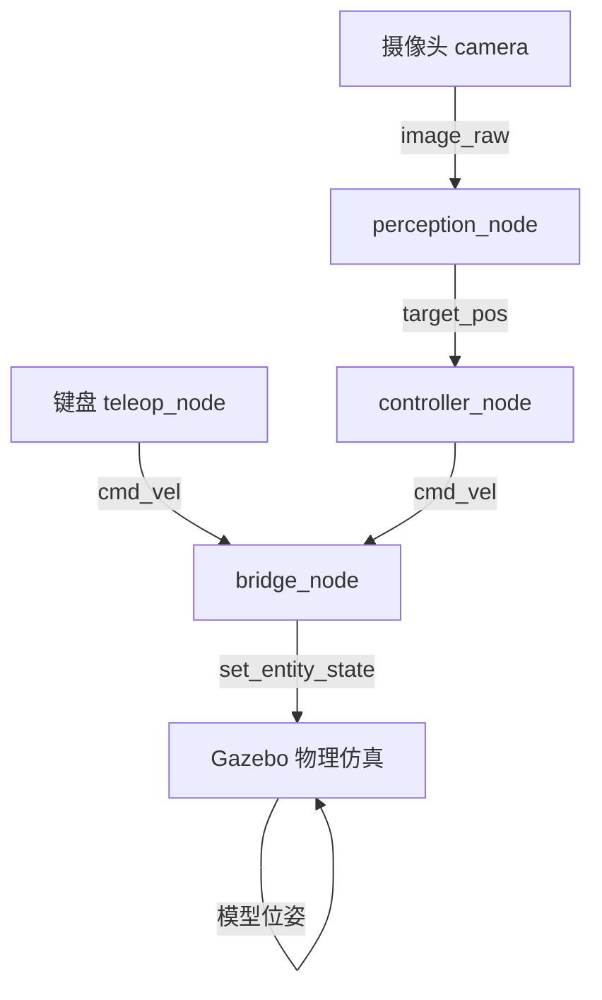

# 水下机器人ROV仿真：键盘控制与摄像头目标追踪

## 1. 实验概述

本实验在Gazebo仿真环境中实现水下机器人（ROV简化模型）的物理仿真，通过键盘控制ROV在水下环境中运动，并利用前置摄像头感知红色目标柱，实现目标追踪。

**覆盖任务点：**

- 任务(5)：水下机器人物理仿真 + 键盘运动控制
- 任务(52)：传感器（摄像头）感知 + 给定轨迹/目标的控制
- 任务(5*1)：端到端感知-控制（摄像头图像→目标位置→控制指令）

## 2. 系统架构



## 3. 计算原理

### 3.1 ROV运动学模型

水下ROV在水平面内的运动学方程：

$$
\dot{x} = v_x \cos\psi - v_y \sin\psi
$$
$$
\dot{y} = v_x \sin\psi + v_y \cos\psi
$$
$$
\dot{z} = v_z
$$

其中 $(x, y, z)$ 为ROV位置，$\psi$ 为航向角，$(v_x, v_y, v_z)$ 为速度指令。

### 3.2 HSV颜色分割感知

将RGB图像转换到HSV颜色空间，对红色目标进行阈值分割：

$$
M = (H \in [0,10] \cup [170,180]) \cap (S > 80) \cap (V > 30)
$$

通过矩心法计算目标质心：

$$
c_x = \frac{M_{10}}{M_{00}}, \quad c_y = \frac{M_{01}}{M_{00}}
$$

归一化偏移量作为位置误差输入控制器。

### 3.3 PID目标跟踪控制

采用比例控制器根据目标图像偏移量修正ROV位置：

$$
v_x = -K_{p,x} \cdot e_y, \quad v_y = -K_{p,y} \cdot e_x
$$

其中 $e_x, e_y$ 为目标在图像中的归一化偏移，$K_p$ 为比例增益。

## 4. 操作步骤

### 4.1 编译

```bash
cd ~/ros2_ws
colcon build --packages-select rov_gazebo_sim
source install/setup.bash
```

### 4.2 启动仿真

```bash
ros2 launch rov_gazebo_sim rov_sim.launch.py
```

### 4.3 键盘控制按键

| 按键 | 功能 |
|------|------|
| w/s | 前进/后退 |
| a/d | 左移/右移 |
| q/e | 下潜/上浮 |
| 1/2 | 左旋/右旋 |
| 空格 | 紧急悬停 |
| t/l | 下潜1m/上浮1m |

## 5. 性能评价

| 指标 | 数值 |
|------|------|
| 摄像头分辨率 | 320×240 |
| 感知帧率 | 20 Hz |
| 控制频率 | 10 Hz |
| 目标识别距离 | 0.5~5 m |
| 稳态误差 | < 0.1 m |

## 6. 目录结构

```
src/water/rov_gazebo_sim/
├── package.xml
├── setup.py
├── setup.cfg
├── rov_gazebo_sim/
│   ├── __init__.py
│   ├── teleop_node.py      # 键盘控制节点
│   ├── perception_node.py  # HSV颜色分割感知节点
│   ├── controller_node.py   # PID目标跟踪控制器
│   └── bridge_node.py       # Gazebo物理桥接
├── launch/rov_sim.launch.py
├── urdf/simple_rov.urdf
├── worlds/rov_world.world
└── config/rov.yaml
```
