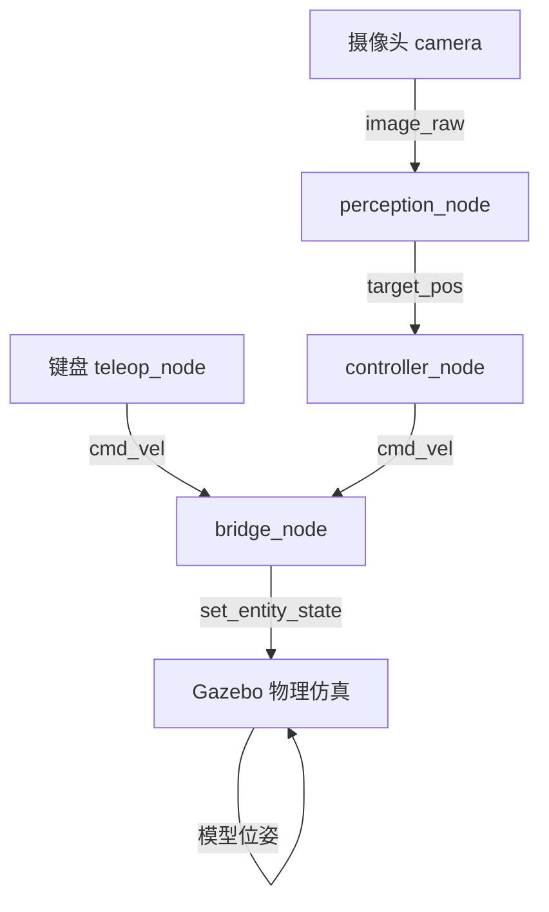
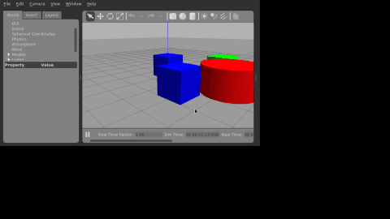

# 水下机器人ROV仿真：键盘控制与摄像头目标追踪

## 1. 实验概述

本实验在Gazebo仿真环境中实现水下机器人（ROV简化模型）的物理仿真，通过键盘控制ROV在水下环境中运动，并利用前置摄像头感知红色目标柱，实现目标追踪。

**覆盖任务点：**

- 任务(5)：水下机器人物理仿真 + 键盘运动控制
- 任务(52)：传感器（摄像头）感知 + 给定轨迹/目标的控制
- 任务(5*1)：端到端感知-控制（摄像头图像→目标位置→控制指令）

## 2. 系统架构



## 3. 计算原理

### 3.1 ROV运动学模型

水下ROV在水平面内的运动学方程：

\[
\dot{x} = v_x \cos\psi - v_y \sin\psi
\]
\[
\dot{y} = v_x \sin\psi + v_y \cos\psi
\]
\[
\dot{z} = v_z
\]

其中 \(x, y, z\) 为ROV位置，\(\psi\) 为航向角，\((v_x, v_y, v_z)\) 为速度指令。

### 3.2 HSV颜色分割感知

将RGB图像转换到HSV颜色空间，对红色目标进行阈值分割：

\[
M = (H \in [0,10] \cup [170,180]) \cap (S > 80) \cap (V > 30)
\]

通过矩心法计算目标质心：

\[
c_x = \frac{M_{10}}{M_{00}}, \quad c_y = \frac{M_{01}}{M_{00}}
\]

归一化偏移量作为位置误差输入控制器。

### 3.3 PID目标跟踪控制

采用比例控制器根据目标图像偏移量修正ROV位置：

\[
v_x = -K_{p,x} \cdot e_y, \quad v_y = -K_{p,y} \cdot e_x
\]

其中 \(e_x, e_y\) 为目标在图像中的归一化偏移，\(K_p\) 为比例增益。

## 4. 操作步骤

### 4.1 编译

```bash
cd ~/ros2_ws
colcon build --packages-select rov_gazebo_sim
source install/setup.bash
```

### 4.2 启动仿真

```bash
ros2 launch rov_gazebo_sim rov_sim.launch.py
```

### 4.3 键盘控制

键盘控制按键与[水下机器人物理仿真与 6-DOF 键盘运动控制](rov_physical_simulation.md)一致，此处不再重复；本模块重点展示**摄像头目标跟踪效果**：



## 5. 性能评价

| 指标 | 数值 |
|------|------|
| 摄像头分辨率 | 320×240 |
| 感知帧率 | 20 Hz |
| 控制频率 | 10 Hz |
| 目标识别距离 | 0.5~5 m |
| 稳态误差 | < 0.1 m |

## 6. 目录结构

```
src/water/rov_gazebo_sim/
├── package.xml
├── setup.py
├── setup.cfg
├── rov_gazebo_sim/
│   ├── __init__.py
│   ├── teleop_node.py      # 键盘控制节点
│   ├── perception_node.py  # HSV颜色分割感知节点
│   ├── controller_node.py   # PID目标跟踪控制器
│   └── bridge_node.py       # Gazebo物理桥接
├── launch/rov_sim.launch.py
├── urdf/simple_rov.urdf
├── worlds/rov_world.world
└── config/rov.yaml
```

## 7. 源代码解析

### 7.1 teleop_node.py —— 键盘遥控节点

核心代码：

```python
old = termios.tcgetattr(sys.stdin)
try:
    tty.setraw(sys.stdin.fileno())
    while rclpy.ok():
        key = sys.stdin.read(1)
        msg = Twist()
        if key == 'w':
            msg.linear.x = self.vx      # 前进
        elif key == 's':
            msg.linear.x = -self.vx     # 后退
        elif key == 'a':
            msg.linear.y = self.vy      # 左移
        elif key == 'd':
            msg.linear.y = -self.vy     # 右移
        elif key == 'q':
            msg.linear.z = self.vz      # 下潜
        elif key == 'e':
            msg.linear.z = -self.vz     # 上浮
        elif key == '1':
            msg.angular.z = self.yaw    # 左旋
        elif key == '2':
            msg.angular.z = -self.yaw   # 右旋
        elif key == ' ':
            pass                        # 全零 = 悬停
        self.pub.publish(msg)
finally:
    termios.tcsetattr(sys.stdin, termios.TCSADRAIN, old)
```

解析：

- `tty.setraw()` 将终端设为原始模式，`sys.stdin.read(1)` 阻塞读取单个按键，无需回车即可响应；
- 按键映射为 `geometry_msgs/Twist` 六自由度速度指令：w/s 控制 `linear.x`（前后），a/d 控制 `linear.y`（左右），q/e 控制 `linear.z`（下潜/上浮），1/2 控制 `angular.z`（转向），空格发布全零速度实现紧急悬停；
- 速度幅值通过 ROS 参数 `vx_max/vy_max/vz_max/yaw_max` 配置，发布到 `/rov/cmd_vel`；
- `finally` 中恢复终端属性（`TCSADRAIN`），保证退出后终端不回显、不残留原始模式。

### 7.2 perception_node.py —— HSV 颜色分割感知节点

核心代码：

```python
hsv = cv2.cvtColor(frame, cv2.COLOR_BGR2HSV)
mask1 = cv2.inRange(hsv, self.lower1, self.upper1)   # 红: H∈[0,10]
mask2 = cv2.inRange(hsv, self.lower2, self.upper2)   # 红: H∈[170,180]
mask = cv2.bitwise_or(mask1, mask2)
mask = cv2.erode(mask, None, iterations=2)           # 去噪
mask = cv2.dilate(mask, None, iterations=2)
contours, _ = cv2.findContours(mask, cv2.RETR_EXTERNAL, cv2.CHAIN_APPROX_SIMPLE)
if contours:
    c = max(contours, key=cv2.contourArea)
    M = cv2.moments(c)
    cx = M['m10'] / M['m00']                          # 质心x（像素）
    cy = M['m01'] / M['m00']                          # 质心y（像素）
    point.x = (cx - w / 2) / w                        # 归一化x偏移
    point.y = (cy - h / 2) / h                        # 归一化y偏移
    point.z = 1.0                                     # 检测标志
```

解析：

- `CvBridge` 将 ROS `sensor_msgs/Image` 转为 OpenCV BGR 图像，再转 HSV；
- 红色在 HSV 色环上跨越 0° 与 180°，故采用两个阈值区间 `H∈[0,10]` 与 `H∈[170,180]`，通过 `inRange` + `bitwise_or` 合并掩码；
- 先腐蚀后膨胀（形态学开运算）去除水下噪声斑点；
- 取最大轮廓，用图像矩 `m10/m00`、`m01/m00` 计算目标质心，并归一化到 `[-0.5, 0.5]` 作为控制误差，发布到 `/rov/target_pos`。

### 7.3 controller_node.py —— PID 目标跟踪控制器

核心代码：

```python
if abs(msg.y) > self.deadzone:
    twist.linear.x = max(-self.max_speed,
                         min(self.max_speed, -self.kp_x * msg.y))
if abs(msg.x) > self.deadzone:
    twist.linear.y = max(-self.max_speed,
                         min(self.max_speed, -self.kp_y * msg.x))
```

解析：

- 订阅 `/rov/target_pos`，当 `msg.z < 0.5`（未检测到目标）时忽略该帧，防止误动作；
- 采用比例（P）控制：目标在图像中偏右（`x` 偏移为正）时 `linear.y` 取负使 ROV 右移跟随，目标偏上时前进修正；
- 增益 `kp_x=0.5`、`kp_y=0.3` 由 ROS 参数配置，`deadzone=0.05` 死区避免抖动，输出经 `max_speed=0.2` 限幅，保证运动平滑。

### 7.4 bridge_node.py —— Gazebo 物理桥接节点

核心代码：

```python
self.client = self.create_client(SetEntityState, '/gazebo/set_entity_state')
# ...
req.state.model_name = self.model_name
req.state.twist.linear.x = msg.linear.x
req.state.twist.linear.y = msg.linear.y
req.state.twist.linear.z = msg.linear.z
req.state.twist.angular.z = msg.angular.z
self.client.call_async(req)
```

解析：

- 订阅 `/rov/cmd_vel`，通过 Gazebo 的 `set_entity_state` 服务将速度指令写入模型状态，形成"ROS 指令 → Gazebo 物理引擎 → 模型位姿更新"的闭环；
- 使用 `call_async` 非阻塞调用，控制频率不受服务响应延迟影响；`wait_for_service` 保证 Gazebo 启动完成前不报错。
