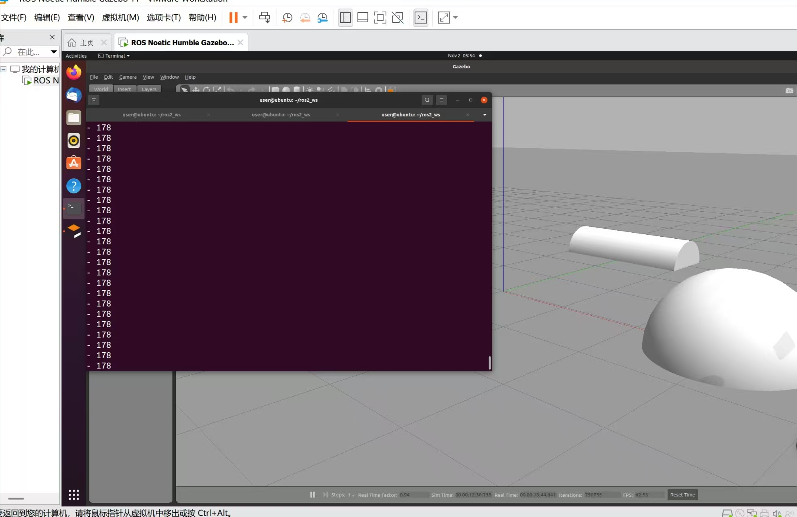
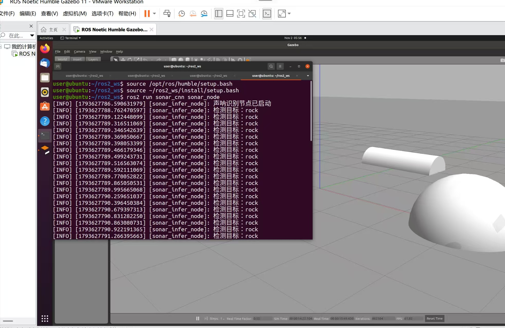

# water 功能包：水下 ROV 声呐图像 CNN 目标识别

## 概述

`water` 是 ROS2 Python 功能包，用 Gazebo 搭建水下场景，通过相机采集图像，用 3 层卷积网络对图像做 3 类目标分类（rock / pipe / sand），并把带标注的结果图发布到 RViz 或 `rqt_image_view`。

> 说明：当前 Gazebo 世界中使用的是普通 RGB 相机（`libgazebo_ros_camera.so`）模拟声呐成像，不是真实侧扫声呐传感器。若用于论文实验，应改为真实声呐数据集离线推理，或在文中如实说明"以相机图像代理声呐图像验证流程"。

## 目录结构

```
src/water
├── water/
│   ├── __init__.py
│   ├── sonar_model.py        # 网络定义（训练/推理共用）
│   ├── sonar_infer_node.py   # 推理节点
│   ├── train_sonar.py        # 训练脚本（ImageFolder 数据集）
│   └── capture_dataset.py    # 数据采集脚本（Gazebo 图像按类别存盘）
├── launch/
│   └── rov.launch.py
├── worlds/
│   └── underwater.world
├── weights/                  # 训练输出目录（*_weights.pth + classes.json，存在才安装）
├── resource/
│   └── water
├── package.xml
├── setup.cfg
└── setup.py
```

## 环境依赖

- ROS2（Humble 及以上）+ Gazebo classic
- `sudo apt install ros-$ROS_DISTRO-gazebo-ros-pkgs ros-$ROS_DISTRO-cv-bridge python3-opencv`（注意：是 Ubuntu 侧的 ROS2 环境，不是 Windows PowerShell）
- pip 依赖：

```bash
pip install torch torchvision --index-url https://download.pytorch.org/whl/cpu
pip install opencv-python -i https://pypi.tuna.tsinghua.edu.cn/simple
```

## 编译

```bash
colcon build --packages-select water
source install/setup.bash
```

## 数据集与权重说明

本仓库**不包含** `.pth` 权重，也不包含数据集图像：

- 权重是训练产物（数 MB 二进制），每次训练都会变化，按仓库约定不入库；`setup.py` 用
  `glob('weights/*.pth')` 做「存在才安装」，因此没有权重时 `colcon build` 依然能通过；
- 图像样本属于实验数据，体积大且与采集环境强相关，同样不入库；
- 所以「数据集 → 训练出权重 → 启动节点」是必要链路。节点在权重缺失时会直接报错退出，
  **不会**用随机权重输出假结果（这是刻意设计）。

### 数据集从哪来

三种方式任选，最终都整理成 ImageFolder 结构（`dataset/<类别>/*.png`）：

1. **Gazebo 采集（推荐，随包提供脚本）**：启动仿真后按类别存图，每个类别换几组 ROV
   位姿/光照多采几轮：

```bash
ros2 launch water rov.launch.py
# 另开终端，分别采集三类样本
ros2 run water capture_dataset --out dataset/rock --interval 0.5 --max 120
ros2 run water capture_dataset --out dataset/pipe --interval 0.5 --max 120
ros2 run water capture_dataset --out dataset/sand --interval 0.5 --max 120
```

2. **录包后离线抽帧**：`ros2 bag record -o sonar_run /sonar/camera/image_raw`，
   录完再把帧导出成图片，按类别分目录。
3. **公开声呐数据集**：找水下前视声呐（FLS）分类数据集，下载后按类别重排到
   `dataset/<类别>/`，注意统一成三通道 RGB。

> 当前 Gazebo 用普通 RGB 相机代理声呐成像，纹理与真实声呐不同；若改用公开真实声呐数据，
> 请在文档/论文中如实写明数据来源。

## 训练（必须先有数据集）

数据集按类别子文件夹组织：

```
dataset/
├── rock/*.jpg
├── pipe/*.jpg
└── sand/*.jpg
```

```bash
cd ~/ros2_ws
ros2 run water train_sonar --data /path/to/dataset --epochs 20 \
    --out src/water/weights/sonar_cnn_weights.pth
colcon build --packages-select water     # 重新编译，把 weights/*.pth 与 classes.json 装进 share/water/weights
source install/setup.bash
```

### 类别顺序（重要）

`ImageFolder` 按文件夹名**字母序**编号，`rock/pipe/sand` 三目录实际得到
`{'pipe': 0, 'rock': 1, 'sand': 2}`，并不是 `rock/pipe/sand`。

为避免这类静默错标，训练结束会自动把类别顺序写入权重同目录的 `classes.json`：

```json
["pipe", "rock", "sand"]
```

推理节点默认读取权重同目录的 `classes.json` 并打印 `从 ... 读取类别顺序`；只有该文件
缺失时才回退到 `classes` 参数（并打印警告）。因此**不要手工调整 `classes` 参数**，
除非你确认与训练时的字母序一致。

## 运行

启动前确认权重已装进安装空间，否则节点会直接报错退出：

```bash
ls install/water/share/water/weights          # 应看到 sonar_cnn_weights.pth 与 classes.json
ros2 launch water rov.launch.py
```

确认数据链路：

```bash
ros2 topic hz /sonar/camera/image_raw     # 应为 15 Hz 左右
ros2 topic echo /sonar/result --once      # 带标注的结果图
rqt_image_view                            # 选 /sonar/result 查看
```

常用参数覆盖（`classes` 一般不用改，见上一节）：

```bash
ros2 run water sonar_infer_node --ros-args \
  -p weight_file:=/absolute/path/sonar_cnn_weights.pth \
  -p image_topic:=/sonar/camera/image_raw \
  -p infer_period:=0.5 \
  -p device:=cuda
```

## 效果图





## 常见问题

| 现象 | 原因 | 处理 |
|---|---|---|
| Gazebo 打开后世界为空 / 报 world 解析错误 | world 文件未安装或 SDF 语法错误 | 确认 `install/water/share/water/worlds/underwater.world` 存在；`gz sdf -k src/water/worlds/underwater.world` 自检 |
| 节点一直无输出、`ros2 topic hz` 无数据 | 订阅话题与实际话题不一致 | 用 `ros2 topic list \| grep sonar` 确认真实话题名，再改 `-p image_topic:=` |
| 启动即报"未找到权重文件" | 未训练、未重新 colcon build，或权重路径不对 | 按「数据集与权重说明」采集数据并训练，权重放到 `src/water/weights/` 后重新 `colcon build`；或用 `-p weight_file:=<绝对路径>` 指定 |
| 类别标签总是固定错位（rock/pipe 互换） | 训练与推理的类别顺序不一致 | 确认权重同目录有 `classes.json`；没有就重跑训练生成，不要手填 `classes` |
| 图像全黑 | 相机贴住海床或场景过暗 | 已通过 `<static>true</static>` 固定 ROV；可调高 `rov` 的 pose z 值 |
