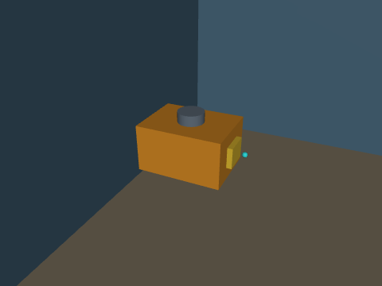

# ROV 水下机器人 MuJoCo 物理仿真与神经网络建图导航

在 MuJoCo 中搭建六自由度 ROV（遥控潜水器），完成**物理仿真与 6-DOF 键盘遥控**、
**声呐/深度感知与轨迹控制**、**建图导航与 SLAM 同步仿真**、**端到端声呐图航行**四项任务。
浮力/阻力/推力全部显式建模，飞控为速度+姿态串级控制器；感知、规划、控制与端到端网络
均为纯 NumPy 实现，通过 ROS Noetic 封装，`rostopic`/`main.py` 两种入口。



## 项目结构概览

```text
rov_mujoco_slam_nn_nav/
├── rov_mujoco_slam_nn_nav/             # 算法库
│   ├── model.py            # MJCF：ROV 本体 + 三个水域场景
│   ├── control.py          # 6-DOF 速度/姿态控制（浮力·阻力前馈）
│   ├── sim.py              # MuJoCo 内核（xfrc 推力 + 浮力 + 阻力）
│   ├── sensors.py          # 180 线声呐 / 24×32 深度 / IMU / 里程计
│   ├── mapping.py          # 对数几率栅格 + 相关扫描匹配
│   ├── planning.py         # A* + 膨胀代价地图
│   ├── nn.py               # NumPy MLP / CNN + Adam
│   ├── neural.py           # 四个网络的推理封装
│   └── nav.py              # 建图导航栈
├── scripts/                # sim / teleop / nav / e2e / metrics
├── launch/main.launch      # mode:=teleop|nav|e2e
├── models/                 # 4 个网络权重
├── tools/                  # 采集 / 训练 / 评测 / 录 GIF
├── tests/                  # 无 ROS 单元测试
├── main.py                 # 一键入口（不依赖 ROS）
├── CMakeLists.txt
└── package.xml
```

## 一、环境准备与依赖安装

| 项目 | 版本 |
| --- | --- |
| 系统 | Ubuntu 20.04 LTS |
| ROS | Noetic（Python 3.8） |
| 物理引擎 | MuJoCo 3.x |
| 其他 | numpy、pillow |

```bash
pip3 install --user "mujoco>=3.1,<3.3" numpy pillow
mkdir -p ~/rov_ws/src && cd ~/rov_ws
catkin_make && source devel/setup.bash
```

## 二、启动流程

```bash
# 6-DOF 键盘遥控
roslaunch rov_mujoco_slam_nn_nav main.launch mode:=teleop scene:=pool

# 建图 + 导航 + SLAM 同步
roslaunch rov_mujoco_slam_nn_nav main.launch mode:=nav scene:=trench

# 端到端声呐图
roslaunch rov_mujoco_slam_nn_nav main.launch mode:=e2e scene:=trench

# 不依赖 ROS
python3 main.py --mode nav --scene pipe_field
python3 main.py --mode test
```

按键：`W/S` 进退、`A/D` 横移、`R/F` 升沉、`Q/E` 偏航、`空格` 悬停、`X` 退出。
无图形界面加 `terminal:=false` 后手动 `rosrun rov_mujoco_slam_nn_nav teleop_node.py`。

## 三、实现要点

### 3.1 水动力模型

ROV 质量 12.9 kg、排水体积 13.2 L，净浮力约 +3 N；阻力按各轴线性+二次项建模：

$$
m\dot{\mathbf v}=\mathbf T+\mathbf B-mg\hat z-\big(c\,\mathbf v+q\,\mathbf v|\mathbf v|\big),
\qquad \mathbf B=\rho g V
$$

控制器给推力并把浮力、重力、阻力作为前馈抵消：

$$
\mathbf T=m k_v(\mathbf v_{ref}-\mathbf v)+\big(c\mathbf v+q\mathbf v|\mathbf v|\big)-\mathbf B+mg\hat z
$$

闭环因此退化为一阶跟踪。姿态用 PD 保持水平、偏航跟踪指令。
实测：定深 1 s 高度漂移 < 0.08 m；指令 0.5 m/s 前飞 2 s 位移 0.85 m。

### 3.2 声呐与建图

前视声呐用 180 条射线模拟（含噪声），1.0 m 定高扫描；对数几率栅格 + 相关扫描匹配
建图，A\* 在 0.46 m 膨胀代价地图上规划；执行层把前视点误差转成机体系速度
（ROV 可全向平移），交给 6-DOF 控制器。

### 3.3 神经网络

| 网络 | 结构 | 输入 → 输出 | 训练方式 |
| --- | --- | --- | --- |
| 感知 | MLP 9-32-32-1 | 9 线声呐滑窗 → 中心距离 | 自监督 |
| 规划 | MLP 124-64-64-2 | 11×11 局部栅格 + 目标 → 方向 | 克隆 A* |
| 控制 | MLP 6-64-64-3 | 距离/航向/三向净空 → $(v_x,v_y,\omega)$ | 克隆经典栈 |
| 端到端 | Conv(1→8,5×5,s2)+FC | 24×32 深度图 → $(v_x,v_y,\omega)$ | 行为克隆 |

## 四、实验结果

三场景闭环（目标 0.4 m 内成功）：

| 策略 | pool | pipe_field | trench |
| --- | --- | --- | --- |
| 经典栈 | ✅ 11.2 s / 0.392 m / ATE 0.073 | ✅ 9.7 s / 0.390 m / 0.013 | ✅ 9.3 s / 0.395 m / 0.015 |
| 神经规划+控制 | ❌ 90 s 未达 | ✅ 9.7 s / 0.391 m | ✅ 9.3 s / 0.392 m |
| 端到端 CNN | ❌ 坠底 | ❌ 坠底 | ❌ 坠底 |

离线指标：

| 指标 | 结果 |
| --- | --- |
| 声呐去噪 | RMSE 0.582 → 0.027 m |
| 规划方向误差 | 4.32°（验证集，99.4% 在 45° 内） |
| 控制器 | vx MAE 0.116，vy MAE 0.039，ω MAE 0.098 |
| 端到端 | vx MAE 0.564（数据仅 466 帧，明显欠拟合） |

**失败分析**：端到端网络只用单帧深度图、训练样本少，出航几米后就会撞壁；
神经规划在 pool 这种"目标被大障碍遮挡"的场景被目标方向主导。本包保留 A\* 作为
安全回退，并把经典栈作为默认演示路径。

## 五、常见报错与解决方法

### 1. `ModuleNotFoundError: No module named 'mujoco'`

`pip3 install --user "mujoco>=3.1,<3.3"`，确认 `python3 -c "import mujoco"` 通过。

### 2. `Package 'rov_mujoco_slam_nn_nav' not found`

没有 `source ~/rov_ws/devel/setup.bash`。

### 3. ROV 沉底 / 浮不起来

检查 `MODEL.VOLUME` 与质量是否匹配（净浮力应在 +2~+5 N）；`~depth` 低于 0.4 m 会触底。

### 4. 键盘节点没反应

`main.launch` 默认用 `xterm`，需要窗口焦点；SSH 场景用 `terminal:=false` 后 `rosrun`。

### 5. 导航一直 `blocked`

地图未建立，等 1–2 s；或把 `~inflation` 从 0.46 降到 0.32。

### 6. 虚拟机里录 GIF 黑屏

GIF 用 MuJoCo 离屏渲染，不需要显示器；渲染器在 `mj_forward` 之后创建（`sim.py` 已延迟）。

## 六、扩展方向

- 加 DVL/多波束声呐，做 3D 建图与海底地形测绘；
- 用洋流扰动测试控制鲁棒性（与 `mjc_rov_current_teleop` 的洋流模型对齐）；
- 端到端补数据（历史帧 + DAgger），或改用声呐极坐标图输入。
