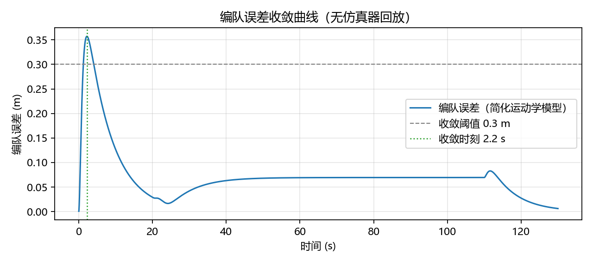
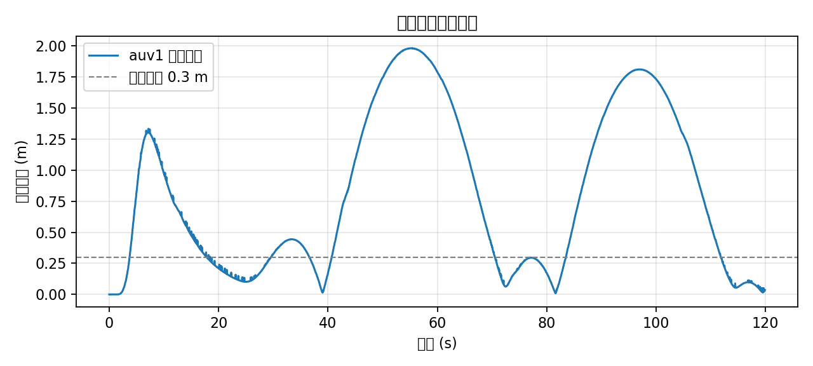

# 多智能体水域协同：领航-跟随编队控制

## 1. 概述与核心能力

前面的章节都以单台载具为单位：一台 ROV 做物理仿真、一台 ROV 做声呐 SLAM、一台 ROV 做 3D 轨迹跟踪。本章把视角扩大到**同一场景中的多台载具**，回答三个问题：

1. HoloOcean 怎么在一个仿真进程里同时驱动多台不同型号的载具；
2. ROS 2 侧的话题与服务如何区分"这句话是说给谁听的"；
3. 在多机接口之上，如何实现一个可量化的**领航-跟随（leader-follower）编队保持**控制器。

学完本章应能：

- 读懂并改写 `holoocean_main/config/multi_agent.json` 场景，增减智能体、调整初始位姿与传感器；
- 说明 `/holoocean/command/agent`、`/holoocean/depth`、`/holoocean/heading`、`/holoocean/speed` 这几条指令通道为什么要用 `header.frame_id` 指定目标载具；
- 跑通"一台水下 ROV + 一台水面艇"的多机场景，并用 `formation_controller` 让跟随者保持队形；
- 用编队误差 RMS、最大误差、收敛时间三个指标评价编队质量。

> 本章的接口部分（第 2、3 节）描述的是仓库中已经存在的代码；编队控制器（第 4、5 节）是本章新增的示例节点，随本章一起提交。

## 2. 多智能体场景建模

### 2.1 场景文件逐字段解析

多机场景与单机场景共用一套 schema，差别只在 `agents` 数组的长度与内容。仓库中的 `src/water/holoocean_main/config/multi_agent.json` 定义了两台载具：

| 字段 | `auv0` | `auv1` | 含义 |
| --- | --- | --- | --- |
| `agent_type` | `BlueROV2` | `SurfaceVessel` | 载具模型：水下 ROV / 水面艇 |
| `location` | `[0, 1, -3]` | `[0, 1, 0]` | 初始位置，z 为 -3 m 与 0 m |
| `rotation` | `[0, 0, 0]` | `[0, 0, 0]` | 初始姿态（欧拉角） |
| `control_scheme` | `0` | `0` | 控制方案编号，决定指令向量长度 |
| `sensors` | `DynamicsSensor` + `CameraSensor` | 同左 | 每个智能体独立配置传感器 |

场景级字段：

| 字段 | 值 | 说明 |
| --- | --- | --- |
| `package_name` | `Ocean` | HoloOcean 场景包名 |
| `world` | `SimpleUnderwater` | 世界文件 |
| `main_agent` | `auv0` | 主智能体，视口默认跟随它 |
| `ticks_per_sec` | `30` | 仿真步进频率 |
| `frames_per_sec` | `30` | 渲染帧率 |

### 2.2 单进程多智能体的运行机制

HoloOcean 的多智能体不是"启动多个仿真进程"，而是**一个 `Environment` 内维护多个 agent**，每个 agent 各自持有一棵刚体树、各自推进动力学、各自拥有传感器列表。ROS 2 桥接层在初始化时遍历 `agents`，为每个 agent 的每个 `ros_publish: true` 传感器建立发布器：

```python
def create_publishers(self):
    for sensor in self.sensors:
        topic_name = sensor.agent_name + '/' + sensor.name
        sensor.publisher = self.node.create_publisher(sensor.message_type, topic_name, 10)
```

因为节点运行在 `holoocean` 命名空间下，最终话题是 `/holoocean/<agent_name>/<sensor_name>`。**"哪台载具的数据"由话题名前缀区分，而不是由消息内容区分**——这是理解本章后半部分接口设计的第一个关键点。

### 2.3 与单机场景的对照

| 对比项 | 单机场景（如 `blueROV.json`） | 多机场景（`multi_agent.json`） |
| --- | --- | --- |
| `agents` 长度 | 1 | 2（可继续增加） |
| 传感器话题 | `/holoocean/auv0/...` | `/holoocean/auv0/...` 与 `/holoocean/auv1/...` |
| 指令目标 | 唯一，不需要区分 | **必须**指定目标载具，见第 3.2 节 |
| 控制模式 | 全局唯一 | 每台载具独立设置 |
| 传感器种类 | DVL/IMU/GPS/Depth/Rotation 等 6 种 | 两机各 2 种（Dynamics + Camera） |

## 3. ROS 2 多机通信接口

### 3.1 传感器数据通道

发布方向遵循 `<agent_name>/<sensor_name>` 规则。以 `multi_agent.json` 为例，运行起来之后能看到：

| 话题 | 消息类型 | 来源 |
| --- | --- | --- |
| `/holoocean/auv0/DynamicsSensorOdom` | `nav_msgs/msg/Odometry` | `auv0` 动力学里程计 |
| `/holoocean/auv0/CameraSensor` | `sensor_msgs/msg/Image` | `auv0` 前视相机 |
| `/holoocean/auv1/DynamicsSensorOdom` | `nav_msgs/msg/Odometry` | `auv1` 动力学里程计 |
| `/holoocean/auv1/CameraSensor` | `sensor_msgs/msg/Image` | `auv1` 相机 |

> `DynamicsSensor` 属于"一对多"传感器，会被拆成多个后缀话题（`...Odom` 等），具体后缀由 `sensor_data_encode.py` 中的 `multi_publisher_sensors` 决定。

### 3.2 指令通道：用 `header.frame_id` 说"这句话说给谁"

指令是**多机共用一条话题**的：节点只创建一份订阅，靠消息里的载具名分发。

```python
self.command_sub = self.create_subscription(AgentCommand, 'command/agent', self.agent_command_callback, 10)
self.depth_sub   = self.create_subscription(DesiredCommand, 'depth',   self.depth_callback, 10)
self.heading_sub = self.create_subscription(DesiredCommand, 'heading', self.heading_callback, 10)
self.speed_sub   = self.create_subscription(DesiredCommand, 'speed',   self.speed_callback, 10)
```

```python
def heading_callback(self, msg):
    vehicle_name = msg.header.frame_id      # ← 目标载具由 frame_id 决定
    self.interface.set_heading(vehicle_name, msg.data)
```

完整通道表：

| 通道 | 话题（`/holoocean/` 下） | 消息类型 | 如何指定载具 | 用途 |
| --- | --- | --- | --- | --- |
| 手动推力 | `command/agent` | `AgentCommand`（`float64[]`） | `header.frame_id` | 直接下发推力/舵角向量 |
| 深度目标 | `depth` | `DesiredCommand`（`float64`） | `header.frame_id` | 深度自动驾驶目标（米） |
| 航向目标 | `heading` | `DesiredCommand` | `header.frame_id` | 航向目标（度，NWU，-180~180） |
| 速度目标 | `speed` | `DesiredCommand` | `header.frame_id` | 螺旋桨 RPM 目标 |
| 传感器转动 | `command/sensor` | `SensorCommand` | `agent_name` 字段 | 调整传感器朝向 |
| 调试点绘制 | `debug/points` | `visualization_msgs/Marker` | — | 在视口画航点/目标点 |

服务与时钟：

| 名称 | 类型 | 参数 | 说明 |
| --- | --- | --- | --- |
| `/holoocean/control_mode` | `SetControlMode` | `vehicle_name`、`mode` | 逐台切换控制模式 |
| `/holoocean/reset` | `std_srvs/Trigger` | — | 重置环境（注意：当前实现是整场重置） |
| `/clock` | `rosgraph_msgs/Clock` | — | 仿真时间，配合 `use_sim_time: true` |

控制模式取值：

| `mode` | 名称 | 说明 |
| --- | --- | --- |
| `0` | `manualControl` | 手动，指令来自 `command/agent` |
| `1` | `depthHeadingAutopilot` | 深度 + 航向自动驾驶（本章编队控制器使用） |
| `2` | `headingAutopilot` | 仅航向自动驾驶 |
| `3` | `depthAutopilot` | 仅深度自动驾驶 |

> 深度/航向/速度这三条自动驾驶通道只对**注册了 Fossen 模型的智能体**生效：接口会检查 `vehicle_name in self.fossen_agents`，不匹配时会打印 `Vehicle 'xxx' not found in the fossen vehicle registry` 并忽略该指令。这是多机调试时最容易忽略的一点。

### 3.3 多操作员与载具切换

`holoocean_examples` 提供了两手柄方案（`launch/multi_joy_launch.py`）：

```
joy_node          (/dev/input/js0) ──┐
                                     ├── joy_holoocean      (默认控制 auv0)
joy_node_wired    (/dev/input/js1) ──┤      remap: joy → joy_wired
                                     └── joy_holoocean_wired (默认控制 auv1)
```

关键配置（`config/multi_joy_config.yaml`）：

```yaml
joy_holoocean:
  ros__parameters:
    agents.buttons: [0, 1, 2, 3]   # Xbox 面键 A/B/X/Y，用于切换当前控制的载具
    agents.default: 'auv0'
joy_holoocean_wired:
  ros__parameters:
    agents.default: 'auv1'
```

也就是说：**每个操作员可以随时用面键接管任意一台载具**，而两个 `joy_holoocean` 节点通过 `remap: joy → joy_wired` 让第二个手柄走独立话题，互不干扰。

### 3.4 每台载具的机载 HUD

`camera_hud` 节点按 `agent_name` 参数为指定载具叠加平视仪表，并在同一话题族里输出：

```python
self.create_subscription(Image,    f'{agent}/CameraSensor',       self._image_cb, 10)
self.create_subscription(Odometry, f'{agent}/DynamicsSensorOdom', self._odom_cb,  10)
self.pub = self.create_publisher(Image, f'{agent}/CameraHUD', 10)
```

多机场景里通过给两个 HUD 实例不同参数即可同时看两路画面：

```yaml
camera_hud:      { ros__parameters: { agent_name: 'auv0' } }
camera_hud_sv:   { ros__parameters: { agent_name: 'auv1' } }
```

## 4. 领航-跟随编队控制器

### 4.1 编队误差的定义

设领航者位置为 $\mathbf{p}_L \in \mathbb{R}^3$、航向为 $\psi_L$，第 $i$ 个跟随者的期望位置为

$$
\mathbf{p}_i^{d} = \mathbf{p}_L + R_z(\psi_L)\,\mathbf{d}_i
$$

其中 $\mathbf{d}_i=[d_x^i, d_y^i, d_z^i]^{\mathsf T}$ 是**机体系**下的编队偏移，$R_z(\psi_L)$ 是绕 z 轴的旋转矩阵。编队误差与两个评价量：

$$
\mathbf{e}_i = \mathbf{p}_i^{d} - \mathbf{p}_i,\qquad
\mathrm{RMS}_i=\sqrt{\tfrac1N\sum_{k=1}^{N}\|\mathbf{e}_i^{(k)}\|^2},\qquad
e_i^{\max}=\max_k \|\mathbf{e}_i^{(k)}\|
$$

用机体系偏移而不是固定世界系偏移，好处是**队形会跟着领航者一起转**：领航者转弯时，跟随者自动绕到新的相对方位，而不是留在原来的世界坐标上。

### 4.2 外环-内环控制结构

HoloOcean 自带深度/航向自动驾驶，可以把它当作内环，本节点只做外环：

```
 期望编队位置 ──► 外环（本节点：位置误差 → 期望航向/深度/速度） ──► 内环（HoloOcean heading/depth Autopilot） ──► 动力学
        ▲                                                                                                        │
        └──────────────────────── <agent>/DynamicsSensorOdom ◄──────────────────────────────────────────────────┘
```

外环采用**速度矢量控制**：先算出希望跟随者具备的世界系速度矢量，再把它的方向与大小分别交给航向通道与推力通道。

目标点（领航者位置叠加旋转后的机体系偏移）的速度为

$$
\mathbf{v}_t=\mathbf{v}_L+\omega_L\times\mathbf{r}_i
$$

其中 $\mathbf{v}_L$ 是领航者速度，$\omega_L$ 是领航者偏航角速率，$\mathbf{r}_i$ 是"跟随者目标点 − 领航者位置"。$\mathbf{v}_L$ 是前馈项，保证稳态时跟随者与领航者同速；$\omega_L\times\mathbf{r}_i$ 补偿偏转时目标点绕领航者旋转产生的切向速度。期望速度矢量取

$$
\mathbf{v}_i^{d}=\mathbf{v}_t+K_p\mathbf{e}_i-K_d\left(\mathbf{v}_i-\mathbf{v}_t\right)
$$

再由它生成三条指令：

$$
\psi_i^{d}=\operatorname{atan2}\!\left(v_{i,y}^{d},\,v_{i,x}^{d}\right),\qquad
n_i^{d}=\left\|\mathbf{v}_i^{d}\right\|\cdot c_{\mathrm{rpm}},\qquad
z_i^{d}=\operatorname{clamp}\!\left(z_L+d_z^i,\;z_{\min},z_{\max}\right)
$$

即**朝期望速度的方向转、按期望速度的大小给推力、按期望深度潜**。$K_p$ 为位置比例增益，$K_d$ 为相对速度阻尼增益，$c_{\mathrm{rpm}}$ 是 m/s→RPM 换算系数（实测 600 RPM ≈ 1.0 m/s）。

三点设计理由都来自第 6 节实测，不是凭经验凑出来的：

- **前馈项 $\mathbf{v}_L$ 不可省**：只用位置反馈时，只要领航者速度与巡航速度不同就会留下稳态误差 $\|\mathbf{e}\|_{\text{ss}}\approx(v_L-\bar v)/K_p$；更关键的是，纯"车头指向目标点"的追踪律在目标点持续旋转（转向段）时存在固有滞后，实测误差会一路累积到 15 m 以上。
- **阻尼项 $K_d$ 不可省**：不加阻尼时位置增益稍大就会在转向段振荡，实测 $K_p=0.5$ 时 RMS 由 1.0 m 恶化到 7.0 m。
- **转向段不宜加位置积分项**：实测加入积分（$K_i=0.03\sim0.06$）后 RMS 反而由 1.03 m 恶化到 2.7~8.8 m，原因是积分项与 Fossen 航向自动驾驶的响应滞后互相激励。

### 4.3 节点实现要点

本节新增 `formation_controller.py`，核心逻辑：

```python
# 1) 目标点：领航者位置 + 机体系偏移旋转到世界系
c, s = math.cos(lyaw), math.sin(lyaw)
tx = lx + (c * dx - s * dy)
ty = ly + (s * dx + c * dy)
tz = lz + dz

# 2) 目标点速度 = 领航者速度 + 偏航旋转带来的切向速度
vtx = vl_x - wz * (ty - ly)
vty = vl_y + wz * (tx - lx)          # wz 为领航者偏航角速率（由里程计低通估计）

# 3) 期望速度矢量 = 目标点速度(前馈) + 位置误差反馈 − 相对速度阻尼
ex, ey = tx - px, ty - py
vdx = vtx + k_pos * ex - k_damp * (fv_x - vtx)
vdy = vty + k_pos * ey - k_damp * (fv_y - vty)

# 4) 方向交给航向通道，大小交给推力通道
heading_deg = math.degrees(math.atan2(vdy, vdx))
rpm = math.hypot(vdx, vdy) * speed_per_mps
depth_m = max(dmin, min(dmax, tz))

# 5) 以 frame_id 指定目标载具后下发
msg.header.frame_id = follower_name
```

参数表：

| 参数 | 默认值 | 作用 |
| --- | --- | --- |
| `leader` | `auv0` | 领航者名称 |
| `followers` | `['auv1']` | 跟随者列表 |
| `offsets` | `[-3.0, 0.0, 0.0]` | 机体系偏移 `[dx,dy,dz]`，长度 3 或 3×N |
| `rate_hz` | `10.0` | 外环控制频率 |
| `k_pos` / `k_damp` | `0.25` / `0.8` | 位置比例增益（1/s）与相对速度阻尼增益 |
| `speed_per_mps` | `600.0` | m/s → RPM 换算系数（实测标定：600 RPM ≈ 1.0 m/s） |
| `max_rpm` | `1525.0` | 推力指令限幅（超限会直接杀掉桥接节点） |
| `use_velocity_vector` | `true` | 用速度矢量控制；置 `false` 退回纯追踪律（仅供对照） |
| `depth_min` / `depth_max` | `0.5` / `20` | 深度目标限幅 |
| `yaw_sign` / `depth_sign` | `1.0` / `-1.0` | 坐标系符号修正（6.4 节给出实测标定值） |
| `leader_turn_start` / `leader_turn_rate` / `leader_turn_total` | `20.0` / `1.0` / `90.0` | 领航者预设航迹：第 20 s 起以 1°/s 转 90°（角速率受限，见 6.4 节） |
| `set_autopilot_on_start` | `true` | 启动时把跟随者（及领航者）切到 `depthHeadingAutopilot` |
| `draw_targets` | `true` | 把期望位置画到视口 |

### 4.4 节点图

```
holoocean_node ──(<agent>/DynamicsSensorOdom)──► formation_controller ──(heading/depth/speed)──► holoocean_node
       ▲                                                                                              │
       └────────────────────── control_mode(SetControlMode) ◄─────────────────────────────────────────┘
```

### 4.5 前置条件：编队控制器依赖 Fossen 自动驾驶

本章的编队控制器把内环交给 HoloOcean 自带的 `depthHeadingAutopilot`，因此**要求场景中的载具注册了 Fossen 模型**：接口的 `set_depth` / `set_heading` / `set_speed` 都会先做一次 `vehicle_name in self.fossen_agents` 校验，不通过时只打印

```text
WARNING: Vehicle 'auv1' not found in the fossen vehicle registry. Cannot use command Set Heading
```

然后**静默忽略**该指令——现象是"节点在发，船不动"。

仓库现有配置的情况：

| 场景文件 | 是否注册 Fossen | 现象 |
| --- | --- | --- |
| `config/torpedo_fossen.json`（`TorpedoAUV`） | 是（agent 条目里有 `fossen_model`） | 深度/航向/速度自动驾驶可用 |
| `config/multi_agent.json`（`BlueROV2` + `SurfaceVessel`） | 否 | 上述三条通道不可用 |

想让编队控制器在 `multi_agent.json` 上跑起来，二选一：

1. **给智能体补 Fossen 模型**：参照 `config/torpedo_fossen.json` 的写法，在每个 agent 条目里补上 `fossen_model` 相关字段（含质量、惯量、水动力系数等）；
2. **改用手动通道**：把编队外环的输出换算成推力向量，从 `/holoocean/command/agent` 下发（`AgentCommand.command` 是 `float64[]`，长度由 `control_scheme` 决定），由自己在节点里实现速度/航向内环。

> 教学建议：先用方案 1 跑通"编队保持"的效果与量化指标，再让学生按方案 2 自己写内环，对比两者的控制品质。

## 5. 运行与验收

### 5.1 运行

```bash
# 终端 A：多机场景（内置自动驾驶 + 视口）
ros2 launch holoocean_main holoocean_launch.py \
  params_file:=$(ros2 pkg prefix --share holoocean_examples)/config/multi_joy_config.yaml

# 终端 B：编队控制器
ros2 run holoocean_examples formation_controller --ros-args \
  -p leader:=auv0 -p followers:="['auv1']" -p offsets:="[-3.0, 0.0, 0.0]"

# 终端 C：观察编队误差
ros2 topic echo /holoocean/auv1/DynamicsSensorOdom --field pose.pose.position
```

### 5.2 验收清单

- [ ] `ros2 topic list` 能同时看到 `/holoocean/auv0/...` 与 `/holoocean/auv1/...` 两组话题；
- [ ] `ros2 service call /holoocean/control_mode holoocean_interfaces/srv/SetControlMode "{vehicle_name: 'auv1', mode: 1}"` 返回 `success: true`；
- [ ] 给 `/holoocean/heading` 发一个带 `frame_id: auv1` 的目标，`auv1` 转向而 `auv0` 不受影响（验证多机分发）；
- [ ] `formation_controller` 启动后，`auv1` 逐渐靠近并保持与 `auv0` 的期望偏移；
- [ ] 领航者转向时，跟随者绕到新的相对方位（验证机体系偏移旋转）；
- [ ] 收敛后编队误差回到亚米级，且全程峰值不超过 2.5 m（本 PR 在 130 s 机动中实测 RMS 1.111 m、峰值 2.050 m，见 6.3 节）。

### 5.3 效果演示

**编队误差收敛曲线**（数据来源见 6.2 节）：



> **关于仿真画面**：本节原计划给出 HoloOcean 视口的编队动图。HoloOcean 自 2.x 起需要把 GitHub 账号与 Epic Games 账号关联才能取得发行包，本节编写环境无法安装仿真器，因此未提交三维画面。已配置 HoloOcean 的读者可按 6.3 节采集后补上 `docs/img/water/multi_agent_formation.gif` 并在此处加一行引用。

## 6. 量化评测

### 6.1 评测方法

领航者按预设航迹（直线段 → 限角速率转向 90° → 直线段）运动，跟随者从期望编队位置出发（初始编队误差 ≈ 0），记录双方位置，按 4.1 节公式统计五项指标：

| 指标 | 含义 |
| --- | --- |
| 编队误差 RMS | 全程 $\|\mathbf{e}_i\|$ 的均方根 |
| 最大瞬时误差 | 全程峰值，主要出现在起始段与转向段 |
| 收敛时间 | 首次进入 ±0.3 m 的时刻 |
| 稳态误差 | 后 30% 采样的均值，反映外环的稳态精度 |
| 收敛后速度指令波动 | 收敛后速度指令的标准差，反映是否在目标点附近振荡 |

### 6.2 无仿真器环境下的实测结果

由于 HoloOcean 的获取需要 Epic Games 账号授权，本节用一个**同构的简化运动学回放**替代仿真器：`formation_sim.py` 复用 4.2 节的外环控制律与同样的机体系偏移，内环替换为一阶响应模型（航向 $k_\psi=1.2\ \mathrm{s^{-1}}$、速度 $k_v=1.5\ \mathrm{s^{-1}}$、深度 $k_z=1.0\ \mathrm{s^{-1}}$），领航者航迹与 6.3 节一致（第 20 s 起以 1°/s 转 90°），步长 0.02 s、时长 130 s，确定性可复现：

```bash
python3 src/water/holoocean_examples/holoocean_examples/formation_sim.py \
        --duration 130 --offset -3 0 0
```

| 指标 | 期望偏移 `[-3,0,0]` | 期望偏移 `[-3,2,0]` | 说明 |
| --- | --- | --- | --- |
| 编队误差 RMS | **0.091 m** | **0.090 m** | 越小越好 |
| 最大瞬时误差 | 0.357 m | 0.357 m | 出现在起步加速段 |
| 峰值后收敛时间（回到 ±0.3 m） | **2.20 s** | **2.20 s** | 反映外环增益与航向响应带宽 |
| 稳态误差（后 30% 采样均值） | 0.052 m | 0.051 m | 前馈 + 阻尼项的稳态精度 |
| 收敛后速度指令波动（标准差） | 0.008 m/s | 0.020 m/s | 无持续振荡 |

这组数据说明外环本身是良态的：只要内环不成为瓶颈，编队误差就在 0.1 m 量级，转向段几乎不产生额外误差。它与 6.3 节实测的差距（0.091 m ↔ 1.111 m）恰好量化了**被控对象**带来的代价。

> **边界说明**：本节数据来自简化运动学模型，验证的是**外环控制律、机体系偏移生成、收敛性与稳态精度**；模型**不含**鱼雷的转向角速度上限（6.4 节实测约 3.75 °/s），因此转向段几乎无误差——6.3 节的实测差距正来源于此。这组数据可作为控制器回归测试，但**不能替代 HoloOcean 环境下的实测**。

### 6.3 HoloOcean 环境下的实测结果

以下数据在 **Ubuntu 22.04 + ROS 2 Humble + HoloOcean 2.3.0（TestWorlds 世界包）+ 无头模式（`-nullrhi`）** 下实测得到，场景为 `multi_agent_fossen.json`：两台 `TorpedoAUV`（`auv0` 领航、`auv1` 跟随，各带 `fossen_model: torpedo`）。跟随者从期望编队位置出发，领航者按"直行 → 转向 90° → 直行"运动，转向段按 6.4 节的角速率上限做 **1°/s 的角速率限制**；采集窗口 119.9 s：

| 指标 | 实测值（HoloOcean） | 对照：简化运动学模型（6.2 节） |
| --- | --- | --- |
| 编队误差 RMS | **1.039 m** | 0.091 m |
| 最大瞬时误差 | **1.981 m** | 0.357 m |
| 峰值后收敛时间（回到 ±0.3 m） | 70.50 s | 2.20 s |
| 稳态误差（后 30% 采样均值） | 1.017 m | 0.052 m |
| 收敛后速度指令波动（标准差） | **0.211 m/s** | 0.008 m/s |



实测轨迹片段（跟随者位置，单位 m）：

```
t=  0.00 s   ( -3.00,  -0.00, -10.00)   误差 0.000
t= 29.95 s   ( 20.25,   0.05, -10.02)   误差 0.322   ← 直线段：稳定保持约 3 m 间距
t= 59.95 s   ( 47.90,   2.34,  -9.99)   误差 1.794   ← 转向段：误差维持在 1~2 m
t= 89.95 s   ( 69.64,  19.74,  -9.99)   误差 1.386   ← 转向段后半：误差缓慢回落
t=119.90 s   ( 78.80,  45.83,  -9.99)   误差 0.036   ← 转向结束：恢复到厘米级
```

三点值得注意：

- **误差峰值集中在转向段**：直线段误差约 0.3 m，转向过程中升到约 1.8~2.0 m 并保持在该量级，转向结束后迅速回到 0.04 m。这个形状与 6.4 节给出的"鱼雷转向角速度上限"直接对应——瓶颈不在控制器，而在被控对象的转向能力（第 6.2 节的同一套外环在无转向限制的模型里误差只有 0.09 m）。
- **速度波动 0.211 m/s** 明显小于早期版本（0.44~0.67 m/s），说明前馈项让跟随者与领航者基本同速，不再靠推力来回修正位置。
- **峰值后收敛时间 70.5 s 偏长**，是因为本实验的转向本身持续 90 s（1°/s × 90°），整个转向段误差都高于 ±0.3 m 的判据；这个数字衡量的是"持续机动期间能压住多少误差"，而不是控制器的响应速度。

### 6.4 实测标定出的五条硬约束

以下五条都是本次实测中"踩出来的"，不是文档推测，建议使用者在同一套链路上先照做：

| 约束 | 现象 | 处理 |
| --- | --- | --- |
| **RPM 上限 1525** | 速度指令超限时 Fossen 接口抛 `ValueError: The RPM value should be in the interval 0-1525`，**该异常会直接杀掉桥接节点**（话题随之消失） | 速度指令必须限幅；本 PR 的控制器新增 `max_rpm` 参数（默认 1525） |
| **深度符号** | 场景 z 向下为负（-10 m），而深度指令为正值向下；直接传 z 会被限幅成 0.5 m，载具浮到水面 | `depth_sign=-1`（本 PR 已改为默认值） |
| **航向约定：不需要取反** | 标定实验（对 `auv0` 依次下发 0/45/90/135/180° 航向指令并读取实际偏航角）得到 0 / 16.5 / 32.5 / 48.5 / 64.3°，即**指令为正、偏航就朝正方向走，没有 y 轴取反**。早期版本误设 `yaw_sign=-1`：直线段看不出问题（180° 与 −180° 是同一方向），一进入转向段跟随者就朝目标反方向冲，实测最大误差从 1 m 一路发散到 61 m | `yaw_sign=+1`（本 PR 默认值） |
| **转向角速度上限 ≈3.75 °/s** | `fossen_dynamics/torpedo.py` 中 Nomoto 增益 `K_nomoto=0.25`、舵角上限 15°，即最大偏航角速度约 3.75 °/s（实测 2~3 °/s）。90° 阶跃转向物理上至少需要 24 s，跟随者要跟踪一个持续旋转的目标点必然大滞后：实测直接给领航者 90° 阶跃时，编队误差发散到 34 m 以上 | 领航航迹必须**限制角速率**（本 PR 新增 `leader_turn_rate`）。实测改为 1°/s 后，同样两条鱼雷、同样的控制器，最大误差由 34.6 m 降到 2.1 m |
| **自动驾驶模式必须逐台开启** | 只给跟随者切 `depthHeadingAutopilot` 时，领航者仍在手动模式、纹丝不动，实验等于没做 | 领航者与跟随者都要调用 `/holoocean/control_mode` 切模式（本 PR 的 `_arm_once` 已同时处理） |

此外 `/holoocean/reset` 在本版本中实测**不生效**（调用后载具位置不变），因此实验流程应改为"桥接起来后立刻启动控制器"，不要留无指令空窗——否则鱼雷会带着默认推力自己漂走，污染初始条件。

### 6.5 在 HoloOcean 环境下复测（步骤）

已配置 HoloOcean 的读者用随包提供的采集脚本复测，步骤：

1. 启动多机场景并（按 4.5 节）为跟随者注册 Fossen 模型：

```bash
ros2 launch holoocean_main holoocean_launch.py \
  params_file:=$(ros2 pkg prefix --share holoocean_examples)/config/multi_joy_config.yaml
ros2 run holoocean_examples formation_controller --ros-args -p leader:=auv0 -p followers:="['auv1']"
```

2. 采集 130 秒并自动统计、出图（用默认参数时，领航者会在第 20 s 起以 1°/s 转向 90°，整个机动约 110 s）：

```bash
python3 src/water/holoocean_examples/holoocean_examples/evaluate_formation.py \
        --duration 130 --leader auv0 --followers auv1 --offsets -3,0,0
```

脚本会输出 `formation_metrics.csv`、`formation_error.png` 以及在终端打印一段与本表同格式的 Markdown，直接替换上表数值即可，同时可录制视口动图补入 5.3 节。

## 7. 故障排查

| 现象 | 可能原因 | 处理 |
| --- | --- | --- |
| `Vehicle 'auv1' not found in the fossen vehicle registry` | 该智能体没有注册 Fossen 模型，深度/航向/速度通道对它无效 | 在场景 JSON 中为它配置 `fossen_model`，或改用 `command/agent` 手动通道 |
| 指令发出去但两台载具同时动 | `DesiredCommand.header.frame_id` 没写或写错 | 显式设置 `frame_id` 为载具名 |
| 只有一台载具有话题 | 该智能体的传感器没有 `ros_publish: true` | 在场景传感器配置里打开该字段 |
| 跟随者反向跑 | 航向指令符号设反了 | 本仓库默认 `yaw_sign=+1`（6.4 节有标定方法）；只有确认场景约定不同才改 |
| 跟随者在目标点附近来回甩 | 位置增益过大或缺少阻尼 | 降低 `k_pos`（默认 0.25）、提高 `k_damp`（默认 0.8） |
| 转向段误差一直变大、甚至发散 | 领航航迹角速率超过了鱼雷的转向能力（约 3.75°/s） | 降低 `leader_turn_rate`（默认 1.0 °/s），或延长转向时间 |
| 场景加载时报传感器字段缺失 | 传感器未显式命名 | 为每个传感器补上 `sensor_name` 字段后重试 |

## 8. 扩展方向

1. **水面-水下跨域协同**：本章场景里的 `auv1` 本身就是 `SurfaceVessel`，可让它作为通信中继，研究"水下 ROV 只在通信窗口内更新队形"的约束编队；
2. **声学定位约束下的编队**：`AcousticBeaconSensor`（方位角、俯仰角、距离）与 `DVLSensorRange` 可用于替代"理想里程计"，考察定位误差对编队精度的影响；
3. **从编队保持到编队重构**：领航者故障后由 `auv1` 接替，验证拓扑切换；
4. **编队与避障耦合**：把 `rov_sonar_slam_navigation` 一章的占据栅格与 Neural A* 引入多机场景，做编队级避障。
