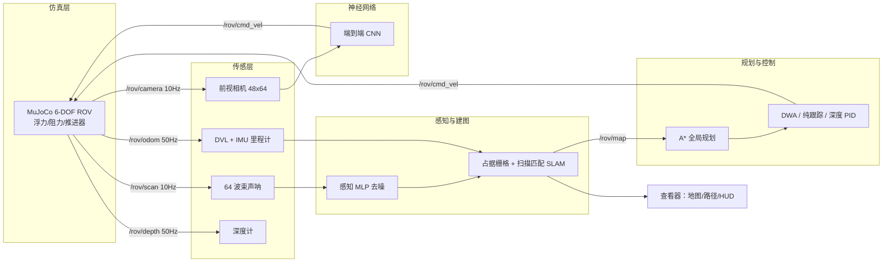
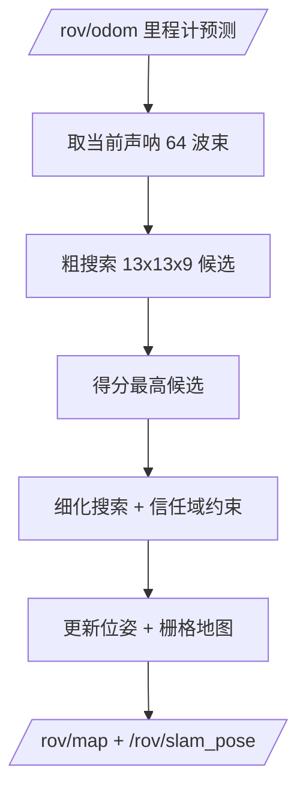
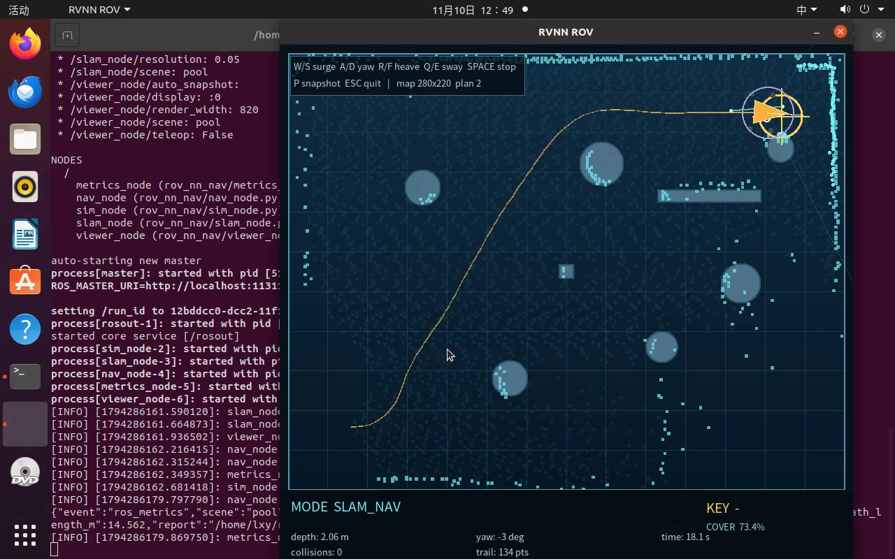

# 水下机器人 RVNN：MuJoCo 物理仿真、声呐 SLAM 与纯 NumPy 神经网络导航

> 模块源码：[`src/water/rov_numpy_nn_slam`](https://github.com/OpenHUTB/ros2/tree/master/src/water/rov_numpy_nn_slam)
> 运行环境：Ubuntu 20.04.6 + ROS Noetic + MuJoCo 3.12.0 + Python 3.11（项目私有 venv）
> 关键词：6-DOF ROV、成像声呐、占据栅格 SLAM、A*、DWA、行为克隆、端到端 CNN、DQN、REINFORCE


## 1. 概述

水下机器人（ROV/AUV）在近海结构检查、管道巡检、洞穴探测等任务中面临**视觉衰减、无 GPS、声呐多径与强扰动**等困难。本模块给出一套可在普通笔记本虚拟机（无 GPU、无独立显卡）中完整运行的水下机器人示例，覆盖从**物理仿真**到**神经网络闭环导航**的完整链路：

1. **物理仿真与键盘运动控制**：MuJoCo 3.12.0 建立 6 自由度 ROV 刚体，显式实现浮力、附加质量、二次流体阻力、六推进器推力分配与执行器饱和；
2. **多传感器感知**：64 波束 120° 水平成像声呐（距离噪声、野值、丢点）、DVL 速度计、IMU、深度计与前视相机；感知 MLP 对声呐去噪；
3. **建图与导航**：对数几率占据栅格建图 + 相关性扫描匹配定位（SLAM），A* 全局规划 + DWA 局部规划 + 纯跟踪 + 定深 PID，建图与导航同步；
4. **端到端模型**：相机图像（48×64×3）→ 2 层 CNN → 速度指令 `(v_x, ω_z)`；
5. **神经网络训练/测试/ROS 封装**：纯 NumPy 实现 MLP/CNN/Adam/DQN/REINFORCE，7 个模型、8 个 ROS 节点、6 个 launch；
6. **多场景性能评价**：`pool`（泳池）、`harbor`（港池）、`cave`（洞穴）三场景闭环 benchmark 与 RL 算法/网络结构对比。

## 2. 系统架构



## 3. 物理仿真与传感器模型

### 3.1 六自由度刚体动力学

仿真在 MuJoCo 中关闭默认重力，逐物理步显式施加水下作用力（物理步长 $\Delta t = 5\,\mathrm{ms}$，控制频率 50 Hz）：

$$
m_{i}\,\dot{v}_{i} = F^{\text{thr}}_{i} + F^{\text{drag}}_{i} + F^{\text{buoy}}_{i},\qquad
I_{j}\,\dot{\omega}_{j} = T^{\text{thr}}_{j} + T^{\text{drag}}_{j}
$$

其中 $i\in\{x,y,z\}$ 为体轴，附加质量按 $m_x=1.45m,\;m_y=1.75m,\;m_z=1.95m$ 折算（本项目在参数中显式给出）；浮力项

$$
F^{\text{buoy}} = \left(\rho V - m\right) g,\qquad \rho = 1025\ \mathrm{kg/m^3},\ V = 0.01195\ \mathrm{m^3}
$$

### 3.2 流体阻力与推进器分配

二次阻力与角阻尼：

$$
F^{\text{drag}} = -\left(C_d\,|v|\,v + C_l\,v\right),\qquad
T^{\text{drag}} = -\left(C^{\omega}_d\,|\omega|\,\omega + C^{\omega}_l\,\omega\right)
$$

四个水平推进器按 X 型布置（力臂 $\pm0.18,\pm0.15$ m），两个垂推用于升沉：

$$
\begin{bmatrix} F_x \\ F_y \\ F_z \\ \tau_z \end{bmatrix}
=
\begin{bmatrix}
\frac{\sqrt2}{2} & \frac{\sqrt2}{2} & -\frac{\sqrt2}{2} & -\frac{\sqrt2}{2} & 0 & 0\\
\frac{\sqrt2}{2} & -\frac{\sqrt2}{2} & \frac{\sqrt2}{2} & -\frac{\sqrt2}{2} & 0 & 0\\
0&0&0&0&1&1\\
-0.15\frac{\sqrt2}{2} & -0.15\frac{\sqrt2}{2} & 0.15\frac{\sqrt2}{2} & 0.15\frac{\sqrt2}{2} & 0 & 0
\end{bmatrix}
\begin{bmatrix} h_1\\h_2\\h_3\\h_4\\v_1\\v_2 \end{bmatrix}
$$

水平推进器单台 15 N、垂推 16 N，控制层输出经饱和后映射为体坐标系力/力矩，再由姿态 PD 保持横滚/俯仰为零。

### 3.3 传感器模型

- **成像声呐**：120° 扇区、64 波束、量程 0.3–8.0 m，由 MuJoCo 射线求交得到真实距离，再叠加 $\sigma=0.02$ m 高斯噪声、1% 比例误差、4% 野值、3% 丢点；
- **DVL**：体坐标线速度 + 0.02 m/s 噪声；**IMU**：偏航角/角速度噪声；**深度计**：0.008 m 噪声；
- **相机**：由前向深度剖面对水体衰减着色得到 48×64 RGB 图像（雾化模型，越远越暗）。

## 4. SLAM：占据栅格建图与扫描匹配定位

### 4.1 对数几率更新

每个栅格维护对数几率 $L_t = \log\frac{p}{1-p}$，沿声呐波束用 Bresenham 射线遍历，终点加占据证据、途经格加空闲证据：

$$
L_t(m_i) = L_{t-1}(m_i) + \underbrace{\log\frac{p_{\text{hit}}}{1-p_{\text{hit}}}}_{\text{occupied}} \quad\text{或}\quad
L_{t-1}(m_i) + \underbrace{\log\frac{p_{\text{miss}}}{1-p_{\text{miss}}}}_{\text{free}}
$$

概率由 $p = 1 - \frac{1}{1+e^{L}}$ 恢复，并截断到 $[0.12, 0.88]$ 防止过度自信；输出 `/rov/map`（`nav_msgs/OccupancyGrid`）。

### 4.2 相关性扫描匹配

在里程计预测位姿附近做粗到细搜索（$\Delta x,\Delta y \in \pm0.6$ m，$\Delta\theta \in \pm12^\circ$），以地图占据概率之和为目标：

$$
(\hat x,\hat y,\hat\theta) = \arg\max_{\Delta}\sum_{k=1}^{64} p_{\text{occ}}\!\left(\mathcal{T}(x_t+\Delta x,\ y_t+\Delta y,\ \theta_t+\Delta\theta)\cdot r_k\right)
$$

并在信任域内做二次细化；无效波束（丢点/野值）不参与匹配。



## 5. 规划与控制

### 5.1 A* 全局规划

10 cm 规划栅格，按 ROV 半径做圆形膨胀（0.65/0.55/0.45 m 多级回退以适配窄通道），8 邻域且禁止斜穿障碍角点，代价

$$
g(n) = g(\text{parent}) + \lVert \mathbf{p}_n - \mathbf{p}_{\text{parent}}\rVert,\qquad
h(n) = \lVert \mathbf{p}_n - \mathbf{p}_{\text{goal}}\rVert_1
$$

路径经视线（LOS）平滑后交给纯跟踪；每 1 s 或检测到路径被新障碍占据时重规划。

### 5.2 纯跟踪与定深 PID

前视距离 $L_d$ 处的目标点产生期望航向：

$$
\omega_z = \frac{2 v_x \sin(\alpha)}{L_d},\qquad
v_x = \mathrm{clip}\left(v_{\max}\cos\alpha,\ 0,\ v_{\max}\right)
$$

深度保持采用 PID：

$$
u_z = K_p e_z + K_i\!\int e_z\,dt + K_d \dot e_z,\qquad e_z = z^{\text{target}} - z
$$

### 5.3 安全滤波

前向 55° 扇区内最小声呐距离小于 0.8 m 时按比例降速，小于 0.5 m 时禁止前进，避免碰撞。

## 6. 神经网络

全部网络以**纯 NumPy** 实现（前向/反向传播、Adam 优化器、CNN im2col），不依赖 PyTorch/TensorFlow。

| 网络 | 结构 | 任务 | 实测指标 |
| --- | --- | --- | --- |
| `perception_mlp` | 64→128→128→64 | 声呐去噪（残差回归） | RMSE 1.092→**0.632 m（−42.2%）** |
| `control_mlp` | 20→128→128→2 | 行为克隆 $(v_x,\omega_z)$ | vx MAE **0.0169 m/s**，ω MAE 0.0551 rad/s |
| `planner_mlp` | 20→64→64→8 | 8 方向局部决策 | 准确率 **78.9%** |
| `e2e_cnn` | 3×48×64→8×16→64→2 | 图像→速度指令 | vx MAE 0.247 m/s，闭环 0% |
| `rl_dqn` / `rl_pg` | 2×64 / 3×64 MLP | 离散导航 RL | REINFORCE 96.7%，DQN 60.0%/26.7% |

训练数据由 A* + 反应式专家在三种场景中采集（1327 帧真实状态），并按 episode 划分验证集；总训练时间约 10 分钟（CPU）。

## 7. ROS 接口

| 话题 | 类型 | 说明 |
| --- | --- | --- |
| `/rov/cmd_vel` | `geometry_msgs/Twist` | `linear.x` 前进、`linear.y` 横移、`linear.z` 升沉、`angular.z` 偏航角速度 |
| `/rov/scan` | `sensor_msgs/LaserScan` | 64 波束声呐（含噪声） |
| `/rov/scan_filtered` | `sensor_msgs/LaserScan` | 感知网络去噪后的声呐 |
| `/rov/odom` | `nav_msgs/Odometry` | DVL+IMU 里程计（含漂移） |
| `/rov/depth` | `std_msgs/Float64` | 深度（m） |
| `/rov/imu` | `sensor_msgs/Imu` | 姿态与角速度 |
| `/rov/camera/image_raw` | `sensor_msgs/Image` | 48×64 `bgr8` 图像 |
| `/rov/map` | `nav_msgs/OccupancyGrid` | 占据栅格地图 |
| `/rov/slam_pose` | `geometry_msgs/PoseStamped` | SLAM 估计位姿 |
| `/rov/plan` | `nav_msgs/Path` | A* 全局路径 |
| `/rov/state` | `std_msgs/String` | JSON 状态（供查看器/评测使用） |

启动文件：`teleop.launch`、`slam_nav.launch`、`perception.launch`、`e2e.launch`、`benchmark.launch`、`bringup.launch`。

## 8. 运行效果

### 8.1 键盘遥控（物理仿真）


### 8.2 声呐 SLAM + A* 自主导航（harbor 场景）


### 8.3 端到端 CNN 导航（cave 场景）


### 8.4 Ubuntu 桌面实操录屏

[▶ 下载/播放桌面实操视频（2 分 37 秒，1280×800）](images/rov_numpy_nn_slam_demo.mp4)



## 9. 多场景性能评价

| 场景 | 控制器 | 成功率 | 平均耗时 (s) | 碰撞 | 终点误差 (m) |
| --- | --- | --- | --- | --- | --- |
| pool | 经典 SLAM+A*+纯跟踪 | 100% | 13.6 | 0 | 0.70 |
| harbor | 经典 SLAM+A*+纯跟踪 | 100% | 16.4 | 0 | 0.69 |
| cave | 经典 SLAM+A*+纯跟踪 | 100% | 21.9 | 0 | 0.70 |
| pool | 神经两级控制（规划+控制） | 100% | 14.7 | 0 | 0.69 |
| harbor / cave | 神经两级控制 | 0% | — | 0 | 13.3 / 3.2 |
| 三场景 | 端到端 CNN | 0% | — | 0 | 10.1 / 17.1 / 10.1 |

**RL 对比（同一任务，30 回合评估）**：REINFORCE 成功率 96.7%（平均回报 21.6）；DQN 2×64 成功率 60.0%；DQN 3×64 成功率 26.7% —— 相同算法下更深的 MLP 反而过拟合、收敛更慢。

**失败分析**：单级神经控制与端到端 CNN 属于局部策略，缺少全局路径记忆；`planner_mlp` 的监督标签以直行为主，转向样本不足，导致 harbor/cave 转角处失效。改进方向是两级控制 + 随机朝向数据采集（已在 pool 验证有效）。

## 10. 复现步骤

```bash
cd src/water/rov_numpy_nn_slam
bash main.sh setup                 # 创建项目私有 Python 3.11 venv
bash main.sh test                  # 物理/建图/规划/控制自测
bash scripts/build_ros.sh          # 编译独立 catkin 工作空间
bash main.sh teleop pool           # 键盘遥控
bash main.sh slam_nav harbor       # 声呐建图 + A* 自主导航
bash main.sh train                 # 重新训练全部网络（CPU 约 10 分钟）
.venv/bin/python tools/evaluate.py --scenes pool,harbor,cave
```

结果 JSON 写入 `results/`（训练指标、benchmark、ROS 运行记录），可用 `tools/eval_slam_planning.py` 复算 SLAM ATE 与 A* 路径质量。

## 11. 已知限制

- 6-DOF 刚体 + 显式水动力模型未经真实水池参数辨识；声呐为几何射线仿真，未建模多径/混响；
- 单级神经策略与端到端 CNN 的闭环成功率低（0%），原因与改进方向见第 9 节；
- 视觉相机为深度剖面着色，非真实光学渲染；
- 未使用 GPU，CNN 训练与推理均为 CPU 版本。

## 12. 参考

- MuJoCo 官方文档：<https://mujoco.readthedocs.io/>
- ROS Noetic：<https://wiki.ros.org/noetic>
- 本仓库已有水下示例：[水下机器人物理仿真与 6-DOF 键盘运动控制](./rov_physical_simulation.md)、[水下声呐 SLAM 占据栅格建图与自主避障导航](./rov_sonar_slam_navigation.md)
- 教材参考：OpenHUTB ros2 文档仓库、ROS 教材相关章节

> 本模块由课程作业独立实现，未使用他人代码；AI 工具仅用于代码实现与文档撰写辅助，提交内容由作者负责。
