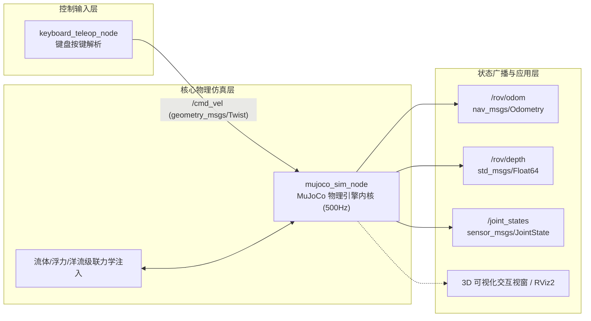
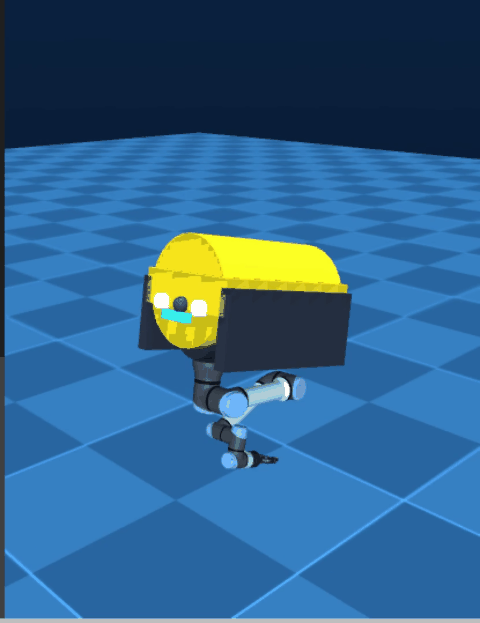

# 任务 1：物理仿真与 6-DOF 键盘运动控制

## 1. 运行环境

- Ubuntu 22.04 + ROS2 Humble + MuJoCo 3.12.0
- 无头测试：`MUJOCO_GL=osmesa`
- 3D 视窗：`LIBGL_ALWAYS_SOFTWARE=1 MUJOCO_GL=glfw`
## 1. 概述与目标

本模块旨在建立水下遥控无人潜水器（Remote Operated Vehicle, ROV）在真实水下流体介质中的物理仿真环境，实现六自由度（6-DOF）空间动力学响应计算，并通过标准 ROS 2 话题架构接入键盘遥控输入，完成全向运动操控。

### 核心任务目标
1. **真实水下多物理场建模**：在 MuJoCo 物理引擎中解算重力、阿基米德静态浮力、各向异性流体阻尼以及三层级联海洋洋流干扰力。
2. **ROS 2 原生节点封装**：将仿真引擎封装为符合 ROS 2 Humble 规范的独立节点 `mujoco_sim_node`，具备 500 Hz 物理内核步进与 50 Hz 传感器数据广播能力。
3. **6-DOF 全向键盘运动控制**：设计 `keyboard_teleop_node` 节点，发布标准 `geometry_msgs/msg/Twist` 速度控制指令。
4. **一键 Launch 启动**：提供规范的主入口脚本（`main.py`、`main.sh`、`main.launch.py`），满足规范化构建与一键测试运行要求。

---

## 2. 数学物理模型与计算原理

水下航行体的空间动力学计算采用 **Fossen 水下航行体理论模型** 与 **Newton-Euler 空间运动学方程**。

### 2.1 空间运动学与坐标系定义

定义地球固定坐标系（NED 惯性系）与航行体固定坐标系（Body-fixed 系）：

- 空间位置与姿态角：\(\boldsymbol{\eta} = [x, y, z, \phi, \theta, \psi]^T\)
- 体坐标系下线速度与角速度：\(\boldsymbol{\nu} = [u, v, w, p, q, r]^T\)

坐标转换关系为：
\[
\dot{\boldsymbol{\eta}} = \boldsymbol{J}(\boldsymbol{\eta}) \boldsymbol{\nu}
\]

### 2.2 重力与阿基米德浮力平衡方程

设水下航行体长方体尺寸为 \(L \times W \times H = (2d_x) \times (2d_y) \times (2d_z)\)，航行体质量为 \(m\)，流体介质密度为 \(\rho\)（海水通常取 \(1025 \, \text{kg/m}^3\)，清水取 \(1000 \, \text{kg/m}^3\)）：

航行体体积：
\[
V = 8 d_x d_y d_z
\]

航行体受到的重力向量与浮力向量分别为：
\[
\boldsymbol{F}_g = \begin{bmatrix} 0 \\ 0 \\ -m g \end{bmatrix}, \quad
\boldsymbol{F}_b = \begin{bmatrix} 0 \\ 0 \\ \rho V g \end{bmatrix}
\]

净静态恢复力（沿 \(Z\) 轴）：
\[
\Delta F_z = F_b - F_g = (\rho V - m) g
\]
当 \(\rho V > m\) 时，航行体呈现正浮力，具有水下天然自保安全上浮特性。

### 2.3 各向异性流体动力阻力模型

由于 ROV 外壳几何形状非对称，各向迎水投影截面积不同。在 MuJoCo 椭球流体模型中，流体阻力与阻力矩表示为相对流速的二次函数：
\[
\boldsymbol{F}_{drag} = -\frac{1}{2} \rho \boldsymbol{C}_D \boldsymbol{A} \odot |\boldsymbol{v}_{rel}| \boldsymbol{v}_{rel}
\]
其中相对水流速度为：
\[
\boldsymbol{v}_{rel} = \boldsymbol{v}_{robot} - \boldsymbol{v}_{current}
\]

阻力系数向量 \(\boldsymbol{C}_{fluid} = [c_{x}, c_{y}, c_{z}, c_{\phi}, c_{\theta}, c_{\psi}]\)：

- 迎水端面阻力系数 \(c_x = 0.40\)（端面流线型迎水，阻力小）
- 侧面迎水阻力系数 \(c_y = 7.79\)（侧面迎水截面大，阻力大）
- 垂直迎水阻力系数 \(c_z = 2.81\)

### 2.4 三层级联海洋洋流模型

水下环境叠加三层级联非平稳洋流扰动：
\[
\boldsymbol{v}_{current}(x, y, z, t) = \boldsymbol{v}_{GM}(t) + \boldsymbol{v}_{stratified}(z) + \boldsymbol{v}_{turbulent}(x, y, z, t)
\]

1. **第一层 Gauss-Markov 时间波动流**：
   一阶随机连续微分方程离散化更新：
   \[
   \dot{\boldsymbol{v}}_{GM} + \mu \boldsymbol{v}_{GM} = \boldsymbol{w}(t), \quad \boldsymbol{w}(t) \sim \mathcal{N}(0, \sigma^2)
   \]
2. **第二层 Stratified 深度垂直剪切流**：
   洋流速度随下潜深度 \(z\) 呈现梯度分层，通过剖面插值计算：
   \[
   v_{strat}(z) = v_k + \frac{z - z_k}{z_{k+1} - z_k} (v_{k+1} - v_k)
   \]
3. **第三层 Turbulent 空间相关湍流扰动**：
   空间距离相关指数衰减扰动，表征局部水流微漩涡。

---

## 3. 软件架构与 ROS 2 节点设计

系统基于 ROS 2 Humble 架构解耦设计，节点拓扑如下：



### 3.1 话题与通信接口设计

| 话题名称 | 消息类型 | 发布/订阅 | 频率 | 功能描述 |
| :--- | :--- | :--- | :--- | :--- |
| `/cmd_vel` | `geometry_msgs/msg/Twist` | 仿真节点订阅 | 20 Hz (按键事件) | 6-DOF 速度控制向量（线速度 + 角速度） |
| `/rov/odom` | `nav_msgs/msg/Odometry` | 仿真节点发布 | 50 Hz | ROV 空间位姿 (X, Y, Z, 四元数) 与线速度 |
| `/rov/depth` | `std_msgs/msg/Float64` | 仿真节点发布 | 50 Hz | 水下深度实时标量（单位：米） |
| `/joint_states` | `sensor_msgs/msg/JointState` | 仿真节点发布 | 50 Hz | 机械臂 6 个关节与夹爪位置、角速度 |

### 3.2 键盘遥控控制键位映射表

| 控制动作 | 字母键 | 方向键 | 数字键/小键盘 | 作用物理自由度 | 物理响应说明 |
| :--- | :--- | :--- | :--- | :--- | :--- |
| **前进 / 后退** | `W` / `S` | `↑` / `↓` | — | \(X\) 轴线速度 (\(u\)) | 驱动水平主推进器产生纵向位移 |
| **原地左转 / 右转** | `J` / `L` | `←` / `→` | `4` / `6` | \(Z\) 轴角速度 (\(r\)) | 偏航转向力矩，旋转调整艏向角 |
| **垂直上浮 / 下潜** | `Q` / `E` | — | `8` / `2` | \(Z\) 轴线速度 (\(w\)) | 垂直推进器推力，平滑调节巡航深度 |
| **左横移 / 右横移** | `A` / `D` | — | `7` / `9` | \(Y\) 轴线速度 (\(v\)) | 侧向推进器推力，实现水下横向平移 |
| **俯仰调节（低头 / 抬头）** | `I` / `K` | — | `1` / `3` | \(Y\) 轴角速度 (\(q\)) | 纵摇俯仰力矩，调整机身倾角 |
| **横滚调节（左 / 右）** | `U` / `O` | — | — | \(X\) 轴角速度 (\(p\)) | 横滚力矩，用于滚转姿态修正 |
| **急停悬停** | `空格` / `0` / `5` | — | `5` | 全部 6 自由度 | 推力与角速度清零并锁定当前深度，日志仅在状态切换时打印一次 |
| **推力比例调节** | `+` / `-` | — | — | 控制增益缩放 | 动态增加或减小单次操作推力倍率 |

---

## 4. 关键源代码实现解析

### 4.1 仿真物理步进与推力注入 (`mujoco_sim_node.py`)

在每步物理循环中，将 `/cmd_vel` 映射的推力与环境浮力、洋流力叠加后注入 `data.xfrc_applied`：

```python
def _sim_step_callback(self):
    """500 Hz 物理高频计算回调"""
    dt = self.model.opt.timestep

    # 1. 恒定阿基米德浮力注入 (Z轴)
    self.data.xfrc_applied[self.body_id, 2] = self.buoyancy_force

    # 2. 三层级联洋流拖曳力计算与注入
    if self.ocean_current:
        pos = self.data.sensor("pos").data[:3]
        v_current = self.ocean_current.get_velocity(pos[0], pos[1], pos[2], dt)
        self._apply_current_drag(self.data, self.body_id, v_current, self.drag_coeff)

    # 3. 映射键盘 6-DOF 控制指令为推进器推力与力矩
    self.data.xfrc_applied[self.body_id, 0] += self.cmd_vel.linear.x * self.force_scale
    self.data.xfrc_applied[self.body_id, 1] += self.cmd_vel.linear.y * self.force_scale
    self.data.xfrc_applied[self.body_id, 2] += self.cmd_vel.linear.z * self.force_scale
    self.data.xfrc_applied[self.body_id, 3] += self.cmd_vel.angular.x * self.torque_scale
    self.data.xfrc_applied[self.body_id, 4] += self.cmd_vel.angular.y * self.torque_scale
    self.data.xfrc_applied[self.body_id, 5] += self.cmd_vel.angular.z * self.torque_scale

    # 4. 执行 MuJoCo 物理积分推进
    mujoco.mj_step(self.model, self.data)
```

### 4.2 非阻塞键盘读取与指令广播 (`keyboard_teleop_node.py`)

利用 Linux 下 `termios` 与 `select` 实现低延迟非阻塞按键监听：

```python
def _get_key(self, timeout=0.05):
    """设置终端为原始模式，非阻塞等待单字符输入"""
    tty.setraw(sys.stdin.fileno())
    rlist, _, _ = select.select([sys.stdin], [], [], timeout)
    key = sys.stdin.read(1) if rlist else ''
    termios.tcsetattr(sys.stdin, termios.TCSADRAIN, self.settings)
    return key
```

---

## 5. 仿真运行步骤指南 (Step-by-Step)

### 5.1 支持与测试环境声明

为确保所有开发者在不同系统与设备上均能稳定复现实验效果，功能包经过了跨平台严格测试：

| 配置项 | Ubuntu 20.04（官方教学虚拟机） | Ubuntu 22.04 / WSL2 |
| :--- | :--- | :--- |
| **操作系统** | Ubuntu 20.04 LTS | Ubuntu 22.04 LTS |
| **ROS 2 版本** | ROS 2 Humble（虚拟机预装） | ROS 2 Humble |
| **Python 版本** | **Python 3.8**（系统默认，严格要求） | **Python 3.10**（系统原生默认） |
| **图形渲染** | 虚拟机 3D 加速 / 纯终端模式 | 本地 OpenGL 3.3+ / 终端模式 |

!!! warning "Python 版本与 ROS 2 底层 ABI 绑定提醒"
    - **Ubuntu 20.04 虚拟机**：ROS 2 Humble 的底层 C 语言扩展库（`_rclpy_pybind11`）是针对系统默认的 **Python 3.8** 编译链接的。因此在虚拟机中**必须使用 Python 3.8** 运行（系统原生 `python3` 或 `conda activate <py38>`）。若在 20.04 下切换为 Python 3.10 环境运行，解释器将因找不到对应 ABI 动态库而报错退出。
    - **Ubuntu 22.04 系统**：系统原生搭载的 ROS 2 Humble 对应为 **Python 3.10**。

---

### 5.2 步骤 0：环境准备与依赖安装 (Prerequisites)

在运行仿真或执行测试前，必须确保安装了 MuJoCo 物理引擎及科学计算依赖库，否则将提示 `ModuleNotFoundError: No module named 'mujoco'`：

```bash
./main.sh --gui     # 3D 视窗 + 键盘遥控
./main.sh --test    # 自动化测试
```

## 2. 物理模型

ROV 为 freejoint 刚体，质量 $m$，重力 $g$。为模拟中性浮力，每步在机体 Z 方向施加

$$
F_{\text{buoy}} = \Big(\sum_i m_i\Big) g .
$$

推进器指令映射为机体力/力矩：

$$
\mathbf f_{\text{body}} = (350\,v_x,\ 350\,v_y,\ 0)^\top,\qquad
\boldsymbol\tau_{\text{body}} = (90\,\omega_x,\ 90\,\omega_y,\ 90\,\omega_z)^\top,
$$

再经偏航旋转矩阵 $R(\psi)$ 变换到世界系：

$$
\mathbf f_{\text{world}} = R(\psi)\,\mathbf f_{\text{body}} .
$$

深度方向由 PID 定深控制器输出推力（`mujoco_sim_node.py:296` 起）：

$$
F_z = K_p (z_d-z) + K_i \int (z_d-z)\,dt + K_d (\dot z_d-\dot z),
$$

参数 $K_p=1800,\ K_i=35,\ K_d=900$，上限 3500 N。

## 3. 键盘映射

| 按键 | 功能 |
|------|------|
| W/S | 前进/后退（$\pm x$） |
| A/D | 左移/右移（$\pm y$） |
| Q/E | 上浮/下潜（$\pm z$） |
| J/L | 左/右偏航 |
| I/K | 前/后俯仰 |
| U/O | 左/右翻滚 |
| 空格 | 急停（所有指令清零） |
| +/- | 速度比例增减 |

实现位置：`rov_mujoco/keyboard_teleop_node.py`。

## 4. 测试

`./main.sh --test` 依次验证：

1. 初始位姿读取；
2. 按 W 后位移与速度；
3. 按 Q 后垂向运动；
4. 按 J 后偏航角速度响应；
5. 传感器话题发布。

实测（`00_总览/实测输出/task1.log`）：

```text
初始位置: [-0.0017, 0.0010, -0.9516] m
按下 W 后: 位移 0.0364 m，速度 0.3442 m/s
按下 Q 后: 位移 0.0316 m，速度 0.2912 m/s
按下 J 后: 旋转响应正常
EXIT=0
```

测试代码在 `test/test_sim_teleop.py`（入口 `main.py --test`）。

## 5. 运行演示

任务 1 键盘控制实测 GIF（W/S/A/D 操作，ROV 在场景中移动与转向）：



> GIF 由 GUI 录屏（MP4）转码得到，480×623、82 帧、约 6.5 MB。

## 5. 源码解析

| 文件:行号 | 内容 |
|---|---|
| `rov_mujoco/mujoco_sim_node.py:127` | 中性浮力计算 |
| `rov_mujoco/mujoco_sim_node.py:296` | 物理步进：外力、洋流拖曳、姿态自稳 |
| `rov_mujoco/mujoco_sim_node.py:354` | 定深 PID / 键盘推力映射 |
| `rov_mujoco/keyboard_teleop_node.py:91` | 键盘节点初始化与按键映射 |

## 6. 已知限制

- 3D 视窗依赖 WSLg/Mesa 软件渲染，帧率较低，关闭窗口时可能 core dump（不影响测试）。
- 无头环境只验证了测试入口，未验证交互式视窗。
