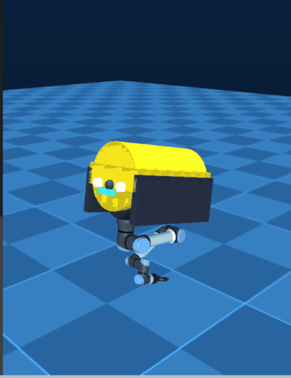

# 任务 1：物理仿真与 6-DOF 键盘运动控制

## 1. 运行环境

- Ubuntu 22.04 + ROS2 Humble + MuJoCo 3.12.0
- 无头测试：`MUJOCO_GL=osmesa`
- 3D 视窗：`LIBGL_ALWAYS_SOFTWARE=1 MUJOCO_GL=glfw`

```bash
./main.sh --gui     # 3D 视窗 + 键盘遥控
./main.sh --test    # 自动化测试
```

## 2. 物理模型

ROV 为 freejoint 刚体，质量 $m$，重力 $g$。为模拟中性浮力，每步在机体 Z 方向施加

$$
F_{\text{buoy}} = \Big(\sum_i m_i\Big) g .
$$

推进器指令映射为机体力/力矩：

$$
\mathbf f_{\text{body}} = (350\,v_x,\ 350\,v_y,\ 0)^\top,\qquad
\boldsymbol\tau_{\text{body}} = (90\,\omega_x,\ 90\,\omega_y,\ 90\,\omega_z)^\top,
$$

再经偏航旋转矩阵 $R(\psi)$ 变换到世界系：

$$
\mathbf f_{\text{world}} = R(\psi)\,\mathbf f_{\text{body}} .
$$

深度方向由 PID 定深控制器输出推力（`mujoco_sim_node.py:296` 起）：

$$
F_z = K_p (z_d-z) + K_i \int (z_d-z)\,dt + K_d (\dot z_d-\dot z),
$$

参数 $K_p=1800,\ K_i=35,\ K_d=900$，上限 3500 N。

## 3. 键盘映射

| 按键 | 功能 |
|------|------|
| W/S | 前进/后退（$\pm x$） |
| A/D | 左移/右移（$\pm y$） |
| Q/E | 上浮/下潜（$\pm z$） |
| J/L | 左/右偏航 |
| I/K | 前/后俯仰 |
| U/O | 左/右翻滚 |
| 空格 | 急停（所有指令清零） |
| +/- | 速度比例增减 |

实现位置：`rov_mujoco/keyboard_teleop_node.py`。

## 4. 测试

`./main.sh --test` 依次验证：

1. 初始位姿读取；
2. 按 W 后位移与速度；
3. 按 Q 后垂向运动；
4. 按 J 后偏航角速度响应；
5. 传感器话题发布。

实测（`00_总览/实测输出/task1.log`）：

```text
初始位置: [-0.0017, 0.0010, -0.9516] m
按下 W 后: 位移 0.0364 m，速度 0.3442 m/s
按下 Q 后: 位移 0.0316 m，速度 0.2912 m/s
按下 J 后: 旋转响应正常
EXIT=0
```

测试代码在 `test/test_sim_teleop.py`（入口 `main.py --test`）。

## 5. 运行演示

任务 1 键盘控制实测 GIF（W/S/A/D 操作，ROV 在场景中移动与转向）：



> GIF 由 GUI 录屏（MP4）转码得到，480×623、82 帧、约 6.5 MB。

## 5. 源码解析

| 文件:行号 | 内容 |
|---|---|
| `rov_mujoco/mujoco_sim_node.py:127` | 中性浮力计算 |
| `rov_mujoco/mujoco_sim_node.py:296` | 物理步进：外力、洋流拖曳、姿态自稳 |
| `rov_mujoco/mujoco_sim_node.py:354` | 定深 PID / 键盘推力映射 |
| `rov_mujoco/keyboard_teleop_node.py:91` | 键盘节点初始化与按键映射 |

## 6. 已知限制

- 3D 视窗依赖 WSLg/Mesa 软件渲染，帧率较低，关闭窗口时可能 core dump（不影响测试）。
- 无头环境只验证了测试入口，未验证交互式视窗。
