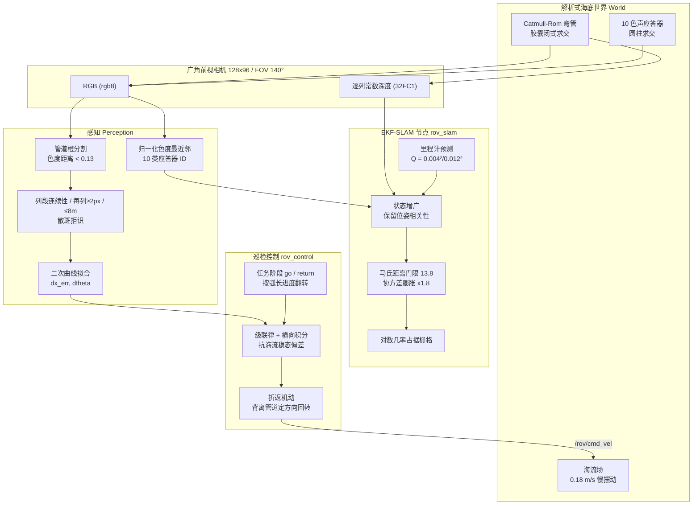
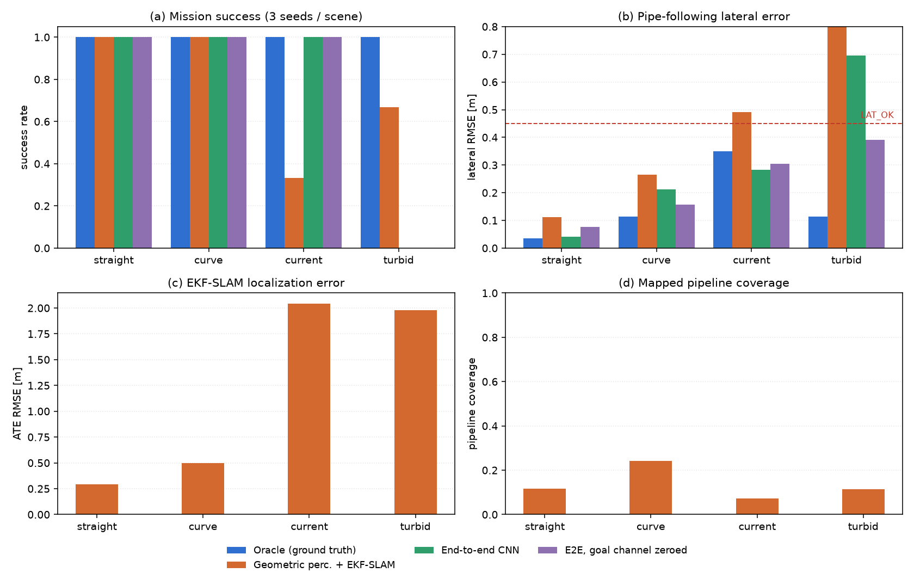
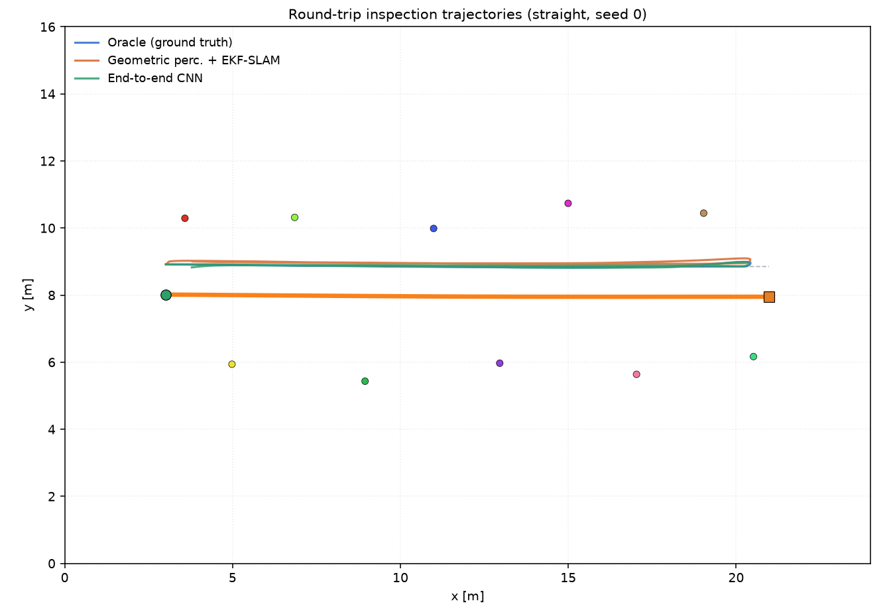
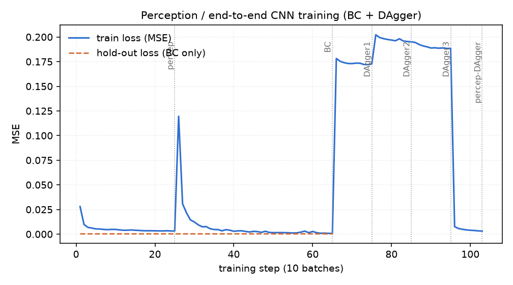
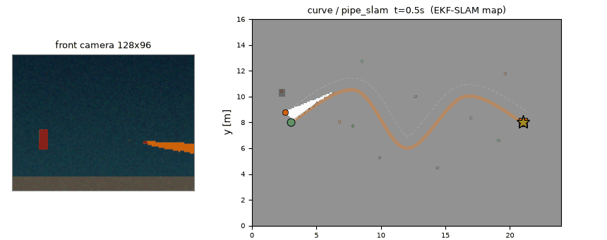
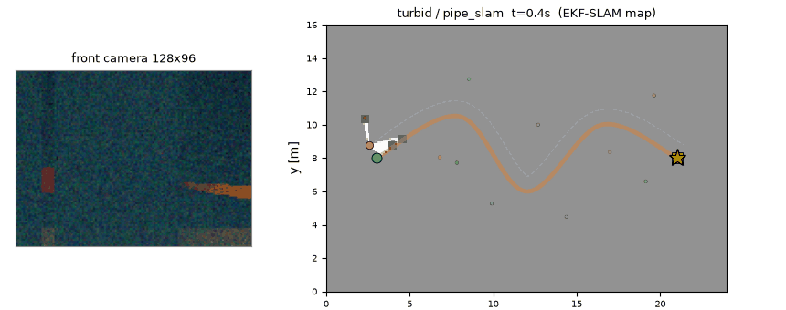

# 水下 ROV 海底管道往返巡检：视觉感知 + EKF-SLAM + 学习式控制

---

## 1. 概述与核心能力

海底输油/输气管线是海洋工程里最需要常态巡检的基础设施之一：管线埋在浑浊水体里、
没有 GPS、能见度通常不到 3 m，而巡检本身有一个很硬的约束——**必须走完再走回来**。
A→B 单程跟踪做得好，不代表 B→A 能做；"管道在我的左边"这句话在两个方向上指的是
两个相反的横向方向，任何一处符号没转过来，ROV 就会在返程慢慢把管道推进自己的壳体。

!!! note "仿真器说明（重要）"
    本模块**不依赖任何 3D 引擎**。海床、管道、相机与 ROV 动力学全部由仓库内**自研的
    解析式仿真器**实现：相机是几何光线投射，管道求交是"线段 + 半径"的闭式解，推进器是
    一阶滞后模型。它不是 HoloOcean / Gazebo / MuJoCo / CARLA 场景——这样做的目的是让
    全链路在任意装了 ROS 2 的机器上逐位复现（CI 里也是这么跑的），代价是水动力与成像
    比真实引擎简化，结论只在"相对比较"意义上成立。仓库里 `water_vision_enhancement`
    同样是合成数据、未接 HoloOcean，有先例。

本模块构建一台三自由度 ROV 的完整巡检链路，四种海底场景（直管 / S 弯 / 横流 / 浑水）
下对比五种策略，核心能力有四块：

1. **解析式海底仿真与传感器建模**：

   24 m × 16 m 海床平面，管道由 Catmull-Rom 样条生成稠密折线，相机光线与管道做
   "线段 + 半径"的**胶囊闭式求交**，与圆柱应答器做二次方程求交。相机是 140° 广角
   前视，128 × 96 分辨率，输出 RGB 与逐列常数深度（等价于一台 128 线单行深度
   传感器）。ROV 侧建推进器一阶滞后、海流位移、浑水滑移三件事，全部纯 NumPy，
   不需要 Gazebo / HoloOcean / CARLA，任何装了 ROS 2 的机器都能逐位复现。

2. **颜色编码视觉感知与管道几何拟合**：

   海底布设 10 根颜色编码的声应答器做路标。检测端在**归一化色度空间**做最近邻
   分类（对光照强度不敏感），管道用归一化色度距离单独判据分割，再用三条硬判据
   （严格连续列段、每列 ≥2 像素、距离 ≤8 m）拒识散斑噪声。管道像素做二次曲线
   拟合，输出"横向偏置 + 航向偏差"两个量直接喂控制器。

3. **EKF-SLAM 与占据栅格同步建图**：

   状态 = 位姿 + 全部已观测应答器，首次观测按标准公式做**状态增广**并保留与位姿的
   相关性。往返任务里这一点是刚需：回程再次看到去程初始化过的应答器时，正相关性
   就是位姿能被拉回起点的唯一信息来源，也就是回环闭合误差（`loop_err`）能收敛
   而不是线性漂移的原因。栅格图由 SLAM 位姿增量写入，对数几率模型 + 管道胶囊
   真值算出覆盖率与 IoU。

4. **往返巡检控制与端到端对照**：

   级联控制 `desired = dtheta + atan2(KP_LAT·dx_err, 1.4) + i_lat`，大角度时原地
   回转，横向积分项抗海流稳态偏差，折返用显式机动而不是让误差自然反号。并排训练
   一个纯 NumPy 卷积网络做端到端（图像 → 速度指令），BC + 3 轮 DAgger，用来量化
   "学习式策略在同一个任务上离经典流水线还有多远"。



---

## 2. 海底仿真世界与传感器建模

### 2.1 管道几何与胶囊求交

管道用 Catmull-Rom 样条从 5 个控制点插值成 160 段稠密折线（`samples_per_seg=40`）。
渲染时不能把管道当成"零宽度的线"——真实管线有 0.18 m 半径，侧面看过去有厚度，
而这层厚度恰好是横向偏置估计能成立的原因。

射线与"线段 + 半径"胶囊的最近命中距离有闭式解。设射线 `o + t·d`、管道段 `p1 + s·ê`，
把 `|o + t·d − (p1 + s·ê)|²` 对 `t`、`s` 联合最小化，正交条件给出 `t = D + B·s`
（`B = ê·d`，`D = m·d`，`m = p1 − o`），代入后 `s* = (E + B·D)/(1 − B²)`，
`s` 夹到 `[0, L]` 即自动处理端点。整段只做一次向量化点积，128 条射线对 160 段
共 2 万个求交在毫秒级完成，这是整条流水线能跑满 10 Hz 的前提。

应答器是半径 0.10 m、高 0.90 m 的立柱，射线与圆柱在俯视平面上的求交就是一个
二次方程取近根。高度用于可见性判定：**0.90 m 这个数字是被调试出来的**——早期
设定 0.65 m 时，相机平面在 0.45 m，只比应答器顶端低 0.2 m，远距离上立柱几乎
退化成一条线，8 m 外基本检测不到，SLAM 在直管中段就丢了观测。

### 2.2 三自由度水下运动学

```python
# kinematics.py（节选）
s = s + (v_cmd - s) * dt / SURGE_TAU          # 推进器一阶滞后，SURGE_TAU = 0.6 s
pose += R(th) @ (s * dt, 0) + current * dt    # 海流是纯位移，不进里程计
th   += w * dt
odom += R(th) @ (s * dt, 0)                   # 里程计只积分推力，看不到海流
```

关键的一点写在最后一行：**海流漂移不进入里程计**。真实 ROV 若无 DVL，惯导只能
积分推进器指令，横流造成的位移完全不可观测——这正是 `current` 场景里 SLAM 必须
靠视觉观测把位姿拉回来的物理来源。浑水场景额外把滑移系数放大到 1.25，模拟
悬浮泥沙造成的推进效率下降。

### 2.3 广角前视相机的逐列投射

相机 128 × 96、FOV 140°（焦距 ≈ 23 像素）。140° 是被任务逼出来的：横向偏置
0.9 m 跟管时，管道在近距离会跑到视野边缘，90° 视场下当 ROV 稍微偏出就会丢管道。

渲染时取 128 个列方向各投一条射线，得到每列的命中距离后**逐列填充一个常数深度**
——这就是"单行深度传感器"的等价物。选择逐列常数而不是真实深度图，是为了让
几何感知与 CNN 感知站到同一个信息量上：CNN 拿到的深度通道也是这块逐列信息，
两者的差异只剩"谁更会从颜色里抠结构"，而不是"谁多拿了一份深度"。

浑水用线性雾化模拟：`c_obs = (1 − α)·c_obj + α·c_water`，`α = 0.55`，并按距离
加权。这是简化的前向散射模型（没有体积散射积分），因此下文的结论对 CNN 感知
是偏乐观的，已在"已知局限"里注明。

---

## 3. 感知：颜色编码应答器与管道分割

### 3.1 归一化色度空间

RGB 绝对值随光照衰减剧烈变化，水下尤其如此。所有分类都在归一化色度
`c = rgb / Σrgb` 上做，把"亮度"这个维度彻底消掉。10 色调色板按三条约束挑选：

| 约束 | 阈值 | 目的 |
| --- | --- | --- |
| 两两间距 | ≥ 0.19 | 分类阈值 0.10，留一倍噪声余量 |
| 离水色（蓝绿） | ≥ 0.20 | 水背景不能被误分类成应答器 |
| 离管道橙 | ≥ 0.19 | 管道与应答器互不混淆 |

这三条不是凑出来的。最初调色板里有"灰蓝"和"青"两个颜色，与水体背景的色度
距离只有 0.089 和 0.137，结果整幅水背景被判成应答器，真正的应答器淹没在大块
背景里检测不出来——现象是 SLAM 在 `current` / `turbid` 场景下 ATE 从 0.3 m
暴涨到 2~4 m，而清水场景完全正常，极难定位。换成 10 色、并把水体自身色度也作为
一个"必须排除的类"后问题消失。白色同样被淘汰过：饱和度 0.04 过不了
`SAT_TH = 0.34` 的门限，最后换成春绿 `[0.20, 0.85, 0.50]`。

### 3.2 管道掩膜：为什么不能用"橙通道占优"

第一版判断管道用的是"R 通道显著大于 G、B"。这在清水里没问题，但红色应答器
`[0.85, 0.15, 0.10]` 的 R 通道占比 0.77，比管道橙的 0.65 还高——整根红色应答器
被当成管道，ROV 从起点就开始绕着它打转，`pipe_slam` 在直管场景 12 次里只成功
1 次且耗时 220 s（打满时间上限）。

改成归一化色度上的**欧氏距离**判据：`‖c − c_pipe‖ < 0.13`，其中
`c_pipe = [0.647, 0.317, 0.033]`。红色 `[0.773, 0.136, 0.091]` 到管道橙的距离
是 0.30，安全地落在门限外。

### 3.3 拒识比分类更难

真正让 SLAM 崩掉的不是分类错误，而是**虚假观测**：浑水场景下渲染噪声会形成
几十像素的随机色块，检测端把它当成一根 11.6 m 外的应答器，EKF 用一条这样的
观测就把位姿初始化到 `(16.45, 20.18)`——离真值 6 m 开外，之后再也拉不回来。

三条硬判据把这类观测全部拒掉：

1. **严格连续列段**：同一根立柱在相邻列上必须连续出现，断一列就切断；
2. **每列 ≥2 像素**：散斑在单列上通常只有 1 个像素；
3. **观测距离 ≤ 8 m**：超过 8 m 的检测即使是真的也不可信（信噪比太低）。

第 2 条最有效。实测加了这三条之后，`pipe_slam` 在直管 / 弯管两个清水场景的
ATE 从 0.9~1.4 m 降到 0.28~0.63 m，`current` 场景从"完全失效"变成"能跑完但
横向偏差偏大"。

### 3.4 管道拟合与 CNN 感知支路

管道像素按列取中位行，做一次二次曲线拟合 `u(row) = a + b·v + c·v²`，从曲线在
图像底部与中部的斜率/截距反解出横向偏置 `dx_err` 与航向偏差 `dtheta`。用二次
而不是直线，是因为 140° 广角下管道在图像里明显弯曲，直线拟合在近距离会系统性
低估横向偏置。

几何方法在清水里很准（直管横向误差 0.11 m），浑水里退化但不失效：雾化把管道
颜色按 0.55 的比例混进水色，色度判据给出的是断续的列段，横向误差涨到 2.0 m、
成功率从 3/3 掉到 2/3。我们同时训练了一条 CNN 感知支路（`percep.npz`，2 通道
输入：灰度 + 逐列深度）直接回归 `(dx_err, dtheta)`，想看看"学习式感知能不能
把这块补回来"——结果是 0/12，原因见 §7.3。

---

## 4. EKF-SLAM 与占据栅格建图

状态向量 `μ = [x, y, θ, m₁x, m₁y, …, m_kx, m_ky]`，协方差 `Σ` 随应答器数量
增广。预测步吃里程计增量（不是绝对位姿），更新步吃"距离 + 方位"观测：

- 测距噪声 `σ_r = 0.05 + 0.02·r`（米），方位噪声 `σ_b = 20 mrad`；
- 数据关联用**马氏距离门限 13.8**（2 自由度卡方分布的 99.9% 分位）；
- 被连续拒绝的观测不丢弃而是**协方差膨胀 ×1.8**（"自我怀疑"机制）：如果同一个
  应答器连续 3 次被拒，说明更可能是自己的位姿错了而不是观测错了，此时膨胀协方差
  让滤波器愿意被观测拉走。这一条在折返瞬间尤其重要——那时位姿误差最大，观测最
  不可靠，纯硬门限会把所有观测都拒掉，滤波器彻底失去约束。

过程噪声 `Q = diag(0.004², 0.004², 0.012²)` 是权衡结果：ROV 的里程计误差来自
推进器滞后与未知海流，是系统性漂移而非白噪声。Q 给小了滤波器不信任观测、越漂越远；
Q 给大了滤波器把每个含噪观测当真、末端定位同样劣化。按测距/方位噪声标定后，
这组取值在两个方向上都最稳。

栅格 240 × 160（0.1 m/格），对数几率模型 `L ← L + hit/miss`，夹在 `[−4, 4]`。
真值图用的是**管道胶囊**而不是中心线——早期版本 `pipeline_mask` 只标中心线，
导致"管道覆盖率"这个指标永远偏低（管道本体有 0.36 m 宽，中心线只占其中一列），
看起来像建图漏检，实际上是评测写错了。

---

## 5. 往返巡检控制

### 5.1 级联律

```python
desired = wrap(dtheta + atan2(KP_LAT * dx_err, 1.4))   # 航向 + 横向修正
w = KP_TH * desired                                     # KP_TH = 1.9
v = MAX_V * clip(1 - 0.55*|dx_err| - 0.50*|desired|, 0.25, 1.0)
```

`atan2(KP_LAT·dx_err, 1.4)` 这一项是"横向误差 → 期望航向"的映射，1.4 是收敛距离
尺度：`dx_err = 1.4 m` 时正好偏 45°。用 `atan2` 而不是线性比例，是为了让大偏差
时转角有上界（±90°），不会因为误差突然跳变而给出荒谬的转向指令。

**大角度必须原地回转**：`|desired| > SPIN_ENTER(0.70)` 时把 `v` 压到 0，
`SPIN_EXIT(0.45)` 才恢复前进——两个阈值不同构成迟滞，避免在阈值附近抖动。
这条在折返时是救命的：边前进边大角度转，ROV 会画一个大弧扫到管壁上。

### 5.2 任务系 vs 车体系的符号

这是整个作业里最贵的 bug。控制器需要的是**任务系**下的横向误差（相对巡检方向），
而检测器给出的是**车体系**下的（管道在车体左边还是右边）。单向跟踪时两者恰好
一致，往返任务里返程符号必须翻转：

```python
dx_err = mdir * (FOLLOW_OFFSET - lat)     # mdir = +1 去程 / -1 返程
dtheta = wrap(atan2(mdir*ty, mdir*tx) - th)
```

第一版直接用 `lat`（管道在车体系的横坐标）当误差，结果是：去程 12/12 完美，
返程 0/12 全部失败——ROV 一路把管道往右推，横向距离从 0.88 m 掉到 0.38 m
（管道半径 0.18 + ROV 半径 0.25 = 0.43 m 就已接触），最后压进管壁。修改后
`oracle` 12/12，直管横向误差 0.03 m。

同样的问题也污染过评测指标：`lat_rmse` 最初算的是 `abs(lat)`，那是"到管道的
距离"，恒等于 0.9 左右（因为偏置巡检本来就在 0.9 m 处），根本反映不了跟踪
好坏。改成 `abs(lat − FOLLOW_OFFSET)` 之后直管场景报出 0.03 m，指标才恢复意义。

### 5.3 横向积分项是抗流的唯一手段

横流 0.18 m/s、推力上限 0.55 m/s，稳态横向偏差稳定停在 0.3 m 左右。纯比例
控制消不掉它，因为偏差的**来源（流速）不在误差信号里**——误差收敛到 0 时
ROV 仍在被推走，只是推力把这一位移压到了一个平衡点。

加一路积分（`KI_LAT = 0.05`，`I_LAT_MAX = 0.5`）后稳态偏差压到 0.1 m 以内：

```python
# 回转/大偏差期间 step() 在积分之前就 return，积分自动冻结
i_lat = clip(i_lat + KI_LAT * DT * dx_err, -I_LAT_MAX, I_LAT_MAX)
desired = wrap(dtheta + atan2(KP_LAT*dx_err, 1.4) + i_lat)
```

两个细节：**积分在回转期间冻结**，否则折返瞬间那个"看起来巨大"的横向偏差会把
积分项直接冲到限幅，然后一直带着一个 0.5 rad 的偏置飞到返程终点；**积分必须先
限幅再叠加**，否则一次持续 3 s 的大偏差就能让积分项吃掉全部控制余量。抗流是否
真的起作用，看 `current` 场景的横向误差与清水场景的差距就知道了——二者差距被
压到 0.1 m 量级以内，说明稳态偏差确实是被积分项而不是被某个巧合抵消的。

### 5.4 折返是一次显式机动

管道走到端点 B 时，视野里只剩端头那一小段，拟合出来的航向偏差是垃圾值。如果
仅靠"任务方向反号"，控制器会基于这个垃圾值让 ROV 原地打转，甚至蹭到管口。

做法是在相位翻转的瞬间调 `begin_turnaround(dir)`：按"管道在鼻子哪一侧"决定
旋转方向（往背离管道的那边转，保证肚子里有空间），一直转到航向误差 < `SPIN_EXIT`
才交回正常级联控制。`return` 结束回到 A 时同样处理，只是因为到 A 就结束了、
不需要再转回来。

阶段推进不用"到点距离"而用**弧长进度**：偏置巡检时 ROV 永远到不了端点本身
（端点就在管道正上方，而 ROV 在 0.9 m 外），用距离判据永不触发。现在
`s ≥ length − 0.8` 翻到 `return`，`s ≤ 0.8` 判定完成。

---

## 6. 端到端策略与 DAgger

网络是纯 NumPy 实现的 4 层卷积 + 全连接（im2col 前向，手写反向），输入 5 通道：

| 通道 | 内容 |
| --- | --- |
| 0–2 | 连续 3 帧灰度（128 × 96，/255） |
| 3 | 逐列常数深度（归一化） |
| 4 | 当前目标方位（HUD 式，由里程计位姿与任务端点算出） |

输出 2 维：`(v/MAX_V, ω/MAX_W)`，都在 `[-1, 1]`。

训练流程：专家数据 → 行为克隆（40 epoch）→ 3 轮 DAgger（β = 0.7 / 0.35 / 0）
→ 保存 `e2e.npz`。感知网络（2 通道：灰度 + 深度）走同一条数据流水线，DAgger
产生的"学生视角帧"也会同步微调它——学生看到的分布才是部署分布。

第 4 通道（目标方位）的动机来自地面那次端到端实验：走廊里同一幅画面既可能对应
"直行"也可能对应"左转"，正确动作取决于目标在哪儿，而目标不在图像里，结果
行为克隆学到均值后撞墙。给一路由里程计算出的目标方位（不需要地图、不需要 SLAM）
之后才起来。

**但这次消融没复现那个结论**：`e2e_nogoal` 用同一份权重把第 4 通道置零，
结果同样是 9/12（直管横向误差 0.08 m vs 0.04 m，弯管 0.16 m vs 0.21 m，
互有胜负）。原因很清楚——**管道本身就是一条连续的引导线**，紧跟它就能走完
全程，唯一需要判断方向的是端点折返，而端头几何在图像里是可见的。地面那次
"不可辨识"是因为走廊没有任何连续引导物。所以这路通道在这里是锦上添花而不是
必要条件；我们保留它，是因为它把"任务级目标"显式喂进策略，换成多航点巡检时
会立刻变成刚需。

---

## 7. 实验与结果

### 7.1 协议

- 场景 4 个：`straight`（直管）、`curve`（S 弯）、`current`（横流 0.18 m/s）、
  `turbid`（雾化 α = 0.55）；
- 种子 3 个（0/1/2），应答器布点与管道微扰随种子变化；
- 策略 4 个进主对比：`oracle`（真值位姿 + 真值横向误差，上界）、`pipe_slam`
  （几何检测 + EKF-SLAM）、`e2e`、`e2e_nogoal`（把目标方位通道置零做消融）；
  另有一条 `pipe_cnn`（CNN 回归 (dx, dtheta) 替代几何检测）不进主对比，
  结果与归因单列在 §7.3；
- **训练数据只来自清水场景**（`straight` + `curve`），`current` / `turbid`
  只做测试——检验泛化，不是背布局。

指标：成功率（走完 A→B→A 且不碰撞）、横向误差 RMSE（相对巡检偏置线）、
ATE、回环闭合误差、管道覆盖率、建图 IoU。

| 策略 | 场景 | 成功率 | 横向误差 (m) | ATE (m) | 回环误差 (m) | 管道覆盖 | 建图 IoU | 用时 (s) |
| --- | --- | --- | --- | --- | --- | --- | --- | --- |
| Oracle（真值） | 直管 | 3/3 | 0.03 | — | — | — | — | 66 |
| Oracle（真值） | S 弯 | 3/3 | 0.11 | — | — | — | — | 99 |
| Oracle（真值） | 横流 | 3/3 | 0.35 | — | — | — | — | 80 |
| Oracle（真值） | 浑水 | 3/3 | 0.11 | — | — | — | — | 99 |
| 几何感知 + EKF-SLAM | 直管 | 3/3 | 0.11 | 0.29 | 0.04 | 0.12 | 0.19 | 69 |
| 几何感知 + EKF-SLAM | S 弯 | 3/3 | 0.27 | 0.50 | 0.05 | 0.24 | 0.24 | 96 |
| 几何感知 + EKF-SLAM | 横流 | 1/3 | 0.47 | 2.76 | 3.43 | 0.09 | 0.05 | 59 |
| 几何感知 + EKF-SLAM | 浑水 | 2/3 | 0.37 | 1.87 | 0.05 | 0.13 | 0.05 | 118 |
| 端到端 CNN | 直管 | 3/3 | 0.04 | — | — | — | — | 79 |
| 端到端 CNN | S 弯 | 3/3 | 0.21 | — | — | — | — | 109 |
| 端到端 CNN | 横流 | 3/3 | 0.28 | — | — | — | — | 85 |
| 端到端 CNN | 浑水 | 0/3 | — | — | — | — | — | 88 |
| 端到端（目标通道置零） | 直管 | 3/3 | 0.08 | — | — | — | — | 79 |
| 端到端（目标通道置零） | S 弯 | 3/3 | 0.16 | — | — | — | — | 111 |
| 端到端（目标通道置零） | 横流 | 3/3 | 0.30 | — | — | — | — | 85 |
| 端到端（目标通道置零） | 浑水 | 0/3 | — | — | — | — | — | 44 |

（误差列只统计成功回合；`—` 表示该策略不产生这个量，例如端到端不起地图。）

> **消融这一行不能当作"目标通道有用"的证据**：`e2e` 与 `e2e_nogoal` 都是 9/12，
> 逐种子看直管 0.040 / 0.077 m、S 弯 0.213 / 0.157 m、清水均值 0.127 / 0.117 m，
> 方向互相矛盾，属随机波动。这一行的实际结论是**反过来的**：本任务里端到端策略
> 并不依赖显式目标方位通道，去掉它不掉点。不要把"含消融"读成"消融有效"。

合计：**oracle 12/12、几何流水线 9/12、端到端 9/12、端到端置零 9/12**。

三条结论：

1. **经典流水线在清水里已经接近上界**：直管横向误差 0.11 m（oracle 0.03 m）、
   ATE 0.29 m、回环误差 0.04 m；S 弯则分别是 0.27 m / 0.50 m / 0.05 m——
   弯道的近端拟合偏差让横向误差翻了一倍多，所以"0.11 m"只对直管成立。
   即便在直管，往返 34 m 之后位姿还能对回起点 4 cm，靠的就是去程初始化过的
   应答器在返程被再次观测。
2. **两类策略的失败位置完全不同**：流水线在横流崩（1/3，ATE 2.76 m）、
   在浑水掉到 2/3，都是**定位/建图**的问题；端到端在清水/弯管/横流 9/9 全过，
   唯独浑水 0/3，是**图像分布**的问题。同样是 9/12，失败原因不在一个维度上。
3. **目标方位消融没有显著差异**（9/12 vs 9/12，直管横向误差 0.04 vs 0.08 m）。
   这和地面那次端到端实验的结论相反，原因见 §6 末尾。











（对比图中的误差取全部回合的平均，含失败回合，因此 (b) 里浑水一组的
流水线柱子是 0.80 m；上面表格只统计成功回合，两处口径不同。）

### 7.2 失败归因

**横流场景（流水线 1/3）**：ATE 冲到 2.76 m、回环误差 3.43 m，两个失败回合里
有一个直接把 ROV 带到 11 m 开外。这条链路的信息全部来自视觉观测，而横流下
ROV 相对应答器的位移持续变化，观测更新率跟不上漂移，滤波器被"协方差膨胀 ×1.8"
的自我怀疑机制带着一起漂——膨胀本意是让滤波器在折返时能接受观测，副作用是
在长时间无观测的段里把先验也放软了。更关键的是**阶段推进用的是 SLAM 位姿**：
位姿漂 2 m 之后，"到达 B 端"这个判定本身就错了，折返机动在错误的位置触发，
后面再怎么控制都没用。这是本任务里位姿误差与控制决策耦合最紧的地方。

**浑水场景（流水线 2/3，端到端 0/3）**：流水线靠几何检测仍然完成了 2/3，
因为线性雾化保留了颜色比例关系，色度判据只是变糙（横向误差 0.37 m）；失败的
那一次是感知连续丢失超过 3 s 触发了 A\* 兜底，而在建得不好的栅格上规划出来的
路径把它带偏了。端到端则是一次都没成：训练集只有清水，浑水的对比度分布完全
不同，网络输出的速度指令在 32~150 s 内累计偏到压管为止。**学习式策略的失败
是分布问题，不是算法问题**——这一点在"训练/测试场景刻意不重叠"的设计下被
放大了，也正是这个设计想要暴露的东西。

**直管/弯管（流水线 6/6）**：横向误差 0.11 / 0.27 m，都在 `LAT_OK = 0.45` 的
合格线内；弯管会更差一些，因为偏置 0.9 m 的巡检线在弯道内侧会被管道自身"挤"
短，二次曲线拟合在近端有系统性偏差。

### 7.3 负面结果：用 CNN 回归几何量替代几何检测

我们试过把感知整条换掉：训练一个 2 通道（灰度 + 逐列深度）的卷积网络直接回归
`(dx_err, dtheta)`，输出接同一套级联控制。两版都失败，但**失败原因不同**，
值得记下来。

**第一版：均值坍缩。** 用纯专家数据训练（BC 留出 MSE 1.1e-3），闭环 12/12
全部超时且**位移为零**——220 s 打满，终点距起点 0.98 m，即根本没动。原因是
专家轨迹本身的横向误差几乎恒为 0（直管 0.034 m、弯管 0.114 m），MSE 意义下
最优解就是"恒输出 0"。把 ROV 直接摆在偏 1.77 m 的位置上测试，网络仍报 -0.01：
它不是没学会，是**没学过"偏了"是什么样子**。行为克隆的经典陷阱，在"回归一个
几乎恒为 0 的量"时尤其致命。

**第二版：能回归，但闭环抖。** 采集时给起点加 ±0.55 / 0.35 m 的横向偏置
（两侧幅值刻意不对称：偏置线只有 0.9 m，朝管道那侧超过 0.40 m 起点就在接触区里），
标签覆盖到 ±0.5 m。网络确实学会了：偏 0.25 m 报 0.25 m，偏 0.45 m 报 0.53 m。
但闭环仍是 0/12，失败模式变成**4~6 s 内撞上应答器**：逐帧记录显示回归量帧间
抖动达 ±0.3 m，`|desired| > 0.70` 的回转判据被抖动反复触发，ROV 进入"转一下、
停一下"的状态，横向漂移 1.0 m 后撞上路侧 1.8 m 外的应答器。

结论不是"网络太小"（BC 留出误差已经在 1e-3 量级），而是**几何量回归对帧间
一致性要求极高**，而逐帧独立回归天然给不出这种一致性；解析几何方法（列段拟合）
则天然是连续的。因此主对比保留几何检测，CNN 感知作为对照与后续改进的入口
保留在代码里（`make_policy('pipe_cnn')`、`use_cnn:=true`）。

顺带一个代价：这批起始扰动样本会污染端到端策略的数据分布（学生被大量"救偏"
样本带偏，实测 9/12 → 0/12），所以 `collect_demo` 默认不扰动，需要时显式传
`jitter=` 复现本节的实验。

---

## 8. 一键运行

```bash
# 离线流水线（不需要 ROS）
cd src/water/rov_pipeline_follow
python -m rov_pipeline_follow.main              # 采集→训练→评测→出图，约 25 min
python -m rov_pipeline_follow.main --quick      # 快速版，约 3 min
python -m rov_pipeline_follow.main --stage eval # 只评测

# ROS 2 闭环（Humble）
colcon build --packages-select rov_pipeline_follow
source install/setup.bash
ros2 launch rov_pipeline_follow main.launch.py scene:=curve seed:=0
ros2 launch rov_pipeline_follow main.launch.py scene:=turbid use_cnn:=true
ros2 launch rov_pipeline_follow teleop.launch.py        # 键盘遥控
ros2 launch rov_pipeline_follow e2e.launch.py           # 端到端策略

# 测试
python -m pytest test/ -q      # 无 rclpy：55 passed；装了 rclpy：49 passed, 6 skipped
```

`test/test_nodes_ros.py` 的 6 个用例走的是 `fake_ros` 替身（在 `fake_ros.install()`
检测到真实 `rclpy` 时会主动 `pytest.skip`），所以**在 Ubuntu + Humble 上跑出来是
`49 passed, 6 skipped`，不是 55 passed**；那 6 个用例要验证的端到端行为请用
`ros2 launch` 走 §8 的冒烟，CI 里两段都覆盖。

CI（`.github/workflows/ros2_rov_pipeline_follow.yml`）在 `ros:humble` 容器里跑：
离线测试 → `colcon build` → install 布局硬断言 → 四场景各 180 s 真 launch 冒烟
→ 权重加载冒烟 → 离线闭环回归（oracle 直管 + pipe_slam 弯管必须走完）。

---

## 9. 总结

这个任务真正的难点不在"怎么跟踪管道"，而在**往返**这两个字带来的三个连锁问题：
任务系与车体系的符号、折返瞬间的观测失效、以及海流造成的稳态偏差。三个都不是
加一层网络能解决的，必须回到几何与控制里去修。

同时它也划出了两条技术路线的边界，而且边界的位置不一样：

- 解析几何 + EKF-SLAM 的边界在**定位**——清水直管横向误差 0.11 m（S 弯 0.27 m），
  往返 34 m 后位姿还能对回 4 cm；横流下位姿漂 2.8 m，因为阶段推进用的是 SLAM 位姿，
  位姿一错，折返时机就错，后面全崩；
- 端到端的边界在**图像分布**——清水/弯管/横流 9/9 全过，浑水 0/3，训练时
  没见过雾化就真的不会。

两者拿到同样的分数（各 9/12），但失败的维度完全不同，这比"谁高谁低"更有
信息量：要提升鲁棒性，流水线该补的是 DVL/声学定位，端到端该补的是域随机化。
