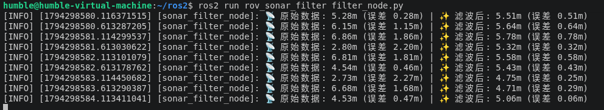

# 水下机器人声呐数据滤波初步验证

## 一、项目介绍
本项目是一个独立的 ROS 2 功能包 `rov_sonar_filter`。真实的水下声呐传感器在探测时，极易受到水流、气泡和反射等因素的干扰，产生大量噪声。本项目旨在模拟声呐传感器采集数据的过程，并引入“滑动平均滤波算法（Moving Average Filter）”，以验证该算法在平滑数据、降低测量误差方面的有效性。

## 二、运行环境
- 操作系统：Ubuntu 22.04 (虚拟机)
- ROS 版本：ROS 2 Humble Hawksbill
- 编程语言：Python 3.10
- 依赖功能包：rclpy, random, math (Python 内置库)

## 三、项目结构
```text
src/rov_sonar_filter/
├── scripts/
│   └── filter_node.py           # 核心滤波与打印节点
├── CMakeLists.txt
├── package.xml
└── README.md
```

## 四、核心算法解析

1. 噪声模拟：设定一个真实的障碍物距离（例如 5 米），使用高斯分布（random.gauss）生成带有随机波动的模拟声呐原始数据。
2. 滑动平均滤波：维护一个长度为 5 的队列 history。每次收到新数据时，将其加入队列。如果队列满了，则剔除最旧的数据。最后对队列内的数据求平均值，作为滤波后的结果。
3. 效果对比：在终端实时打印“原始数据”与“滤波后数据”，并计算它们与真实距离的误差绝对值，直观验证滤波算法的降噪效果。

## 五、运行步骤

```bash
cd ~/ros2
colcon build --packages-select rov_sonar_filter
source install/setup.bash
ros2 run rov_sonar_filter filter_node.py
```

## 六、运行效果



## 七、实验总结

本次实验成功独立开发了声呐数据滤波节点。实验结果表明，通过滑动平均滤波，能够有效抑制传感器产生的高斯噪声，使得输出的距离数据更加平滑，误差显著减小，为后续 SLAM 建图和避障算法提供了更可靠的数据源。