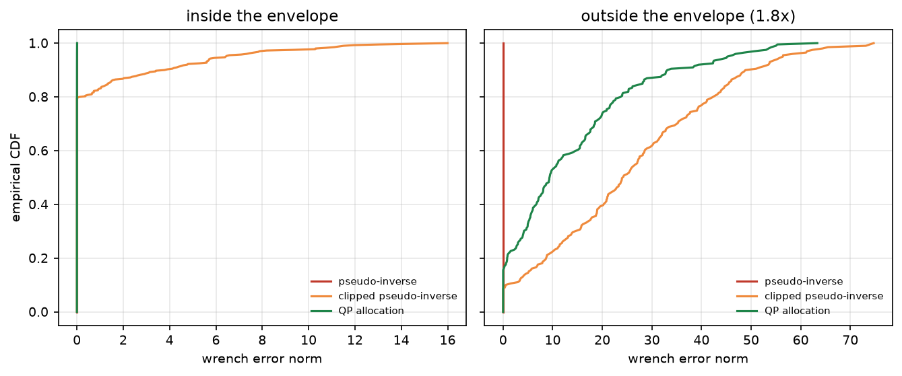
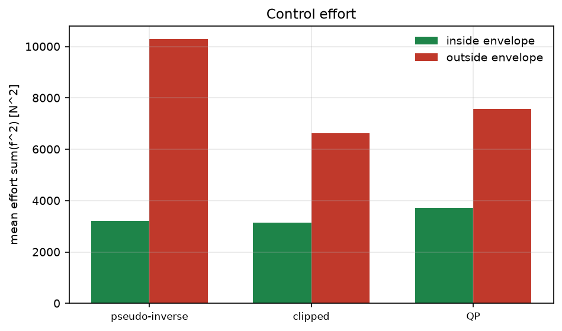

# ROV 推进器配置矩阵与饱和感知推力分配

推力分配是 ROV 控制里最容易被忽略的一环：伪逆看起来"精确"，但它给出的推力可能超过推进器上限；
先算伪逆再限幅虽然安全，却会把力矩残差放大。本模块用 8 推进器配置对比三种分配方式，
并给出"触限比例"这个容易被忽略的指标。

与仓库已有模块的区别：

- 仓库里没有推进器分配/配置矩阵相关模块（`thruster`、`allocation` 关键词命中数为 0）；
- `rov_physical_simulation`、`rov_handling_eval` 关注 6-DOF 运动与手操品质，本模块关注**控制分配**这一层；
- 输出是推力指令与残差，不涉及水动力建模。

## 1. 方法

### 1.1 配置矩阵

每个推进器用位置 $\mathbf{r}_i$ 与推力方向 $\mathbf{d}_i$（单位向量）描述，对机体六维力旋量贡献

$$
\mathbf{t}_i=\begin{bmatrix}\mathbf{d}_i\\ \mathbf{r}_i\times\mathbf{d}_i\end{bmatrix}\in\mathbb{R}^6,
\qquad
\boldsymbol{\tau}=T\mathbf{f},\quad T=[\mathbf{t}_1,\dots,\mathbf{t}_8]
$$

本模块的 8 推进器：4 个水平 45° 布置在四角（提供纵向、横向、艏摇），4 个垂直布置在
$(\pm0.30,\pm0.22)$（提供升沉、横滚、纵倾）。配置矩阵条件数 10.9，满秩 6。

> 备注：只用 2 个垂推时矩阵秩为 5（横滚不可控），这也是实际 ROV 要么 2 垂推只做纵倾、
> 要么 4 垂推才做横滚的原因。第一版就是 6 推进器，`cond=inf`，加两个垂推后才满秩。

### 1.2 三种分配

- 伪逆：$\mathbf{f}=T^{+}\boldsymbol{\tau}$，残差为零但**不检查限幅**；
- 伪逆后限幅：$\mathbf{f}=\mathrm{clip}(T^{+}\boldsymbol{\tau},\pm f_{\max})$，安全但残差被放大；
- 箱约束 QP：

$$
\min_{\mathbf{f}}\ \lVert T\mathbf{f}-\boldsymbol{\tau}\rVert^2+\lambda\lVert\mathbf{f}\rVert^2
\quad\text{s.t.}\quad |f_i|\le f_{\max}
$$

用循环坐标下降求解（每次只更新一个分量并投影回盒内），$\lambda=10^{-6}$ 只作数值正则。

### 1.3 需求生成

包络内需求取 $\boldsymbol{\tau}=T\mathbf{f}_{\text{true}}$，其中 $f_{\text{true}}$ 在
$[-f_{\max},f_{\max}]$ 内均匀采样，因此一定可达；超包络需求把同样的力旋量乘以 1.8，
必然触发限幅。这样两类场景的"标准答案"都是已知的。

## 2. ROS 2 接口

| 节点 | 作用 |
|---|---|
| `thruster_sim` | 按固定 seed 发布 40 组力旋量需求（可整体缩放） |
| `thruster_allocator` | 箱约束 QP 分配，发布推力与残差 |

## 3. 构建与运行

```bash
source /opt/ros/humble/setup.bash
cd ~/hutb_ws
colcon build --symlink-install --packages-select rov_thruster_allocation
source install/setup.bash
ros2 launch rov_thruster_allocation main.launch.py scale:=1.0
```

离线：

```bash
cd src/water/rov_thruster_allocation
python3 main.py --out results --figure-dir ../../../docs/img/water/rov_thruster_allocation
python3 -m unittest discover -s tests -v
```

## 4. 结果

环境：Windows 11、Python 3.12.14、NumPy 2.3.5。包络内 400 组、超包络 200 组需求，
推进器上限 40 N/个。

| 场景 | 指标 | 伪逆 | 伪逆后限幅 | QP |
|---|---|---|---|---|
| 包络内 | 残差 RMS | 0.00 | 2.63 | **0.002** |
| 包络内 | 残差 p95 | 0.00 | 6.42 | **0.00** |
| 包络内 | 触限比例 | 2.8 % | 2.8 % | 3.7 % |
| 包络内 | 平均推力平方和 | 3219 | 3141 | 3710 |
| 超包络 | 残差 RMS | 0.00* | 31.41 | **20.00** |
| 超包络 | 残差 p95 | 0.00* | 56.40 | 45.23 |
| 超包络 | 触限比例 | 29.6 % | 29.6 % | 39.3 % |
| 超包络 | 平均推力平方和 | 10283 | 6629 | 7563 |

\* 伪逆的零残差是"数学上可达、物理上不可实现"：它有 29.6 % 的推力指令超过 40 N 上限。





三点结论：

1. 包络内伪逆与 QP 都精确，但伪逆有 2.8 % 的触限——分配器必须知道限幅，否则下游再截断就失真；
2. 超包络时没有精确解，QP 的力旋量残差比"先伪逆再限幅"低 36 %（20.00 vs 31.41）；
3. 代价是 QP 的推力平方和更高（7563 vs 6629）——它优先保力旋量而非省电，实际部署可按任务在
   $\lambda$ 与残差权重之间取舍。

**口径**：QP 的箱约束是硬约束，max|f| 恒为 40 N，所以它那一列是“触限比例”（顶在限幅边界），不是“越限”。真正的越限只发生在未限幅伪逆上：包络内 2.75 %、超包络 29.62 %，峰值分别到 54.5 N 与 98.1 N。包络内伪逆的零残差建立在这样不可实现的解上，原因是 8 个推进器只张成 6 维力旋量、零空间 2 维，最小范数解不等于生成需求的 f_true，可能把某些分量推过 40 N。

## 5. 复现

```bash
cd src/water/rov_thruster_allocation
python3 main.py --out results --figure-dir ../../../docs/img/water/rov_thruster_allocation
python3 -m unittest discover -s tests -v    # 12 项
```

| 文件 | 内容 |
|---|---|
| `rov_thruster_allocation/core.py` | 配置矩阵、伪逆/限幅/QP 分配、箱约束坐标下降 |
| `rov_thruster_allocation/scene.py` | 包络内/超包络力旋量需求生成 |
| `rov_thruster_allocation/headless.py` | 实验与 `results/summary.json` |
| `rov_thruster_allocation/plotting.py` | 两张图 |
| `rov_thruster_allocation/nodes.py` | 需求发布与分配节点 |
| `results/summary.json` | 本文全部数值 |

## 6. 限制

1. 只做静态分配，没有推力动态（推进器响应延迟、死区、螺旋桨推力-转速非线性）。
2. 未考虑推进器故障重构（配置矩阵重排、剩余推进器再分配）。
3. 力旋量需求按均匀随机生成，未覆盖真实任务剖面（如定点保持、轨迹跟踪的力矩分布）。
4. 坐标下降在 Python 里未优化；实时实现应换 OSQP 或 C++，并做热启动。
5. 未考虑流体动力（阻尼、附加质量）对可达力旋量的影响。
6. ROS 2 端只做了 `compileall`、`package.xml` 解析与桩模块联调，未在本机执行 `colcon build` 与 `ros2 launch`。

## 7. 大模型使用声明

使用 DeepSeek Harness（deepseek-flash）辅助完成代码、推导整理、测试与文档。作者核对了配置矩阵的
秩/条件数、伪逆与 QP 的关系，并在本机实际运行了离线实验与 12 项单元测试，数值来自 `results/summary.json`。
