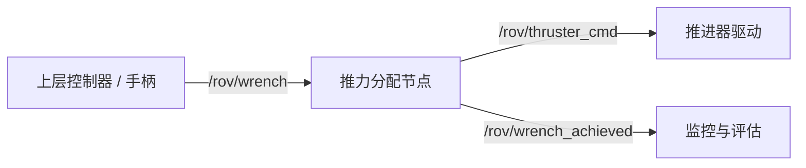
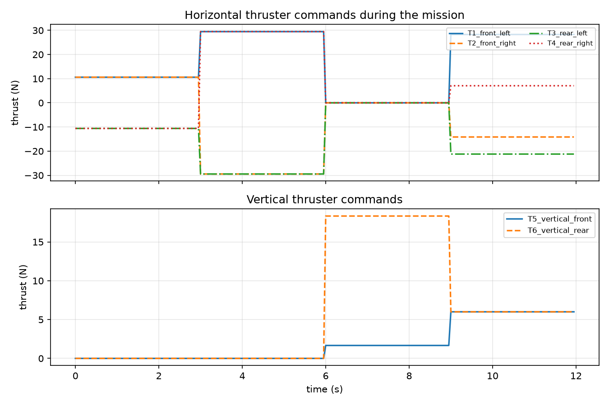
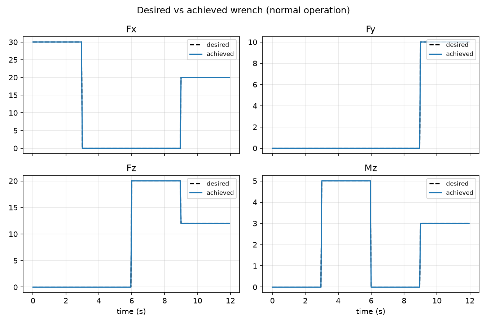
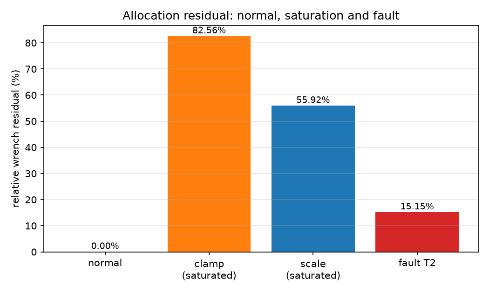

# ROV 六推进器推力分配实验

上层控制器通常输出一个六维力/力矩，而 ROV 只能通过各个推进器的推力来合成这个 wrench
（力与力矩的合称）。本实验实现「wrench → 各推进器推力」的分配节点：用推进器布置矩阵
的伪逆做最小二乘分配，并处理推进器饱和与单推进器故障。

## 一、实验目的与环境说明

### 1.1 实验目的

1. 理解推进器布置矩阵 $B$ 的构造：每一列是一个推进器对六维 wrench 的贡献；
2. 掌握用伪逆 $B^{+}$ 把期望 wrench 分配到各推进器的方法；
3. 理解**饱和**对分配结果的影响，对比 `clamp`（直接限幅）与 `scale`（按比例缩小）两种策略；
4. 掌握**推进器故障重构**：移除故障列后重新分配，并评估剩余控制能力；
5. 学会在 ROS 中把「期望 wrench」和「推进器指令」组织成话题接口。

### 1.2 实验环境

| 项目 | 配置 |
| ---- | ---- |
| 操作系统 | Ubuntu 20.04（ROS 端）；Windows/Linux（离线验证） |
| ROS 发行版 | ROS Noetic（Python 3） |
| 依赖 | rospy、geometry_msgs、std_msgs、numpy |
| 离线验证 | Python 3 + numpy + matplotlib（不需要 ROS） |
| 被控对象抽象 | 六推进器 ROV（4 个 45° 水平推进器 + 2 个垂直推进器） |

功能包目录结构：

```text
rov_thruster_allocation_ros1/
├── main.py          # ROS 节点入口：订阅 wrench、发布推进器指令
├── allocation.py    # 纯 Python 分配算法（可单独测试）
├── offline_sim.py   # 预设任务、饱和与故障场景、出图
├── launch/main.launch  # roslaunch 入口
├── config/params.yaml
├── test/test_rov_thruster_allocation_ros1_local.py  # 本地测试
├── package.xml
├── CMakeLists.txt
└── README.md
```

## 二、推进器布置与分配矩阵

### 2.1 推进器布置

| 编号 | 名称 | 位置 (x, y) m | 推力方向 |
| ---- | ---- | ---- | ---- |
| T1 | 前左水平 | (0.22, 0.16) | 45° |
| T2 | 前右水平 | (0.22, −0.16) | −45° |
| T3 | 后左水平 | (−0.22, 0.16) | 135° |
| T4 | 后右水平 | (−0.22, −0.16) | −135° |
| T5 | 前垂直 | (0.18, 0.0) | +Z |
| T6 | 后垂直 | (−0.18, 0.0) | +Z |

### 2.2 分配矩阵

设第 $i$ 个推进器的推力为 $T_i$、安装位置为 $\mathbf{r}_i$、推力方向单位向量为
$\mathbf{d}_i$，则它产生的力与力矩为

$$
\mathbf{F}_i = T_i \mathbf{d}_i, \qquad \mathbf{M}_i = \mathbf{r}_i \times \mathbf{F}_i
$$

把所有推进器按列拼起来就得到分配矩阵 $B$：

$$
\underbrace{\begin{bmatrix} F_x \\ F_y \\ F_z \\ M_x \\ M_y \\ M_z \end{bmatrix}}_{\text{wrench}}
= B \underbrace{\begin{bmatrix} T_1 \\ \vdots \\ T_6 \end{bmatrix}}_{T}
$$

本布置无法产生横滚力矩（所有推进器的力都通过或平行于 x 轴所在平面），
因此 $B$ 的秩为 5，横滚是**不可控自由度**。

### 2.3 伪逆分配

期望 wrench 已知时，最小范数解为

$$
T = B^{+}\,\text{wrench}
$$

伪逆解会自动让各推进器“平均分担”载荷，不会出现一组很大的正推力和另一组很大的负推力。

### 2.4 饱和与故障

- **饱和**：当某个 $|T_i|$ 超过单推进器上限 $T_{\max}$ 时：
  - `clamp`：直接限幅 $T_i \leftarrow \mathrm{clip}(T_i, \pm T_{\max})$。各推进器被独立裁剪，
    合力方向会改变；
  - `scale`：把整个解乘以 $s = T_{\max} / \max_i |T_i|$，所有推进器等比缩小，
    合力方向不变、幅度降为 $s$ 倍。
- **故障**：把故障推进器的列从 $B$ 中删掉，对剩余列求伪逆，故障推进器输出置 0。

## 三、节点结构与接口



| 方向 | 话题 | 类型 | 说明 |
| ---- | ---- | ---- | ---- |
| 订阅 | `/rov/wrench` | `geometry_msgs/Wrench` | 期望力/力矩（机体坐标系） |
| 发布 | `/rov/thruster_cmd` | `std_msgs/Float64MultiArray` | 6 个推进器推力（N） |
| 发布 | `/rov/wrench_achieved` | `geometry_msgs/Wrench` | 限幅后实际可达的 wrench |

安全处理：超过 `wrench_timeout`（0.5 s）没有收到新的期望 wrench 时，推进器指令归零；
节点退出时同样归零。

## 四、运行步骤

### 4.1 ROS 节点

```bash
mkdir -p ~/catkin_ws/src
cp -r <本仓库>/src/water/rov_thruster_allocation_ros1 ~/catkin_ws/src/
chmod +x ~/catkin_ws/src/rov_thruster_allocation_ros1/main.py
cd ~/catkin_ws && catkin_make
source devel/setup.bash

roslaunch rov_thruster_allocation_ros1 main.launch

# 另开终端发送期望 wrench
rostopic pub -1 /rov/wrench geometry_msgs/Wrench \
  "{force: {x: 30.0, y: 0.0, z: 0.0}, torque: {x: 0.0, y: 0.0, z: 0.0}}"
rostopic echo /rov/thruster_cmd
```

故障重构示例：`roslaunch rov_thruster_allocation_ros1 main.launch failed_thruster:=1`。

### 4.2 离线验证

```bash
cd <本仓库>
python -m pip install numpy matplotlib
python src/water/rov_thruster_allocation_ros1/offline_sim.py
```

脚本发送一段 12 s 的预设任务（前进 → 转向 → 下潜抬头 → 组合运动），
再单独测试饱和和故障场景，输出三张图与指标。

## 五、实验结果

### 5.1 正常任务下的推进器指令



- 0～3 s 前进：四个水平推进器成对出力（T1/T2 为正、T3/T4 为负），合力沿 +x；
- 3～6 s 转向：对角推进器反向出力，产生 +Mz 力矩；
- 6～9 s 下潜抬头：T6 明显大于 T5，既提供垂向力又产生抬头力矩；
- 9～12 s 组合运动：水平与垂直推进器同时工作。

### 5.2 期望与可达 wrench



正常工况下（最大推力 40 N），实际可达 wrench 与期望值完全重合，
任务段最大分配残差约 $10^{-13}\%$（数值精度），说明伪逆分配是精确的。

### 5.3 饱和与故障对比



| 场景 | 相对残差 | 说明 |
| ---- | ---- | ---- |
| 正常 | ≈ 0% | 指令在推进器能力范围内 |
| 饱和 + clamp | 82.56% | 各推进器被独立裁剪，水平力方向偏差 13.57° |
| 饱和 + scale | 55.92% | 等比缩小 0.441 倍，方向不变，幅度不足 |
| T2 故障 | 15.15% | 剩余推进器重新分配，前进力降到约 25.5 N，转向力矩部分损失 |

结论：饱和时 `clamp` 的残差反而比 `scale` 更大，因为独立限幅破坏了推进器之间的比例关系；
`scale` 虽然也达不到期望，但至少保持了合力方向，更适合作为默认策略。

## 六、讨论与限制

1. 伪逆分配只考虑几何关系，没有考虑推进器推力与电压/转速的非线性、死区和效率差异；
2. 本布置横滚不可控，若需要横滚自由度需要增加推进器或改变布置；
3. 故障重构假设已通过检测知道哪个推进器失效，故障诊断本身不在本实验范围内；
4. 离线验证只检查分配矩阵与限幅逻辑，不包含 ROV 动力学响应；
5. 本机为 Windows，没有 ROS 与 ROV 仿真环境，**ROS 端实际运行未验证**，
   需要在 ROS Noetic 与 ROV 仿真器/实机上按 4.1 节复验。

## 说明

本文档与配套代码在整理过程中使用了 AI 助手（DeepSeek）辅助，实验参数、运行结果
和图表均由作者实际运行核对；作者对本文内容负全部责任。
