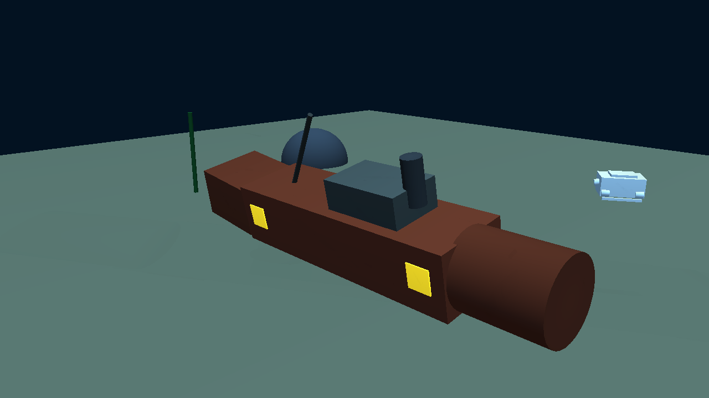
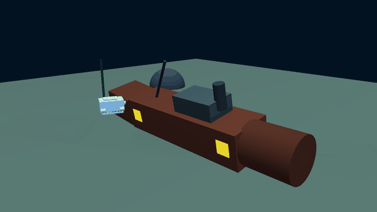
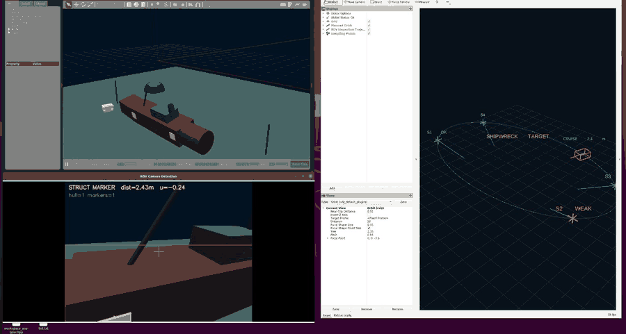
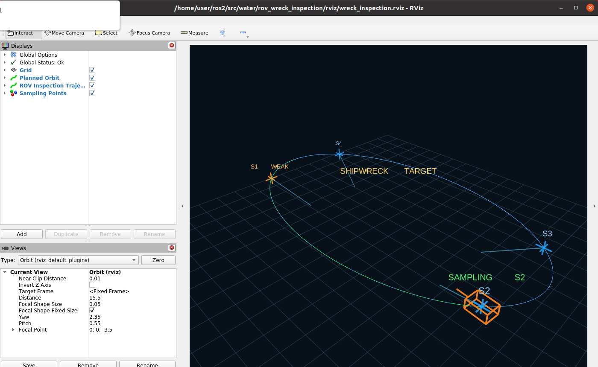

# 水下 ROV 视觉引导的沉船结构巡检采样仿真

本项目在 ROS 2 Humble + Gazebo classic 中搭建水下沉船场景：ROV 沿沉船外侧椭圆航线环绕巡检，
机头持续朝向船体，用前视相机识别船体侧面的黄色结构标记板并估算距离；到达预设采样点时停止
运动、悬停模拟采样，视觉确认通过后在 RViz 中把该点位标记为绿色。RViz 同时绘制规划航线、
实际巡检轨迹、采样点位与 ROV 本体轮廓。

全部效果图与数据来自 Ubuntu 22.04 虚拟机中的实际运行，不是示意绘制。



上图由 Gazebo 场景相机 `scene_camera` 真实渲染：锈红色沉船船体、船首圆柱、甲板室、烟囱、
桅杆，船体两侧共 4 块自发光黄色结构标记板，右侧为巡检中的 ROV 本体。



上图为 70 帧连续渲染（约 0.35 s 一帧，640 宽），可见 ROV 沿船体外侧移动。



上图为 Gazebo、ROV 相机识别窗口与 RViz 三个窗口同时运行时的实际屏幕录制（94 帧，约 28 秒）：
ROV 沿椭圆航线环绕沉船，识别窗口实时输出 `STRUCT MARKER dist=…m` 的结构标记测距，
RViz 同步更新椭圆轨迹、`CRUISE` 速度与 S1～S4 采样点状态（绿 `OK`、橙 `WEAK/VISION`、`SAMPLE`）。

## 1. 作业流程

1. **环绕巡检**：ROV 沿参数化椭圆 `(a·cos t, b·sin t)` 运动，`a=6.6 m`、`b=3.6 m`、
   高度 `z=-3.6 m`，巡航速度 `0.45 m/s`；机头偏航始终指向沉船中心。
2. **视觉引导**：`hull_detector` 对前视图像做 HSV 分割，提取黄色标记板；
   按像平面横向偏移 `u` 计算机头偏角 `err = atan(2u·tan(hfov/2))`，控制节点反向补偿，
   使标记板回到画面中心；检测超时则回退到纯几何朝向。
3. **定点采样**：椭圆参数角到达采样点时锁定位置并悬停 `3.5 s`。期间若标记板
   `|u| < 0.16` 且单目测距在 `1.5～6.0 m` 内并持续 `0.6 s`，记为视觉确认（绿色）；
   否则降级记录（橙色）。
4. **可视化**：发布规划航线、实际轨迹、采样点 MarkerArray 与状态文本。

采样点的椭圆参数角由标记板在世界坐标中的径向方向反算：
`k = 1 / sqrt((xm/a)² + (ym/b)²)`，`t = atan2(k·ym/b, k·xm/a)`。

## 2. 运行环境

| 项目 | 版本 / 说明 |
| --- | --- |
| 系统 | Ubuntu 22.04（VMware 虚拟机） |
| ROS 2 | Humble |
| 仿真器 | Gazebo classic 11.13 + `gazebo_ros` |
| 依赖 | `rclpy`、`gazebo_msgs`、`opencv-python`、`numpy`、`PyYAML` |
| 显示 | RViz2；虚拟机无 GPU 加速时使用 `LIBGL_ALWAYS_SOFTWARE=1` |

## 3. 核心文件清单

```
src/water/rov_wreck_inspection/
├── CMakeLists.txt
├── package.xml
├── config/inspection.yaml          # 航线、速度、悬停时间、采样点
├── launch/main.launch.py           # 一键启动 Gazebo + 节点 + RViz
├── rviz/wreck_inspection.rviz      # RViz 显示配置
├── scripts/hull_detector.py        # HSV 视觉检测与单目测距
├── scripts/inspection_controller.py# 环绕控制、采样状态机、轨迹与标记发布
├── urdf/rov.urdf                   # ROV 机体与前视相机
└── world/wreck_inspection.world    # 沉船场景、标记板、场景相机
```

## 4. 运行步骤

```bash
cd ~/ros2
source /opt/ros/humble/setup.bash
colcon build --packages-select rov_wreck_inspection
source install/setup.bash
ros2 launch rov_wreck_inspection main.launch.py
```

- 只需要 RViz、不显示 Gazebo 客户端：`ros2 launch rov_wreck_inspection main.launch.py gui:=false`
- 只跑仿真与算法、不启动 RViz：`rviz:=false`
- 虚拟机中 RViz 白屏或卡在 `vmw_fence_wait`：
  `LIBGL_ALWAYS_SOFTWARE=1 rviz2 -d src/water/rov_wreck_inspection/rviz/wreck_inspection.rviz`

启动后 10 s 生成 ROV，14 s 启动视觉与控制节点，16 s 启动 RViz；一圈约 90 s。

## 5. 关键话题

| 话题 | 类型 | 说明 |
| --- | --- | --- |
| `/rov/camera/image_raw` | `sensor_msgs/Image` | 前视相机原图 |
| `/rov/camera/image_detected` | `sensor_msgs/Image` | 检测叠加图 |
| `/rov/hull_detection` | `std_msgs/Float32MultiArray` | 船体/标记板检测结果、像平面坐标、测距 |
| `/inspection/planned_path` | `nav_msgs/Path` | 规划椭圆航线 |
| `/inspection/trajectory` | `nav_msgs/Path` | 实际轨迹 |
| `/inspection/sample_points` | `visualization_msgs/MarkerArray` | 采样点、视线、标签、ROV 轮廓 |
| `/inspection/status` | `std_msgs/String` | 状态与进度 |
| `/inspection/sample_event` | `std_msgs/String` | 采样完成事件 |
| `/scene/camera/image_raw` | `sensor_msgs/Image` | 第三人称场景相机 |

## 6. 效果与运行数据



- 蓝色曲线：规划椭圆航线；绿色曲线：ROV 实际走过的轨迹。
- 十字标记：4 个采样点。绿色 = 视觉确认通过；橙色 = 视觉确认超时降级；蓝色 = 待检。
- 橙色线框：ROV 本体轮廓及机头指向；文字为 `SHIPWRECK TARGET` 与当前状态。

同一轮巡检的采样事件（`/inspection/sample_event`），距离为单目估计值：

```
S1 采样完成，视觉对准，单目估计距离 2.21 m
S2 采样完成，视觉对准，单目估计距离 2.21 m
S3 采样完成，视觉对准，单目估计距离 2.24 m
S4 采样完成，视觉对准，单目估计距离 2.26 m
```

上述数值不是几何真值：S1 的几何距离约 3.0 m（相机前移约 0.4 m 后），估计值系统性偏小约 30%；
`/inspection/status` 中的 2.44 m 同样为单目估计，对应几何距离约 2.79 m（偏差约 12%）。
偏差量随斜视角度变化，不是采样噪声，而是 `max(bw, bh)` 取长边与针孔近似在大倾角下的系统误差。

`/inspection/status` 输出示例：

```
CRUISE  36.3% | marker dist=2.44m u=+0.01
SAMPLE  41.1% | marker dist=2.24m u=-0.09
```

多次运行中，标记板单目估计距离稳定在 2.1～2.4 m（对应几何距离约 2.8～3.4 m）。若某一采样点悬停期间标记板被船体结构遮挡或偏出画面中心，该点会以橙色“视觉确认超时（降级记录）”记录，而不是伪造成功。

## 7. 已知限制

- ROV 为运动学位姿控制（`/gazebo/set_entity_state`），没有推进器与水动力模型。
- 视觉只使用单目 RGB 的 HSV 颜色分割，依赖光照与标记板可见性，未接入声呐、SLAM 或学习模型。
- 单目测距为针孔近似：斜视时 `max(bw, bh)` 取到较长边，估计距离系统性偏小，文档中的距离均为单目估计值而非几何真值。
- Gazebo classic 的相机渲染在软件 OpenGL 下速度较低；RViz 中网格型 Marker（`SPHERE`/`CUBE`）
  会触发 Ogre 包围盒断言，因此采样点与 ROV 使用 `LINE_LIST` 绘制。
