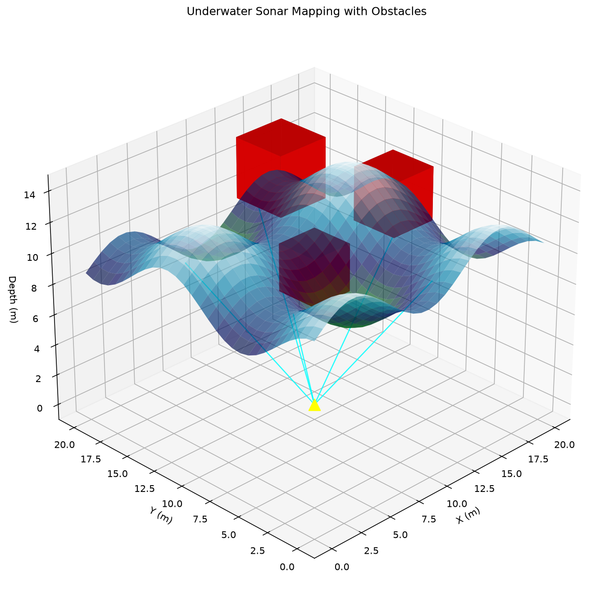

# 水域载具 - 水下声呐三维测深与避障 ROS 2 封装模块

## 实验目标

本模块使用确定性合成数据演示水下三维地形、三个障碍物和五束声呐扇形探测的
可视化流程。数据由参数化海底曲面生成，不代表真实声呐测量结果，也不会连接真实设备。

## 运行环境

| 项目 | 版本或说明 |
|---|---|
| 操作系统 | Ubuntu 22.04 |
| ROS | ROS 2 Humble |
| Python | 3.10 |
| 依赖 | NumPy、Matplotlib |

## 模块结构

```text
src/underwater_sonar_mapping/
├── launch/
│   └── main.launch.py
├── tests/
│   └── test_scene.py
├── underwater_sonar_mapping/
│   ├── main.py              # ROS 2 可视化节点
│   └── scene.py             # 可复用的场景生成与离线渲染
├── README.md
├── package.xml
└── setup.py
```

## 构建与运行

```bash
mkdir -p ~/ros2_ws/src
cp -r /path/to/ros2/src/underwater_sonar_mapping ~/ros2_ws/src/
cd ~/ros2_ws
colcon build --packages-select underwater_sonar_mapping
source install/setup.bash
ros2 launch underwater_sonar_mapping main.launch.py
```

节点启动后会打开 Matplotlib 三维窗口。也可以把场景保存到指定文件：

```bash
ros2 launch underwater_sonar_mapping main.launch.py \
  save_path:=$HOME/underwater_sonar.png
```

## 无界面渲染

在模块目录执行：

```bash
python3 -m underwater_sonar_mapping.scene \
  --output docs/img/underwater_sonar_3d_mapping_run.png \
  --dpi 150
```

脚本使用同一套场景生成函数，可在没有图形界面的 CI 环境生成截图。

## 回归测试

```bash
python3 -m pytest tests -q
```

测试检查地形数组尺寸、深度范围、障碍物数量、非法网格参数以及无界面 PNG 渲染。

## 运行效果



图中蓝色曲面表示合成海底地形，红色立方体表示障碍物，黄色三角和青色射线表示
声呐位置及五个探测方向。