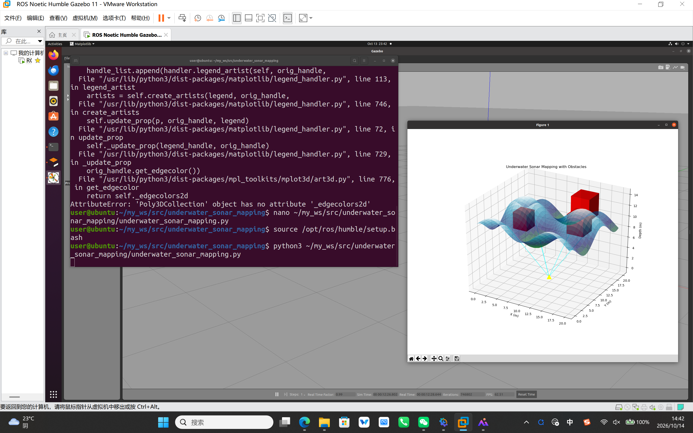

# 水域载具 - 水下声呐三维测深与避障 ROS 2 封装模块

## 作业概述与背景
本模块基于水下声呐探测原理，在 ROS 2 环境下实现了一个水下三维地形测绘与避障仿真节点。节点模拟了声呐探测海底起伏以及识别障碍物的过程，实时生成包含障碍物信息的三维海底地形图，为水下航行器的自主避障提供环境感知基础。

## 二、运行环境
* 操作系统：Ubuntu 22.04（虚拟机）
* ROS 2 版本：Humble
* 依赖库：rclpy, matplotlib, numpy

## 核心代码文件

本模块包含以下核心文件，均已提交至仓库：

```text
src/
└── underwater_sonar_mapping/
    ├── main.py                 # 三维声呐测绘与障碍物可视化节点
    ├── setup.py                # ROS 2 功能包配置文件
    └── launch/
        └── main.launch.py      # 一键启动文件
```
## 运行步骤

1. 新建标准工作空间并进入 src 目录：
```bash
mkdir -p ~/ros2_ws/src
cd ~/ros2_ws/src
```
2. 从 ros2 仓库拷贝模块代码到工作空间：
```bash
cp -r ~/OpenHUTB/ros2/src/underwater_sonar_mapping ~/ros2_ws/src/
cd ~/ros2_ws
```
3. 编译工作空间并部署环境：
```bash
colcon build --packages-select underwater_sonar_mapping
source install/setup.bash
```
4. 运行水下声呐测绘节点：
```bash
ros2 launch underwater_sonar_mapping main.launch.py
```
5.运行效果（截图）


效果说明：节点成功启动，基于模拟声呐数据生成了三维海底地形，并清晰标注了水下沉船/暗礁等障碍物位置，验证了声呐三维测绘与避障感知算法的可行性。

