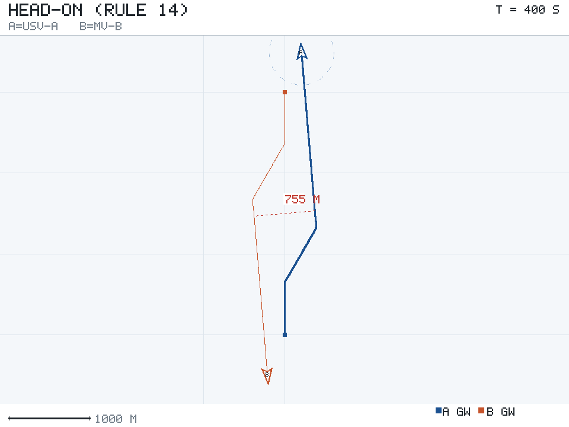
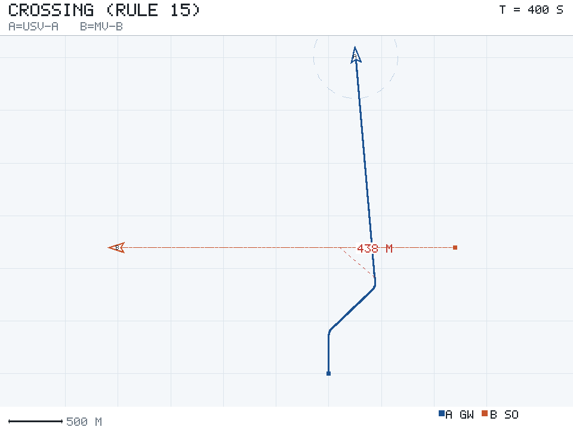
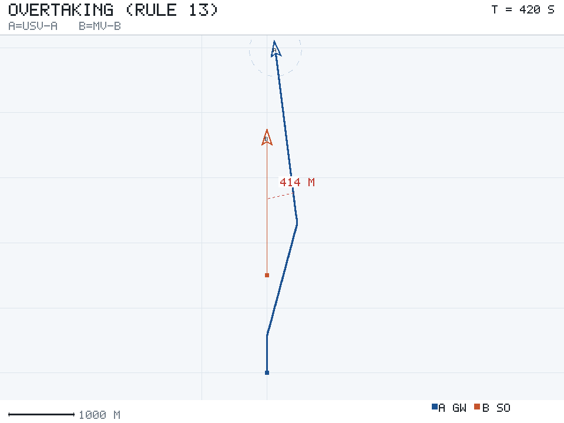
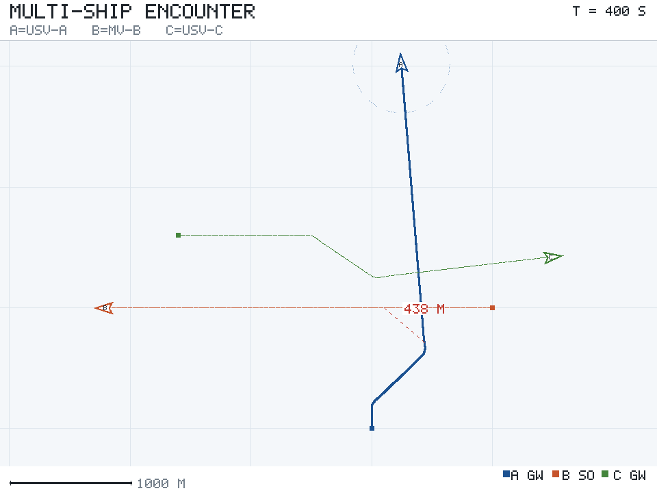
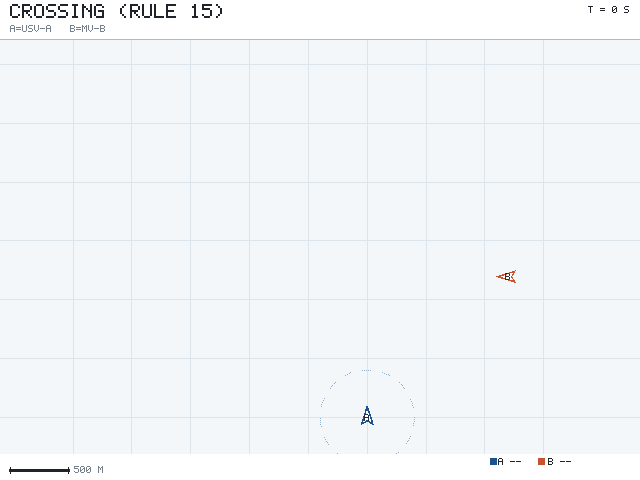

# 水面无人艇 COLREG 会遇避碰

## 概述

本模块实现的是一条**水面**无人艇（USV）在开阔水域遇上其他船时该怎么办：先按《国际海上避碰规则》（COLREG）判断两船构成哪种会遇局面、谁该让路，再由让路船按规定幅度右转避让，直航船保持航向航速。

和陆上避障最大的区别在于——海上不是"看到障碍就绕开"。同样一个目标，处在右舷还是左舷、在你前方还是正横后方，对应的规则完全不同，责任方也不同。判错局面，转向再平滑也是违规的。

模块特点：

- **只做规则判定与避让决策本身**，船舶运动用 Nomoto 一阶操舵响应，不依赖仿真器、不依赖 numpy；
- **规划器纯标准库**，没有 ROS 也能 `python3 main.py --offline` 跑出轨迹图和动画；
- 四个场景（对遇 / 交叉 / 追越 / 三船）都带"不避让"的对照基线，可以直接看出避让起没起作用；
- 20 项单元测试覆盖局面判定、DCPA 计算、角色分配和闭环结果。

## 运行环境

| 项目 | 说明 |
|---|---|
| 离线模式 | 任意 Python 3.8+，仅标准库 |
| ROS 2 模式 | ROS 2 Humble / Ubuntu 22.04，rviz2 用于显示 |
| 第三方依赖 | 无（ROS 模式下才需要 rclpy 等） |

## 会遇局面判定

两船位置差 $\mathbf{r}$、相对速度 $\mathbf{v}_{rel} = \mathbf{v}_T - \mathbf{v}_O$，先算最近会遇距离与到达时刻：

$$t_{CPA} = -\frac{\mathbf{r}\cdot\mathbf{v}_{rel}}{|\mathbf{v}_{rel}|^{2}}, \qquad DCPA = \left|\mathbf{r} + \mathbf{v}_{rel}\, t_{CPA}\right|$$

$t_{CPA} < 0$ 表示已经在远离，不再构成局面。相对方位取本船船首为 0°、右舷为正：

$$\beta = \operatorname{wrap}_{180}\left(\operatorname{atan2}(r_x, r_y) - \psi_O\right)$$

判定顺序与规则一一对应：

| 优先级 | 规则 | 条件 | 本船角色 | 规定动作 |
|---|---|---|---|---|
| 1 | Rule 14 对遇 | $\lvert\beta\rvert \le 6°$ 且航向差 $\ge 170°$ | 双方均让路 | 各自向右转 |
| 2 | Rule 13(d) 追越延续 | $\lvert\beta\rvert > 90°$ 且对方更快 | 被追越 | 保向保速 |
| 3 | Rule 13 追越 | $\lvert\beta\rvert > 112.5°$ | 追越船让路 | 小角度右转 |
| 4 | Rule 15 右舷交叉 | $\beta \in (6°, 112.5°]$ | 让路船 | 右转，从对方船尾通过 |
| 5 | Rule 15 左舷交叉 | $\beta \in [-112.5°, -6°)$ | 直航船 | 保向保速 |
| 6 | Rule 17(b) | 直航船被逼近 $D_{emergency}$ 仍未见对方动作 | 直航船 | 自行右转 |

第 2 条容易被忽略：追越船从侧前方擦过去时，被追越船看到的方位会从"正后方"变成"右舷"，如果不加这条延续判据，被追越船会误判成交叉局面跟着一起让路，两条船同时转向，反而越让越近。Rule 13(d) 明确说追越责任不因随后方位变化而解除。

## 避让决策

转向幅度不是固定值。给定安全距离 $D_{safe}$，在 $[0°, 90°]$ 内搜索最小的右转角 $\delta$，使得按新航向航行时 $DCPA \ge (1+\eta) D_{safe}$：

$$\delta^{*} = \min\left\{\delta \in [\delta_{min}, 90°] \;:\; DCPA(\psi_O + \delta) \ge (1+\eta) D_{safe}\right\}$$

其中 $\eta = 0.15$ 是留给操舵滞后的余量——几何外推假设的是瞬时转向，实际船要几秒钟才转到位。$\delta_{min}$ 取 Rule 16 的"大幅度"下限：对遇与交叉 30°，追越没有幅度要求，取 15°。

避让动作一旦开始就**锁定**避让航向，不每一步重算。否则 DCPA 刚回到安全值舵就回过来，下一帧又冲突再转回去，航向来回摆——这正是 Rule 8 说的"避免一连串小变动"。

解除锁定的判据是**目标过本船正横 110°**，而不是 DCPA 达标：

```python
if tcpa <= 0.0 and separation >= d_safe:      # 已过最近会遇点且拉开
    return True
if abs(relative_bearing(own, other)) >= 110.0 and separation > d_emergency:
    return True
```

追越场景尤其需要这个余量。刚超过被追越船时两船纵向只差几十米，这时候切回原航线等于横穿对方船首，所以必须等目标真正落到正横后方。

## 运行结果

四个场景的对照（安全会遇距离 $D_{safe} = 400$ m）：

| 场景 | 不避让最小距离 | 避让后 | 碰撞 | 首次让路时刻 | 峰值转向 |
|---|---|---|---|---|---|
| 对遇 | 1.2 m | 754.8 m | 是 → 否 | 67 s | 33.1° / 33.1° |
| 交叉 | 0.0 m | 438.1 m | 是 → 否 | 44 s | 49.8° / 0° |
| 追越 | 0.6 m | 414.1 m | 是 → 否 | 43 s | 16.6° / 0° |
| 三船 | 0.0 m | 438.2 m | 是 → 否 | 19 s | 49.8° / 0° / 37.3° |

### 对遇

两船各 9 m/s 相向而行，间距 3 km。双方都在 67 s 时向右转 33°，错开 755 m 后各自拐回原航线。



### 交叉

B 船从 A 船右舷约 68° 方位横穿，两船同时到达航迹交点。A 是让路船，右转 49.8° 从 B 船尾通过；B 全程航向没动过（峰值转向 0°），符合 Rule 17(a) 的保向保速。



### 追越

A 船 12 m/s 从正后方追上 5 m/s 的 B 船。A 只转了 16.6° 就从右侧超越——追越不像对遇那样需要大幅度转向，转太多反而迟迟追不上，横向让清后保持在对方右舷外侧直到过正横。



### 三船同时会遇

B 在 A 右舷交叉、C 在 A 左舷交叉。A 只需为 B 让路，对 C 保持直航；C 反过来要为 A 让路（C 视角里 A 在其右舷），右转 37.3° 绕到 A 的船尾后方。三条船各自独立判断，没有集中调度。



### 避让过程动画



图中图例的 GW 表示该船扮演过让路船角色、SO 表示直航船；虚线圆是本船的安全会遇距离圈；红色虚线标注全程最小会遇距离。

## ROS 2 接口

| 话题 / 服务 | 类型 | 说明 |
|---|---|---|
| `/usv_colreg/markers` | `visualization_msgs/MarkerArray` | 船位方块、历史轨迹、安全圈、角色文字标签 |
| `/usv_colreg/track_a` | `nav_msgs/Path` | 主船完整轨迹 |
| `/usv_colreg/status` | `std_msgs/String` | 逐帧的"角色/局面"文本，如 `t=44.0s A=give-way/crossing-give-way B=stand-on/crossing-stand-on` |
| `/usv_colreg/replay` | `std_srvs/Trigger` | 从头回放 |

节点启动时先把整个场景离线程跑完（几百毫秒），再按 `playback_rate` 逐帧回放，所以 RViz2 里看到的是实时动画，但计算不占实时预算。

| 参数 | 默认值 | 说明 |
|---|---|---|
| `scenario` | `crossing` | `head_on` / `crossing` / `overtaking` / `multi` |
| `d_safe` | `400.0` | 安全会遇距离 (m) |
| `playback_rate` | `8.0` | 回放帧率 (Hz) |
| `frame_step` | `4` | 每帧推进的仿真步数 |

## 运行步骤

离线模式（不需要 ROS）：

```bash
cd src/water/usv_colreg_avoidance
python3 -m usv_colreg_avoidance.main --offline --output results
python3 -m pytest tests -v        # 20 项
```

ROS 2 模式：

```bash
cd ~/ros2_ws/src
git clone https://github.com/OpenHUTB/ros2.git
cd ~/ros2_ws && colcon build --packages-select usv_colreg_avoidance
source install/setup.bash
ros2 launch usv_colreg_avoidance main.launch.py
# 换场景
ros2 launch usv_colreg_avoidance main.launch.py scenario:=head_on
```

RViz2 里会看到：海图网格、三条船的实时位置与历史轨迹、主船周围 400 m 的安全圈、随局面变化的角色标签（让路 / 直航 / 自由）。

## 已知限制

- 只做二维平面运动，未建模横摇、纵摇与波浪干扰，USV 在小艇尺度上这些会影响转向响应；
- 全程假设目标是匀速直航，对方机动时需要重算。真实系统靠雷达持续跟踪并用最新观测刷新；
- 只处理开阔水域，未考虑航道边界、浅水效应、分道通航制（TSS）；
- 未建模减速与倒车。实际避让中减速往往比转向更省力，Rule 8 也把减速列为正当手段；
- 三船以上时，每船只针对最紧迫的一个目标决策，没有做全局一致性检查。
